# MEDIFAST — Sistema web de reserva de citas y simulación de pagos con Yape

> Curso Integrador I: Sistemas Software — UTP, 2026-02
> Cliente: Dr. Moisés Barrantes Cabrera (Medicina Interna y Reumatología, Trujillo) — **Consultorio Medifast**

MEDIFAST es un sistema web en el que los pacientes del Consultorio Medifast se registran, consultan los horarios libres y reservan una cita adjuntando la constancia de un pago con Yape (simulado). El médico revisa la constancia, valida o rechaza el pago, gestiona su agenda, registra si el paciente asistió y obtiene reportes exportables a Excel.

Este README es la referencia funcional y técnica del proyecto. Si un informe, un diagrama o el prototipo lo contradicen, se corrigen ellos. El seguimiento de la rúbrica y de las evidencias del APF3 está en [docs/entregables/checklist-apf3.md](docs/entregables/checklist-apf3.md).

---

## Índice

1. [Contexto y objetivos](#1-contexto-y-objetivos)
2. [Actores](#2-actores)
3. [Alcance](#3-alcance)
4. [Requerimientos funcionales](#4-requerimientos-funcionales)
5. [Reglas de negocio](#5-reglas-de-negocio)
6. [Requerimientos no funcionales](#6-requerimientos-no-funcionales)
7. [Pantallas](#7-pantallas)
8. [Casos de uso](#8-casos-de-uso)
9. [Diagramas de secuencia](#9-diagramas-de-secuencia)
10. [Modelo de datos](#10-modelo-de-datos)
11. [Arquitectura y stack](#11-arquitectura-y-stack)
12. [Estructura del proyecto](#12-estructura-del-proyecto)
13. [Scripts, diagramas y documentos](#13-scripts-diagramas-y-documentos)
14. [Cómo ejecutar](#14-cómo-ejecutar)
15. [Equipo](#15-equipo)

---

## 1. Contexto y objetivos

### Problema

El Dr. Barrantes gestiona sus citas a mano: las anota en un cuaderno, coordina la disponibilidad con cada paciente por separado y verifica los pagos revisando las capturas de transferencia que le llegan por WhatsApp. Esto le quita tiempo de atención, hace difícil saber qué horarios quedan libres y permite cruces de horario.

### Objetivo general

Desarrollar un sistema web en el que los pacientes reserven su cita y adjunten la constancia de pago, y en el que el médico valide los pagos, gestione su agenda y obtenga reportes. La base de datos queda preparada para varios médicos y consultorios.

### Objetivos específicos

1. Registrar pacientes con DNI o CE, permitirles actualizar sus datos e iniciar sesión con su número de documento.
2. Mostrar la disponibilidad a partir del horario configurado en la base de datos.
3. Reservar citas de 60 min (paciente nuevo, S/ 150) o 30 min (control, S/ 80), con el tipo detectado automáticamente y una sola cita activa por paciente.
4. Apartar el horario 15 min mientras el paciente adjunta la constancia, y entregar la confirmación en pantalla y en PDF.
5. Permitir al médico validar o rechazar pagos, cancelar citas con observación y registrar si el paciente fue atendido o no asistió.
6. Generar dos reportes filtrables (citas y pagos), con indicadores de resumen y exportación a Excel.
7. Construir la solución en Java con MVC, DAO, SOLID y TDD, versionada en GitHub.

### Indicadores de éxito

- Las 11 pantallas (P0–P10) y los 16 RF implementados.
- Ningún bloque de horario asignado a más de una cita activa y ningún paciente con más de una cita activa (garantizado por la BD).
- Ninguna reserva apartada más de 15 min sin constancia.
- Lograr pruebas unitarias en verde para las reglas de negocio y alcanzar una cobertura objetivo de **≥ 60 % en la capa `service`**, verificada mediante JaCoCo.

---

## 2. Actores

| Actor              | Qué hace                                                                                                                                                                | Cómo se autentica                                             |
| ------------------ | ------------------------------------------------------------------------------------------------------------------------------------------------------------------------ | -------------------------------------------------------------- |
| **Paciente** | Se registra, actualiza sus datos, consulta horarios, reserva (una cita activa a la vez), adjunta la constancia, descarga la confirmación en PDF y revisa su historial   | N.º de documento + contraseña                                |
| **Médico**  | Consulta su agenda, revisa constancias, valida o rechaza pagos, cancela con observación, marca atendida / no asistió y genera reportes                                 | N.º de documento + contraseña (su cuenta se crea por script) |
| **Sistema**  | Genera los bloques de horario, detecta si la cita es nueva o de control, aplica la ventana de reserva de 1 a 30 días y cancela las reservas sin constancia a los 15 min | —                                                             |

El rol sale de la cuenta: la pantalla de login no pide elegirlo.

---

## 3. Alcance

### 3.1 Incluye

| Módulo          | Detalle                                                                                                                                                   |
| ---------------- | --------------------------------------------------------------------------------------------------------------------------------------------------------- |
| Cuentas          | Registro de paciente (DNI/CE), login por n.º de documento para paciente y médico, actualización de datos y contraseña del paciente                    |
| Horarios         | Plantilla semanal por médico **configurada en la BD** (por defecto: lunes a sábado, 09:00–13:00), bloques de 30 min, bloqueos de fechas en la BD |
| Citas            | Reserva con apartado de 15 min, detección nuevo/control, una cita activa por paciente, confirmación en pantalla y en PDF, historial                     |
| Pago simulado    | Pantalla tipo Yape con el monto según el tipo de cita, constancia adjunta, opción de retomar el pago mientras no vencen los 15 min                      |
| Gestión médica | Agenda, ver constancia, validar pago, rechazar pago (= cancelar con observación), cancelar con observación, atendida / no asistió                      |
| Reportes         | (1) Citas por día, semana o estado; (2) pagos validados por período. Ambos con indicadores de resumen y exportables a .xlsx                             |
| Plataforma       | Web responsive sobre MySQL, ejecutada en localhost. BD multi-médico y multi-consultorio; la interfaz opera con un médico                                |

### 3.2 Fuera del alcance

- **Horarios:** pantalla para editar el horario de atención (se configura directamente en la BD).
- **Citas del paciente:** cancelar o reprogramar su cita, tener más de una cita activa, reservar para el mismo día.
- **Citas del médico:** reprogramar citas, registrar citas a nombre de terceros, notas de atención, reembolsos.
- **Administración:** módulo para dar de alta médicos o consultorios (se cargan por script).
- **Cuentas:** recuperación de contraseña, elegir el rol al iniciar sesión, cambio de tipo o número de documento, documentos distintos de DNI y CE (pasaporte, etc.).
- **Comunicación:** notificaciones o confirmaciones por correo, SMS o WhatsApp.
- **Información clínica:** historia clínica, diagnósticos, recetas, telemedicina.
- **Pagos reales:** integración con Yape o bancos, facturación electrónica. El pago es solo una simulación y no pide credenciales bancarias.
- **Otros:** inteligencia artificial, app móvil nativa, despliegue en la nube.

### 3.3 Supuestos y restricciones

- La interfaz trabaja con un médico y un consultorio; la BD admite varios.
- Java es el lenguaje principal (≥ 50 % del stack).
- Uso obligatorio de Google Guava, Apache Commons, Apache POI y Logback.
- Ejecución en localhost, sin costo de infraestructura.

---

## 4. Requerimientos funcionales

| ID   | Requerimiento                                                                                                                                    | Actor    | Pantalla             |
| ---- | ------------------------------------------------------------------------------------------------------------------------------------------------ | -------- | -------------------- |
| RF01 | Reservar una cita en un horario disponible, con apartado de 15 min                                                                               | Paciente | P2                   |
| RF02 | Registrar la cuenta: tipo (DNI/CE) y n.º de documento, nombres, apellidos, fecha de nacimiento, celular, correo, contraseña y su confirmación | Paciente | P1                   |
| RF03 | Simular el pago con Yape: mostrar el monto, adjuntar la constancia y retomar el pago dentro de los 15 min                                        | Paciente | P3                   |
| RF04 | Consultar la agenda con filtros por día, semana y estado                                                                                        | Médico  | P7                   |
| RF05 | Mostrar los horarios disponibles según la duración del tipo de cita                                                                            | Paciente | P2                   |
| RF06 | Generar los bloques a partir del horario semanal configurado en la BD                                                                            | Sistema  | — (BD)              |
| RF07 | Iniciar y cerrar sesión con n.º de documento, con acceso según el rol                                                                         | Ambos    | P0                   |
| RF08 | Marcar una cita como atendida o no asistió                                                                                                      | Médico  | P8                   |
| RF09 | Reportes de citas (día/semana/estado) y de pagos (período), con indicadores de resumen y exportación a Excel                                  | Médico  | P9, P10              |
| RF10 | Ver el historial de citas propias, de la más reciente a la más antigua                                                                         | Paciente | P5                   |
| RF11 | Actualizar los datos personales y la contraseña                                                                                                 | Paciente | P6                   |
| RF12 | Ver la constancia de pago de una cita                                                                                                            | Médico  | P8                   |
| RF13 | Validar el pago o rechazarlo (rechazo = cancelación con observación)                                                                           | Médico  | P8                   |
| RF14 | Cancelar una cita con observación obligatoria                                                                                                   | Médico  | P8                   |
| RF15 | Mostrar la confirmación de la cita en pantalla y descargarla en PDF                                                                             | Paciente | P4, P5               |
| RF16 | Cancelar automáticamente las reservas sin constancia a los 15 min y liberar el horario                                                          | Sistema  | — (evento de MySQL) |

### 4.1 Criterios de aceptación

- **RF01** — Si el paciente ya tiene una cita activa (`PENDIENTE_PAGO` o `PROGRAMADA`), no puede reservar y se le muestra cuál es. Si no la tiene, al elegir un horario libre se crea, en una sola transacción, la cita `PENDIENTE_PAGO` con `expira_en = ahora + 15 min` y se apartan sus bloques (1 o 2). Si otro paciente tomó el horario antes, se muestra "Horario no disponible, elija otro".
- **RF02** — DNI de 8 dígitos; CE alfanumérico de 9 a 12 caracteres; n.º de documento único; fecha de nacimiento en el pasado; celular de 9 dígitos que empieza en 9; correo válido y único; contraseña de al menos 8 caracteres, igual a su confirmación.
- **RF03** — Muestra un QR o número de Yape de ejemplo, el monto de la tarifa (S/ 150 o S/ 80), un contador del tiempo restante y la constancia como campo obligatorio (JPG, PNG o PDF de hasta 5 MB); el n.º de operación es opcional y, si se ingresa, solo admite dígitos. Leyenda visible: "Simulación — no se realizó ningún cobro". Al adjuntar la constancia, la cita pasa a `PROGRAMADA` y el pago queda `POR_VALIDAR`. Si el paciente sale de la pantalla, puede volver desde "Mis citas" mientras no venza el plazo; si vence, ve la cita como cancelada.
- **RF04** — Lista ordenada por fecha y hora con paciente, tipo, estado de la cita y estado del pago; filtros por día, semana y estado.
- **RF05** — Solo bloques desde mañana hasta dentro de 30 días, no bloqueados y sin cita activa. Para un paciente nuevo, solo se ofrecen inicios con 2 bloques consecutivos libres dentro del horario.
- **RF06** — Los bloques se generan desde `horario_semanal` para toda la ventana de reserva, sin duplicados, al iniciar la aplicación y una vez al día.
- **RF07** — `/paciente/**` exige el rol PACIENTE y `/medico/**` el rol MEDICO. Al iniciar sesión, cada rol llega a su pantalla principal (P2 o P7).
- **RF08** — Solo sobre citas `PROGRAMADA` cuya hora de inicio ya llegó. `ATENDIDA` exige el pago `VALIDADO`; `NO_ASISTIO` no lo exige.
- **RF09** — Cada reporte tiene filtros, una tabla, indicadores de resumen, una consulta documentada y exportación a .xlsx.
  - **Citas (P9):** filtros por rango de fechas (día o semana) y estado. Indicadores: total por cada estado (PENDIENTE_PAGO, PROGRAMADA, ATENDIDA, NO_ASISTIO y CANCELADA).
  - **Pagos (P10):** filtro por período (rango de fechas; el mes es un atajo). Solo pagos `VALIDADO`. Indicadores: cantidad, total en S/ y ticket promedio.
- **RF10** — Cada cita muestra fecha, hora, tipo, monto, estado de la cita y estado del pago. Acciones: "Continuar pago" (si está `PENDIENTE_PAGO` y no venció), "Ver detalle" y "Descargar PDF" (si está `PROGRAMADA` o `ATENDIDA`) y "Ver constancia" (si tiene pago, RF12). Las canceladas muestran su observación. Una cita `PENDIENTE_PAGO` vencida que la tarea de RF16 aún no canceló se muestra como "Vencida", sin acciones.
- **RF11** — Se pueden editar nombres, apellidos, fecha de nacimiento, celular, correo y contraseña. El cambio de contraseña pide la actual y la confirmación de la nueva. El tipo y el n.º de documento se muestran pero no se editan. Se aplican las validaciones de RF02.
- **RF12** — La constancia solo la pueden ver el paciente dueño de la cita y el médico que la atiende.
- **RF13** — Solo sobre pagos `POR_VALIDAR`. "Validar" deja el pago `VALIDADO` con fecha y hora. "Rechazar" pide una observación y, en una sola transacción, deja el pago `RECHAZADO`, la cita `CANCELADA` y libera sus bloques.
- **RF14** — Solo sobre citas `PENDIENTE_PAGO` o `PROGRAMADA`; la observación es obligatoria; libera los bloques.
- **RF15** — La confirmación muestra n.º de cita, médico, fecha, hora, tipo, monto y estado del pago, con un botón "Descargar PDF" en P4 y P5. No se envía por correo.
- **RF16** — Un evento de MySQL que corre cada minuto cancela las citas `PENDIENTE_PAGO` vencidas con la observación "Tiempo de reserva vencido" y libera sus bloques.

---

## 5. Reglas de negocio

| ID    | Regla                                                                                                                                           |
| ----- | ----------------------------------------------------------------------------------------------------------------------------------------------- |
| RN-01 | Un bloque de horario pertenece como máximo a **una cita activa**. Lo garantiza la BD                                                     |
| RN-02 | El tipo de cita se detecta al reservar: **CONTROL** si el paciente tiene alguna cita `ATENDIDA` con ese médico; si no, **NUEVO** |
| RN-03 | Tarifas por defecto: NUEVO = 60 min / S/ 150; CONTROL = 30 min / S/ 80. Se configuran por médico en la tabla `tarifa`                        |
| RN-04 | Una reserva sin constancia se cancela automáticamente a los **15 min** y libera el horario                                               |
| RN-05 | La cita y el pago siguen los estados y transiciones descritos abajo                                                                             |
| RN-06 | Solo se reserva desde **mañana** hasta **30 días** después (parámetros del consultorio)                                         |
| RN-07 | No se puede marcar `ATENDIDA` sin el pago `VALIDADO`. Rechazar el pago cancela la cita con observación                                     |
| RN-08 | El horario se configura por médico en la BD, en bloques de 30 min. Una cita debe empezar y terminar dentro del horario                         |
| RN-09 | Un paciente solo puede tener **una cita activa** (`PENDIENTE_PAGO` o `PROGRAMADA`) a la vez. Lo garantiza la BD                       |
| RN-10 | El sistema no almacena información clínica                                                                                                    |
| RN-11 | La constancia es un JPG, PNG o PDF de hasta 5 MB; el n.º de operación es opcional                                                             |
| RN-12 | El n.º de documento identifica a un único usuario y no se modifica; el correo es único. Documentos aceptados: DNI y CE                       |
| RN-13 | Solo el médico cancela, y siempre con observación (el motivo). El paciente no cancela ni reprograma                                           |
| RN-14 | Solo se marcan atendida / no asistió citas cuya hora de inicio ya llegó                                                                       |

### 5.1 Estados de la cita y del pago (RN-05)

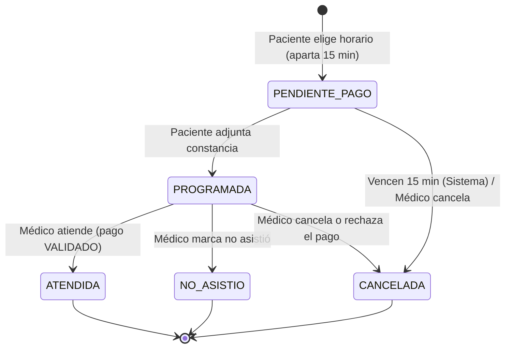

| Pago                             | Transición                                                       | Quién   |
| -------------------------------- | ----------------------------------------------------------------- | -------- |
| → `POR_VALIDAR`               | El paciente adjunta la constancia (recién aquí se crea el pago) | Paciente |
| `POR_VALIDAR` → `VALIDADO`  | La constancia es correcta                                         | Médico  |
| `POR_VALIDAR` → `RECHAZADO` | La constancia no es válida; la cita pasa a `CANCELADA`         | Médico  |

- **Cita activa** = `PENDIENTE_PAGO` o `PROGRAMADA`.
- **Bloque libre** = no bloqueado y sin cita activa.
- Ambos conceptos se derivan del estado; no se guardan aparte.

### 5.2 Etiquetas en pantalla

Los estados se guardan con los nombres de la BD y se muestran con estas etiquetas:

| Estado de la cita  | Etiqueta       | Estado del pago | Etiqueta    |
| ------------------ | -------------- | --------------- | ----------- |
| `PENDIENTE_PAGO` | Pago pendiente | `POR_VALIDAR` | Por validar |
| `PROGRAMADA`     | Confirmada     | `VALIDADO`    | Verificado  |
| `ATENDIDA`       | Atendida       | `RECHAZADO`   | Rechazado   |
| `NO_ASISTIO`     | No asistió    |                 |             |
| `CANCELADA`      | Cancelada      |                 |             |

---

## 6. Requerimientos no funcionales

| ID    | Categoría     | Requerimiento                                                                                                                                       | Cómo se verifica               |
| ----- | -------------- | --------------------------------------------------------------------------------------------------------------------------------------------------- | ------------------------------- |
| RNF01 | Restricción   | Java como lenguaje principal (≥ 50 % del stack)                                                                                                    | Stack y repositorio             |
| RNF02 | Usabilidad     | Las 11 pantallas son responsive desde 360 px de ancho                                                                                               | Capturas en móvil y escritorio |
| RNF03 | Seguridad      | Contraseñas con bcrypt, acceso por rol, sesión de 30 min, bloqueo de 15 min tras 5 intentos fallidos de login                                     | Pruebas de acceso               |
| RNF04 | Seguridad      | Consultas parametrizadas (JPA), validación en servidor (Bean Validation) y protección CSRF                                                        | Revisión de código            |
| RNF05 | Integridad     | RN-01 y RN-09 garantizadas con constraints en la BD y operaciones transaccionales                                                                   | Prueba de concurrencia          |
| RNF06 | Seguridad      | Archivos subidos: se valida el tipo real y el tamaño, se renombran con UUID, se guardan fuera de `static/` y solo los ven el dueño y el médico | Prueba con archivo inválido    |
| RNF07 | Privacidad     | Solo datos administrativos mínimos (Ley 29733); los logs no registran contraseñas ni documentos completos                                         | Revisión de logs               |
| RNF08 | Rendimiento    | Disponibilidad y agenda responden en < 2 s con 1 000 citas                                                                                          | Prueba con datos de carga       |
| RNF09 | Usabilidad     | Reserva en ≤ 4 pantallas desde el login, contador visible de los 15 min y mensajes de error claros                                                 | Prueba de usabilidad            |
| RNF10 | Mantenibilidad | MVC + DAO + SOLID; Javadoc en los servicios                                                                                                         | Revisión de código            |
| RNF11 | Calidad        | Aplicar TDD en las reglas de negocio y alcanzar una cobertura objetivo de ≥ 60 % en la capa `service`                                            | JUnit + JaCoCo                  |
| RNF12 | Portabilidad   | Se ejecuta en localhost con Java 21 y MySQL 8.4, en macOS, Linux o Windows, siguiendo este README                                                   | Instalación limpia             |
| RNF13 | Auditoría     | Columnas `creado_en` / `actualizado_en` en todas las tablas; log de login, logout, reserva, validación, rechazo y cancelación                 | Modelo físico + logs           |
| RNF14 | Librerías     | Uso real de Guava, Apache Commons, Apache POI y Logback (§11.3)                                                                                    | `pom.xml` + código           |
| RNF15 | Versionado     | Todo el código y la documentación versionados en GitHub, con commits pequeños y descriptivos                                                     | Historial de commits            |

La autenticación consulta `usuario` por `numero_documento`, verifica `contrasena_hash` con bcrypt de coste 10 y obtiene `rol` y `activo` de esa misma fila. El esquema no guarda intentos fallidos: `IntentosLoginService` mantiene el bloqueo temporal en una caché Guava en memoria, que expira tras 15 minutos. Por ello, los bloqueos no sobreviven un reinicio ni se comparten entre varias instancias; una futura ejecución distribuida requeriría una caché compartida.

---

## 7. Pantallas

| #   | Pantalla             | Rol      | RF                     | Contenido principal                                                                                                                | Plantilla                      |
| --- | -------------------- | -------- | ---------------------- | ---------------------------------------------------------------------------------------------------------------------------------- | ------------------------------ |
| P0  | Login                | Ambos    | RF07                   | N.º de documento (DNI o CE), contraseña, enlace a registro, mensaje de bloqueo por intentos                                      | `login.html`                 |
| P1  | Registro             | Paciente | RF02                   | Formulario con validaciones                                                                                                        | `registro.html`              |
| P2  | Reservar cita        | Paciente | RF01, RF05             | Tipo de cita detectado y tarifa; calendario de 1 a 30 días; bloques libres; resumen de la cita; aviso si ya tiene una cita activa | `paciente/reservar.html`     |
| P3  | Pago Yape (simulado) | Paciente | RF03                   | Monto, QR de ejemplo, contador de 15 min, subida de la constancia, n.º de operación                                              | `paciente/pago.html`         |
| P4  | Confirmación        | Paciente | RF15                   | Datos de la cita y botón "Descargar PDF"                                                                                          | `paciente/confirmacion.html` |
| P5  | Mis citas            | Paciente | RF10, RF15, RF03, RF12 | Historial; acciones "Continuar pago", "Ver detalle", "Descargar PDF" y "Ver constancia"                                            | `paciente/citas.html`        |
| P6  | Mi perfil            | Paciente | RF11                   | Datos editables, documento solo lectura y cambio de contraseña                                                                    | `paciente/perfil.html`       |
| P7  | Agenda               | Médico  | RF04                   | Lista de citas con filtros por día, semana y estado                                                                               | `medico/agenda.html`         |
| P8  | Detalle de cita      | Médico  | RF08, RF12, RF13, RF14 | Datos de la cita, constancia y botones Validar / Rechazar / Atendida / No asistió / Cancelar (con modal de observación)          | `medico/cita.html`           |
| P9  | Reporte de citas     | Médico  | RF09                   | Filtros por día, semana y estado; indicadores; tabla; "Exportar Excel"                                                            | `medico/reporte-citas.html`  |
| P10 | Reporte de pagos     | Médico  | RF09                   | Filtro por período; indicadores; tabla con total; "Exportar Excel"                                                                | `medico/reporte-pagos.html`  |

Elementos comunes (`fragments/`): menú lateral según el rol, datos de contacto del consultorio y cierre de sesión. Páginas de error 403 y 404 en `error/`.

### 7.1 Navegación

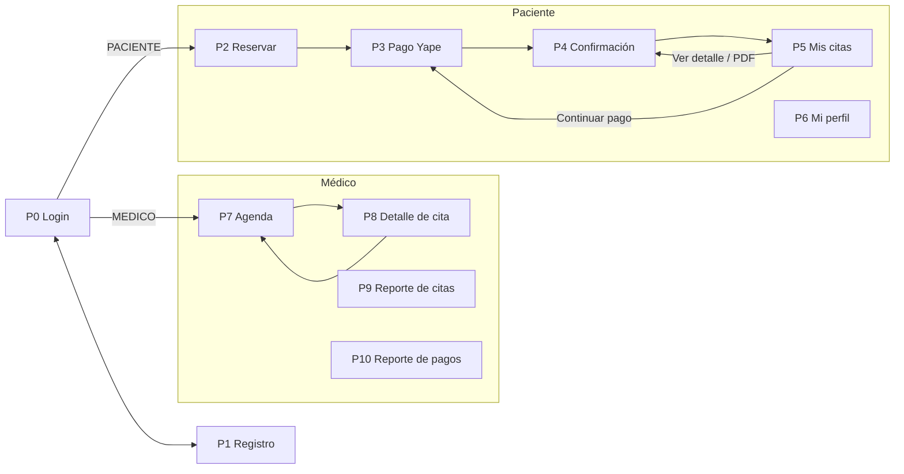

### 7.2 Prototipo

**Prototipo referencial:** [MEDIFAST — Figma Make (P0–P10)](https://media-rhythm-49689685.figma.site/)

Sirve como guía visual de las 11 pantallas. Donde difiere de este README, la implementación sigue el README:

| Pantalla | En el prototipo                                                        | En la implementación                                                                           |
| -------- | ---------------------------------------------------------------------- | ----------------------------------------------------------------------------------------------- |
| General  | "Consultorio Barrantes" / "Consultorio Privado Barrantes"              | **Consultorio Medifast**                                                                  |
| P0       | Selector de rol, "¿Olvidaste tu contraseña?", texto "Ingresa tu DNI" | Sin selector (el rol sale de la cuenta), sin recuperación de contraseña, "DNI o CE"           |
| P1       | No pide la fecha de nacimiento                                         | Se agrega la fecha de nacimiento (obligatoria)                                                  |
| P2       | Horarios desde las 08:00                                               | Solo los bloques del horario de la BD (por defecto 09:00–13:00)                                |
| P4       | "También enviamos la confirmación a tu correo"                       | Sin envío por correo; solo pantalla y PDF                                                      |
| P5       | Dos citas activas a la vez (confirmada y con pago pendiente)           | Como máximo una cita activa (RN-09)                                                            |
| P8       | Sin botón "Rechazar pago"; observación como nota de la atención     | Botón "Rechazar pago"; la observación es el motivo obligatorio al rechazar o cancelar (RN-13) |
| P9, P10  | Filtro por mes                                                         | Rango de fechas (el mes es un atajo); P9 también por día, semana y estado                     |

---

### 7.3 Estado de implementación de interfaces

La rúbrica del APF3 asigna el mayor peso a la **implementación de las interfaces gráficas**, por lo que no basta con que las pantallas estén definidas en el README o diseñadas en Figma: deben existir realmente en la aplicación Spring Boot + Thymeleaf y funcionar de acuerdo con los requerimientos asociados.

Actualmente, el inventario funcional contempla **11 pantallas (P0–P10)**, pero la implementación real todavía se encuentra en progreso.

#### Estado actual de las plantillas

| Código | Pantalla                 | Plantilla esperada             | Estado actual                                                                                                          |
| ------- | ------------------------ | ------------------------------ | ---------------------------------------------------------------------------------------------------------------------- |
| P0      | Login                    | `login.html`                 | 🟡 Existe, pero aún requiere completar todo el flujo funcional                                                        |
| P1      | Registro                 | `registro.html`              | 🟡 Implementada: registro transaccional, validaciones y formulario responsive; falta completar la verificación manual |
| P2      | Reservar cita / horarios | `paciente/reservar.html`     | ✅ Implementada: tipo y tarifa detectados (RN-02/RN-03), semana con ventana de 1 a 30 días, bloques de la BD, aviso de cita activa con "Continuar pago", "Horario no disponible, elija otro" y navbar superior del diseño aprobado |
| P3      | Pago Yape simulado       | `paciente/pago.html`         | ✅ Implementada: monto de la tarifa, QR y número de Yape de ejemplo, contador de 15 min con modal bloqueante "Tiempo de reserva vencido", subida con arrastrar y soltar y "Quitar", tipo real JPG/PNG/PDF y ≤ 5 MB validados en cliente y servidor, n.º de operación opcional solo con dígitos, "Volver" sin liberar el horario, leyenda de simulación, bloqueo de la cita frente a RF16 y navbar superior del diseño aprobado |
| P4      | Confirmación            | `paciente/confirmacion.html` | ✅ Implementada: card dividida del diseño aprobado; desde P3, "Cita reservada" con la alerta de éxito; desde P5, "Detalle de la cita" con el estado real (incluidos "Vencida" y el motivo de las canceladas) y la constancia con "Ver constancia"; n.º de cita, paciente, médico, tipo, fecha y hora, monto y estados de §5.2; "Descargar PDF" solo para citas confirmadas o atendidas; una reserva que aún espera el pago vuelve a P3; cita ajena → 403 |
| P5      | Mis citas                | `paciente/citas.html`        | ✅ Implementada: pestañas Próximas / Historial, "Continuar pago" con contador, PDF de la confirmación (OpenPDF), constancia solo para el dueño y estado "Vencida" |
| P6      | Mi perfil                | `paciente/perfil.html`       | ✅ Implementada: datos personales y contraseña en formularios independientes, documento en solo lectura, validación en servidor y auditoría |
| P7      | Agenda                   | `medico/agenda.html`         | ✅ Implementada: vista Día / Semana (agrupada por día), navegación de fecha y "Hoy", filtro por los 5 estados, indicadores del período (total, por validar, confirmadas, atendidas) con el horario de la BD, DNI parcial, estado vacío y navbar superior del diseño aprobado. "Ver detalle" abre P8 (`/medico/citas/{id}`) conservando los filtros |
| P8      | Detalle de cita          | `medico/detalle-cita.html`   | ✅ Implementada: datos del paciente y de la cita, constancia con vista previa y "Ver constancia" (solo el médico de la cita), acciones según el estado (validar / rechazar pago, marcar atendida / no asistió con ayuda cuando están deshabilitadas, cancelar), modal del motivo obligatorio (≤ 500) validado en cliente y servidor, aviso del motivo en las canceladas, estados finales, alerta tras cada acción, "Volver a la agenda" con los filtros, auditoría y navbar superior del diseño aprobado |
| P9      | Reporte de citas         | `medico/reporte-citas.html`  | ✅ Implementada: rango Desde / Hasta con atajos "Hoy", "Esta semana" (por defecto, lunes a sábado) y "Este mes", filtro por estado, validación de fechas en cliente y servidor, indicadores (total, atendidas, canceladas y no asistieron con %) y total por cada uno de los 5 estados, tabla con DNI parcial y etiquetas de §5.2, estado vacío y "Exportar Excel" con los mismos filtros y el resumen |
| P10     | Reporte de pagos         | `medico/reporte-pagos.html`  | ✅ Implementada: período por fecha de validación con atajos, solo pagos `VALIDADO` (un pago por fila: validado el, n.º de cita, paciente, tipo, n.º de operación y monto), fila de total, indicadores (cantidad, total en S/ y ticket promedio), estado vacío y "Exportar Excel" con filas, total e indicadores |

En el proyecto también existe actualmente:

```text
templates/
├── login.html
├── registro.html
├── paciente/
│   └── reservar.html
├── medico/
│   └── reporte-pagos.html
├── fragments/
│   └── layout.html
└── error/
    ├── 403.html
    └── 404.html
```

---

#### Archivos que deben existir para completar P0–P10

La estructura esperada es:

```text
medifast-app/
└── src/
    └── main/
        └── resources/
            └── templates/
                ├── login.html
                ├── registro.html
                ├── paciente/
                │   ├── reservar.html
                │   ├── pago.html
                │   ├── confirmacion.html
                │   ├── citas.html
                │   └── perfil.html
                ├── medico/
                │   ├── agenda.html
                │   ├── detalle-cita.html
                │   ├── reporte-citas.html
                │   └── reporte-pagos.html
                ├── fragments/
                │   └── layout.html
                └── error/
                    ├── 403.html
                    └── 404.html
```

---

#### Criterio de conformidad

Una pantalla solo debe marcarse como:

```text
✅ Completa
```

cuando se cumplan simultáneamente estas condiciones:

1. Existe la plantilla Thymeleaf correspondiente.
2. Existe el controlador o ruta que permite acceder a ella.
3. Está conectada con la capa de servicios.
4. Utiliza datos reales provenientes de la aplicación o de la base de datos.
5. Cumple los requerimientos funcionales y reglas de negocio asociados.
6. Las validaciones se realizan también en servidor.
7. Puede demostrarse funcionando durante la sustentación.

No debe considerarse suficiente:

- que exista únicamente el diseño en Figma;
- que la pantalla aparezca descrita en el README;
- que exista solamente un archivo HTML sin lógica ni integración;
- que una pantalla de inicio genérica sustituya varias pantallas del alcance.

---

#### Prioridad de implementación

Debido a que el criterio de interfaces gráficas tiene el mayor peso en la rúbrica del APF3, la prioridad de desarrollo debe ser:

1. **P1 — Registro**
2. **P2 — Reserva / horarios**
3. **P3 — Pago Yape simulado**
4. **P4 — Confirmación**
5. **P5 — Mis citas**
6. **P6 — Mi perfil**
7. **P7 — Agenda**
8. **P8 — Detalle de cita**
9. **P9 — Reporte de citas**
10. **P10 — Reporte de pagos**

P0 debe mantenerse y completarse en paralelo con el flujo de autenticación.

---

#### Objetivo para el APF3

El objetivo es que las **11 pantallas P0–P10 estén implementadas y funcionales**, de manera que el sistema cubra el 100 % del alcance gráfico comprometido.

Estado actual:

```text
🟡 En desarrollo
```

El estado podrá cambiar a:

```text
✅ Completo
```

únicamente cuando P0–P10 puedan recorrerse y demostrarse dentro de la aplicación.

## 8. Casos de uso

| CU   | Nombre                            | Actor    | RF               | RN                         | Pantallas      |
| ---- | --------------------------------- | -------- | ---------------- | -------------------------- | -------------- |
| CU01 | Registrarse                       | Paciente | RF02             | RN-12                      | P1             |
| CU02 | Iniciar / cerrar sesión          | Ambos    | RF07             | —                         | P0             |
| CU03 | Consultar disponibilidad          | Paciente | RF05, RF06       | RN-02, RN-03, RN-06, RN-08 | P2             |
| CU04 | Reservar y adjuntar constancia    | Paciente | RF01, RF03, RF16 | RN-01, RN-04, RN-09, RN-11 | P2 → P3 → P4 |
| CU05 | Ver historial y descargar PDF     | Paciente | RF10, RF15       | —                         | P5, P4         |
| CU06 | Actualizar mis datos              | Paciente | RF11             | RN-12                      | P6             |
| CU07 | Consultar agenda                  | Médico  | RF04             | —                         | P7             |
| CU08 | Validar o rechazar pago           | Médico  | RF12, RF13       | RN-07, RN-13               | P8             |
| CU09 | Atendida / no asistió / cancelar | Médico  | RF08, RF14       | RN-05, RN-07, RN-13, RN-14 | P8             |
| CU10 | Generar y exportar reportes       | Médico  | RF09             | —                         | P9, P10        |

Diagrama: [F-01 Casos de uso](docs/diagramas/funcionales.md#f-01--casos-de-uso).

---

## 9. Diagramas de secuencia

Los nombres de clases coinciden con el [diagrama de clases T-02](docs/diagramas/tecnicos.md#t-02--clases-por-capas-mvc-servicios-y-dao). Cada servicio es una interfaz con su implementación en `service/impl/`.

### SD-01 — Iniciar sesión (RF07, RNF03)

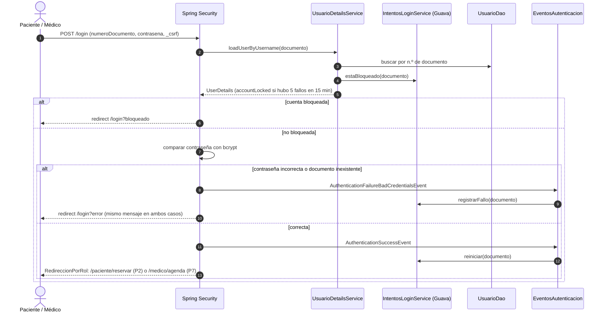

### SD-02 — Registrar paciente (RF02, RN-12)

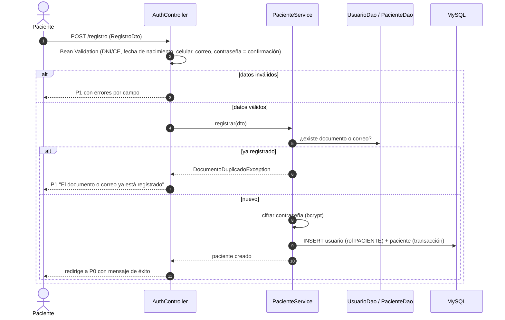

### SD-03 — Reservar cita y adjuntar la constancia (RF01, RF03, RF05, RN-01, RN-02, RN-09, RN-11)

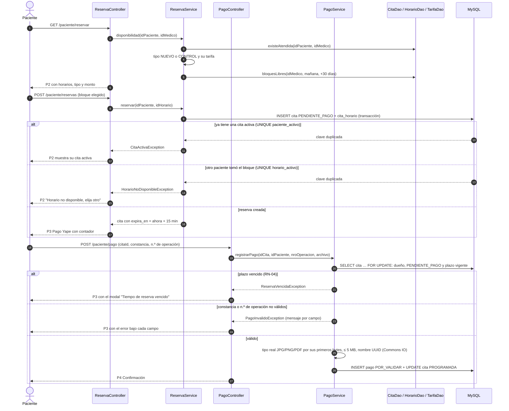

### SD-04 — Vencimiento automático de reservas (RF16, RN-04)

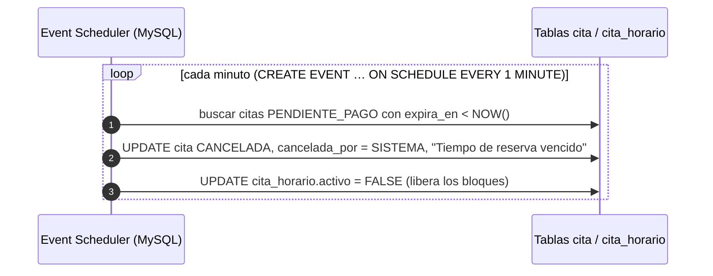

La aplicación no participa: el vencimiento corre dentro de MySQL aunque la aplicación esté detenida. Mientras el evento no pase, la aplicación muestra como "Vencida" la cita `PENDIENTE_PAGO` cuyo `expira_en` ya pasó (RF10).

### SD-05 — Validar o rechazar el pago (RF12, RF13, RN-07, RN-13)

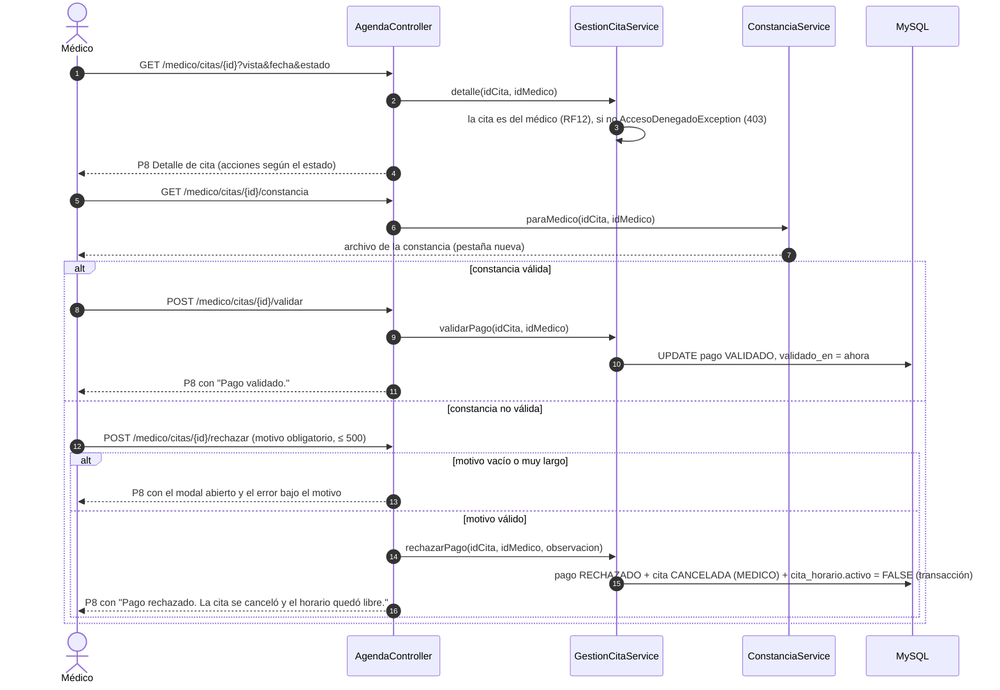

### SD-06 — Atendida, no asistió o cancelar (RF08, RF14, RN-07, RN-13, RN-14)

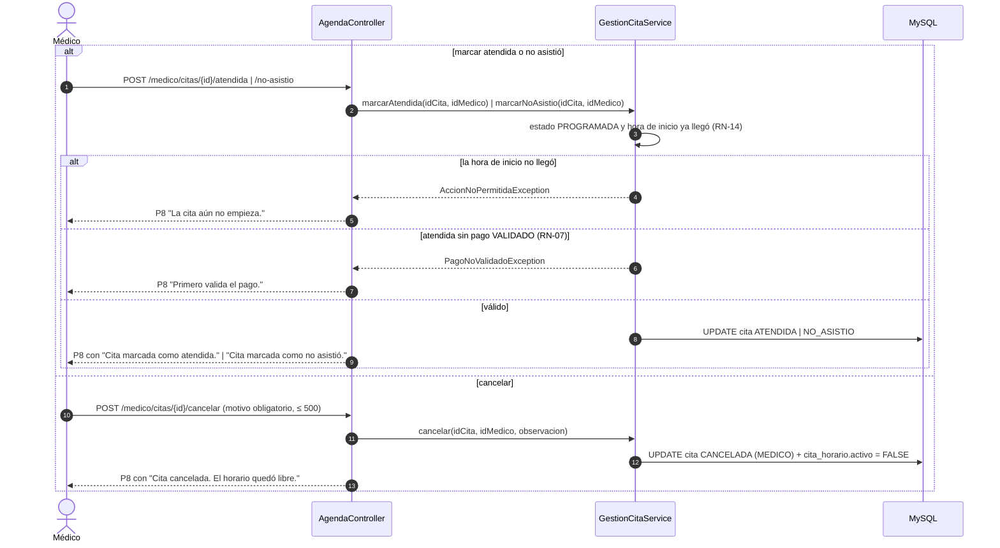

Después de cada acción se vuelve a P8 con la alerta del resultado (decisión de flujo del diseño de P8); "‹ Volver a la agenda" regresa a P7 con los filtros que tenía.

### SD-07 — Generar y exportar reportes (RF09)

```mermaid
sequenceDiagram
    autonumber
    actor Med as Médico
    participant C as ReporteController
    participant R as ReporteService
    participant E as ExportadorReporte (ExcelExportador, Apache POI)
    participant D as VistaCitaDao / PagoDao
    participant DB as MySQL

    Med->>C: GET /medico/reportes/citas?desde&hasta&estado
    C->>C: sin fechas: "Esta semana"; valida Desde / Hasta (obligatorias, Hasta ≥ Desde)
    alt fechas inválidas
        C-->>Med: P9 con el error bajo el campo, sin consultar
    else fechas válidas
        C->>R: citas(idMedico, filtro)
        R->>D: citas por rango y estado
        D->>DB: SELECT sobre v_cita
        R->>R: totales para los 5 estados de la cita
        C-->>Med: P9 con indicadores (con %), total por estado y tabla
    end

    Med->>C: GET /medico/reportes/citas.xlsx?desde&hasta&estado
    C->>R: citas(idMedico, filtro)
    C->>E: exportar(reporte: filas, total y resumen de indicadores)
    E-->>C: bytes .xlsx
    C-->>Med: descarga reporte-citas-<desde>-<hasta>.xlsx

    Note over Med,DB: El reporte de pagos (P10) sigue el mismo flujo con pagos(idMedico, filtro) y PagoDao.pagosValidados: un pago VALIDADO por fila, filtrado por validado_en; cantidad, total y ticket promedio salen de esas filas
```

### SD-08 — Descargar la confirmación en PDF (RF15)

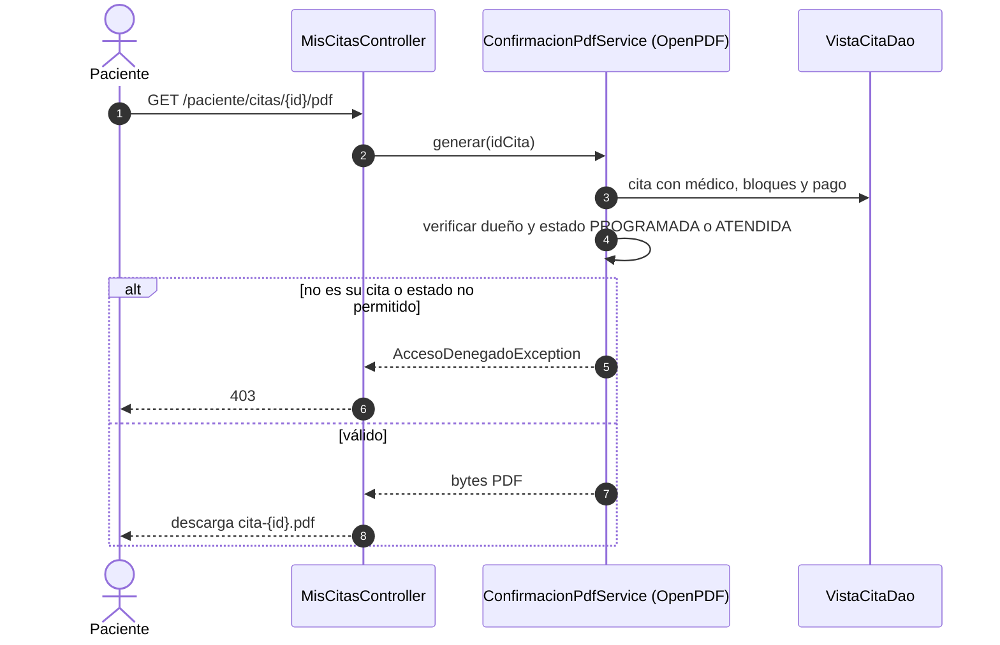

### SD-09 — Consultar la agenda (RF04, RF07, RNF08)

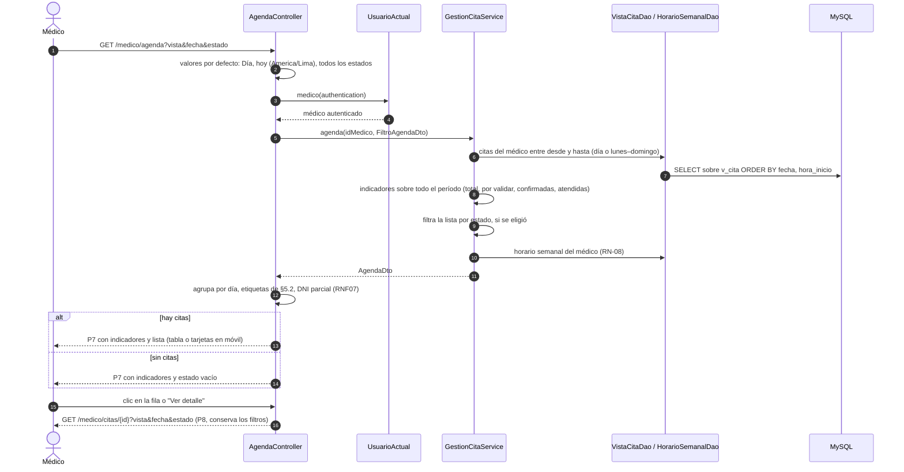

---

## 10. Modelo de datos

MySQL 8.4 (InnoDB, utf8mb4), normalizado hasta 3FN. Soporta varios consultorios y médicos.

**Tablas (10):** `consultorio`, `usuario`, `paciente`, `medico`, `tarifa`, `horario_semanal`, `horario`, `cita`, `cita_horario`, `pago`.

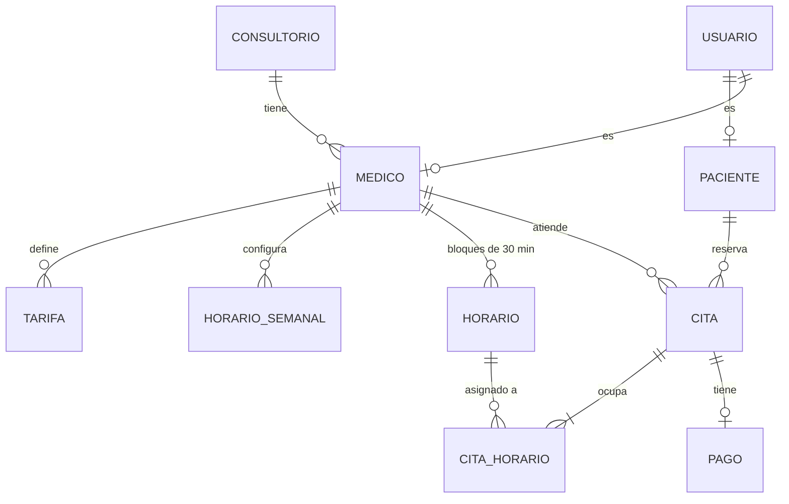

### Decisiones de diseño

- **RN-01 y RN-09 en la BD:** MySQL no tiene índices únicos parciales, así que se usan columnas generadas (`horario_activo` en `cita_horario`, `paciente_activo` en `cita`) que valen `NULL` cuando la fila deja de estar activa, con un índice `UNIQUE`. Como MySQL admite varios `NULL`, al cancelar o atender el bloque y el paciente quedan libres, y la BD rechaza duplicados aunque lleguen dos peticiones a la vez.
- **Cancelar o rechazar** = `cita.estado = 'CANCELADA'` + `cita_horario.activo = FALSE` (+ `pago.estado = 'RECHAZADO'` si se rechaza), en la misma transacción.
- **Fecha y hora de la cita** no se repiten en `cita`: salen de sus bloques a través de la vista `v_cita` (inicio = MIN, fin = MAX).
- **`tipo_cita` y `pago.monto` se guardan** para conservar el tipo y el precio vigentes al momento de reservar.
- **`pago` se crea al adjuntar la constancia**; mientras la cita está `PENDIENTE_PAGO` no existe la fila.
- **El documento vive en `usuario`** porque es el login y no se edita (RN-12).
- **Constancias** en la carpeta local `uploads/comprobantes/`; la BD guarda la ruta y el tipo MIME.
- **Tareas automáticas como eventos de MySQL** (Event Scheduler): el vencimiento de reservas cada minuto (RF16) y la generación diaria de los bloques de `horario` a partir de `horario_semanal` (RN-08). Corren en la BD con su propio horario, sin depender de que la aplicación esté levantada; la aplicación solo lee el resultado.

Modelos conceptual, lógico y físico, restricciones, índices y diccionario de datos: [docs/diagramas/base-de-datos.md](docs/diagramas/base-de-datos.md).

---

## 11. Arquitectura y stack

### 11.1 Arquitectura

La arquitectura objetivo de MEDIFAST corresponde a un monolito Spring Boot organizado en capas mediante MVC y ejecutado en localhost.

Los controladores deberán depender de interfaces de servicio; los servicios concentrarán las reglas de negocio y accederán a la base de datos únicamente mediante interfaces DAO implementadas con Spring Data JPA.

Esta separación busca mantener desacopladas las responsabilidades de presentación, control, lógica de negocio y persistencia.

**Diagramas relacionados:** T-01 Arquitectura MVC + DAO + SOLID y T-02 Clases por capas.

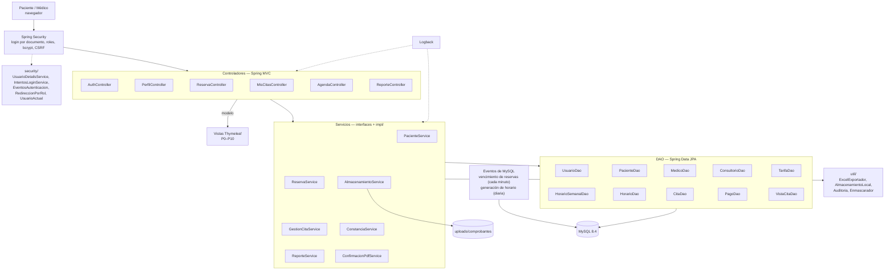

Detalle de dependencias entre clases: [T-01 Arquitectura](docs/diagramas/tecnicos.md#t-01--arquitectura-mvc-por-capas) y [T-02 Clases por capas](docs/diagramas/tecnicos.md#t-02--clases-por-capas-mvc-servicios-y-dao).

### 11.2 Principios de arquitectura definidos para la implementación

> Los siguientes principios representan la arquitectura objetivo de MEDIFAST. Se considerarán completamente implementados únicamente cuando las clases, interfaces, pruebas y demás evidencias correspondientes estén versionadas y puedan demostrarse en el repositorio.

| Principio       | Cómo se aplica                                                                                                                                                                                                                                                                                                                                                                                                                                                                                                    | Dónde se ve                                          |
| --------------- | ------------------------------------------------------------------------------------------------------------------------------------------------------------------------------------------------------------------------------------------------------------------------------------------------------------------------------------------------------------------------------------------------------------------------------------------------------------------------------------------------------------------ | ----------------------------------------------------- |
| **MVC**   | Modelo = entidades JPA y DTO; Vista = plantillas Thymeleaf; Controlador = `@Controller` delgado que recibe la petición, valida el formulario y delega en los servicios                                                                                                                                                                                                                                                                                                                                          | `model/`, `dto/`, `templates/`, `controller/` |
| **DAO**   | Interfaces `*Dao` que extienden `JpaRepository`, con consultas propias (`@Query`) para disponibilidad y reportes. Los servicios dependen solo de estas interfaces                                                                                                                                                                                                                                                                                                                                            | `dao/`                                              |
| **SOLID** | **S**: un servicio por responsabilidad (`ReservaService`, `GestionCitaService`, `ReporteService`, `AlmacenamientoService`, `ConfirmacionPdfService`). **O**: `ExportadorReporte` admite nuevos formatos sin tocar `ReporteService`. **L**: `ExcelExportador` y `AlmacenamientoLocal` sustituyen a su interfaz sin cambiar el comportamiento esperado. **I**: cada controlador depende solo de la interfaz que usa. **D**: inyección por constructor de interfaces | `service/`, `service/impl/`, `util/`            |
| **TDD**   | Las pruebas (JUnit 5 + Mockito) de cada regla RN-01 a RN-14 se escriben antes de su implementación; los commits `test:` preceden a los `feat:`                                                                                                                                                                                                                                                                                                                                                                | `src/test/java/`, historial de commits, JaCoCo      |

**Seguridad:** bcrypt; roles con Spring Security; CSRF; Bean Validation en servidor; consultas parametrizadas; subida de archivos validada por tipo real, tamaño y nombre UUID; bloqueo por intentos fallidos; acceso restringido a constancias y PDF; logs sin datos sensibles; usuario de BD con privilegios mínimos (`medifast_app`).

### 11.3 Librerías requeridas y uso definido

> Las siguientes librerías forman parte del diseño técnico comprometido para el APF3. La presencia de una dependencia en `pom.xml` no se considera por sí sola evidencia de cumplimiento; cada librería deberá tener un uso funcional verificable dentro del código antes de marcarse como implementada.

| Librería                      | Uso en MEDIFAST                                                                                                                                                                        |
| ------------------------------ | -------------------------------------------------------------------------------------------------------------------------------------------------------------------------------------- |
| **Google Guava**         | `Preconditions` en los servicios; caché con expiración para contar intentos fallidos de login y bloquear 15 min (`IntentosLoginService`); colecciones inmutables para catálogos |
| **Apache Commons Lang3** | `StringUtils` para normalizar nombres y documentos; `Validate` en DTO                                                                                                              |
| **Apache Commons IO**    | `FilenameUtils` / `FileUtils` para guardar constancias de forma segura (`AlmacenamientoLocal`)                                                                                   |
| **Apache POI**           | Exportación de los reportes a .xlsx (`ExcelExportador`)                                                                                                                             |
| **Logback**              | `logback-spring.xml` con consola y archivo rotativo; eventos de auditoría (login, reserva, validación, rechazo, cancelación)                                                      |

### 11.4 Stack

| Componente    | Tecnología                                                          |
| ------------- | -------------------------------------------------------------------- |
| Lenguaje      | Java 21 (LTS)                                                        |
| Framework     | Spring Boot 4.1 (Web MVC, Thymeleaf, Data JPA, Security, Validation) |
| Frontend      | Thymeleaf + HTML + CSS + JavaScript                                  |
| Base de datos | MySQL 8.4 LTS                                                        |
| PDF           | OpenPDF                                                              |
| Boilerplate   | Lombok (getters, setters y constructores en entidades y servicios)   |
| Build         | Maven (wrapper `./mvnw` incluido)                                  |
| Pruebas       | JUnit 5, Mockito, Spring Boot Test, JaCoCo                           |
| Contenedores  | Docker Compose (solo para la BD de desarrollo)                       |
| Prototipo     | Figma Make (§7.2)                                                   |
| Diagramas     | Mermaid                                                              |
| Versionado    | Git + GitHub                                                         |

---

## 12. Estructura del proyecto

El repositorio utiliza una estructura monorepo que integra documentación, scripts de base de datos y la aplicación Spring Boot.

**Nota:** la estructura mostrada a continuación representa la **estructura objetivo de MEDIFAST**. Algunos controladores, servicios, utilidades y plantillas todavía se encuentran en desarrollo y serán incorporados progresivamente durante el APF3. El estado real de implementación de las interfaces se encuentra documentado en la sección 7.3.

```text
medifast/
├── README.md                     # este documento
├── docker-compose.yml            # MySQL 8.4 con el esquema y los datos de prueba
├── docs/
│   ├── diagramas/                # diagramas Mermaid (ver §13)
│   ├── sql/                      # scripts de la BD (ver §13)
│   ├── capturas/                 # capturas de P0–P10 de la aplicación en ejecución
│   └── entregables/              # APF1, APF2, Project Charter, rúbrica y checklist del APF3
└── medifast-app/                 # aplicación Spring Boot + Thymeleaf
    ├── pom.xml
    ├── lombok.config             # marca el código generado por Lombok para que JaCoCo lo excluya
    ├── mvnw, mvnw.cmd
    └── src/
        ├── main/java/pe/edu/utp/medifast/
        │   ├── MedifastAppApplication.java
        │   ├── config/           # SecurityConfig, TiempoConfig (ckckClock America/Lima)
        │   ├── controller/       # AuthController, PerfilController, ReservaController, MisCitasController, AgendaController, ReporteController, ManejadorErrores
        │   ├── service/          # interfaces de servicio (reglas de negocio)
        │   │   └── impl/         # implementaciones
        │   ├── dao/              # interfaces que extienden JpaRepository (incluye VistaCitaDao sobre v_cita)
        │   ├── model/            # entidades JPA (Lombok) y VistaCita (solo lectura) sobre v_cita
        │   │   └── enums/        # RolEnum, TipoDocumentoEnum, TipoCitaEnum, EstadoCitaEnum, EstadoPagoEnum, CanceladaPorEnum
        │   ├── dto/              # objetos de formularios y reportes; validacion/ con las anotaciones propias
        │   ├── exception/        # NegocioException y sus subclases (CitaActivaException, HorarioNoDisponibleException, …)
        │   ├── security/         # UsuarioDetailsService, IntentosLoginService (Guava), EventosAutenticacion, RedireccionPorRol, UsuarioActual
        │   └── util/             # ExportadorReporte + ExcelExportador (POI), PDF (OpenPDF), AlmacenamientoLocal (Commons IO), Auditoria, Enmascarador
        │       └── converter/    # AttributeConverter de JPA (DiaSemanaConverter: 1–7 ↔ DayOfWeek)
        ├── main/resources/
        │   ├── application.yml
        │   ├── logback-spring.xml
        │   ├── templates/
        │   │   ├── login.html, registro.html          # P0, P1
        │   │   ├── paciente/                          # P2–P6
        │   │   ├── medico/                            # P7–P10
        │   │   ├── fragments/                         # layout, menú por rol
        │   │   └── error/                             # 403, 404
        │   └── static/           # css/, js/, img/
        └── test/java/pe/edu/utp/medifast/   # pruebas unitarias (TDD)
```

Los nombres de cada plantilla están en la tabla de §7. Fuera de Git: `uploads/` (constancias), `logs/` y `target/`.

---

## 13. Scripts, diagramas y documentos

### 13.1 Scripts SQL — [`docs/sql/`](docs/sql/)

| Script                                                               | Contenido                                                                                                                                                      |
| -------------------------------------------------------------------- | -------------------------------------------------------------------------------------------------------------------------------------------------------------- |
| [`01_schema.sql`](docs/sql/01_schema.sql)                           | Crea la BD `medifast`, las 10 tablas, constraints (incluidas RN-01 y RN-09), índices, la vista `v_cita` y el usuario de aplicación `medifast_app`      |
| [`02_datos_prueba.sql`](docs/sql/02_datos_prueba.sql)               | Datos de prueba: consultorio Medifast, 1 médico, tarifas, horario lunes a sábado 09:00–13:00, bloques ±30 días, 30 pacientes y citas en todos los estados |
| [`03_consultas.sql`](docs/sql/03_consultas.sql)                     | Vista `v_cita`, JOIN de verificación, reporte de citas, reporte de pagos, disponibilidad y pruebas de constraints (INSERT que **deben fallar**)       |
| [`04_migracion_auditoria.sql`](docs/sql/04_migracion_auditoria.sql) | Solo para BD creadas antes de RNF13 completo: agrega `creado_en` / `actualizado_en` a las tablas que no las tenían. Re-ejecutable; requiere `root`      |
| [`05_evento_vencimiento.sql`](docs/sql/05_evento_vencimiento.sql) | Evento `ev_vencer_reservas` (RF16, SD-04): cada minuto cancela las reservas `PENDIENTE_PAGO` vencidas con "Tiempo de reserva vencido" y libera sus bloques. Re-ejecutable; requiere `root` y `event_scheduler = ON` |

### 13.2 Diagramas — [`docs/diagramas/`](docs/diagramas/)

Todos están en Mermaid; GitHub y VS Code los muestran directamente. El [índice](docs/diagramas/README.md) explica cómo exportarlos a PNG.

| Archivo                                            | Diagramas                                                                                                                                     |
| -------------------------------------------------- | --------------------------------------------------------------------------------------------------------------------------------------------- |
| [funcionales.md](docs/diagramas/funcionales.md)     | F-01 Casos de uso · F-02 Proceso AS-IS · F-03 Proceso TO-BE · F-04 Estados de la cita · F-05 Estados del pago · F-06 Mapa de navegación |
| [tecnicos.md](docs/diagramas/tecnicos.md)           | T-01 Arquitectura MVC + DAO + SOLID · T-02 Clases por capas · T-03 Clases del dominio · T-04 y T-05 Secuencias detalladas                  |
| [base-de-datos.md](docs/diagramas/base-de-datos.md) | BD-01 Conceptual · BD-02 Lógico · BD-03 Físico · Restricciones e índices · Diccionario de datos                                        |

### 13.3 Entregables — [`docs/entregables/`](docs/entregables/)

| Archivo                                                                               | Contenido                                                                                             |
| ------------------------------------------------------------------------------------- | ----------------------------------------------------------------------------------------------------- |
| [checklist-apf3.md](docs/entregables/checklist-apf3.md)                                | Cobertura de la rúbrica, estado de los entregables y evidencias que hay que reunir                   |
| [rubrica_apf3.txt](docs/entregables/rubrica_apf3.txt)                                  | Rúbrica de evaluación del APF3                                                                      |
| `APF1_Medifast.pdf`, `APF2_Medifast_Grupo2.pdf`, `Project_Charter_Medifast.pdf` | Informes y acta de constitución entregados                                                           |
| `docs/javadoc/`                                                                     | Documentación técnica generada mediante Javadoc para las principales clases y métodos del sistema. |
| `docs/entregables/referencias-apf3.md`                                              | Referencias bibliográficas y documentación técnica consultadas durante el desarrollo del APF3.     |

---

## 14. Cómo ejecutar

**Requisitos:** Java 21 o superior y Docker (o un MySQL 8.4 local). No hace falta instalar Maven: se usa el wrapper.

```bash
# 1. Base de datos: crea el esquema y carga los datos de prueba
docker compose up -d

# 2. Aplicación (en Windows: .\mvnw.cmd spring-boot:run)
cd medifast-app
./mvnw spring-boot:run
# http://localhost:8080
```

Sin Docker, ejecuta los scripts en un MySQL 8.4 local:

```bash
mysql -u root -p < docs/sql/01_schema.sql
mysql -u root -p < docs/sql/02_datos_prueba.sql
mysql -u root -p < docs/sql/05_evento_vencimiento.sql          # RF16: vencimiento de reservas
mysql --force -u root -p medifast < docs/sql/03_consultas.sql   # la sección 6 contiene errores esperados
```

¿Ya tenías la BD creada con una versión anterior del esquema? Actualízala sin perder datos (o recréala con `docker compose down -v && docker compose up -d`):

```bash
docker exec -i medifast-mysql mysql -uroot -proot < docs/sql/04_migracion_auditoria.sql
docker exec -i medifast-mysql mysql -uroot -proot < docs/sql/05_evento_vencimiento.sql   # si tu BD no tiene el evento de RF16
```

**Cuentas de prueba** (contraseña `Medifast2026`):

| Rol             | N.º de documento             |
| --------------- | ----------------------------- |
| Médico         | `10000001`                  |
| Pacientes (DNI) | `70000001` a `70000025`   |
| Pacientes (CE)  | `001000026` a `001000030` |

**Variables de entorno** (opcionales; por defecto apuntan al contenedor):

| Variable                 | Valor por defecto                                                    |
| ------------------------ | -------------------------------------------------------------------- |
| `MEDIFAST_DB_URL`      | `jdbc:mysql://localhost:3306/medifast?serverTimezone=America/Lima` |
| `MEDIFAST_DB_USER`     | `medifast_app`                                                     |
| `MEDIFAST_DB_PASSWORD` | `medifast_app`                                                     |
| `MEDIFAST_UPLOADS_DIR` | `uploads/comprobantes`                                             |

**Pruebas y cobertura:** `./mvnw test` (en Windows: `.\mvnw.cmd test`) → reporte en `medifast-app/target/site/jacoco/index.html`.

**Reiniciar la BD desde cero:** `docker compose down -v && docker compose up -d`.

---

## 15. Equipo

| Integrante                         | Código   |
| ---------------------------------- | --------- |
| Guarniz Cruz, Manuel Elmer Esteban | U24314208 |
| Linares Barrantes, Jorge Moisés   | U23262883 |
| Hurtado Razuri, Jack Max Malek     | U24228666 |
| Angulo Leiva, Jennifer Elizabeth   | U24203850 |

Docente: Segundo Edwin Cieza Mostacero.
