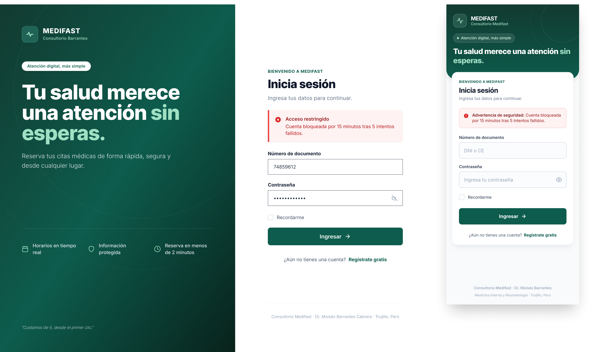
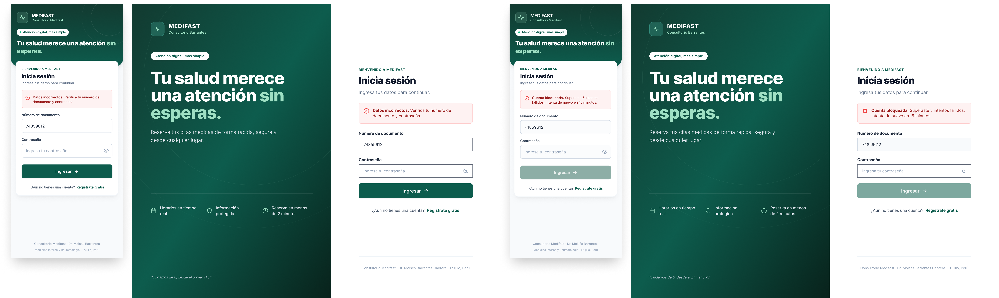
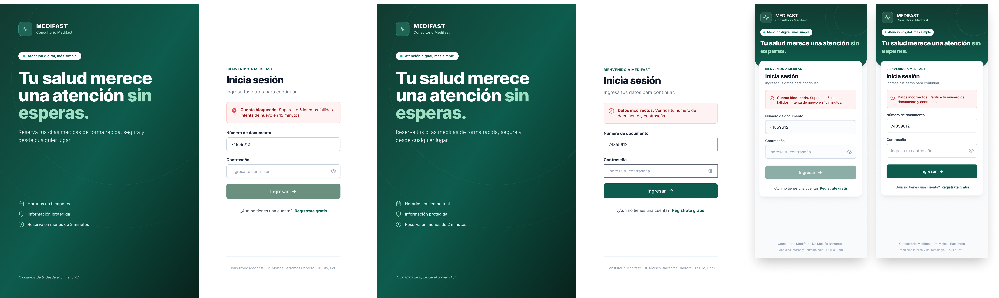

# P0 – Login: iteraciones

- **Requerimientos:** RF07 · RNF03 (bloqueo de 15 min tras 5 intentos, sesión de 30 min)
- **Plantilla:** `templates/login.html`
- **Referencia visual:** [referencia-figma-make.png](referencia-figma-make.png), el prototipo de Figma Make. Incluye elementos fuera de alcance: selector de rol, "¿Olvidaste tu contraseña?", "Consultorio Barrantes" y el aviso de modo demostración.

| Versión | Fecha      | Resultado       | Estado                                                   |
| -------- | ---------- | --------------- | -------------------------------------------------------- |
| v1       | 2026-10-25 | [v1.png](v1.png) | Revisada, requiere cambios                               |
| v2       | 2026-10-25 | [v2.png](v2.png) | Revisada; móvil casi lista, escritorio requiere cambios |
| v3       | 2026-10-25 | [v3.png](v3.png) | ✅ Aprobada, con 2 ajustes a completar en Figma |

---

## v1

**Prompt:** [prompt base](../00-prompt-base.md) (versión inicial) + [P0 v1](../01-prompts-pantallas.md#p0--login), con la referencia de Figma Make adjunta.

**Resultado:**



### Feedback

**Lo que funciona (mantener):**

- El layout dividido, el degradado, el titular con "sin esperas." en menta y la jerarquía del formulario son fieles a la referencia.
- Se eliminaron el selector de rol y "¿Olvidaste tu contraseña?". El placeholder dice "DNI o CE".
- Incluye la variante de bloqueo por intentos y una versión móvil con la cabecera compacta.
- El pie de página con los datos del consultorio es correcto.

**Lo que hay que corregir:**

| # | Problema                                                                                                                                                                                                                | Dónde                      | Severidad |
| - | ----------------------------------------------------------------------------------------------------------------------------------------------------------------------------------------------------------------------- | --------------------------- | --------- |
| 1 | El logo dice "Consultorio Barrantes"; debe decir "Consultorio Medifast" (en móvil ya está bien)                                                                                                                       | Escritorio, panel izquierdo | Alta      |
| 2 | Inputs con borde negro de 1–2px y esquinas casi rectas; no siguen el sistema de diseño (gris claro #cbd5e1, radio de 8px). Además, no coinciden con los de la versión móvil                                        | Escritorio, formulario      | Alta      |
| 3 | La alerta de bloqueo es distinta en cada versión: en escritorio, "Acceso restringido" con barra lateral y texto rojo; en móvil, "Advertencia de seguridad:" con borde completo. Hay que unificar el texto y el estilo | Ambas                       | Media     |
| 4 | "Recordarme" no está en el alcance y choca con la sesión de 30 min (RNF03). Lo había pedido el prompt v1: es un error del prompt, no de Stitch                                                                       | Ambas                       | Media     |
| 5 | Con la cuenta bloqueada, el formulario sigue activo y la contraseña sigue escrita. Debería limpiarse la contraseña y deshabilitar "Ingresar"                                                                         | Escritorio                  | Media     |
| 6 | El ícono de contraseña muestra "ojo tachado" mientras la contraseña está oculta; debe mostrar "ojo" (acción: mostrar)                                                                                              | Escritorio                  | Baja      |
| 7 | Los beneficios se parten en dos líneas ("Horarios en tiempo / real") y queda un hueco grande entre ellos y la cita del pie                                                                                             | Escritorio, panel izquierdo | Baja      |
| 8 | La píldora "Atención digital, más simple" es blanca en escritorio y oscura con punto en móvil                                                                                                                       | Ambas                       | Baja      |
| 9 | Falta mostrar el estado de foco del input (borde primario con halo) y el error de credenciales inválidas, que es el error más común                                                                                  | —                          | Baja      |

**Cambios al prompt base** derivados de esta revisión (para que no se repitan en otras pantallas): estilo explícito de inputs y foco, estilo único de alertas, subtítulo del logo, "Recordarme" en "No incluir". Ver el historial en [00-prompt-base.md](../00-prompt-base.md#cambios).

---

## v2

**Prompt:** pegar en la misma sesión de Stitch, sobre el resultado v1.

```text
Ajusta la pantalla de login manteniendo el layout, el degradado, el titular y la jerarquía actuales. Cambios:

1. Marca: en la versión de escritorio, el subtítulo del logo debe decir "Consultorio Medifast" (no "Consultorio Barrantes"), igual que en móvil.

2. Inputs (escritorio y móvil idénticos): borde de 1px gris claro #cbd5e1, radio de 8px, altura de 48px, fondo blanco y placeholder #94a3b8. Al enfocar: borde #0d5c4d con un halo suave rgba(13,92,77,0.15). Muestra el campo "Número de documento" en estado de foco.

3. Contraseña: el ícono a la derecha es un "ojo" cuando la contraseña está oculta (acción: mostrar) y un "ojo tachado" cuando está visible.

4. Elimina el checkbox "Recordarme". El botón "Ingresar →" va directamente después del campo de contraseña.

5. Genera TRES estados del formulario, en escritorio y móvil:
   a) Normal: campos vacíos con placeholder, documento en foco.
   b) Credenciales inválidas: alerta de error (fondo #fef2f2, borde 1px #fecaca, radio de 8px, ícono de círculo con X a la izquierda) con el texto "**Datos incorrectos.** Verifica tu número de documento y contraseña." El documento se conserva y la contraseña se vacía.
   c) Cuenta bloqueada: misma alerta con el texto "**Cuenta bloqueada.** Superaste 5 intentos fallidos. Intenta de nuevo en 15 minutos." La contraseña se vacía y el botón "Ingresar" se muestra deshabilitado (verde desaturado).
   Usa exactamente el mismo estilo de alerta en escritorio y móvil.

6. Panel izquierdo (escritorio): los tres beneficios en una sola línea cada uno, apilados en vertical con 16px de separación (ícono + texto), o en fila con el ancho suficiente para que no se partan. Reduce el espacio vacío entre los beneficios y la cita del pie: alinea el bloque del titular más abajo o centra verticalmente todo el contenido.

7. La píldora "Atención digital, más simple" debe ser igual en escritorio y móvil: fondo blanco, texto #0d5c4d, punto verde a la izquierda.

No agregues selector de rol, "¿Olvidaste tu contraseña?", "Recordarme" ni logins sociales.
```

**Resultado:** 4 pantallas (móvil y escritorio × credenciales inválidas y cuenta bloqueada).



### Feedback

**Corregido respecto a v1:**

- La alerta tiene el mismo texto y estilo en escritorio y móvil, para ambos errores (#3).
- Se eliminó "Recordarme" (#4).
- En el estado bloqueado, la contraseña se vacía y "Ingresar" aparece deshabilitado (#5).
- La versión móvil ya cumple: inputs redondeados con borde gris claro, ícono de ojo correcto, píldora con punto y subtítulo "Consultorio Medifast".

**Pendiente:** Stitch corrigió la versión móvil pero dejó casi igual la de escritorio.

| # | Problema                                                                                                                                                                        | Dónde     | Severidad | Veces |
| - | ------------------------------------------------------------------------------------------------------------------------------------------------------------------------------- | ---------- | --------- | ----- |
| 1 | El logo sigue diciendo "Consultorio Barrantes"                                                                                                                                  | Escritorio | Alta      | 2.ª  |
| 2 | Los inputs siguen rectos y con borde gris oscuro; no coinciden con los de móvil                                                                                                | Escritorio | Alta      | 2.ª  |
| 3 | En el estado bloqueado, el documento aparece con fondo gris (como deshabilitado) y la contraseña no. Deben verse iguales: ambos normales, porque solo se deshabilita el botón | Escritorio | Media     | nuevo |
| 4 | Falta el estado normal (a) con el campo de documento en foco; solo se generaron los dos estados de error                                                                        | Ambas      | Media     | 2.ª  |
| 5 | El ícono sigue siendo un "ojo tachado" con la contraseña oculta                                                                                                               | Escritorio | Baja      | 2.ª  |
| 6 | Los beneficios siguen partiéndose en dos líneas y sigue el hueco entre el subtítulo y los beneficios                                                                         | Escritorio | Baja      | 2.ª  |
| 7 | La píldora "Atención digital, más simple" no tiene el punto verde que sí tiene en móvil                                                                                    | Escritorio | Baja      | 2.ª  |

**Aprendizaje:** las instrucciones generales ("en escritorio y móvil") solo se aplicaron al frame móvil. Para v3, seleccionar en Stitch únicamente los frames de escritorio y pedir que copien los estilos del frame móvil, que ya está bien. Si "Consultorio Barrantes" persiste en v3, se corrige a mano en Figma en lugar de seguir iterando.

---

## v3

**Prompt:** en Stitch, seleccionar **solo los dos frames de escritorio** y pegar:

```text
Edita solo estas pantallas de escritorio. Toma como referencia exacta los frames móviles, que ya están correctos, y no cambies nada más del layout.

1. TEXTO DEL LOGO: reemplaza "Consultorio Barrantes" por "Consultorio Medifast". La palabra "Barrantes" no debe aparecer en el logo.

2. INPUTS: copia exactamente el estilo de los inputs del frame móvil. Borde de 1px #cbd5e1, border-radius de 8px (esquinas visiblemente redondeadas), altura de 48px y fondo blanco. Nada de bordes oscuros ni esquinas rectas.

3. ESTADO BLOQUEADO: los dos inputs (documento y contraseña) se ven iguales, con fondo blanco y estilo normal. Lo único deshabilitado es el botón "Ingresar".

4. ÍCONO DE CONTRASEÑA: usa el ícono de "ojo" abierto (el mismo del frame móvil), no el ojo tachado.

5. PÍLDORA: "Atención digital, más simple" con un punto verde a la izquierda del texto, igual que en móvil.

6. BENEFICIOS: apila los tres beneficios en vertical (ícono + texto en una sola línea, 16px entre cada uno), justo debajo del subtítulo con 48px de separación. Elimina la línea divisoria. La cita "Cuidamos de ti, desde el primer clic." se queda al pie.

7. Agrega un tercer frame de escritorio en ESTADO NORMAL: sin alerta, campos vacíos con placeholder y el campo "Número de documento" en foco (borde #0d5c4d con un halo suave rgba(13,92,77,0.15)). Genera también su equivalente móvil.
```

**Resultado:** 4 pantallas: escritorio bloqueada, escritorio con datos incorrectos, móvil bloqueada y móvil con datos incorrectos.



### Feedback

**Corregido respecto a v2:**

- El logo dice "Consultorio Medifast" en todas las pantallas (#1).
- En la pantalla de escritorio bloqueada, los inputs coinciden con los de móvil: borde gris claro, radio de 8px y fondo blanco en ambos campos (#2, #3).
- El ícono de contraseña es un ojo abierto (#5).
- Los beneficios están apilados en una sola línea cada uno (#6).
- La píldora tiene el punto verde (#7).

**Pendiente:**

| # | Problema | Dónde | Severidad | Veces |
| --- | --- | --- | --- | --- |
| 1 | Los inputs siguen rectos y con borde gris oscuro (la pantalla bloqueada sí está bien) | Escritorio, datos incorrectos | Media | 3.ª |
| 2 | No se generó el estado normal (sin alerta, documento en foco) | Ambas | Media | 2.ª |
| 3 | Sigue habiendo espacio vacío entre los beneficios y la cita del pie. Es aceptable: el panel se centra verticalmente al implementarlo | Escritorio | Baja | — |

### Decisión

Se aprueba v3 y no se itera más en Stitch. Los dos pendientes son mecánicos y salen de piezas que ya están bien en esta versión. En Figma, además, conviene construirlos como componentes:

1. **Input:** crear el componente desde la pantalla de escritorio bloqueada (variantes default, focus, error y disabled) y aplicarlo también en la pantalla de datos incorrectos.
2. **Estado normal:** duplicar la pantalla bloqueada, quitar la alerta, poner "Ingresar" en estado activo y aplicar la variante focus al campo de documento. Hacer lo mismo en móvil.
3. **Estado "cuenta creada"** (definido al revisar [P1](../P1-registro/iteraciones.md#decisiones-de-flujo)): duplicar el estado normal y poner arriba una alerta de éxito (fondo #ecfdf5, borde 1px #a7f3d0, radio de 8px, ícono de check en #10b981) con el texto "**Cuenta creada.** Ya puedes iniciar sesión." El número de documento recién registrado va precargado. Hacer lo mismo en móvil.

**Aprendizaje para las siguientes pantallas:**

- Stitch aplica mejor los cambios si se selecciona una sola pantalla por prompt.
- Cuando se piden pantallas nuevas dentro de un prompt de corrección, las ignora. Conviene pedirlas en un prompt aparte.
- Después de 2–3 iteraciones sobre el mismo detalle, conviene corregirlo en Figma.
