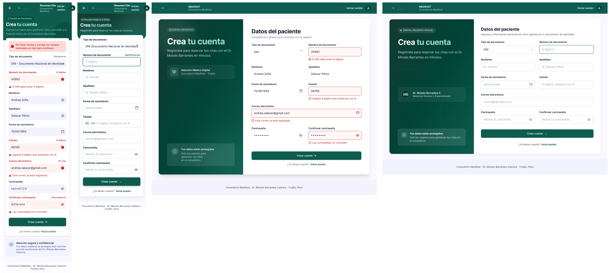
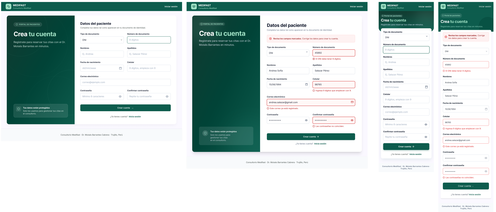

# P1 – Registro: iteraciones

- **Requerimientos:** RF02 · RN-12 · RNF02 · RNF07
- **Plantilla:** `templates/registro.html`
- **Referencia visual:** [referencia-registro.png](referencia-registro.png). Se toma el layout de card dividida (panel oscuro con el titular + formulario en 2 columnas). Contiene elementos que no se siguen:
  - "Consultorio Barrantes" en el logo (debe ser "Consultorio Medifast").
  - Falta el campo **Fecha de nacimiento**, obligatorio en RF02.
  - El rótulo "01 / CREA TU CUENTA" sugiere un asistente de varios pasos; el registro es un solo paso.
  - El checkbox de términos de uso no está en RF02 (se omite; si se quiere, primero hay que agregarlo al README).
  - Falta el enlace "¿Ya tienes cuenta? Inicia sesión".
  - Tipografía distinta de Inter.

| Versión | Fecha      | Resultado | Estado       |
| ------- | ---------- | --------- | ------------ |
| v1      | 2026-10-25 | [v1.png](v1.png) | Revisada, requiere cambios |
| v2      | 2026-10-25 | [v2.png](v2.png) | ✅ Aprobada, con 4 ajustes a completar en Figma |

---

## v1

**Prompt:** [prompt base](../00-prompt-base.md) + el prompt de abajo (actualizado también en [P1 v1](../01-prompts-pantallas.md#p1--registro-de-paciente)), con [P0 v3](../P0-login/v3.png) y [la referencia](referencia-registro.png) adjuntas.

```text
P1 – Registro de paciente. Usa la imagen de login adjunta (P0) como referencia de estilo: mismos inputs, botones, alertas, navbar y tipografía Inter. Usa la otra imagen adjunta solo como referencia de layout.

LAYOUT (escritorio)
1. Navbar #0d5c4d con el logo MEDIFAST y el subtítulo "Consultorio Medifast" (no "Consultorio Barrantes"). A la derecha, solo el enlace "Iniciar sesión". Sin menú de paciente: el usuario aún no tiene cuenta.
2. Fondo #f8fafc. Card centrada de ~1200px, radio de 16px y sombra suave, dividida en dos:
   - Izquierda (~40%): fondo verde oscuro (#0d5c4d con degradado como en el login). Titular H1 blanco "Crea tu cuenta" con "tu cuenta" en verde menta #9fe0c4. Debajo, el texto "Regístrate para reservar tus citas con el Dr. Moisés Barrantes en minutos." Al pie, un recuadro translúcido con ícono de escudo: "Tus datos están protegidos" / "Solo los usamos para gestionar tus citas en el consultorio." Sin numeración de pasos.
   - Derecha (~60%): fondo blanco, título H2 "Datos del paciente" y el formulario en 2 columnas con 24px de separación.

FORMULARIO (en este orden, etiquetas exactas)
3. Fila 1: "Tipo de documento" (select con las opciones "DNI" y "CE", valor DNI) | "Número de documento" (placeholder "8 dígitos").
4. Fila 2: "Nombres" (placeholder "Ej. Andrea") | "Apellidos" (placeholder "Ej. Salazar Pérez").
5. Fila 3: "Fecha de nacimiento" (input de fecha, placeholder "dd/mm/aaaa", ícono de calendario a la derecha) | "Celular" (placeholder "9 dígitos, empieza con 9").
6. Fila 4: "Correo electrónico" a ancho completo (placeholder "correo@ejemplo.com").
7. Fila 5: "Contraseña" (placeholder "Mínimo 8 caracteres") | "Confirmar contraseña" (placeholder "Repite tu contraseña"). Ambos con ícono de "ojo" a la derecha (contraseña oculta).
8. Inputs: altura 48px, borde 1px #cbd5e1, radio 8px, placeholder #94a3b8, etiqueta 14px/600 arriba. Foco: borde #0d5c4d con halo rgba(13,92,77,0.15).
9. Botón primario a ancho completo "Crear cuenta →" (relleno #0d5c4d, texto blanco, radio 8px, 48px de alto).
10. Debajo, centrado: "¿Ya tienes cuenta? Inicia sesión" con "Inicia sesión" como enlace #0d5c4d en negrita.
11. Pie de página: "Consultorio Medifast · Dr. Moisés Barrantes Cabrera · Trujillo, Perú".

ESTADOS (escritorio y móvil 360px)
12. Normal: campos vacíos, "Número de documento" en foco.
13. Errores de validación en línea (borde #ef4444, ícono de alerta y mensaje rojo 14px debajo del campo), con estos textos exactos:
   - Número de documento: "El DNI debe tener 8 dígitos."
   - Celular: "Ingresa 9 dígitos que empiecen con 9."
   - Correo electrónico: "Este correo ya está registrado."
   - Confirmar contraseña: "Las contraseñas no coinciden."
   Los campos válidos conservan su valor y el borde normal.

MÓVIL (360px)
14. Navbar compacta con logo y "Iniciar sesión". El panel verde se reduce a una cabecera con el titular "Crea tu cuenta" y una línea de texto (sin el recuadro de seguridad). El formulario pasa a una sola columna, mismos textos y orden.

No incluir: checkbox de términos de uso, selector de rol, tipos de documento distintos de DNI y CE (nada de pasaporte), registro con Google/Facebook, numeración de pasos ("01 /"), verificación por correo o SMS, ni campos clínicos (alergias, antecedentes, seguro).
```


**Resultado:** 4 frames: móvil con errores, móvil normal, escritorio con errores y escritorio normal.



### Feedback

**Lo que funciona (mantener):**

- La card dividida, el titular "Crea tu cuenta" con "tu cuenta" en menta y el título "Datos del paciente".
- Los campos de RF02 en el orden pedido, con "Fecha de nacimiento" incluida, y el correo a ancho completo.
- Los 4 mensajes de error con el texto exacto. El estado normal de escritorio tiene "Número de documento" en foco.
- "Crear cuenta →", "¿Ya tienes cuenta? Inicia sesión" y el pie de página. Sin checkbox de términos ni numeración de pasos.
- El frame de escritorio normal es el mejor resuelto: sirve de referencia para los demás.

**Lo que hay que corregir:**

| # | Problema | Dónde | Severidad | Veces |
| --- | --- | --- | --- | --- |
| 1 | Logo roto: un ícono de pulso suelto con un texto diminuto "Consultorio Barrantes" al lado, y "MEDIFAST / Consultorio Medifast" separado a la derecha. Falta el cuadrado menta con el ícono | Todas, navbar | Alta | 1.ª |
| 2 | La navbar móvil tiene una flecha atrás, el título "Resumen Cita", "Iniciar sesión" partido en dos líneas y un ícono de usuario | Móvil (ambos) | Alta | 1.ª |
| 3 | El subtítulo dice "…acceder a tu historial clínico en el Consultorio Barrantes" (información clínica fuera de alcance y marca incorrecta) | Móvil, errores | Alta | 1.ª |
| 4 | La card inferior "Atención segura y confidencial: Tus datos médicos se protegen bajo estricto secreto profesional…" habla de datos médicos; además, el prompt pedía no mostrar el recuadro de seguridad en móvil | Móvil, errores | Alta | 1.ª |
| 5 | Los inputs móviles tienen fondo lavanda y no tienen borde; en error usan relleno rosa, un ícono dentro del campo y un triángulo. No coinciden con escritorio | Móvil (ambos) | Media | 1.ª |
| 6 | Etiquetas auxiliares a la derecha de los labels ("Obligatorio", "8 dígitos", "En uso", "Discrepancia", "Identificación") | Móvil (ambos) | Media | 1.ª |
| 7 | En el estado de error, las contraseñas se ven en texto plano ("secret123", "different") | Móvil, errores | Media | 1.ª |
| 8 | El select muestra "DNI - Documento Nacional de Identidad", que se monta sobre la flecha. Debe decir solo "DNI" | Móvil (ambos) | Media | 1.ª |
| 9 | La alerta general "Por favor revisa y corrige los campos…" solo aparece en móvil y con un estilo distinto del prompt base | Ambas, errores | Media | 1.ª |
| 10 | Los campos válidos del escritorio con errores no tienen borde (solo sombra); en el frame normal sí lo tienen | Escritorio, errores | Media | 1.ª |
| 11 | Panel izquierdo con cards inventadas: "Atención Médica Digital" y "Dr. Moisés Barrantes C. · Medicina General y Especializada" (la especialidad correcta es Medicina Interna y Reumatología). Las píldoras cambian en cada frame ("Portal Pacientes", "Portal Paciente Oficial", "Portal de Pacientes", "Acceso Seguro a Citas") | Ambas | Media | 1.ª |
| 12 | El celular tiene el prefijo "+51" con bandera solo en el móvil normal | Móvil, normal | Baja | 1.ª |
| 13 | El subtítulo bajo "Datos del paciente" cambia en cada frame de escritorio | Escritorio | Baja | 1.ª |
| 14 | El fondo del pie de página es lavanda, no #f8fafc | Todas | Baja | 1.ª |

**Aprendizaje:** Stitch rellenó el panel izquierdo con cards que nadie pidió y, en móvil, cambió el estilo de los inputs. Conviene listar el contenido exacto del panel y pedir que el móvil copie los inputs del frame de escritorio que ya está bien.

**Cambio al prompt base:** se agrega la navbar pública (login y registro): solo el logo y un enlace, sin flecha atrás, título de página ni ícono de usuario. Ver [00-prompt-base.md](../00-prompt-base.md#cambios).

---

## v2

Se corrige en dos prompts, porque Stitch aplica mejor los cambios si se selecciona un solo tipo de frame por vez.

**v2a — Prompt:** en Stitch, seleccionar **solo los 2 frames de escritorio** y pegar:

```text
Edita solo estas dos pantallas de escritorio. No cambies nada más del layout. Toma como referencia el frame de escritorio en estado normal (con "Número de documento" en foco), que ya está bien.

1. Logo de la navbar: un solo bloque a la izquierda, con un cuadrado de 40px, radio de 10px y fondo verde menta #9fe0c4, con el ícono de pulso cardíaco en #0d5c4d dentro. A la derecha del cuadrado, "MEDIFAST" (blanco, 18px/700) y debajo "Consultorio Medifast" (#9fe0c4, 13px). Quita el ícono de pulso suelto y el texto pequeño "Consultorio Barrantes".
2. Navbar derecha: solo el texto "Iniciar sesión" en blanco. Quita el ícono de usuario circular.
3. Panel izquierdo, igual en los dos frames y solo con esto, de arriba abajo: la píldora "Portal de pacientes" (fondo blanco al 10%, texto #9fe0c4, ícono de escudo), el titular "Crea tu cuenta", el texto "Regístrate para reservar tus citas con el Dr. Moisés Barrantes en minutos." y, al pie, el recuadro "Tus datos están protegidos" / "Solo los usamos para gestionar tus citas en el consultorio." en 2 líneas como máximo. Quita las cards "Atención Médica Digital" y "Dr. Moisés Barrantes C.".
4. Subtítulo bajo "Datos del paciente", igual en ambos: "Completa tus datos tal como aparecen en tu documento de identidad."
5. Frame con errores: todos los campos válidos llevan el mismo borde 1px #cbd5e1 que el frame normal (no solo sombra). Arriba del formulario, debajo del subtítulo, agrega una alerta de error: fondo #fef2f2, borde 1px #fecaca, radio 8px, ícono de círculo con X a la izquierda y el texto "**Revisa los campos marcados.** Corrige los datos para crear tu cuenta."
6. Pie de página con fondo #f8fafc (no lavanda).
```

**v2b — Prompt:** en Stitch, seleccionar **solo los 2 frames móviles** y pegar:

```text
Edita solo estas dos pantallas móviles. No cambies nada más del layout. Copia exactamente el estilo de los inputs, los mensajes de error y la alerta del frame de escritorio con errores.

1. Navbar: logo a la izquierda (cuadrado menta #9fe0c4 de 36px con el ícono de pulso en #0d5c4d, "MEDIFAST" en blanco y "Consultorio Medifast" debajo en #9fe0c4). A la derecha, solo "Iniciar sesión" en una línea. Quita la flecha atrás, el título "Resumen Cita" y el ícono de usuario.
2. Cabecera verde igual en los dos frames: la píldora "Portal de pacientes", el titular "Crea tu cuenta" y el texto "Regístrate para reservar tus citas en minutos." Elimina cualquier mención a "historial clínico" o "Consultorio Barrantes".
3. Inputs: fondo blanco, borde 1px #cbd5e1, radio 8px, 48px de alto y placeholder #94a3b8 (no fondo lavanda). En error: borde #ef4444, fondo blanco y, debajo, un ícono de círculo con "!" y el mensaje rojo de 14px. Sin íconos de error dentro del campo.
4. Quita las etiquetas a la derecha de los labels ("Obligatorio", "8 dígitos", "En uso", "Discrepancia", "Identificación").
5. Select "Tipo de documento": el valor es solo "DNI", con la flecha a la derecha sin superponerse.
6. Celular: sin prefijo "+51" ni bandera, solo el placeholder "9 dígitos, empieza con 9".
7. Frame con errores: las contraseñas se muestran ocultas con puntos (••••••••). La alerta superior usa el mismo estilo y texto que en escritorio: "**Revisa los campos marcados.** Corrige los datos para crear tu cuenta."
8. Elimina la card "Atención segura y confidencial" del final. Después del enlace "¿Ya tienes cuenta? Inicia sesión" va directamente el pie de página, con fondo #f8fafc.

No agregues historial clínico, datos médicos, flecha atrás ni ícono de usuario.
```

**Resultado:** v2a y v2b se ejecutaron por separado y se unieron en una sola captura: escritorio normal, escritorio con errores, móvil normal y móvil con errores.



### Feedback

**Corregido respecto a v1:**

- #1 y #2: el logo tiene el cuadrado menta y la marca en un solo bloque; las navbars solo tienen "Iniciar sesión". Sin flecha atrás, "Resumen Cita" ni ícono de usuario.
- #3 y #4: sin menciones a "historial clínico", "datos médicos" ni "Consultorio Barrantes". Se eliminó la card inferior del móvil.
- #5 a #8: los inputs móviles copian el estilo de escritorio (fondo blanco, borde #cbd5e1, error con borde rojo y mensaje debajo). Se quitaron las etiquetas auxiliares, las contraseñas están ocultas y el select dice "DNI".
- #9: la alerta "Revisa los campos marcados." aparece en escritorio y en móvil con el mismo estilo.
- #10 a #14: los campos válidos tienen borde; el panel izquierdo solo muestra la píldora "Portal de pacientes", el titular, el texto y el recuadro de seguridad; no hay "+51"; los subtítulos coinciden y el pie de página tiene fondo #f8fafc.

**Pendiente:**

| # | Problema | Dónde | Severidad | Veces |
| --- | --- | --- | --- | --- |
| 15 | Ícono del logo distinto: pulso en el escritorio normal y corazón con pulso en los otros 3 frames | Todas, navbar | Baja | 1.ª |
| 16 | "Crear cuenta": texto en peso normal y flecha "→" tipográfica en el móvil con errores y en el escritorio normal; en los otros dos frames está en negrita, con ícono de flecha | Ambas | Baja | 1.ª |
| 17 | Los inputs con error del escritorio tienen un relleno rosa muy tenue; en móvil, el fondo es blanco | Escritorio, errores | Baja | 1.ª |
| 18 | En la cabecera del móvil con errores, el texto "Regístrate para reservar…" es menta; en el móvil normal es blanco | Móvil, errores | Baja | 1.ª |
| 19 | El campo de correo tiene un ícono de sobre solo en el escritorio con errores; en los demás frames no lo tiene | Escritorio, errores | Baja | 1.ª |
| 20 | La píldora "Portal de pacientes" va en mayúsculas en escritorio y en tipo oración en móvil, y no sigue el estilo de la píldora de P0 (fondo blanco, texto #0d5c4d y punto verde) | Ambas | Baja | 1.ª |

### Decisión

Se aprueba v2 y no se itera más en Stitch: solo quedan ajustes mecánicos. En Figma:

1. **Logo:** usar el componente del logo de P0 (cuadrado menta con el ícono de pulso) en los 4 frames.
2. **Botón primario:** reutilizar el componente de P0 (texto 16px/600 e ícono de flecha) en los 4 frames.
3. **Input:** aplicar el componente de input de P0 con su variante error (borde #ef4444 y fondo blanco) en ambos frames con errores. Así el escritorio queda igual que el móvil.
4. **Cabecera móvil:** el texto bajo el titular va en blanco con opacidad del 80%, igual en los dos frames.
5. **Input de correo:** quitar el ícono de sobre del escritorio con errores. Ningún input lleva ícono, salvo los de fecha (calendario) y contraseña (ojo).
6. **Píldora:** crear un componente a partir de la píldora de P0 (fondo blanco, texto #0d5c4d en tipo oración y punto verde) y usarlo en P0 y P1 con el texto "Portal de pacientes".

### Decisiones de flujo

Se tomaron con el usuario el 2026-10-25:

- **Después del registro:** se redirige a P0 con una alerta de éxito ("**Cuenta creada.** Ya puedes iniciar sesión.") y el número de documento precargado. No se inicia sesión automáticamente: así se mantiene la navegación P0 ↔ P1 del README §7.1. El estado se agrega a P0 en Figma (ajuste #3 de [P0](../P0-login/iteraciones.md#decisión)).
- **Layout distinto de P0:** se acepta. P0 es la portada (pantalla dividida a pantalla completa) y P1 es un formulario largo (navbar + card). Comparten el logo, la píldora, los inputs, los botones y las alertas.

### Mensajes de validación (para la implementación)

El diseño muestra 4 errores de ejemplo. Esta es la lista completa que deben usar las anotaciones de Bean Validation y la plantilla, todas con el mismo estilo de error en línea:

| Campo | Regla (RF02 / RN-12) | Mensaje |
| --- | --- | --- |
| Tipo de documento | Obligatorio: DNI o CE | "Selecciona el tipo de documento." |
| Número de documento | DNI: 8 dígitos | "El DNI debe tener 8 dígitos." |
| Número de documento | CE: alfanumérico de 9 a 12 caracteres | "El CE debe tener entre 9 y 12 caracteres (letras y números)." |
| Número de documento | Único (RN-12) | "Este número de documento ya está registrado." |
| Nombres / Apellidos | Obligatorios | "Ingresa tus nombres." / "Ingresa tus apellidos." |
| Fecha de nacimiento | Obligatoria y en el pasado | "Ingresa una fecha de nacimiento anterior a hoy." |
| Celular | 9 dígitos, empieza con 9 | "Ingresa 9 dígitos que empiecen con 9." |
| Correo electrónico | Formato válido | "Ingresa un correo válido." |
| Correo electrónico | Único (RN-12) | "Este correo ya está registrado." |
| Contraseña | Mínimo 8 caracteres | "La contraseña debe tener al menos 8 caracteres." |
| Confirmar contraseña | Igual a la contraseña | "Las contraseñas no coinciden." |

Al elegir CE, el placeholder del número de documento cambia a "9 a 12 caracteres". Al volver a mostrar el formulario con errores, las contraseñas se vacían.

**Aprendizaje para las siguientes pantallas:**

- Separar la corrección en un prompt para los frames de escritorio y otro para los móviles resolvió en una sola iteración los 14 problemas de v1.
- Listar el contenido exacto del panel lateral evita que Stitch invente cards.
- "Copia el estilo del frame X" volvió a funcionar mejor que describir los tokens de nuevo.
