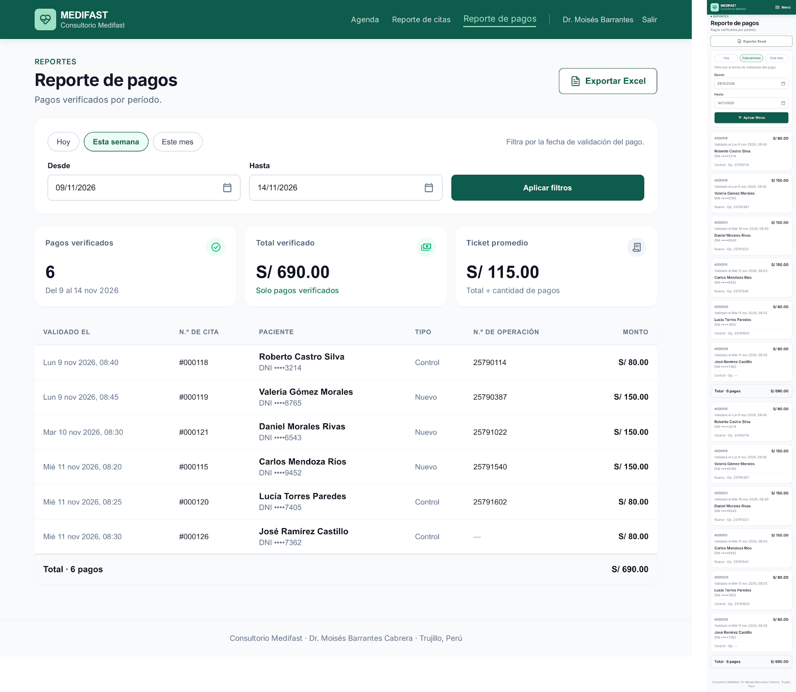
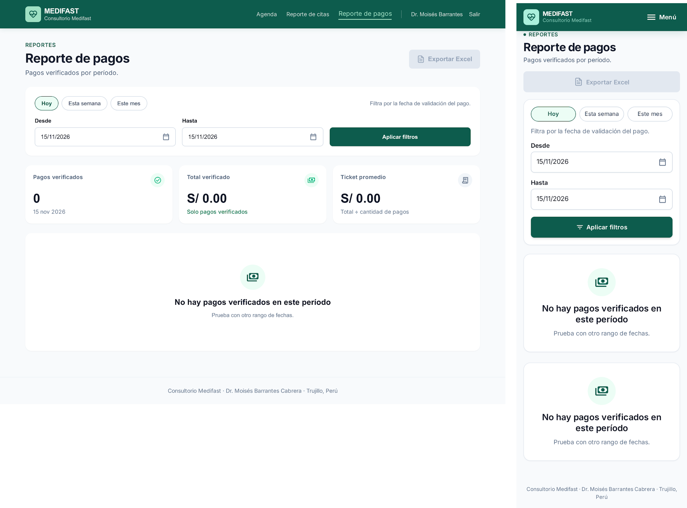
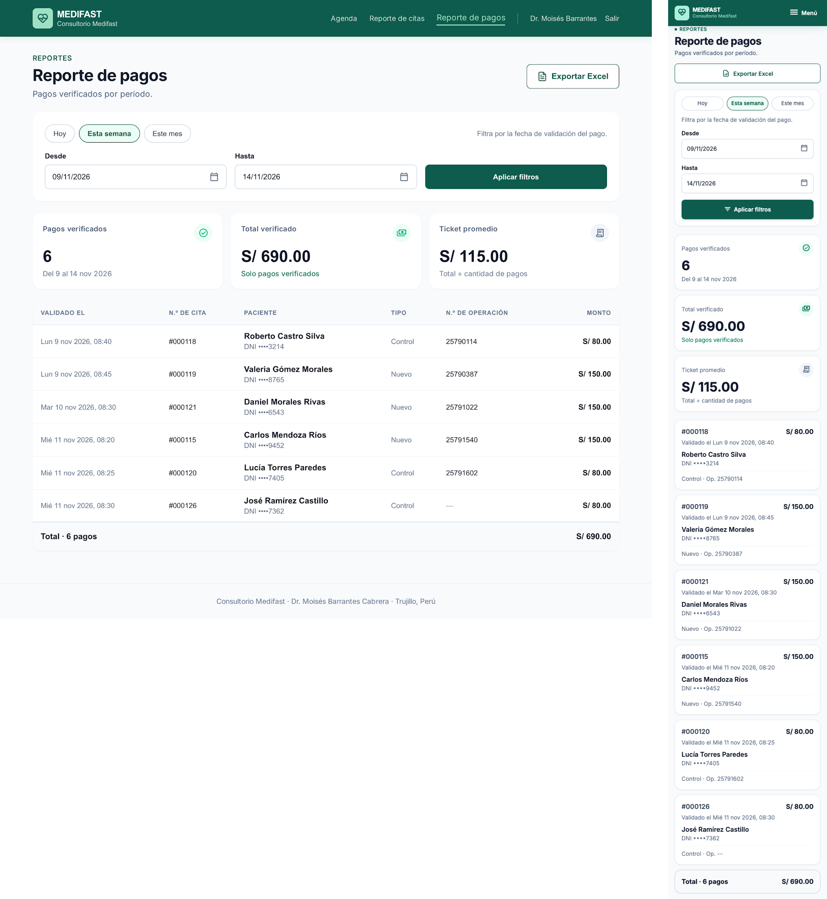
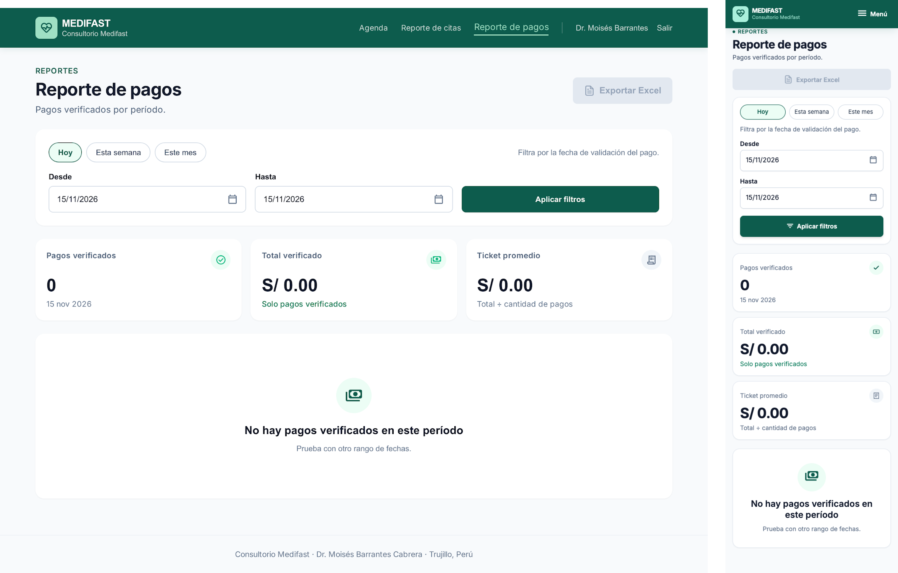

# P10 – Reporte de pagos: iteraciones

- **Requerimientos:** RF09 · RN-03 · RN-05 · RN-11 · RNF07 · RNF14 (Apache POI para el .xlsx)
- **Plantilla:** `templates/medico/reporte-pagos.html`
- **Base:** se genera **duplicando el frame aprobado de [P9 v2](../P9-reporte-citas/v2.png)** en la misma sesión de Stitch, a pedido del usuario: P10 comparte la navbar, los filtros, las cards de indicadores, la tabla y "Exportar Excel"; solo cambia el contenido.
- **Referencia visual:** [referencia-reporte-pagos.png](referencia-reporte-pagos.png). Confirma el layout de P9 (encabezado con "Exportar Excel", filtros, indicadores y tabla). Contiene elementos que no se siguen:
  - "Consultorio Barrantes", el **menú lateral**, el avatar "MB" y la card de ayuda: navbar superior de médico (P7).
  - **Filtro "Estado" y el indicador y la fila "Por validar":** RF09 dice "solo pagos `VALIDADO`". Se quitan el filtro de estado y la columna de estado; todas las filas son pagos verificados.
  - **"Período: Agosto 2026"** como único filtro: rango de fechas con el mes como atajo (RF09, §7.2). Igual que P9.
  - **Buscador** y "+12 % vs. julio": no los pide RF09.
  - **4 indicadores:** RF09 pide 3 (cantidad, total en S/ y ticket promedio).
  - **Falta la fila de total** al final de la tabla (prompt v1).
  - "Método: Yape": siempre es Yape (simulado); la columna se quita.
  - Todos los montos S/ 150.00: Control cuesta S/ 80 (RN-03).
  - "Estado" y "Monto" con los encabezados cruzados (el badge está bajo MONTO).

| Versión | Fecha | Resultado | Estado |
| --- | --- | --- | --- |
| v1 | 2026-10-26 | [v1.1](v1.1.png) · [v1.2](v1.2.png) | Revisada: escritorio aprobado, móvil requiere corrección |
| v2 | 2026-10-26 | [v2.1](v2.1.png) · [v2.2](v2.2.png) | ✅ Aprobada, con 4 ajustes a completar en Figma |

### Decisiones de flujo

Propuestas por Claude el 2026-10-26, pendientes de confirmar:

- **El período filtra por la fecha de validación** (`pago.validado_en`, como la consulta de `03_consultas.sql`), no por la fecha de la cita. La tabla lo muestra en la primera columna.
- **Filtro por defecto:** "Esta semana", igual que P9. Atajos "Hoy", "Esta semana" y "Este mes"; validación de fechas y mensajes iguales a [P9](../P9-reporte-citas/iteraciones.md#mensajes-para-la-implementación).
- **Ticket promedio** = total ÷ cantidad, con 2 decimales. Sin pagos, se muestra "S/ 0.00".
- **N.º de operación opcional** (RN-11): si el paciente no lo ingresó, la celda muestra "—".
- **"Exportar Excel"** descarga las filas, la fila de total y los 3 indicadores; deshabilitado sin resultados. Cada fila abre el detalle de la cita (P8).

### Datos de ejemplo

Los 6 pagos verificados de la semana de [P9](../P9-reporte-citas/iteraciones.md#datos-de-ejemplo), validados antes de cada cita y vistos el miércoles 11 a las ~11:45 (el pago de Andrea sigue "Por validar", así que no aparece):

| Validado el | N.º de cita | Paciente | DNI | Tipo | N.º de operación | Monto |
| --- | --- | --- | --- | --- | --- | --- |
| Lun 9 nov 2026, 08:40 | #000118 | Roberto Castro Silva | ••••3214 | Control | 25790114 | S/ 80.00 |
| Lun 9 nov 2026, 08:45 | #000119 | Valeria Gómez Morales | ••••8765 | Nuevo | 25790387 | S/ 150.00 |
| Mar 10 nov 2026, 08:30 | #000121 | Daniel Morales Rivas | ••••6543 | Nuevo | 25791022 | S/ 150.00 |
| Mié 11 nov 2026, 08:20 | #000115 | Carlos Mendoza Ríos | ••••9452 | Nuevo | 25791540 | S/ 150.00 |
| Mié 11 nov 2026, 08:25 | #000120 | Lucía Torres Paredes | ••••7405 | Control | 25791602 | S/ 80.00 |
| Mié 11 nov 2026, 08:30 | #000126 | José Ramírez Castillo | ••••7362 | Control | — | S/ 80.00 |

Indicadores (calculados de las filas): Pagos verificados **6** · Total verificado **S/ 690.00** · Ticket promedio **S/ 115.00**.

---

## v1

En la sesión de Stitch donde está P9, un prompt por dispositivo. Incluye el estado principal y el de "sin pagos", porque duplicar un frame ya aprobado funcionó en todas las pantallas anteriores. El error de fechas es idéntico al de P9 y se arma en Figma desde [P9 v3.3](../P9-reporte-citas/v3.3.png).

### Prompt 1 — Escritorio

Seleccionar **el frame de escritorio de P9 v2** (estado principal) y pegar:

```text
Duplica este frame 2 veces para crear la pantalla "Reporte de pagos". En las dos copias mantén exactamente la navbar, los estilos de las cards, inputs, botones, tabla y el pie de página; cambia solo lo que se indica.

CAMBIOS COMUNES A LAS DOS COPIAS
1. Navbar: "Reporte de pagos" pasa a activo (texto #9fe0c4 con la barra de 2px) y "Reporte de citas" a inactivo.
2. Encabezado: H1 "Reporte de pagos" y el texto "Pagos verificados por período." El rótulo "REPORTES" y el botón "Exportar Excel" se mantienen.
3. Filtros: elimina el select "Estado". Quedan los atajos ("Hoy", "Esta semana", "Este mes"), "Desde", "Hasta" y "Aplicar filtros", repartidos en la fila. Encima de "Desde", la ayuda 14px gris: "Filtra por la fecha de validación del pago."
4. Indicadores: solo 3 cards iguales a lo ancho (elimina la cuarta), con los mismos estilos:
   - "Pagos verificados", ícono de check sobre #ecfdf5
   - "Total verificado", ícono de billete sobre #ecfdf5
   - "Ticket promedio", ícono de recibo sobre #f1f5f9
5. Tabla: encabezados VALIDADO EL, N.º DE CITA, PACIENTE, TIPO, N.º DE OPERACIÓN y MONTO (alineado a la derecha). Sin columnas de estado ni badges: todas las filas son pagos verificados.

COPIA A — "Reporte de pagos" (estado principal)
6. Atajo "Esta semana" activo; "Desde" = "09/11/2026", "Hasta" = "14/11/2026".
7. Indicadores: "Pagos verificados" · "6" · "Del 9 al 14 nov 2026" (gris); "Total verificado" · "S/ 690.00" · "Solo pagos verificados" (verde #047857); "Ticket promedio" · "S/ 115.00" · "Total ÷ cantidad de pagos" (gris).
8. Seis filas, en este orden (paciente con nombre 16px/600 y "DNI ••••" 14px gris debajo; montos con 2 decimales):
   - "Lun 9 nov 2026, 08:40" · "#000118" · Roberto Castro Silva · DNI ••••3214 · Control · "25790114" · "S/ 80.00"
   - "Lun 9 nov 2026, 08:45" · "#000119" · Valeria Gómez Morales · DNI ••••8765 · Nuevo · "25790387" · "S/ 150.00"
   - "Mar 10 nov 2026, 08:30" · "#000121" · Daniel Morales Rivas · DNI ••••6543 · Nuevo · "25791022" · "S/ 150.00"
   - "Mié 11 nov 2026, 08:20" · "#000115" · Carlos Mendoza Ríos · DNI ••••9452 · Nuevo · "25791540" · "S/ 150.00"
   - "Mié 11 nov 2026, 08:25" · "#000120" · Lucía Torres Paredes · DNI ••••7405 · Control · "25791602" · "S/ 80.00"
   - "Mié 11 nov 2026, 08:30" · "#000126" · José Ramírez Castillo · DNI ••••7362 · Control · "—" (gris #94a3b8) · "S/ 80.00"
9. Fila de total al final de la tabla, con fondo #f8fafc y una línea superior de 1px #cbd5e1: "Total · 6 pagos" (16px/700) a la izquierda y "S/ 690.00" (16px/700) alineado a la derecha bajo MONTO. Quita el pie "10 citas".

COPIA B — "Sin pagos"
10. Atajo "Hoy" activo; "Desde" = "15/11/2026", "Hasta" = "15/11/2026".
11. Indicadores: "0" · "15 nov 2026"; "S/ 0.00" · "Solo pagos verificados"; "S/ 0.00" · "Total ÷ cantidad de pagos".
12. En lugar de la tabla, un estado vacío centrado en la card: ícono de billete en un círculo #ecfdf5, título "No hay pagos verificados en este período" (20px/600) y el texto "Prueba con otro rango de fechas." (14px gris). "Exportar Excel" deshabilitado (fondo #e2e8f0, texto #94a3b8, sin borde).

No incluir: menú lateral, avatar, buscador, filtro o columna de estado, badges "Por validar" o "Rechazado", columna "Método", comparaciones con otros períodos, gráficos, más de 3 indicadores ni fondos lavanda, azulados o morados.
```

**Resultado:** ver abajo.

### Prompt 2 — Móvil

Seleccionar **el frame móvil de P9 v2** y pegar:

```text
Duplica este frame 2 veces para crear "Reporte de pagos" en móvil. Copia los contenidos de las dos copias de escritorio que acabas de crear ("Reporte de pagos" y "Sin pagos") y mantén exactamente la navbar, los estilos de las cards, inputs, botones y el pie de página de este frame. Cambia solo:
1. Encabezado "Reporte de pagos" / "Pagos verificados por período.", con "Exportar Excel" a ancho completo (deshabilitado en "Sin pagos").
2. Filtros apilados sin el select "Estado": atajos, la ayuda "Filtra por la fecha de validación del pago.", "Desde", "Hasta" y "Aplicar filtros".
3. Los 3 indicadores apilados a ancho completo, con los mismos textos que en escritorio.
4. Copia A: una tarjeta por pago (mismo orden y datos): arriba "#000118" a la izquierda y el monto "S/ 80.00" (16px/700) a la derecha; "Validado el Lun 9 nov 2026, 08:40" (14px gris); nombre y "DNI ••••3214"; y una fila "Control · Op. 25790114" (14px gris; "Op. —" para José Ramírez Castillo). Sin badges. Al final, una tarjeta de total con fondo #f8fafc: "Total · 6 pagos" y "S/ 690.00" en 16px/700.
5. Copia B: el mismo estado vacío que en escritorio.
Sin barra de pestañas inferior, avatar, ni fondos lavanda, azulados, morados o cian.
```

**Resultado:** cada captura con su escritorio y su móvil.

| Captura | Estado | Escritorio | Móvil |
| --- | --- | --- | --- |
| [v1.1](v1.1.png) | A. Reporte de pagos | ✅ | ❌ sin indicadores, lista duplicada |
| [v1.2](v1.2.png) | B. Sin pagos | ✅ | ❌ sin indicadores, estado vacío duplicado |





### Feedback

**Lo que funciona (mantener):**

- Duplicar P9 funcionó en escritorio a la primera: misma navbar (con "Reporte de pagos" activo), filtros sin "Estado", 3 indicadores, tabla sin badges ni columna de estado y fila de total "Total · 6 pagos · S/ 690.00".
- Datos exactos: las 6 filas con su fecha de validación, n.º de cita, tipo, n.º de operación ("—" en José) y monto según el tipo; indicadores 6 / S/ 690.00 / S/ 115.00.
- "Sin pagos": "Hoy" activo, indicadores en 0 / S/ 0.00, estado vacío y "Exportar Excel" deshabilitado.
- Nada fuera de alcance: sin buscador, "Por validar", columna "Método" ni comparaciones.

**Lo que hay que corregir:**

| # | Problema | Dónde | Severidad | Veces |
| --- | --- | --- | --- | --- |
| 1 | **Faltan los 3 indicadores** entre los filtros y la lista | Móvil, v1.1 y v1.2 | Alta | 1.ª |
| 2 | **Contenido duplicado:** la lista de 6 pagos con su total aparece dos veces (v1.1) y el estado vacío dos veces (v1.2) | Móvil | Alta | 1.ª |
| 3 | El frame móvil de v1.1 se exportó a baja resolución y con texto muy chico | Móvil, v1.1 | Media | 1.ª |
| 4 | La ayuda "Filtra por la fecha de validación del pago." quedó a la derecha de los atajos, no encima de "Desde" | Escritorio | Baja | 1.ª |

El escritorio se aprueba; solo se corrigen los dos frames móviles.

---

## v2

Un prompt por frame móvil.

### Prompt 1 — Móvil "Reporte de pagos"

Seleccionar solo **el frame móvil de A (v1.1)** y pegar:

```text
Edita solo este frame. No cambies navbar, encabezado, filtros ni estilos.
1. Elimina la segunda lista de pagos repetida: debe quedar UNA sola lista de 6 tarjetas (#000118, #000119, #000121, #000115, #000120, #000126) seguida de UNA tarjeta de total "Total · 6 pagos" · "S/ 690.00".
2. Entre la card de filtros y la lista, agrega 3 cards de indicadores apiladas a ancho completo, copiando el estilo de las del frame de escritorio (rótulo 14px gris, número 32px/800, nota 14px, ícono arriba a la derecha):
   - "Pagos verificados" · "6" · "Del 9 al 14 nov 2026" (gris), ícono de check sobre #ecfdf5
   - "Total verificado" · "S/ 690.00" · "Solo pagos verificados" (verde #047857), ícono de billete sobre #ecfdf5
   - "Ticket promedio" · "S/ 115.00" · "Total ÷ cantidad de pagos" (gris), ícono de recibo sobre #f1f5f9
3. Tamaños legibles a 360px, como en el móvil de "Reporte de citas": n.º y monto 16px/700, nombre 16px/600, fecha y "Control · Op. 25790114" 14px gris.
```

### Prompt 2 — Móvil "Sin pagos"

Seleccionar solo **el frame móvil de B (v1.2)** y pegar:

```text
Edita solo este frame. No cambies navbar, encabezado, filtros ni estilos.
1. Elimina el segundo estado vacío repetido: debe quedar UNA sola card "No hay pagos verificados en este período".
2. Entre la card de filtros y el estado vacío, agrega 3 cards de indicadores apiladas a ancho completo, con el mismo estilo que el frame móvil "Reporte de pagos":
   - "Pagos verificados" · "0" · "15 nov 2026" (gris), ícono de check sobre #ecfdf5
   - "Total verificado" · "S/ 0.00" · "Solo pagos verificados" (verde #047857), ícono de billete sobre #ecfdf5
   - "Ticket promedio" · "S/ 0.00" · "Total ÷ cantidad de pagos" (gris), ícono de recibo sobre #f1f5f9
```

**Resultado:** las dos capturas incluyen el escritorio (sin cambios) y el móvil corregido.

| Captura | Estado | Escritorio | Móvil |
| --- | --- | --- | --- |
| [v2.1](v2.1.png) | A. Reporte de pagos | ✅ | ✅ |
| [v2.2](v2.2.png) | B. Sin pagos | ✅ | ✅ |





**Corregido respecto a v1:** #1 los 3 indicadores apilados en ambos móviles, con los textos e íconos de escritorio; #2 una sola lista de 6 pagos con una sola tarjeta de total, y un solo estado vacío; #3 el móvil de v2.1 en resolución normal con tamaños legibles.

**Pendiente (pasa a Figma):**

| # | Problema | Dónde | Severidad | Veces |
| --- | --- | --- | --- | --- |
| 4 | La ayuda "Filtra por la fecha de validación del pago." a la derecha de los atajos | Escritorio | Baja | 2.ª |
| 5 | Falta el pie de página al final del frame | Móvil | Baja | 1.ª |

### Decisión

Se aprueba v2. Frames base para Figma: [v2.1](v2.1.png) (estado principal) y [v2.2](v2.2.png) (sin pagos), en escritorio y móvil. Ajustes a completar en Figma:

1. **Ayuda del filtro (escritorio):** moverla encima de "Desde", como en móvil. Corrige #4.
2. **Pie de página móvil:** agregar "Consultorio Medifast · Dr. Moisés Barrantes Cabrera · Trujillo, Perú". Corrige #5.
3. **Error de fechas:** armarlo con el componente de filtros de P9 (v3.3 corregido), sin el select de estado.
4. **Componentes:** reutilizar los de P9 (filtros, tarjeta de indicador, tabla, "Exportar Excel"); nuevos: fila de total (escritorio) y tarjeta de total y tarjeta de pago (móvil). Navbar de médico de P7.

**Aprendizaje para las siguientes pantallas:** cuando una pantalla es casi igual a otra aprobada, duplicar el frame aprobado y cambiar solo el contenido resolvió el escritorio a la primera. El móvil, pedido en el mismo prompt "copiando los contenidos de escritorio", salió con secciones faltantes y duplicadas: conviene listar en el prompt móvil cada sección en orden ("filtros → 3 indicadores → lista → total"), como en una corrección.
