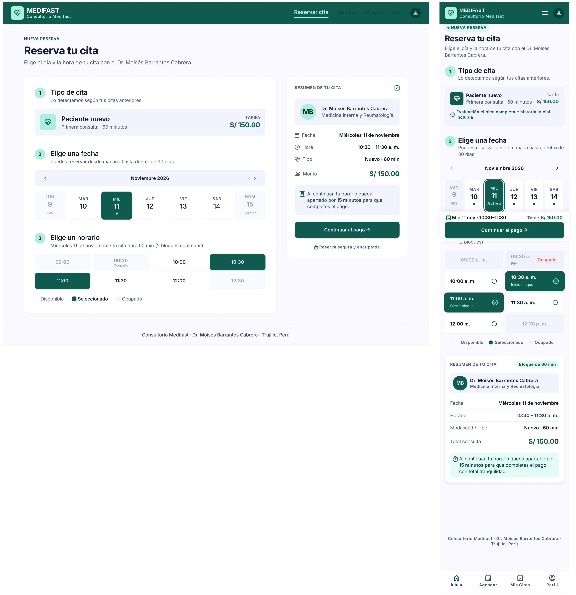
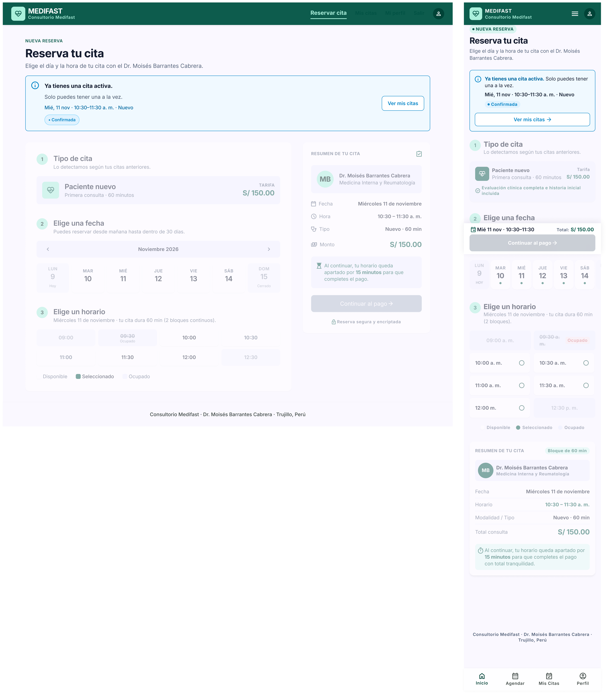
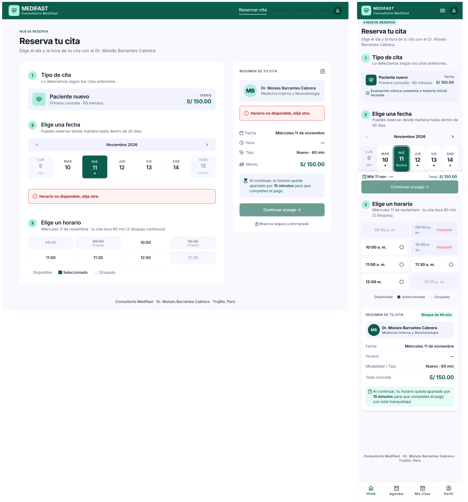
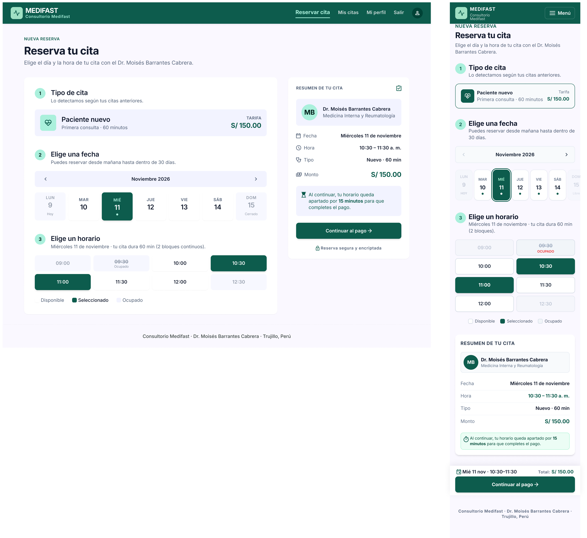
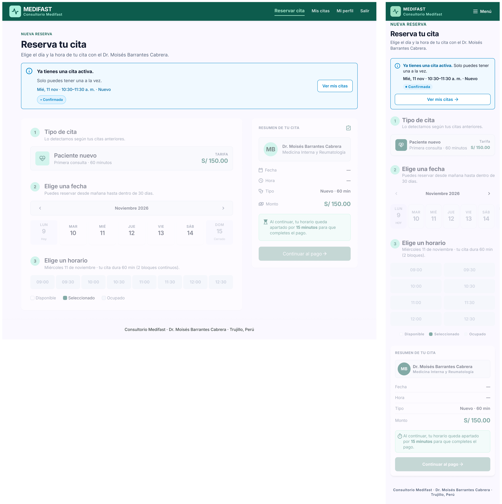
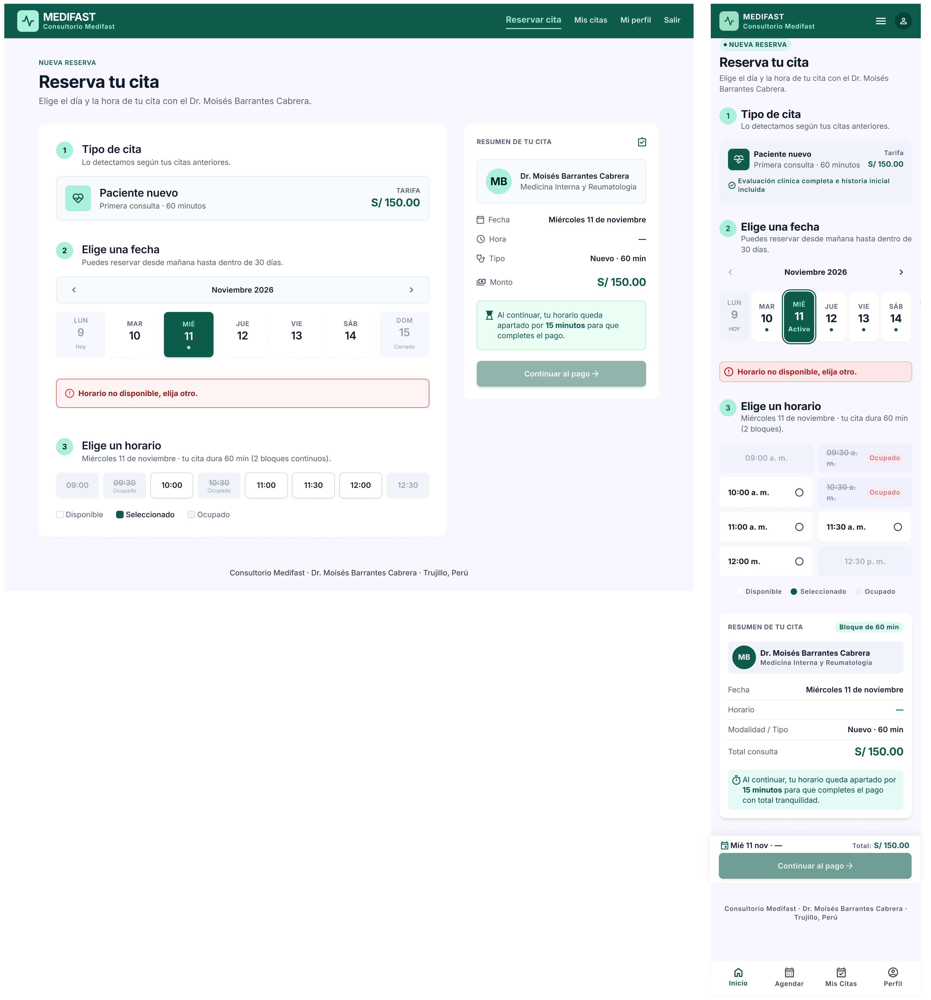
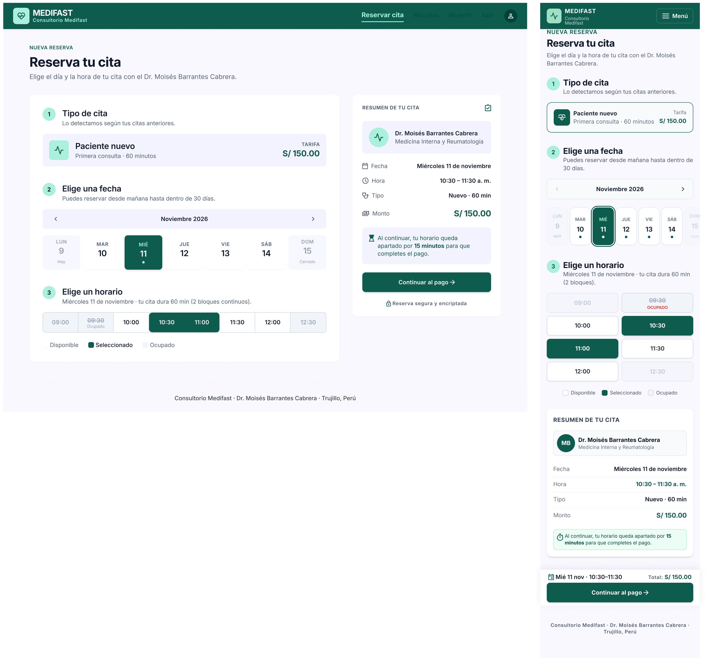
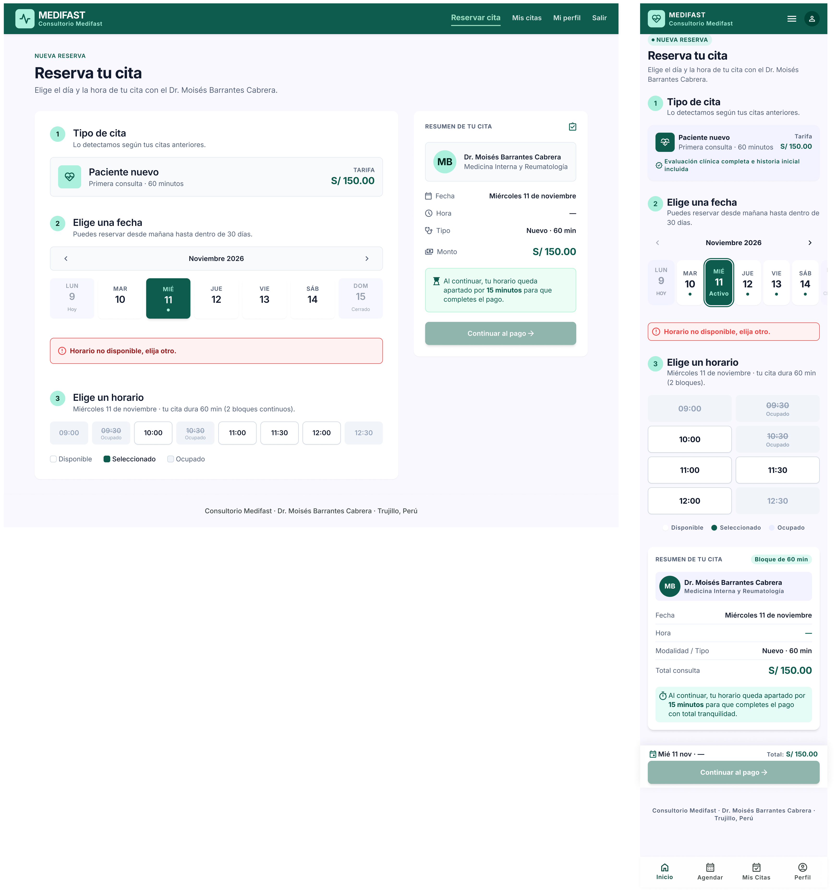
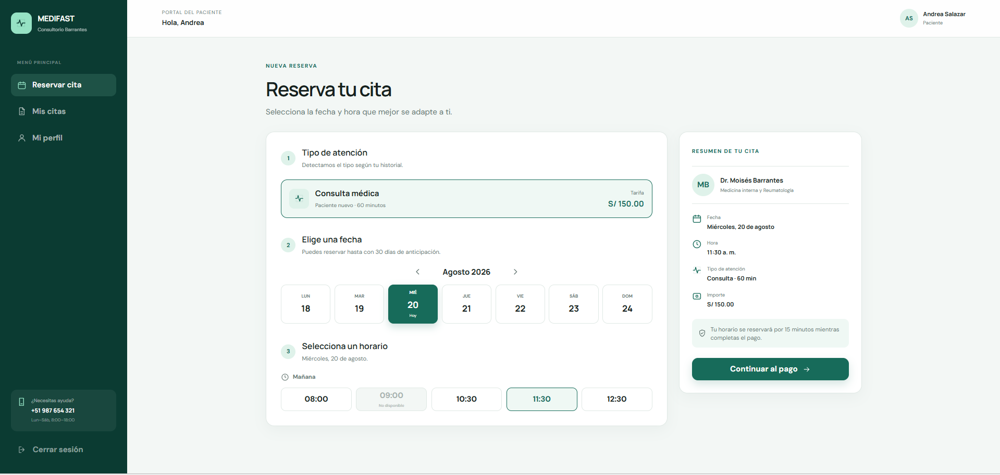

# P2 – Reservar cita: iteraciones

- **Requerimientos:** RF01 · RF05 · RN-02 · RN-03 · RN-04 · RN-06 · RN-08 · RN-09 · RNF02 · RNF09
- **Plantilla:** `templates/paciente/reservar.html`
- **Referencia visual:** [referencia-reservar.png](referencia-reservar.png). Se toman los 3 pasos numerados (tipo de atención → fecha → horario), la tira de días con flechas, los slots como botones grandes y el panel lateral "Resumen de tu cita" con el aviso de los 15 min. Contiene elementos que no se siguen:
  - "Consultorio Barrantes" en el logo (debe ser "Consultorio Medifast").
  - Menú lateral oscuro: el prompt base define una navbar superior (la de [P4 v2](../P4-confirmacion/v2.png)), y "Cerrar sesión" debe decir "Salir".
  - Card "¿Necesitas ayuda?" con un teléfono y horario inventados (08:00–18:00): no está en el README.
  - El día seleccionado es "Hoy": solo se reserva desde mañana hasta +30 días (RN-06).
  - El domingo aparece habilitado: el horario por defecto es de lunes a sábado.
  - Slots 08:00, 11:30 y 12:30 sueltos: deben ser los bloques de la BD, 09:00–13:00 cada 30 min (README §7.2).
  - Para un paciente NUEVO (60 min) se marca un solo slot y el resumen muestra solo "10:30 a. m.": deben marcarse 2 bloques consecutivos y la hora como rango.
  - "Consulta médica" no nombra el tipo detectado (NUEVO / CONTROL, RN-02).
  - Tipografía distinta de Inter.

| Versión | Fecha | Resultado | Estado |
| --- | --- | --- | --- |
| v1 | 2026-10-26 | [v1.1](v1.1.png) · [v1.2](v1.2.png) · [v1.3](v1.3.png) | Revisada, requiere cambios |
| v2 | 2026-10-26 | [v2.1](v2.1.png) · [v2.2](v2.2.png) · [v2.3](v2.3.png) | Revisada: 4 de 6 frames corregidos |
| v3 | 2026-10-26 | [v3.1](v3.1.png) · [v3.3](v3.3.png) | ✅ Aprobada, con 6 ajustes a completar en Figma |

---

## v1

**Prompt:** [prompt base](../00-prompt-base.md) + los dos prompts de abajo, en ese orden (el 1 actualizado también en [P2 v1](../01-prompts-pantallas.md#p2--reservar-cita-paciente)). Adjuntar [P4 v2](../P4-confirmacion/v2.png) como referencia de estilo y [la referencia](referencia-reservar.png) como referencia de layout.

### Prompt 1 — Pantalla principal

```text
P2 – Reservar cita (paciente). Usa la imagen de confirmación adjunta (P4) como referencia de estilo: misma navbar de paciente, logo, badges, botones, cards y tipografía Inter. Usa la otra imagen adjunta solo como referencia de layout (pasos numerados, tira de días, slots grandes y panel de resumen a la derecha).

LAYOUT (escritorio)
1. Navbar superior #0d5c4d copiada de P4: logo MEDIFAST (cuadrado menta con ícono de pulso) y subtítulo "Consultorio Medifast"; a la derecha "Reservar cita" (activo, subrayado), "Mis citas", "Mi perfil", "Salir". Sin menú lateral.
2. Fondo #f8fafc, contenido de ~1200px. Encabezado: rótulo "NUEVA RESERVA" 14px/600 #0d5c4d, H1 "Reserva tu cita" 32px/800 y el texto "Elige el día y la hora de tu cita con el Dr. Moisés Barrantes Cabrera."
3. Dos columnas: card blanca a la izquierda (~65%) con 3 pasos numerados en círculos menta, y card "RESUMEN DE TU CITA" a la derecha (~35%), fija al hacer scroll.

PASO 1 — "Tipo de cita"
4. Subtítulo "Lo detectamos según tus citas anteriores." Card con borde #0d5c4d, ícono de pulso, título "Paciente nuevo", texto "Primera consulta · 60 minutos" y, a la derecha, "Tarifa" / "S/ 150.00". No es seleccionable: solo informa.

PASO 2 — "Elige una fecha"
5. Subtítulo "Puedes reservar desde mañana hasta dentro de 30 días." Encima, "Noviembre 2026" con flechas de semana anterior / siguiente.
6. Tira de 7 días: LUN 9, MAR 10, MIÉ 11, JUE 12, VIE 13, SÁB 14, DOM 15. Hoy es lunes 9: "LUN 9" en gris deshabilitado con la leyenda "Hoy". "DOM 15" en gris deshabilitado (sin atención). "MIÉ 11" seleccionado (relleno #0d5c4d, texto blanco). El resto, disponibles (borde #cbd5e1).

PASO 3 — "Elige un horario"
7. Subtítulo "Miércoles 11 de noviembre · tu cita dura 60 min (2 bloques)."
8. Grilla de 8 slots en 4 columnas y 2 filas, con estas horas exactas: 09:00, 09:30, 10:00, 10:30, 11:00, 11:30, 12:00, 12:30.
   - 09:30 ocupado: fondo gris claro, hora tachada y la leyenda "Ocupado".
   - 09:00 deshabilitado (no hay 2 bloques libres seguidos), mismo estilo gris sin leyenda.
   - 12:30 deshabilitado (la cita terminaría después de las 13:00).
   - 10:30 y 11:00 seleccionados juntos (relleno #0d5c4d, texto blanco), como un solo bloque de 60 min.
   - Los demás, disponibles (borde #cbd5e1, fondo blanco).
9. Debajo de la grilla, leyenda pequeña con 3 muestras: "Disponible", "Seleccionado", "Ocupado".

RESUMEN (columna derecha)
10. Médico: avatar con las iniciales "MB", "Dr. Moisés Barrantes Cabrera" y "Medicina Interna y Reumatología".
11. Filas con ícono: "Fecha" → "Miércoles 11 de noviembre"; "Hora" → "10:30–11:30 a. m."; "Tipo" → "Nuevo · 60 min"; "Monto" → "S/ 150.00".
12. Aviso verde claro con ícono de reloj: "Al continuar, tu horario queda apartado por 15 minutos para que completes el pago."
13. Botón primario a ancho completo "Continuar al pago →" (relleno #0d5c4d, 48px de alto, radio 8px).

MÓVIL (360px)
14. Navbar compacta con el logo y el botón "Menú" (ícono + texto). Encabezado y pasos en una columna, con los mismos textos. La tira de días muestra 7 días con scroll horizontal. Los slots pasan a 2 columnas. El resumen va al final y el botón "Continuar al pago →" queda fijo abajo con la fecha y hora seleccionadas encima ("Mié 11 nov · 10:30–11:30").
15. Pie de página: "Consultorio Medifast · Dr. Moisés Barrantes Cabrera · Trujillo, Perú".

No incluir: menú lateral, card de ayuda con teléfono, horarios fuera de 09:00–13:00, selección del día de hoy, selector de médico o especialidad, selector manual de tipo de cita, citas virtuales, opción de reprogramar, ni campos de síntomas o motivo de consulta.
```

### Prompt 2 — Variantes (pegar después, sin seleccionar frames)

```text
Crea 2 pantallas nuevas a partir del frame de escritorio de P2, copiando exactamente su navbar, encabezado y estilos. Luego, sus versiones móviles (360px) copiando el frame móvil de P2.

A. "Ya tienes una cita activa"
1. Debajo del encabezado, alerta informativa (fondo azul tenue, borde 1px #0284c7, ícono de información): "**Ya tienes una cita activa.** Solo puedes tener una a la vez." Dentro de la alerta: "Mié, 11 nov · 10:30–11:30 a. m. · Nuevo", el badge "Confirmada" y el botón secundario "Ver mis citas".
2. Los 3 pasos y el resumen se ven deshabilitados (opacidad 50%, sin selección) y el botón "Continuar al pago →" en verde desaturado deshabilitado.

B. "Horario no disponible"
3. Igual que la pantalla principal, pero con una alerta de error encima del paso 3 (fondo rojo tenue, borde 1px #ef4444, ícono de alerta): "**Horario no disponible, elija otro.**" (texto literal de RF01) El slot 10:30 pasa a "Ocupado" y no hay ningún slot seleccionado. El resumen muestra "—" en Hora y el botón deshabilitado.

No cambies nada más del layout.
```

**Resultado:** 3 capturas, cada una con un frame de escritorio y uno móvil: [v1.1](v1.1.png) pantalla principal, [v1.2](v1.2.png) "Ya tienes una cita activa" y [v1.3](v1.3.png) "Horario no disponible".





### Feedback

**Lo que funciona (mantener):**

- Navbar superior en lugar del menú lateral, sin la card de ayuda, con "Consultorio Medifast" y tipografía Inter.
- La lógica de los slots es correcta en los 2 dispositivos: 09:00 deshabilitado, 09:30 ocupado, 12:30 deshabilitado y 10:30 + 11:00 seleccionados juntos.
- "Hoy" y el domingo deshabilitados; el resumen muestra la hora como rango "10:30 – 11:30 a. m." y el aviso de los 15 min.
- Las 2 variantes se generaron en pantallas aparte. En v1.2 la alerta informativa tiene el texto, los datos, el badge "Confirmada" y "Ver mis citas"; el formulario se ve deshabilitado.
- En v1.3 (escritorio), "10:30" pasa a "Ocupado", no hay selección y la hora del resumen es "—".

**Lo que hay que corregir — Escritorio:**

| # | Problema | Dónde | Severidad | Veces |
| --- | --- | --- | --- | --- |
| 1 | Los enlaces "Mis citas", "Mi perfil" y "Salir" son verde oscuro sobre la navbar verde: casi invisibles | Los 3 frames | Alta | 1.ª |
| 2 | Ícono de avatar a la derecha de la navbar, que P4 no tiene | Los 3 frames | Media | 1.ª |
| 3 | Logo con ícono de corazón; el aprobado en P4 v2 es el pulso | Los 3 frames | Media | 1.ª |
| 4 | Fondos lavanda (card del tipo, cabecera del mes, card del médico, aviso de 15 min, slots deshabilitados): no están en la paleta | Los 3 frames | Media | 1.ª |
| 5 | El bloque seleccionado queda partido: 10:30 al final de la fila 1 y 11:00 al inicio de la fila 2 | v1.1 | Media | 1.ª |
| 6 | Texto inventado "Reserva segura y encriptada" con candado bajo el botón | Los 3 frames | Media | 1.ª |
| 7 | En la variante de cita activa, el resumen sigue mostrando fecha y hora aunque no hay selección | v1.2 | Media | 1.ª |
| 8 | La alerta "Horario no disponible, elija otro." aparece dos veces (encima del paso 3 y en el resumen) | v1.3 | Media | 1.ª |
| 9 | Botón deshabilitado gris en v1.2 y verde desaturado en v1.3; debe ser verde desaturado en ambos | v1.2 | Baja | 1.ª |
| 10 | Leyenda: la muestra de "Disponible" no se ve y la de "Ocupado" es lavanda | Los 3 frames | Baja | 1.ª |

**Lo que hay que corregir — Móvil:**

| # | Problema | Dónde | Severidad | Veces |
| --- | --- | --- | --- | --- |
| 11 | Barra de pestañas inferior inventada ("Inicio", "Agendar", "Mis Citas", "Perfil"), que choca con el menú de la navbar | Los 3 frames | Alta | 1.ª |
| 12 | "Evaluación clínica completa e historia inicial incluida": información clínica fuera de alcance | Los 3 frames | Alta | 1.ª |
| 13 | Falta la alerta "Horario no disponible, elija otro." | v1.3 | Alta | 1.ª |
| 14 | Navbar con ícono hamburguesa sin el texto "Menú" y con el ícono de avatar; logo de corazón | Los 3 frames | Media | 1.ª |
| 15 | Slots con formato "09:30 a. m." y "12:00 m.", radios, "Inicio bloque" / "Cierre bloque" y "09:30 a. m." tachado partido en dos líneas; en escritorio es "09:30" | Los 3 frames | Media | 1.ª |
| 16 | "Activo" bajo el día seleccionado: se confunde con "cita activa" | v1.1, v1.3 | Media | 1.ª |
| 17 | Etiquetas del resumen distintas de escritorio: "Horario", "Modalidad / Tipo" (sugiere citas virtuales) y "Total consulta"; además el badge "Bloque de 60 min" | Los 3 frames | Media | 1.ª |
| 18 | La barra fija "Continuar al pago" sigue visible en la variante de cita activa, con fecha, hora y total | v1.2 | Media | 1.ª |
| 19 | Fondos lavanda, igual que en escritorio (#4) | Los 3 frames | Media | 1.ª |
| 20 | El aviso agrega "con total tranquilidad"; "NUEVA RESERVA" va en píldora y en escritorio es texto | Los 3 frames | Baja | 1.ª |

**Nota:** la barra fija de móvil aparece a media altura del frame porque Stitch la dibuja al alto de la pantalla del teléfono. Es el comportamiento esperado (`position: fixed`); en Figma se mostrará al pie del frame.

**Aprendizaje:** Stitch inventa elementos de "confianza" y de app nativa (candado con "Reserva segura", barra de pestañas inferior, avatar) y tiñe de lavanda los fondos suaves. Se agregan al prompt base como exclusiones.

---

## v2

Dos prompts, uno por dispositivo. Primero el de escritorio; cuando esté bien, el de móvil, que copia el estilo del escritorio corregido.

### Prompt 1 — Escritorio

En Stitch, seleccionar solo **los 3 frames de escritorio** (principal, cita activa y horario no disponible) y pegar:

```text
Edita solo estos 3 frames de escritorio. No cambies nada más del layout ni de los textos que no se mencionan.

En los 3 frames:
1. Navbar: "Reservar cita" (activo) en verde menta #9fe0c4 con subrayado; "Mis citas", "Mi perfil" y "Salir" en blanco con opacidad del 85%. Quita el ícono de avatar de la derecha.
2. Logo: cambia el ícono de corazón por el ícono de pulso cardíaco (línea de electrocardiograma) del frame de confirmación P4, dentro del mismo cuadrado menta.
3. Quita todos los fondos lavanda. Card "Paciente nuevo", cabecera "Noviembre 2026" y card del médico: fondo #f8fafc con borde 1px #e2e8f0. Aviso de los 15 minutos: fondo #ecfdf5 con borde 1px #a7f3d0. Slots deshabilitados y ocupados: fondo #f1f5f9 y texto #94a3b8.
4. Quita el texto "Reserva segura y encriptada" y su candado.
5. Grilla de horarios en UNA sola fila de 8 slots: 09:00, 09:30, 10:00, 10:30, 11:00, 11:30, 12:00, 12:30, con los mismos estados de cada frame.
6. Leyenda: muestra "Disponible" = cuadrado blanco con borde 1px #cbd5e1; "Seleccionado" = cuadrado #0d5c4d; "Ocupado" = cuadrado #f1f5f9 con borde 1px #cbd5e1.

Solo en el frame principal:
7. 10:30 y 11:00 seleccionados quedan uno al lado del otro y se ven como un solo bloque: relleno #0d5c4d, sin separación entre ellos y con radio solo en los extremos externos.

Solo en el frame "Ya tienes una cita activa":
8. En el resumen, Fecha y Hora muestran "—". El botón "Continuar al pago →" deshabilitado en verde desaturado #8fb5ac con texto blanco, igual que en el frame "Horario no disponible".

Solo en el frame "Horario no disponible":
9. Quita la alerta roja del resumen. Deja solo la que está encima del paso 3.
```

**Resultado:** ver abajo, junto con el del prompt 2.

### Prompt 2 — Móvil

Cuando el escritorio quede bien, seleccionar solo **los 3 frames móviles** y pegar:

```text
Edita solo estos 3 frames móviles (360px). Copia exactamente los estilos de los frames de escritorio corregidos: navbar, logo, colores de fondo, slots, leyenda y resumen. No cambies nada más del layout.

En los 3 frames:
1. Quita la barra de pestañas inferior ("Inicio", "Agendar", "Mis Citas", "Perfil"). La navegación es solo la de la navbar.
2. Navbar: logo con el ícono de pulso cardíaco (como en escritorio) y, a la derecha, solo el botón "Menú" (ícono de 3 líneas + texto "Menú" en blanco). Quita el ícono de avatar.
3. "NUEVA RESERVA": texto 14px/600 #0d5c4d sin píldora, igual que en escritorio.
4. Card "Paciente nuevo": quita la línea "Evaluación clínica completa e historia inicial incluida" y su ícono. Solo quedan "Paciente nuevo", "Primera consulta · 60 minutos", "Tarifa" y "S/ 150.00".
5. Tira de días: quita la palabra "Activo" bajo el día seleccionado.
6. Slots en 2 columnas con el mismo formato que escritorio: solo la hora "09:00", "09:30"…"12:30", centrada, sin "a. m.", sin radios y sin "Inicio bloque" / "Cierre bloque". Ocupado: hora tachada con la leyenda "Ocupado" debajo, en la misma celda.
7. Quita todos los fondos lavanda: mismos colores que escritorio (#f8fafc, #ecfdf5, #f1f5f9).
8. Resumen: quita el badge "Bloque de 60 min". Filas con las etiquetas de escritorio: "Fecha", "Hora", "Tipo", "Monto". El aviso termina en "…para que completes el pago." (sin "con total tranquilidad").

Solo en el frame "Ya tienes una cita activa":
9. Quita la barra fija inferior de "Continuar al pago". En el resumen, Fecha y Hora muestran "—".

Solo en el frame "Horario no disponible":
10. Agrega encima del paso 3 la alerta de error del escritorio: fondo rojo tenue, borde 1px #ef4444, ícono de alerta y el texto en negrita "Horario no disponible, elija otro."
```

**Resultado:** 3 capturas (se renombraron de `2.x.png` a `v2.x.png`; el usuario regeneró luego v2.1 y v2.3, y esta revisión corresponde a esas versiones): [v2.1](v2.1.png) principal, [v2.2](v2.2.png) cita activa y [v2.3](v2.3.png) horario no disponible.





### Feedback

Stitch aplicó cada prompt solo a algunos frames:

| Frame | Escritorio | Móvil |
| --- | --- | --- |
| Principal (v2.1) | ❌ Sin cambios: igual que v1.1 | ✅ Corregido, con detalles menores; la barra fija ya queda al pie del frame |
| Cita activa (v2.2) | ✅ Corregido | ✅ Corregido |
| Horario no disponible (v2.3) | ✅ Corregido | ⚠️ Solo se agregó la alerta de error (#13); el resto sigue igual que v1.3 |

**Corregido respecto a v1:**

- Escritorio (v2.2 y v2.3): #1 enlaces de la navbar visibles, #2 sin avatar, #3 logo de pulso, #4 sin fondos lavanda, #5 slots en una fila, #6 sin "Reserva segura", #7 resumen con "—" (v2.2), #8 una sola alerta (v2.3), #9 botón deshabilitado verde desaturado, #10 leyenda con bordes.
- Móvil (v2.1 y v2.2): #11 sin barra de pestañas, #12 sin la línea clínica, #14 botón "Menú" sin avatar, #15 slots "09:00" sin radios, #16 sin "Activo", #17 etiquetas Fecha / Hora / Tipo / Monto, #13 alerta de error (v2.3), #18 sin barra fija en cita activa (v2.2), #19 sin lavanda en las cards, #20 sin "con total tranquilidad" ni píldora.
- **v2.2 queda como referencia** de los dos dispositivos: es el frame mejor resuelto.

**Pendiente:**

| # | Problema | Dónde | Severidad | Veces |
| --- | --- | --- | --- | --- |
| 1–6, 10 | El frame principal de escritorio no recibió ningún cambio: enlaces invisibles, avatar, corazón, lavanda, slots en 2 filas, "Reserva segura" | Escritorio, v2.1 | Alta | 2.ª |
| 11, 12, 14–20 | El frame móvil "Horario no disponible" solo recibió la alerta: siguen la barra de pestañas, la línea clínica, el logo de corazón y el avatar, "Activo", "a. m." con radios, las etiquetas "Horario" / "Modalidad / Tipo", el badge "Bloque de 60 min", la píldora y "con total tranquilidad" | Móvil, v2.3 | Alta | 2.ª |
| 21 | El domingo dice "Libre" en lugar de "Cerrado" | Móvil, v2.1 | Media | 1.ª |
| 22 | El subtítulo "Consultorio Medifast" del logo se parte en dos líneas y el botón "Menú" tiene borde (en v2.2 no) | Móvil, v2.1 | Baja | 1.ª |
| 23 | "NUEVA RESERVA" pegado a la navbar, sin margen superior | Móvil, v2.1 y v2.2 | Baja | 1.ª |
| 24 | En 2 columnas, el bloque 10:30 + 11:00 queda en filas distintas | Móvil, v2.1 | Baja | 1.ª |
| 25 | "OCUPADO" en mayúsculas y rojo; en escritorio es "Ocupado" en gris | Móvil, v2.1 | Baja | 1.ª |

**Aprendizaje:** aunque se pidan "los 3 frames", Stitch edita solo uno o dos. Para los frames que quedan atrás funciona mejor seleccionar **un solo frame** y pedirle que copie a otro frame ya corregido ("copia exactamente el frame X").

---

### Revisión de las v2 regeneradas (3.ª captura)

El usuario regeneró de nuevo las 3 capturas `v2.x`. Cambios respecto a la revisión anterior:

| Frame | Escritorio | Móvil |
| --- | --- | --- |
| Principal (v2.1) | ⚠️ Mejoró: enlaces de la navbar visibles (#1) y logo de pulso en la navbar (#3) | ✅ Sin cambios |
| Cita activa (v2.2) | ✅ Sin cambios | ✅ Sin cambios |
| Horario no disponible (v2.3) | ✅ Sin cambios | ❌ Sin cambios: solo tiene la alerta |

**Pendiente:**

| # | Problema | Dónde | Severidad | Veces |
| --- | --- | --- | --- | --- |
| 2 | Ícono de avatar en la navbar | Escritorio, v2.1 | Media | 3.ª |
| 3b | Ícono de corazón en la card "Paciente nuevo" (en v2.2 y v2.3 escritorio también; el logo ya es de pulso) | Escritorio, todos | Baja | 1.ª |
| 4 | Fondos lavanda en la card "Paciente nuevo", la cabecera del mes, la card del médico y el aviso de 15 min | Escritorio, v2.1 | Media | 3.ª |
| 5 | Slots en 2 filas, con el bloque 10:30 + 11:00 partido | Escritorio, v2.1 | Media | 3.ª |
| 6 | "Reserva segura y encriptada" con candado | Escritorio, v2.1 | Media | 3.ª |
| 11, 12, 14–20 | Barra de pestañas, línea clínica, logo de corazón y avatar, "Activo", "a. m." con radios, etiquetas "Horario" / "Modalidad / Tipo" / "Total consulta", badge "Bloque de 60 min", píldora, "con total tranquilidad" | Móvil, v2.3 | Alta | 3.ª |
| 21–25 | Detalles menores del móvil principal (ver tabla anterior) | Móvil, v2.1 | Baja | 2.ª |

**Decisión de proceso:** los pendientes llegan a su 3.ª iteración, el límite del flujo. Se hace **un último intento** en Stitch con prompts muy cortos de un solo frame, que en lugar de describir cada cambio piden **duplicar el frame ya corregido** y cambiar solo el estado. Si no funciona, se aprueba P2 y estos frames se completan en Figma a partir de v2.2 (escritorio y móvil) y v2.3 escritorio.

---

## v3

### Prompt 1 — Escritorio principal

En Stitch, seleccionar solo **el frame de escritorio "Horario no disponible"** (que ya está bien) y pegar:

```text
Duplica este frame y en la copia haz solo estos cambios, sin tocar nada más (navbar, colores, cards y estilos quedan exactamente iguales):
1. Quita la alerta roja "Horario no disponible, elija otro.".
2. Slots: 09:00 deshabilitado, 09:30 ocupado, 10:00 disponible, 10:30 y 11:00 seleccionados juntos como un solo bloque (relleno #0d5c4d, texto blanco, sin separación entre ellos), 11:30 y 12:00 disponibles, 12:30 deshabilitado.
3. Resumen: "Hora" → "10:30 – 11:30 a. m." y el botón "Continuar al pago →" activo (relleno #0d5c4d, texto blanco).
4. En la card "Paciente nuevo", cambia el ícono de corazón por el ícono de pulso cardíaco del logo.
```

Después, borrar el frame principal de escritorio anterior (el que tiene avatar y fondos lavanda).

### Prompt 2 — Móvil "Horario no disponible"

Seleccionar solo **el frame móvil principal** (el que tiene 10:30 y 11:00 seleccionados y el botón "Menú") y pegar:

```text
Duplica este frame y en la copia haz solo estos cambios, sin tocar nada más (navbar, colores, cards y estilos quedan exactamente iguales):
1. Encima del paso 3, agrega una alerta de error: fondo #fef2f2, borde 1px #ef4444, radio 8px, ícono de alerta y el texto en negrita "Horario no disponible, elija otro.".
2. Slots: 09:00 deshabilitado, 09:30 y 10:30 ocupados (hora tachada y "Ocupado" debajo en gris #94a3b8), 10:00, 11:00, 11:30 y 12:00 disponibles, 12:30 deshabilitado. Ninguno seleccionado.
3. Resumen: "Hora" → "—".
4. Barra fija inferior: "Mié 11 nov · —" y el botón "Continuar al pago →" deshabilitado en verde desaturado #8fb5ac.
5. Domingo 15: leyenda "Cerrado" en lugar de "Libre".
```

Después, borrar el frame móvil "Horario no disponible" anterior (el que tiene la barra de pestañas).

**Resultado:** [v3.1](v3.1.png) (escritorio principal) y [v3.3](v3.3.png) (móvil horario no disponible). Cada captura incluye también el frame del otro dispositivo, sin cambios.




### Feedback

**Corregido respecto a v2:**

- Escritorio principal: #5 slots en una sola fila con 10:30 + 11:00 unidos como un solo bloque; #3b ícono de pulso en la card "Paciente nuevo".
- Móvil horario no disponible: #15 slots "09:00"…"12:30" sin "a. m." ni radios, con "Ocupado" en gris; etiqueta "Hora"; alerta de error encima del paso 3; barra fija con "Mié 11 nov · —" y el botón deshabilitado.

**Pendiente (pasa a Figma):**

| # | Problema | Dónde | Severidad | Veces |
| --- | --- | --- | --- | --- |
| 4 | Fondos lavanda (card "Paciente nuevo", cabecera del mes, card del médico, aviso de 15 min) | Escritorio, v3.1 | Media | 4.ª |
| 6 | "Reserva segura y encriptada" con candado | Escritorio, v3.1 | Media | 4.ª |
| 26 | El avatar "MB" del médico pasó a ser un ícono de pulso | Escritorio, v3.1 | Baja | 1.ª |
| 11 | Barra de pestañas inferior | Móvil, v3.3 | Alta | 4.ª |
| 12 | "Evaluación clínica completa e historia inicial incluida" | Móvil, v3.3 | Alta | 4.ª |
| 16, 17, 20 | "Activo" bajo el día, "Modalidad / Tipo", "Total consulta", badge "Bloque de 60 min", píldora "NUEVA RESERVA" y "con total tranquilidad" | Móvil, v3.3 | Media | 4.ª |
| 21–25 | "Libre" en el domingo, "OCUPADO" en rojo, subtítulo del logo en 2 líneas, sin margen bajo la navbar | Móvil, v3.1 | Baja | 3.ª |

**Aceptado por el usuario:** el logo (corazón o pulso según el frame) y los colores de los enlaces de la navbar superior se consideran tolerables. Se unifican sin costo al usar el componente de navbar de P4 en Figma.

### Decisiones de flujo

- **Variante "Ya tienes una cita activa" con pago pendiente** (decidido en [P3](../P3-pago/iteraciones.md#decisiones-de-flujo), 2026-10-26): el botón "Volver" de P3 regresa a P2 sin liberar el horario. En ese caso la alerta muestra el badge "Pago pendiente" (ámbar) en lugar de "Confirmada", el mini contador del tiempo restante y el botón primario "Continuar pago →" (lleva a P3) en lugar de "Ver mis citas". Se arma en Figma duplicando el frame v2.2 (escritorio y móvil).

### Decisión

Se aprueba P2 con v3 y no se itera más en Stitch: los pendientes llevan 3–4 iteraciones y son eliminaciones o cambios de texto. Frames base para Figma:

| Estado | Escritorio | Móvil |
| --- | --- | --- |
| Principal | [v3.1](v3.1.png) | [v3.1](v3.1.png) |
| Ya tienes una cita activa | [v2.2](v2.2.png) | [v2.2](v2.2.png) |
| Horario no disponible | [v3.3](v3.3.png) | [v3.3](v3.3.png), con los ajustes de abajo |

Ajustes en Figma:

1. **Navbar:** usar el componente de navbar de paciente de P4 (logo de pulso, enlaces en blanco, sin avatar) en escritorio, y la variante móvil con el botón "Menú" en los 6 frames.
2. **Componente "Slot horario":** crearlo a partir de v3.1 escritorio, con las variantes Disponible, Seleccionado (inicio / fin de bloque, unidos), Ocupado (hora tachada + "Ocupado" en #94a3b8) y Deshabilitado. En móvil (2 columnas) se acepta que el bloque 10:30 + 11:00 quede en filas distintas.
3. **Escritorio principal (v3.1):** copiar los fondos de v3.3 escritorio (#f8fafc con borde #e2e8f0 en las cards y #ecfdf5 con borde #a7f3d0 en el aviso), quitar "Reserva segura y encriptada" y restaurar el avatar "MB" del médico. Corrige #4, #6 y #26.
4. **Móvil horario no disponible (v3.3):** partir del móvil de v3.1 y aplicar el estado: alerta de error encima del paso 3, slots 09:30 y 10:30 ocupados, "Hora" → "—" y la barra fija deshabilitada. Así se eliminan la barra de pestañas, la línea clínica, "Activo", la píldora, el badge "Bloque de 60 min" y las etiquetas "Modalidad / Tipo" y "Total consulta". Corrige #11, #12, #16, #17 y #20.
5. **Móvil principal (v3.1):** domingo con "Cerrado" en lugar de "Libre", "Ocupado" en gris como en escritorio, el subtítulo "Consultorio Medifast" en una línea y 16px de margen bajo la navbar. Corrige #21–#25.
6. **Barra fija móvil:** ubicarla al pie del frame (es `position: fixed`).

**Aprendizaje para las siguientes pantallas:**

- Pedir que Stitch **duplique un frame ya corregido** y cambie solo el estado funcionó mejor que describir cada corrección: resolvió los slots y la alerta, que llevaban 2–3 iteraciones.
- Aun así, Stitch no elimina elementos que él mismo inventó (barra de pestañas, línea clínica) en frames que no se duplicaron desde cero. Conviene generar las variantes desde el principio duplicando el frame principal ya aprobado, no en paralelo.

## Ajuste de implementación posterior a v3

El usuario solicitó que P2 adopte la composición del prototipo publicado en [Figma Make](https://media-rhythm-49689685.figma.site/): menú lateral verde oscuro, encabezado "PORTAL DEL PACIENTE / Hola, [nombre]" y perfil autenticado en la esquina superior derecha. Este cambio posterior prevalece sobre la navbar superior aprobada en v3 para la implementación de P2.



El nombre e iniciales se obtienen del paciente autenticado, no de datos de demostración. Se conserva el resumen de la cita y su monto/duración desde la tarifa configurada por tipo; CONTROL aparece como 30 min / S/ 80 solo cuando aplica RN-02/RN-03. No se incorpora la tarjeta de ayuda con teléfono y horario del prototipo porque esos datos no están definidos por el proyecto.
