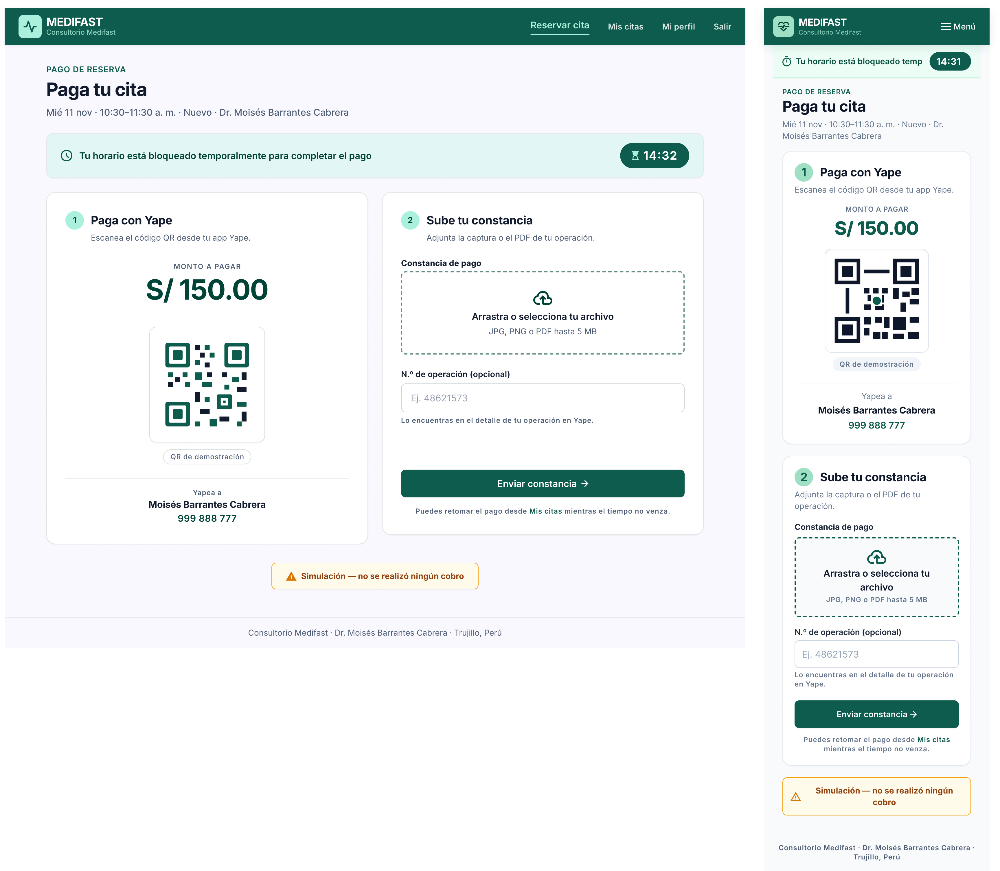
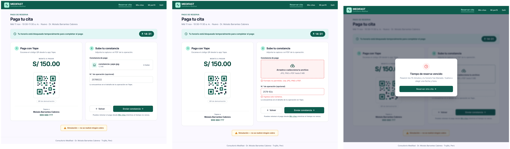
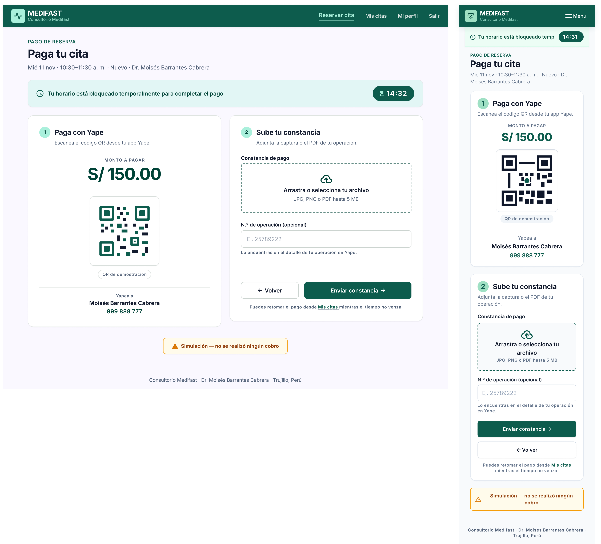
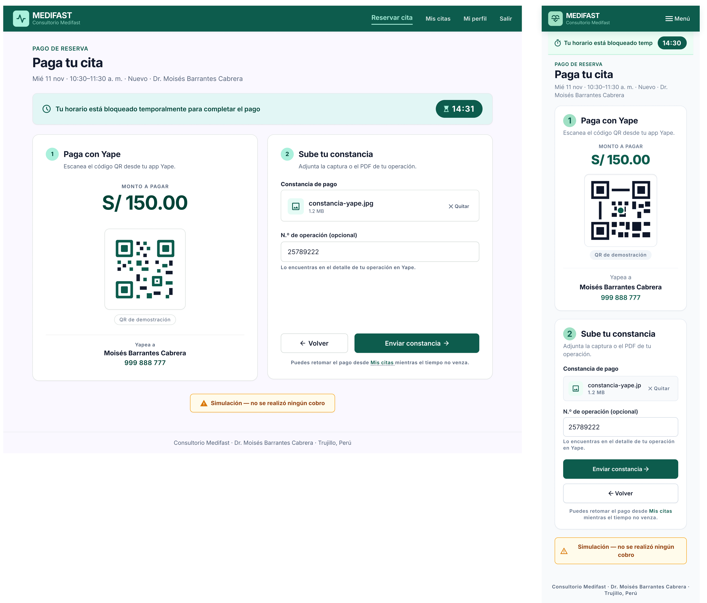
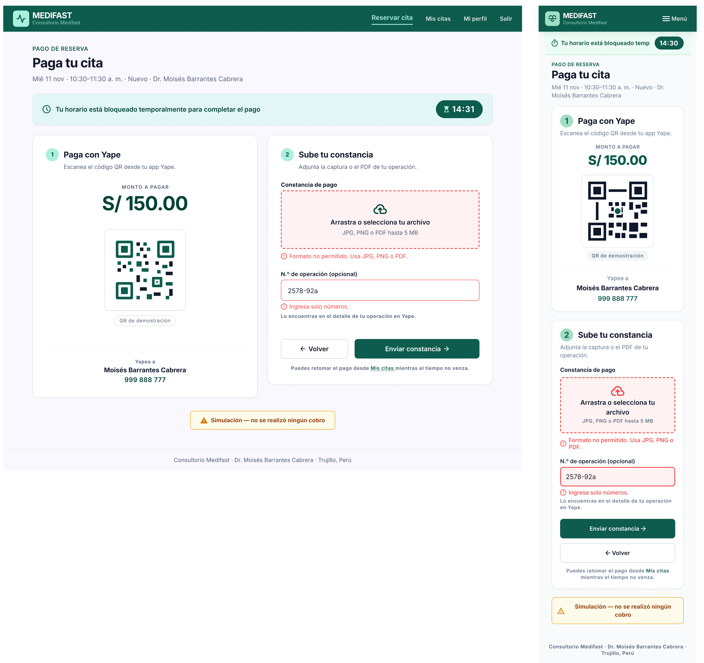
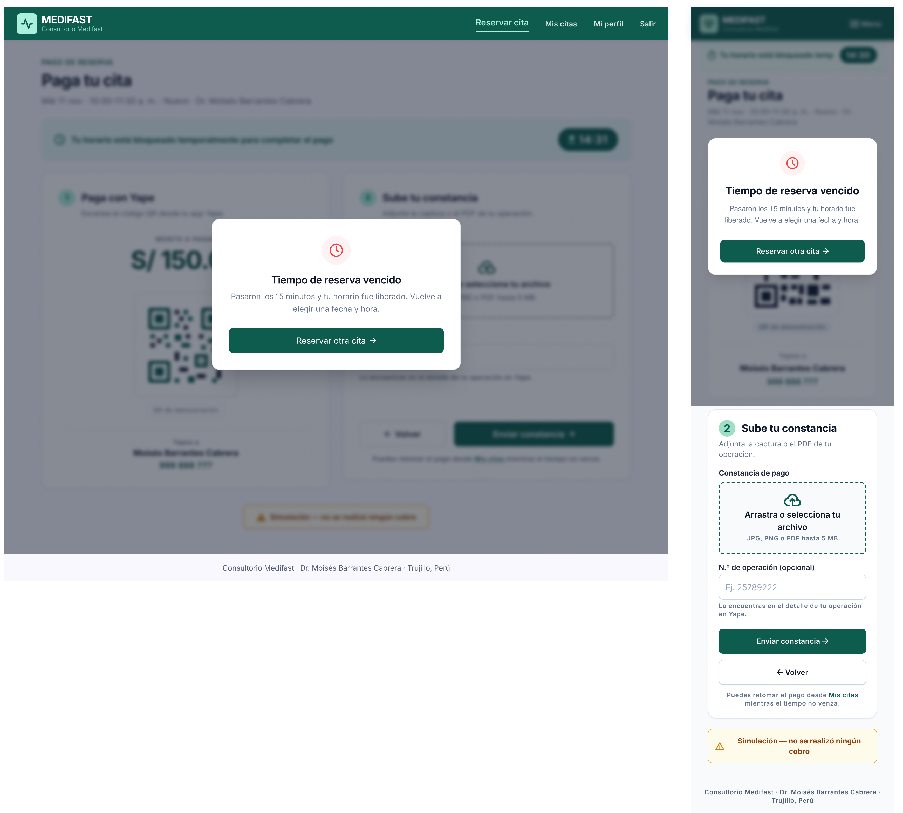

# P3 – Pago Yape (simulado): iteraciones

- **Requerimientos:** RF03 · RF16 · RN-03 · RN-04 · RN-11 · RNF06 · RNF09
- **Plantilla:** `templates/paciente/pago.html`
- **Referencia visual:** [referencia-pago.png](referencia-pago.png). Se toman las dos cards (izquierda: monto, QR y destinatario; derecha: subida de la constancia y n.º de operación), el contador arriba del monto y la nota de simulación al pie. Contiene elementos que no se siguen:
  - "Consultorio Barrantes" en el logo, el menú lateral oscuro, la card "¿Necesitas ayuda?" con un teléfono inventado y la cabecera "Hola, Andrea" con avatar: se usa la navbar superior de paciente de [P4](../P4-confirmacion/v2.png) (README de diseño y prompt base).
  - El contador es una píldora ámbar; el sistema de diseño define una píldora oscura dentro de un aviso verde claro con el texto "Tu horario está bloqueado temporalmente para completar el pago".
  - La subida dice "JPG o PNG": RN-11 acepta también PDF.
  - "Número de operación" no indica que es opcional (RF03).
  - El botón es "Confirmar pago ✓": el prompt v1 y el flujo piden "Enviar constancia →" (el pago no se confirma aquí; queda "Por validar").
  - La leyenda dice "Esta es una simulación académica. No se procesa dinero real."; RF03 exige el texto literal "Simulación — no se realizó ningún cobro".
  - Botón "Volver": ver la decisión de flujo pendiente.
  - Un solo paso numerado ("1"): se numeran los dos (pagar y subir).
  - Título "Confirma tu cita": se cambia por "Paga tu cita", porque la confirmación es P4.
  - Tipografía distinta de Inter.

| Versión | Fecha | Resultado | Estado |
| --- | --- | --- | --- |
| v1 | 2026-10-26 | [v1.png](v1.png) | ✅ Estado principal aprobado, con 4 ajustes en Figma |
| v2 | 2026-10-26 | [v2.1](v2.1.png) | ✅ Botón "Volver" aprobado |
| v3 | 2026-10-26 | [v2.2](v2.2.png) (estados de escritorio) | ✅ Escritorio aprobado; faltan los estados móviles |
| v4 | 2026-10-27 | [v3.1](v3.1.png) · [v3.2](v3.2.png) · [v3.3](v3.3.png) · [v3.4](v3.4.png) | ✅ Aprobada, con 7 ajustes a completar en Figma |

### Decisiones de flujo

Confirmadas con el usuario el 2026-10-26:

- **Botón "Volver" sin liberar el horario:** vuelve a P2 sin cancelar la reserva (RN-09 y RN-13 se mantienen: el paciente no cancela ni reprograma). Como la cita sigue `PENDIENTE_PAGO`, P2 muestra la variante "Ya tienes una cita activa" con el badge "Pago pendiente" y el botón "Continuar pago" (ajuste agregado a [P2](../P2-reservar/iteraciones.md#decisiones-de-flujo)). Para cambiar la fecha u hora hay que esperar a que venzan los 15 min. Se mantiene también la nota "Puedes retomar el pago desde Mis citas mientras el tiempo no venza."
- **Al enviar la constancia:** se redirige a P4 con el titular "Cita reservada" y la alerta de éxito (ya diseñado).
- **Si vence el contador en pantalla:** modal bloqueante (sin botón de cerrar) "Tiempo de reserva vencido" con el texto "Pasaron los 15 minutos y tu horario fue liberado. Vuelve a elegir una fecha y hora." y el botón "Reservar otra cita →", que lleva a P2. Usa la observación literal de RF16. Si el plazo vence al enviar (contador desfasado), el servidor devuelve a P3 con el mismo modal.
- **N.º de operación:** opcional, solo dígitos. Ejemplo real de Yape: "25789222" (8 dígitos). No se fija una longitud, porque el README no la define.

### Mensajes de validación (para la implementación)

| Campo | Regla | Mensaje |
| --- | --- | --- |
| Constancia | Obligatoria | "Adjunta la constancia de pago." |
| Constancia | Tipo real JPG, PNG o PDF (RNF06) | "Formato no permitido. Usa JPG, PNG o PDF." |
| Constancia | Hasta 5 MB | "El archivo supera los 5 MB." |
| N.º de operación | Opcional; si se ingresa, solo dígitos | "Ingresa solo números." |
| (envío) | Plazo vencido al enviar | Modal "Tiempo de reserva vencido" (no es un mensaje en línea) |

La regla de "solo dígitos" del n.º de operación la confirmó el usuario; falta agregarla a RF03 en el README.

---

## v1

Según la lección de P2, primero se genera y corrige **solo el estado principal**. Los demás estados se piden después, duplicando el frame principal ya aprobado.

**Prompt:** [prompt base](../00-prompt-base.md) + el prompt 1, con [P2 v3.1](../P2-reservar/v3.1.png) adjunta como referencia de estilo y [la referencia](referencia-pago.png) como referencia de layout.

### Prompt 1 — Estado principal

```text
P3 – Pago Yape (simulado), paciente. Usa la imagen de "Reserva tu cita" adjunta (P2) como referencia de estilo: misma navbar de paciente, logo, cards, inputs, botones, alertas y tipografía Inter. Usa la otra imagen solo como referencia de layout (dos cards: QR a la izquierda, constancia a la derecha).

LAYOUT (escritorio)
1. Navbar superior #0d5c4d igual que P2: logo MEDIFAST con ícono de pulso y "Consultorio Medifast"; a la derecha "Reservar cita" (activo), "Mis citas", "Mi perfil", "Salir" en blanco. Sin menú lateral, sin avatar, sin saludo "Hola, Andrea".
2. Fondo #f8fafc, contenido de ~1200px. Encabezado: rótulo "PAGO DE RESERVA" 14px/600 #0d5c4d, H1 "Paga tu cita" 32px/800 y el texto "Mié 11 nov · 10:30–11:30 a. m. · Nuevo · Dr. Moisés Barrantes Cabrera".
3. Debajo, a ancho completo, aviso verde claro (#ecfdf5, borde 1px #a7f3d0) con ícono de reloj, el texto "Tu horario está bloqueado temporalmente para completar el pago" y, a la derecha, una píldora oscura #0d5c4d con el contador "14:32" en blanco (mm:ss, 20px/700).
4. Dos cards blancas del mismo alto (radio 16px, sombra suave), con pasos numerados en círculos menta como en P2.

CARD IZQUIERDA — paso 1 "Paga con Yape"
5. Subtítulo "Escanea el código QR desde tu app Yape."
6. Monto grande centrado "S/ 150.00" (40px/800 #0d5c4d) con la etiqueta "Monto a pagar" encima.
7. QR de ejemplo de 200px dentro de un recuadro blanco con borde 1px #e2e8f0, y debajo la píldora gris "QR de demostración".
8. Debajo: "Yapea a" / "Moisés Barrantes Cabrera" (16px/600) / "999 888 777" (número de ejemplo).

CARD DERECHA — paso 2 "Sube tu constancia"
9. Subtítulo "Adjunta la captura o el PDF de tu operación."
10. Zona de subida con borde punteado #0d5c4d, fondo #f8fafc, radio 8px: ícono de subida, "Arrastra o selecciona tu archivo" (16px/600) y "JPG, PNG o PDF hasta 5 MB" (14px gris). Etiqueta arriba: "Constancia de pago" en negrita.
11. Input "N.º de operación (opcional)" con placeholder "Ej. 48621573" y la ayuda "Lo encuentras en el detalle de tu operación en Yape."
12. Botón primario a ancho completo "Enviar constancia →" (relleno #0d5c4d, 48px, radio 8px).
13. Debajo, la nota "Puedes retomar el pago desde Mis citas mientras el tiempo no venza." con "Mis citas" como enlace #0d5c4d.

LEYENDA DE SIMULACIÓN
14. Debajo de las dos cards, centrada, una alerta de advertencia tenue (fondo #fffbeb, borde 1px #f59e0b, ícono de alerta) con el texto exacto en negrita: "Simulación — no se realizó ningún cobro".
15. Pie de página: "Consultorio Medifast · Dr. Moisés Barrantes Cabrera · Trujillo, Perú".

MÓVIL (360px)
16. Navbar con el logo y el botón "Menú" (ícono + texto), sin avatar ni barra de pestañas inferior. Encabezado con los mismos textos. El aviso con el contador queda fijo arriba, bajo la navbar. Las dos cards se apilan en una columna (primero Yape, luego la constancia), con los mismos textos. La leyenda de simulación va antes del pie de página.

No incluir: botón "Volver", botón "Confirmar pago", otros medios de pago (Plin, tarjeta, transferencia), campos bancarios o de tarjeta, número de celular del paciente, card de ayuda con teléfono, avatar, barra de pestañas inferior, textos de seguridad inventados ("pago seguro", candados) ni fondos lavanda.
```

**Resultado:** un frame de escritorio y uno móvil del estado principal.



### Feedback

**Lo que funciona (mantener):**

- Navbar de paciente sin menú lateral, sin avatar y sin card de ayuda; "Consultorio Medifast".
- Encabezado con "PAGO DE RESERVA", "Paga tu cita" y la línea de la cita.
- Aviso verde con el texto del sistema de diseño y la píldora oscura con el contador "14:32"; en móvil queda fijo bajo la navbar.
- Dos pasos numerados: monto grande, QR con "QR de demostración", "Yapea a" con el nombre y el número de ejemplo.
- Zona de subida con "JPG, PNG o PDF hasta 5 MB", "N.º de operación (opcional)" con su ayuda, "Enviar constancia →" y la nota con el enlace "Mis citas". Sin "Volver" ni "Confirmar pago".
- Leyenda literal "Simulación — no se realizó ningún cobro" en alerta de advertencia.
- Escritorio y móvil coherentes: mismos textos y orden.

**Lo que hay que corregir:**

| # | Problema | Dónde | Severidad | Veces |
| --- | --- | --- | --- | --- |
| 1 | El texto del aviso se corta ("Tu horario está bloqueado temp") | Móvil | Media | 1.ª |
| 2 | Las dos cards no tienen el mismo alto y queda un hueco entre la ayuda del n.º de operación y el botón | Escritorio | Baja | 1.ª |
| 3 | La zona de subida tiene fondo blanco (se pidió #f8fafc) y el aviso un verde azulado sin borde | Ambas | Baja | 1.ª |
| 4 | "Arrastra o selecciona tu archivo" se parte en 2 líneas; en móvil no se arrastra | Móvil | Baja | 1.ª |
| 5 | Logo con ícono de corazón | Móvil | Baja (tolerado, ver P2) | — |

### Decisión

Se aprueba el **estado principal** con v1: solo quedan ajustes mecánicos. Ajustes en Figma:

1. **Aviso móvil:** texto en 2 líneas o la versión corta "Horario bloqueado para tu pago" junto a la píldora. Corrige #1.
2. **Cards de escritorio:** igualar el alto y anclar el botón "Enviar constancia →" al pie de la card. Corrige #2.
3. **Componente "Zona de subida":** fondo #f8fafc, borde punteado #0d5c4d; en móvil el texto "Selecciona tu archivo". Aviso con #ecfdf5 y borde 1px #a7f3d0, como en P2. Corrige #3 y #4.
4. **Navbar:** componente de P4/P2. Corrige #5.

El botón "Volver" se agrega en v2 (decisión de flujo posterior). Los estados (archivo adjunto, errores de validación y tiempo vencido) se generan en v3 duplicando los frames de v2.

---

## v2

Primero un prompt de **corrección** del estado principal (agregar "Volver" y el nuevo ejemplo del n.º de operación) y, cuando quede bien, un prompt de **estados** que duplica esos frames. Cada prompt se pega dos veces: con el frame de escritorio seleccionado y luego con el móvil.

### Prompt 1 — Corrección del principal

```text
Edita solo este frame. No cambies nada más del layout.
1. En la card "Sube tu constancia", reemplaza el botón a ancho completo por una fila de dos botones con 16px de separación: a la izquierda el secundario "← Volver" (fondo blanco, borde 1px #cbd5e1, texto #0f172a, ~35% del ancho) y a la derecha el primario "Enviar constancia →" (relleno #0d5c4d, texto blanco, ~65%). Ambos de 48px de alto y radio 8px. En móvil (360px), apilados: primero "Enviar constancia →" y debajo "← Volver", los dos a ancho completo.
2. Placeholder del input "N.º de operación (opcional)": "Ej. 25789222".
3. Mantén debajo la nota "Puedes retomar el pago desde Mis citas mientras el tiempo no venza.".
```

**Resultado:** [v2.1.png](v2.1.png), con escritorio y móvil.


**Corregido:** "← Volver" (secundario, ~35%) junto a "Enviar constancia →" en escritorio, y apilados debajo del primario en móvil; placeholder "Ej. 25789222"; se mantiene la nota de "Mis citas". Sin cambios no pedidos. Siguen los ajustes de Figma #1–#5 de v1 (aviso móvil cortado, alto de las cards, fondos, texto de la zona de subida y logo).

**Decisión:** se aprueba la corrección. Los frames de v2.1 son la base para duplicar los estados en v3.

### Prompt 2 — Estados

Cuando el principal esté bien, seleccionar el frame de escritorio y pegar; luego repetir con el móvil.

```text
Duplica este frame 3 veces y en cada copia cambia solo lo que se indica. No toques navbar, colores, cards, botones ni estilos.

A. "Archivo adjunto": la zona de subida muestra una fila con ícono de imagen, "constancia-yape.jpg", "1.2 MB" y un botón de ícono "Quitar" (x). El input "N.º de operación (opcional)" con el valor "25789222". Contador "09:47".

B. "Errores de validación": la zona de subida con borde rojo #ef4444 y debajo el mensaje rojo 14px con ícono de alerta "Formato no permitido. Usa JPG, PNG o PDF.". El input "N.º de operación (opcional)" con el valor "2578-92a", borde rojo #ef4444 y debajo "Ingresa solo números.". Contador "06:15".

C. "Tiempo vencido": contador "00:00". Encima de toda la pantalla, una capa oscura (#0f172a al 50%) y un modal blanco centrado de 480px (radio 16px, sombra suave, sin botón de cerrar): ícono de reloj en un círculo rojo tenue (#fef2f2, ícono #ef4444), título "Tiempo de reserva vencido" (20px/600), texto "Pasaron los 15 minutos y tu horario fue liberado. Vuelve a elegir una fecha y hora." y el botón primario a ancho completo "Reservar otra cita →". En móvil, el modal ocupa el ancho con 16px de margen.
```

**Resultado:** el usuario guardó los 3 estados de escritorio en una sola captura, [v2.2.png](v2.2.png) (archivo adjunto, errores y tiempo vencido). Stitch no generó las versiones móviles.



### Feedback

**Lo que funciona (mantener):**

- **Archivo adjunto:** fila con ícono de imagen, "constancia-yape.jpg", "1.2 MB" y "× Quitar"; n.º de operación "25789222".
- **Errores:** zona de subida con borde punteado rojo y fondo rojo tenue, "Formato no permitido. Usa JPG, PNG o PDF."; input "2578-92a" con borde rojo y "Ingresa solo números."; la ayuda se mantiene debajo.
- **Tiempo vencido:** capa oscura con desenfoque, modal sin botón de cerrar, ícono de reloj en círculo rojo tenue, título, texto literal y "Reservar otra cita →".
- Los 3 frames conservan navbar, cards, "← Volver" y la leyenda de simulación de [v2.1](v2.1.png).

**Pendiente:**

| # | Problema | Dónde | Severidad | Veces |
| --- | --- | --- | --- | --- |
| 6 | Faltan los 3 estados en móvil | Móvil | Alta | 1.ª |
| 7 | El contador muestra "14:31" en los 3 estados (se pidió "09:47", "06:15" y "00:00") | Escritorio | Baja | 1.ª |
| 8 | En el estado con errores, el hueco sobre los botones desplaza la card y queda más alta que la de Yape | Escritorio | Baja | 1.ª |

Los 3 estados de escritorio se aprueban. #7 y #8 pasan a Figma.

---

## v4

### Prompt — Estados móviles

En Stitch, seleccionar solo **el frame móvil de [v2.1](v2.1.png)** (el que tiene "Enviar constancia →" y "← Volver" apilados) y pegar:

```text
Duplica este frame móvil 3 veces y en cada copia cambia solo lo que se indica. No toques navbar, aviso con contador, cards, botones ni estilos. Copia el contenido de cada estado de los frames de escritorio equivalentes.

A. "Archivo adjunto": la zona de subida se reemplaza por una fila con ícono de imagen, "constancia-yape.jpg", "1.2 MB" y "× Quitar" a la derecha. El input "N.º de operación (opcional)" con el valor "25789222". Contador "09:47".

B. "Errores de validación": la zona de subida con borde punteado rojo #ef4444 y fondo #fef2f2, y debajo el mensaje rojo 14px con ícono de alerta "Formato no permitido. Usa JPG, PNG o PDF.". El input con el valor "2578-92a", borde rojo #ef4444 y debajo "Ingresa solo números.". Contador "06:15".

C. "Tiempo vencido": contador "00:00". Capa oscura (#0f172a al 50%) sobre toda la pantalla y el mismo modal del escritorio, a ancho completo con 16px de margen y centrado vertical: ícono de reloj en círculo #fef2f2, "Tiempo de reserva vencido", "Pasaron los 15 minutos y tu horario fue liberado. Vuelve a elegir una fecha y hora." y el botón a ancho completo "Reservar otra cita →". Sin botón de cerrar.
```

Si Stitch genera solo uno o dos, repetir el prompt con solo la letra del estado que falte.

**Resultado:** el usuario guardó el set completo, cada estado con su frame de escritorio y su móvil:

| Captura | Estado |
| --- | --- |
| [v3.1](v3.1.png) | Principal (igual que [v2.1](v2.1.png)) |
| [v3.2](v3.2.png) | Archivo adjunto |
| [v3.3](v3.3.png) | Errores de validación |
| [v3.4](v3.4.png) | Tiempo vencido |






### Feedback

**Corregido respecto a v3:** #6, los 3 estados móviles. Copian el contenido del escritorio: fila del archivo con "× Quitar" y "25789222"; zona de subida roja con "Formato no permitido. Usa JPG, PNG o PDF." e input "2578-92a" con "Ingresa solo números."; modal "Tiempo de reserva vencido" con "Reservar otra cita →" y sin botón de cerrar.

**Pendiente (pasa a Figma):**

| # | Problema | Dónde | Severidad | Veces |
| --- | --- | --- | --- | --- |
| 7 | El contador no cambia entre estados ("14:30"/"14:31"; se pidió 09:47, 06:15 y 00:00) | Ambas | Baja | 2.ª |
| 9 | La capa oscura del modal cubre solo la primera pantalla; el resto del frame queda sin oscurecer | Móvil, v3.4 | Baja | 1.ª |
| 10 | El nombre del archivo se corta ("constancia-yape.jp") sin puntos suspensivos | Móvil, v3.2 | Baja | 1.ª |
| 11 | El ícono de subida es rojo en el error móvil y verde en el de escritorio | Móvil, v3.3 | Baja | 1.ª |

### Decisión

Se aprueba P3 con v4 (capturas `v3.x`). En Figma, además de los 4 ajustes del estado principal (sección "Decisión" de v1):

5. **Contador:** "09:47" en archivo adjunto, "06:15" en errores y "00:00" en tiempo vencido, en escritorio y móvil. Corrige #7.
6. **Modal de tiempo vencido:** crear el componente "Modal bloqueante" (capa #0f172a al 50% sobre todo el frame + card de 480px, o ancho completo con 16px de margen en móvil) a partir de v3.4 escritorio. Se reutiliza en P8 ("Motivo de cancelación" / "Motivo del rechazo"). Corrige #9.
7. **Componente "Zona de subida":** variantes Vacía, Con archivo (nombre truncado con "…" y "× Quitar") y Error (borde punteado #ef4444, fondo #fef2f2, ícono #0d5c4d, mensaje debajo). Corrige #10 y #11; se reutiliza en P8 para mostrar la constancia.

**Aprendizaje para las siguientes pantallas:**

- Aprobar primero el estado principal y después pedir los estados con "duplica este frame y cambia solo…" resolvió P3 en 4 iteraciones cortas, sin que Stitch reintrodujera elementos fuera de alcance (a diferencia de P2).
- Stitch tiende a generar los estados solo para el dispositivo del frame seleccionado: hay que pedirlos una vez desde el frame de escritorio y otra desde el móvil.
- Stitch no cambia los valores de un componente repetido entre duplicados (el contador): esos valores se ajustan en Figma.
