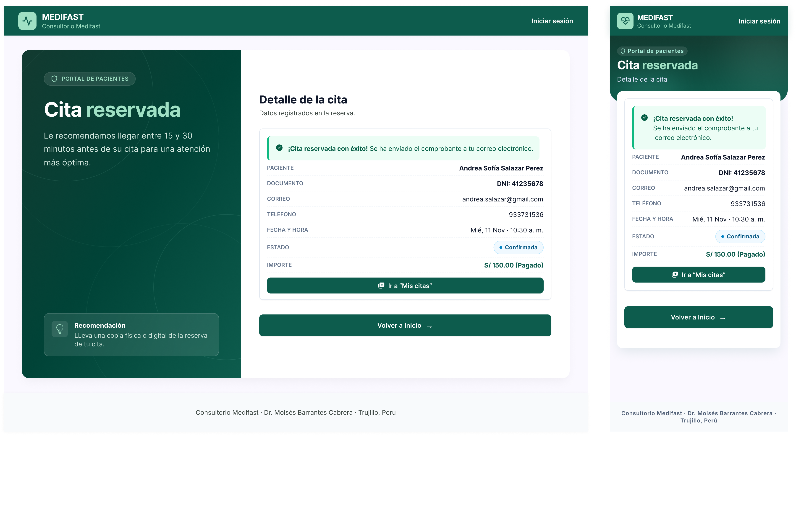
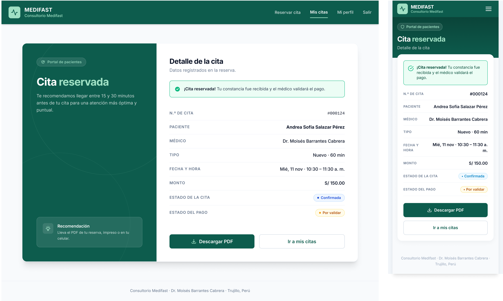

# P4 – Confirmación: iteraciones

- **Requerimientos:** RF15 · RF03 (estado tras adjuntar la constancia) · RN-05 · RNF02 · RNF07
- **Plantilla:** `templates/paciente/confirmacion.html`
- **Flujo (README §7.1):** P3 → P4 → P5, y P5 → "Ver detalle / PDF" → P4. La misma pantalla sirve de confirmación y de detalle de la cita para el paciente.

| Versión | Fecha | Resultado | Estado |
| --- | --- | --- | --- |
| v1 | 2026-10-25 | [v1.png](v1.png) | Revisada, requiere cambios |
| v2 | 2026-10-26 | [v2.png](v2.png) | ✅ Aprobada, con 5 ajustes a completar en Figma |

---

## v1

**Prompt:** generado por el usuario directamente en Stitch (no se registró el texto). Toma el layout de card dividida de [P1 v2](../P1-registro/v2.png).

**Resultado:** 2 frames: escritorio y móvil.



### Feedback

**Lo que funciona (mantener):**

- La card dividida de P1: panel verde con el titular "Cita reservada" ("reservada" en menta) y la card blanca a la derecha. En móvil, la cabecera verde con la card encima.
- La alerta de éxito con ícono de check y el texto en negrita al inicio.
- La lista de datos en filas etiqueta/valor (etiqueta gris en mayúsculas, valor a la derecha), muy legible en 360 px.
- El badge "Confirmada" (azul info, con punto): es la etiqueta correcta de `PROGRAMADA` (§5.2).
- El recuadro translúcido "Recomendación" al pie del panel, como el de P1.
- El pie de página.

**Lo que hay que corregir:**

| # | Problema | Dónde | Severidad | Veces |
| --- | --- | --- | --- | --- |
| 1 | La alerta dice "Se ha enviado el comprobante a tu correo electrónico": no hay envío por correo (§3.2 y §7.2, diferencia explícita de P4) | Ambas | Alta | 1.ª |
| 2 | "S/ 150.00 (Pagado)": tras adjuntar la constancia el pago queda `POR_VALIDAR`; debe mostrarse el badge ámbar "Por validar" (RF03, §5.2) | Ambas | Alta | 1.ª |
| 3 | Faltan datos de RF15: n.º de cita, médico y tipo (NUEVO / CONTROL con su duración) | Ambas | Alta | 1.ª |
| 4 | Falta el botón "Descargar PDF" (RF15) | Ambas | Alta | 1.ª |
| 5 | Navbar pública con "Iniciar sesión": el paciente ya tiene sesión; va la navbar de paciente ("Reservar cita", "Mis citas", "Mi perfil", "Salir"; "Menú" en móvil) | Ambas | Alta | 1.ª |
| 6 | Botones: "Ir a 'Mis citas'" como primario y "Volver a Inicio →" (no existe una página de inicio). Lo planificado es "Descargar PDF" primario e "Ir a mis citas" secundario | Ambas | Media | 1.ª |
| 7 | Se muestran documento, correo y teléfono del paciente: no los pide RF15 y RNF07 pide datos mínimos. Basta con el nombre del paciente | Ambas | Media | 1.ª |
| 8 | Logo distinto: pulso en escritorio, corazón con pulso en móvil. Debe ser el de P0 (pulso) | Móvil | Media | 1.ª |
| 9 | "ESTADO" es ambiguo: separar "Estado de la cita" (Confirmada) y "Estado del pago" (Por validar) | Ambas | Media | 1.ª |
| 10 | Errata "LLeva" y mezcla de usted ("Le recomendamos… su cita") con tú ("tu correo", "tu cita"). Usar tú, como en P0 y P1 | Escritorio | Baja | 1.ª |
| 11 | Píldora "PORTAL DE PACIENTES" en mayúsculas en escritorio y en tipo oración en móvil; la de P0/P1 va en tipo oración | Escritorio | Baja | 1.ª |
| 12 | Card anidada (card con borde dentro de la card blanca) y cabecera móvil con bordes irregulares detrás de la card | Ambas | Baja | 1.ª |

### Decisiones de flujo

Pendiente de confirmar con el usuario:

- **P4 como detalle desde P5:** el README enlaza "Ver detalle / PDF" de P5 a P4. Propuesta: al llegar desde P3 se muestran el titular "Cita reservada" y la alerta de éxito; al llegar desde P5, el titular "Detalle de la cita", sin alerta, y los badges del estado real (Pago pendiente, Atendida, Cancelada con su motivo, etc.). Se pediría como variante en un prompt aparte, después de v2.

---

## v2

**Prompt 1:** en Stitch, seleccionar solo el frame de **escritorio** y pegar:

```text
Edita solo esta pantalla de escritorio. Mantén el layout de card dividida, el panel verde, la tipografía Inter y el estilo de las filas etiqueta/valor. No cambies nada más del layout.

NAVBAR
1. Reemplaza la navbar pública por la navbar de paciente: logo MEDIFAST (cuadrado menta con ícono de pulso, el mismo de ahora) con el subtítulo "Consultorio Medifast"; a la derecha los enlaces "Reservar cita", "Mis citas" (activo, subrayado menta), "Mi perfil" y "Salir". Quita "Iniciar sesión".

PANEL VERDE (izquierda)
2. Píldora "Portal de pacientes" en tipo oración (no en mayúsculas), con el mismo estilo de la del registro.
3. Texto bajo el titular: "Te recomendamos llegar entre 15 y 30 minutos antes de tu cita."
4. Recuadro al pie: título "Recomendación" y texto "Lleva el PDF de tu reserva, impreso o en tu celular."

CARD BLANCA (derecha)
5. Título "Detalle de la cita" y subtítulo "Datos registrados en la reserva." Quita la card con borde interna: las filas van directamente sobre la card blanca.
6. Alerta de éxito (fondo verde tenue, borde 1px #10b981, radio 8px, ícono de check): "**¡Cita reservada!** Tu constancia fue recibida y el médico validará el pago." No menciones correos.
7. Filas, en este orden y con estos textos exactos:
   - "N.º DE CITA" → "#000124"
   - "PACIENTE" → "Andrea Sofía Salazar Pérez"
   - "MÉDICO" → "Dr. Moisés Barrantes Cabrera"
   - "TIPO" → "Nuevo · 60 min"
   - "FECHA Y HORA" → "Mié, 11 nov · 10:30 – 11:30 a. m."
   - "MONTO" → "S/ 150.00"
   - "ESTADO DE LA CITA" → badge píldora azul info "Confirmada" con punto
   - "ESTADO DEL PAGO" → badge píldora ámbar (#f59e0b, fondo tenue) "Por validar" con punto
8. Quita las filas de documento, correo y teléfono.
9. Botones al pie, en una fila: primario "Descargar PDF" con ícono de descarga (relleno #0d5c4d, texto blanco, radio 8px, 48px de alto) y secundario "Ir a mis citas" (borde neutro #cbd5e1, texto #0d5c4d, mismo alto). Quita "Volver a Inicio".

No incluir: envío por correo, SMS o WhatsApp; "Pagado" ni "Verificado"; botones de cancelar o reprogramar la cita; "Iniciar sesión".
```

**Prompt 2:** después, seleccionar solo el frame **móvil** y pegar:

```text
Edita solo esta pantalla móvil (360px). Copia exactamente el contenido y el estilo del frame de escritorio: mismos textos, filas, badges, alerta y botones. No cambies nada más del layout.

1. Logo: usa el mismo del escritorio (cuadrado menta con ícono de pulso), no el corazón.
2. Navbar: logo a la izquierda y un botón "Menú" (ícono de hamburguesa) a la derecha. Quita "Iniciar sesión".
3. Cabecera verde: píldora "Portal de pacientes", titular "Cita reservada" ("reservada" en menta) y el texto "Detalle de la cita" en blanco al 80%. Borde inferior recto, sin formas detrás de la card.
4. Card blanca única (sin card interna) con la alerta, las 8 filas del escritorio y los badges "Confirmada" y "Por validar".
5. Botones apilados a ancho completo: "Descargar PDF" (primario) y debajo "Ir a mis citas" (secundario). Quita "Volver a Inicio".

No incluir: correos, "Pagado", cancelar o reprogramar, "Iniciar sesión".
```

**Resultado:** 2 frames: escritorio y móvil.



### Feedback

**Corregido respecto a v1:**

- #1 La alerta ya no menciona correos: "**¡Cita reservada!** Tu constancia fue recibida y el médico validará el pago."
- #2 y #9 Filas separadas "Estado de la cita" (Confirmada, azul) y "Estado del pago" (Por validar, ámbar). Sin "Pagado".
- #3 y #7 Las 8 filas pedidas (n.º de cita, paciente, médico, tipo, fecha y hora con rango, monto y los dos estados). Sin documento, correo ni teléfono.
- #4 y #6 "Descargar PDF" primario e "Ir a mis citas" secundario, en fila en escritorio y apilados en móvil. Sin "Volver a Inicio".
- #5 Navbar de paciente con "Mis citas" activo; en móvil, botón de menú.
- #8 Mismo logo de pulso en los dos frames.
- #10 y #11 Textos en tú, sin la errata, y la píldora en tipo oración.
- #12 Sin card interna; la cabecera móvil tiene borde recto.

**Pendiente (mecánico, se resuelve en Figma):**

| # | Problema | Dónde | Severidad | Veces |
| --- | --- | --- | --- | --- |
| 13 | "#000124" en fuente monoespaciada; debe ser Inter 16px/600 como en móvil | Escritorio | Baja | 1.ª |
| 14 | "10:30 – 11:30 a. m." se parte en dos líneas y "FECHA Y HORA" también | Móvil | Baja | 1.ª |
| 15 | Ícono de la alerta: check en círculo de contorno en móvil y relleno en escritorio | Móvil | Baja | 1.ª |
| 16 | Peso de los valores: en escritorio solo "Paciente" va en negrita; en móvil todos en 600 | Escritorio | Baja | 1.ª |
| 17 | El botón de menú móvil es solo el ícono; el prompt base pide "Menú" | Móvil | Baja | 1.ª |
| 18 | "para una atención más óptima y puntual": "más óptima" es redundante | Escritorio | Baja | 1.ª |

### Decisión

Se aprueba v2 y no se itera más en Stitch: solo quedan ajustes mecánicos. En Figma:

1. **Filas de datos:** crear un componente "Fila de detalle" (etiqueta 14px/500 #64748b en mayúsculas + valor Inter 16px/600 #0f172a alineado a la derecha) y usarlo en los dos frames. Corrige #13 y #16.
2. **Fecha y hora en móvil:** valor "Mié, 11 nov · 10:30–11:30 a. m." sin espacios alrededor del guion y la etiqueta en una sola línea ("FECHA Y HORA" con ancho fijo de 120px); si aún no entra, la hora va en una segunda línea completa. Corrige #14.
3. **Alerta de éxito:** usar el componente de alerta de P0 (ícono de check relleno #10b981) en ambos frames. Corrige #15.
4. **Navbar móvil de paciente:** crear la variante con el botón "Menú" (ícono + texto) a partir de esta pantalla; se reutiliza en P2, P3, P5 y P6. Corrige #17.
5. **Texto del panel:** "Te recomendamos llegar entre 15 y 30 minutos antes de tu cita." Corrige #18.

**Aprendizaje para las siguientes pantallas:** dar el texto literal de cada fila (etiqueta → valor) y la lista de lo que hay que quitar resolvió los 12 problemas en una sola iteración. Separar los prompts de escritorio y móvil volvió a funcionar.
