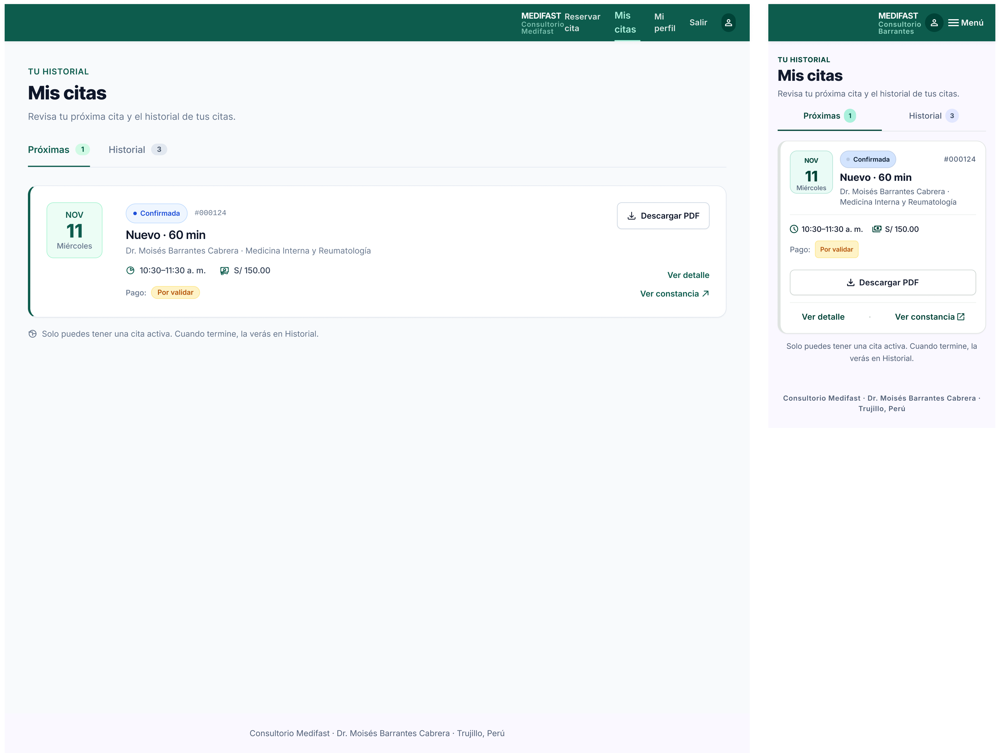
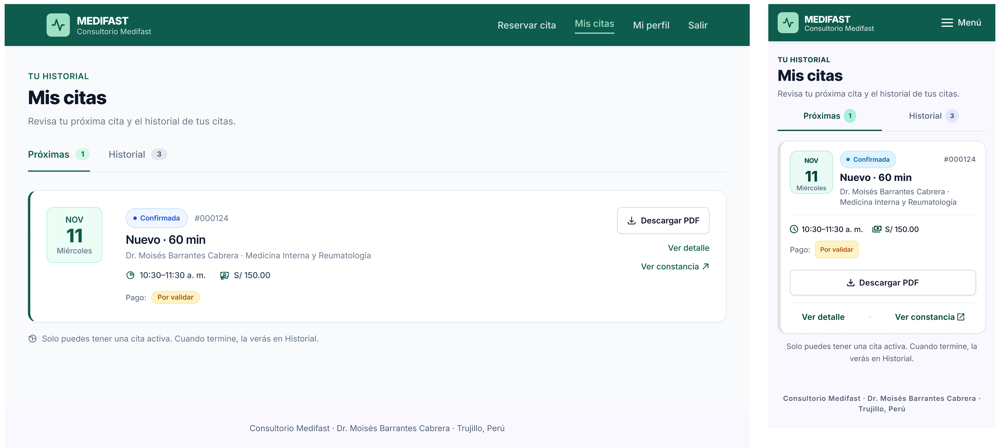
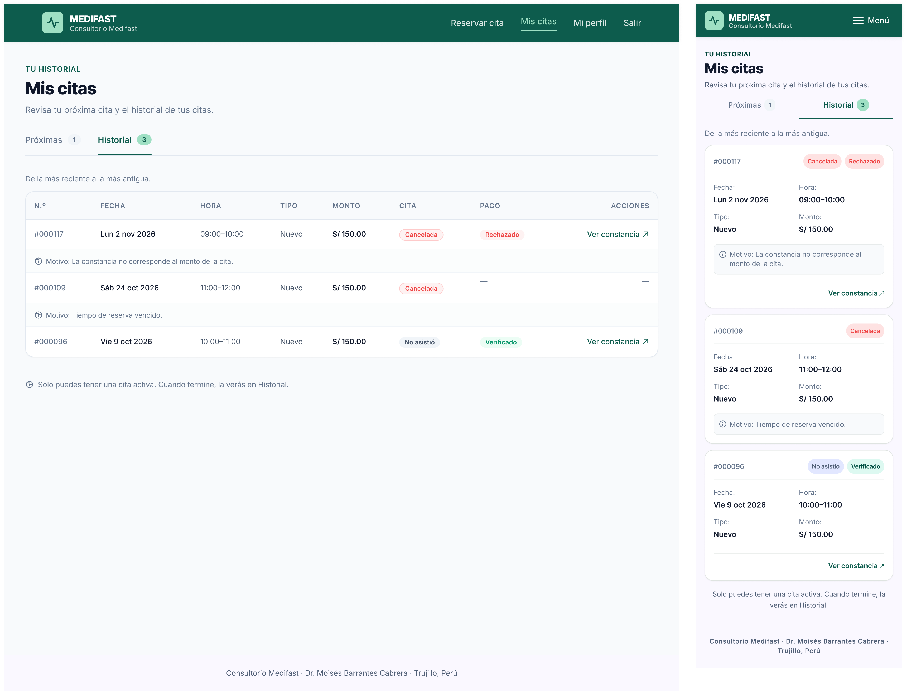
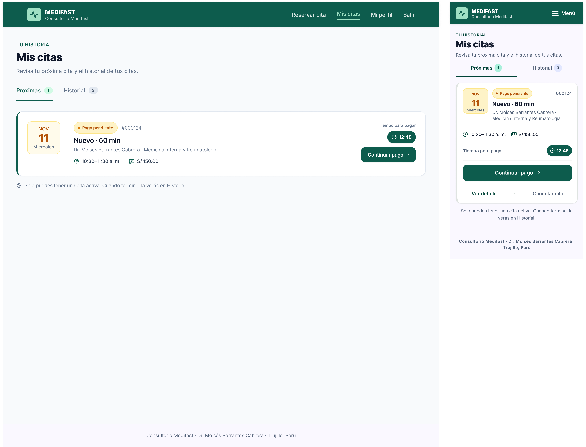
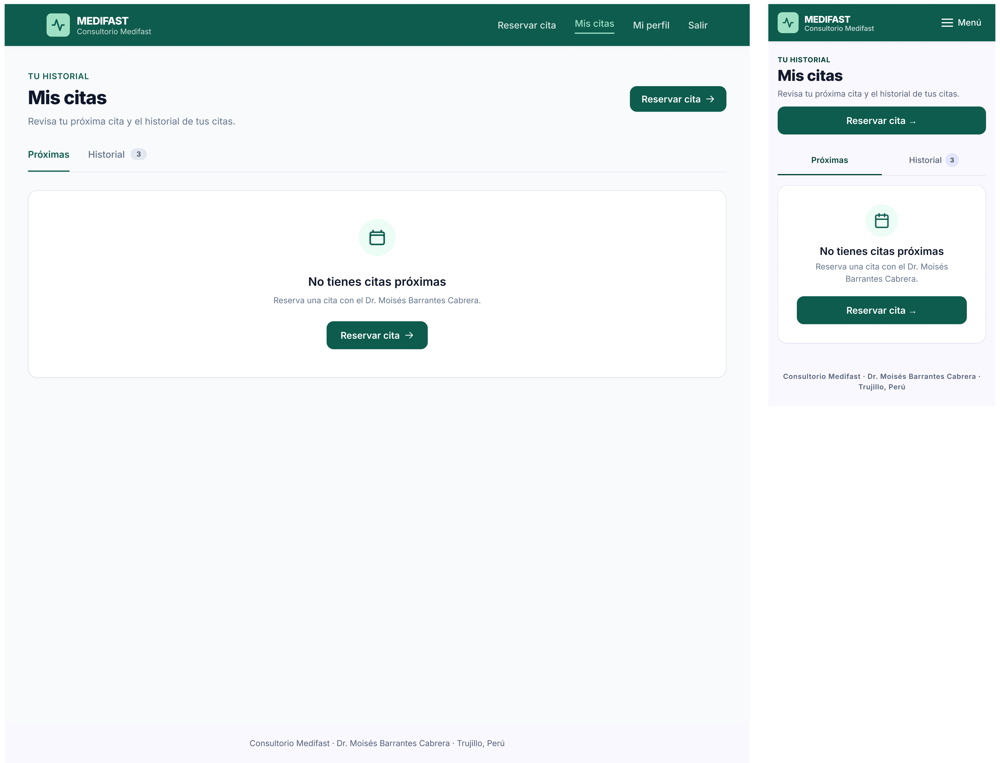

# P5 – Mis citas: iteraciones

- **Requerimientos:** RF10 · RF15 · RF03 · RF12 · RN-02 · RN-03 · RN-09 · RN-13 · RNF02
- **Plantilla:** `templates/paciente/citas.html`
- **Referencia visual:** [referencia-mis-citas.png](referencia-mis-citas.png). Se toman el encabezado "TU HISTORIAL / Mis citas", las cards con el bloque de fecha a la izquierda (mes, día y día de la semana), el badge de estado con el n.º de cita, la línea de hora y duración, y las acciones a la derecha. Contiene elementos que no se siguen:
  - "Consultorio Barrantes" (en el logo y como lugar de la cita), el menú lateral oscuro, la card "¿Necesitas ayuda?" con un teléfono inventado y la cabecera "Hola, Andrea" con avatar: se usa la navbar superior de paciente de P2/P3.
  - **Dos citas activas a la vez** (una Confirmada y otra con Pago pendiente): RN-09 permite una sola. Es justo la diferencia que anota el README §7.2 para P5.
  - "Control médico · 30 min" con "Importe: S/ 150.00": la tarifa de CONTROL es S/ 80 (RN-03).
  - "Consulta médica" / "Control médico" no nombran el tipo: deben decir "Nuevo" o "Control" (RN-02).
  - "Dr. Moisés Barrantes · Medicina interna": la especialidad es "Medicina Interna y Reumatología".
  - Falta el **estado del pago** (Por validar / Verificado / Rechazado) y, en la primera cita, el monto (RF10).
  - Falta "Ver constancia" (RF12) y "Continuar pago" no lleva el mini contador del tiempo restante.
  - Pestañas "Próximas / Historial": se mantienen (decisión del usuario), pero "Próximas" muestra como máximo una cita (la activa) y el contador dice "1".
  - Botón "Reservar nueva cita" siempre visible: con una cita activa no se puede reservar (RN-09). Solo aparece cuando no hay cita activa.
  - N.º de cita "#MF-2084": se usa el formato de P4 ("#000124").
  - Fechas de agosto y septiembre: se usan las de P2–P4 (hoy lunes 9 de noviembre de 2026; cita activa el miércoles 11).
  - Tipografía distinta de Inter.

| Versión | Fecha | Resultado | Estado |
| --- | --- | --- | --- |
| v1 | 2026-10-27 | [v1.png](v1.png) | Revisada: contenido correcto, navbar rota |
| v2 | 2026-10-27 | [v2.png](v2.png) | ✅ Estado principal aprobado, con 1 ajuste en Figma |
| v3 | 2026-10-27 | [v3.1](v3.1.png) · [v3.2](v3.2.png) · [v3.3](v3.3.png) | ✅ Aprobada, con 6 ajustes a completar en Figma |

### Decisiones de flujo

Confirmadas con el usuario el 2026-10-27:

- **Pestañas "Próximas" e "Historial":** son las mismas citas repartidas por estado. "Próximas" muestra solo la cita activa (`PENDIENTE_PAGO` vigente o `PROGRAMADA`; como máximo una, RN-09) como card destacada, con el contador "1" en la pestaña. "Historial" muestra el resto (atendidas, no asistió, canceladas y vencidas), de la más reciente a la más antigua (RF10): tabla en escritorio y tarjetas apiladas en móvil. Por defecto se abre "Próximas" (o "Historial" si no hay cita activa).
- **"Ver constancia":** abre el archivo (imagen o PDF) en una pestaña nueva del navegador, sin diseño propio. Se relaciona con el detalle de la cita: P4 en modo detalle agrega la fila "Constancia" con el nombre del archivo y el enlace "Ver constancia ↗", que abre la misma pestaña nueva (ajuste agregado a [P4](../P4-confirmacion/iteraciones.md#decisiones-de-flujo)). Solo la ven el paciente dueño y el médico (RF12, RNF06).

Propuestas por Claude (siguen RF10):

- **Botón "Reservar cita":** solo cuando no hay cita activa (en el encabezado y en el estado vacío de "Próximas").
- **Acciones por estado (RF10, RF12):**

  | Estado de la cita | Estado del pago | Acciones |
  | --- | --- | --- |
  | Pago pendiente (vigente) | — | "Continuar pago →" con mini contador "mm:ss" |
  | Vencida (pendiente sin cancelar aún, RF10) | — | Ninguna; badge "Vencida" gris |
  | Confirmada | Por validar / Verificado | "Ver detalle", "Descargar PDF", "Ver constancia ↗" |
  | Atendida | Verificado | "Ver detalle", "Descargar PDF", "Ver constancia ↗" |
  | No asistió | Por validar / Verificado | "Ver constancia ↗" |
  | Cancelada | Rechazado | "Ver constancia ↗" + motivo |
  | Cancelada | — (sin pago) | Ninguna + motivo |

- **"Ver detalle"** abre P4 en modo detalle (decisión de [P4](../P4-confirmacion/iteraciones.md#decisiones-de-flujo)): titular "Detalle de la cita", sin alerta de éxito, con los badges del estado real y la fila "Constancia". Se pide duplicando P4 v2.

---

## v1

**Prompt:** [prompt base](../00-prompt-base.md) + el prompt de abajo. Adjuntar [P3 v3.1](../P3-pago/v3.1.png) como referencia de estilo y [la referencia](referencia-mis-citas.png) como referencia de layout. Siguiendo la lección de P2 y P3, primero se genera **solo el estado principal**; los estados (vacío, pago pendiente) se piden después duplicando el frame aprobado.

```text
P5 – Mis citas (paciente). Usa la imagen de pago adjunta (P3) como referencia de estilo: misma navbar de paciente, logo, cards, badges, botones y tipografía Inter. Usa la otra imagen solo como referencia de las cards (bloque de fecha a la izquierda, badge con n.º de cita, línea de hora y acciones a la derecha).

LAYOUT (escritorio)
1. Navbar superior #0d5c4d igual que P3: logo MEDIFAST con ícono de pulso y "Consultorio Medifast"; a la derecha "Reservar cita", "Mis citas" (activo, en menta #9fe0c4 con subrayado), "Mi perfil", "Salir" en blanco. Sin menú lateral, sin avatar, sin saludo.
2. Fondo #f8fafc, contenido de ~1200px. Encabezado: rótulo "TU HISTORIAL" 14px/600 #0d5c4d, H1 "Mis citas" 32px/800 y el texto "Revisa tu próxima cita y el historial de tus citas." Sin botón "Reservar cita" (ya tiene una cita activa).
3. Pestañas debajo del encabezado, con una línea gris #e2e8f0 a todo el ancho: "Próximas" (activa: texto #0d5c4d 16px/600, subrayado de 2px #0d5c4d y un contador en píldora menta "1") e "Historial" (inactiva, texto gris #64748b, con contador gris "3").

PESTAÑA "PRÓXIMAS" (la que se ve en este frame)
4. Una sola card blanca (radio 16px, borde 1px #e2e8f0, sombra suave), con un borde izquierdo de 4px #0d5c4d:
   - Izquierda: bloque de fecha 96×96px, fondo #ecfdf5, radio 12px: "NOV" (14px/600 #0d5c4d), "11" (32px/800 #0d5c4d), "Miércoles" (14px gris).
   - Centro: fila con el badge "Confirmada" (azul info, píldora con punto) y "#000124" en gris; título "Nuevo · 60 min" (20px/600); "Dr. Moisés Barrantes Cabrera · Medicina Interna y Reumatología" (14px gris); fila con ícono de reloj "10:30–11:30 a. m." y con ícono de billete "S/ 150.00"; fila "Pago:" con el badge "Por validar" (ámbar).
   - Derecha, en columna: botón secundario "Descargar PDF" con ícono de descarga, y debajo dos enlaces #0d5c4d: "Ver detalle" y "Ver constancia ↗" (ícono de enlace externo: abre en una pestaña nueva).
5. Debajo de la card, la nota 14px gris: "Solo puedes tener una cita activa. Cuando termine, la verás en Historial."
6. Pie de página: "Consultorio Medifast · Dr. Moisés Barrantes Cabrera · Trujillo, Perú".

MÓVIL (360px)
7. Navbar con el logo y el botón "Menú" (ícono + texto), sin avatar ni barra de pestañas inferior. Encabezado y pestañas con los mismos textos (las dos pestañas ocupan el ancho a partes iguales). La card de la cita activa en una columna: bloque de fecha y datos arriba; "Descargar PDF" a ancho completo y debajo "Ver detalle" y "Ver constancia ↗" lado a lado. Mismos textos y orden que en escritorio.

No incluir: menú lateral, avatar, saludo "Hola", card de ayuda con teléfono, más de una cita activa (en "Próximas" hay una sola card), botón "Reservar cita" (ya hay una cita activa), botones de cancelar o reprogramar, lugar o dirección de la cita, citas virtuales, información clínica (diagnóstico, receta, notas), barra de pestañas inferior, textos de seguridad inventados ni fondos lavanda.
```

**Resultado:** un frame de escritorio y uno móvil de la pestaña "Próximas".



### Feedback

**Lo que funciona (mantener):**

- Encabezado "TU HISTORIAL / Mis citas" con el texto pedido y sin botón "Reservar cita".
- Pestañas "Próximas 1" (activa, contador menta) e "Historial 3" (inactiva).
- Card de la cita activa completa: bloque de fecha "NOV 11 Miércoles", badge "Confirmada", "#000124", "Nuevo · 60 min", médico y especialidad, "10:30–11:30 a. m.", "S/ 150.00", "Pago: Por validar", "Descargar PDF", "Ver detalle" y "Ver constancia ↗".
- Nota "Solo puedes tener una cita activa…". Sin menú lateral, card de ayuda, segunda cita activa, cancelar ni reprogramar.
- Móvil: card en una columna con "Descargar PDF" a ancho completo y los dos enlaces lado a lado; pestañas a partes iguales.

**Lo que hay que corregir:**

| # | Problema | Dónde | Severidad | Veces |
| --- | --- | --- | --- | --- |
| 1 | Navbar rota: sin el cuadrado menta del logo, "MEDIFAST / Consultorio Medifast" empujado a la derecha junto a los enlaces, y "Reservar cita", "Mis citas" y "Mi perfil" partidos en dos líneas | Escritorio | Alta | 1.ª |
| 2 | Ícono de avatar en la navbar | Ambas | Media | 1.ª |
| 3 | Logo sin el cuadrado menta, alineado a la derecha y con el subtítulo "Consultorio Barrantes" | Móvil | Alta | 1.ª |
| 4 | "#000124" en fuente monoespaciada (mismo problema que P4) | Escritorio | Baja | 1.ª |
| 5 | El punto del badge "Confirmada" es gris claro, no azul | Móvil | Baja | 1.ª |
| 6 | Los enlaces de la card quedan separados del botón: "Ver detalle" y "Ver constancia ↗" bajan al pie de la card | Escritorio | Baja | 1.ª |

**Aprendizaje:** en una sesión nueva, "navbar igual que P3" con la imagen adjunta no basta: Stitch rearmó la navbar desde cero. Hay que describirla con su distribución (logo a la izquierda, enlaces a la derecha, en una línea).

---

## v2

Solo se corrige la navbar. Un prompt por dispositivo (lección de P1/P2).

### Prompt 1 — Escritorio

Seleccionar solo **el frame de escritorio** y pegar:

```text
Edita solo la navbar de este frame. No cambies nada más.
1. Navbar de 72px de alto, fondo #0d5c4d, con el contenido alineado al mismo ancho que la página (~1200px, centrado).
2. A la IZQUIERDA, el logo: un cuadrado de 40px con radio 8px en verde menta #9fe0c4 y dentro el ícono de pulso cardíaco (línea de electrocardiograma) en #0d5c4d; a su derecha, en dos líneas, "MEDIFAST" (18px/800 blanco) y "Consultorio Medifast" (13px, blanco al 80%).
3. A la DERECHA, en una sola línea y sin saltos de texto: "Reservar cita", "Mis citas", "Mi perfil", "Salir" (16px/500 blanco, 32px de separación). "Mis citas" activo: texto #9fe0c4 con subrayado de 2px.
4. Quita el ícono de avatar.
5. En la card, el n.º "#000124" con la fuente Inter 14px gris (no monoespaciada), y los enlaces "Ver detalle" y "Ver constancia ↗" justo debajo del botón "Descargar PDF", con 12px de separación.
```

### Prompt 2 — Móvil

Después, seleccionar solo **el frame móvil** y pegar:

```text
Edita solo la navbar de este frame. Copia el logo de la navbar de escritorio. No cambies nada más.
1. A la IZQUIERDA, el logo: cuadrado de 36px con radio 8px en verde menta #9fe0c4 con el ícono de pulso cardíaco en #0d5c4d; a su derecha "MEDIFAST" (16px/800 blanco) y "Consultorio Medifast" (12px, blanco al 80%), en una línea cada uno.
2. A la DERECHA, solo el botón "Menú" (ícono de 3 líneas + texto "Menú" en blanco).
3. Quita el ícono de avatar.
4. El badge "Confirmada" con el punto en azul #0284c7.
```

**Resultado:** un frame de escritorio y uno móvil.



### Feedback

**Corregido respecto a v1:** #1 navbar de escritorio con el logo a la izquierda y los enlaces en una línea, "Mis citas" activo en menta; #2 sin avatar; #3 logo móvil con el cuadrado menta y "Consultorio Medifast"; #4 "#000124" en Inter; #5 punto azul en "Confirmada"; #6 enlaces bajo "Descargar PDF".

**Pendiente (pasa a Figma):**

| # | Problema | Dónde | Severidad | Veces |
| --- | --- | --- | --- | --- |
| 7 | El logo de la navbar no queda alineado con el borde izquierdo del contenido (~40px más adentro) | Escritorio | Baja | 1.ª |

### Decisión

Se aprueba el **estado principal** (pestaña "Próximas" con cita confirmada) con v2. En Figma: usar el componente de navbar de paciente de P4/P2 (corrige #7). Los estados se generan en v3 duplicando estos frames.

---

## v3

**Prompt:** el de "Estados" de la sección [Próximos prompts](#próximos-prompts-después-de-aprobar-el-principal), primero con el frame de escritorio de v2 seleccionado y luego con el móvil.

**Resultado:** cada captura con su frame de escritorio y su móvil: [v3.1](v3.1.png) Historial, [v3.2](v3.2.png) Pago pendiente y [v3.3](v3.3.png) Sin cita activa.





### Feedback

**Lo que funciona (mantener):**

- **Historial:** pestaña activa con el contador menta "3"; tabla con las 8 columnas, las 3 filas en orden, los badges correctos (Cancelada / Rechazado, Cancelada / —, No asistió / Verificado), "Ver constancia ↗" y los motivos bajo cada fila cancelada. En móvil, una tarjeta por cita con filas etiqueta → valor, el motivo en un recuadro y la acción al pie.
- **Pago pendiente:** badge ámbar, bloque de fecha ámbar, sin la fila "Pago:", "Tiempo para pagar" con la píldora "12:48" y "Continuar pago →".
- **Sin cita activa:** "Próximas" sin contador, estado vacío con ícono, título, texto y "Reservar cita →", y el botón también en el encabezado. Sin la nota de una cita activa.
- Navbar, encabezado y pestañas idénticos a v2 en los 6 frames: duplicar el frame aprobado volvió a funcionar.

**Pendiente (pasa a Figma):**

| # | Problema | Dónde | Severidad | Veces |
| --- | --- | --- | --- | --- |
| 8 | Enlace **"Cancelar cita"**: el paciente no cancela (RN-13, fuera de alcance) | Móvil, v3.2 | Alta | 1.ª |
| 9 | Enlace "Ver detalle" en una cita con pago pendiente: RF10 lo permite solo en Confirmada o Atendida | Móvil, v3.2 | Media | 1.ª |
| 10 | La nota "Solo puedes tener una cita activa…" aparece también en la pestaña "Historial" | Ambas, v3.1 | Baja | 1.ª |
| 11 | En la fila #000109, los "—" de Pago y Acciones quedan más arriba que el resto de la fila | Escritorio, v3.1 | Baja | 1.ª |
| 12 | El badge "No asistió" es lavanda; debe ser gris como en escritorio | Móvil, v3.1 | Baja | 1.ª |
| 13 | Dos botones "Reservar cita →" seguidos (encabezado y estado vacío) | Móvil, v3.3 | Baja | 1.ª |

### Decisión

Se aprueba P5 con v3. Todos los pendientes son eliminaciones o ajustes de color y alineación, así que no se itera más en Stitch. Ajustes en Figma:

1. **Navbar:** componente de paciente de P4/P2 (corrige #7).
2. **Pago pendiente móvil (v3.2):** quitar la fila de enlaces "Ver detalle · Cancelar cita"; la card termina en "Continuar pago →". Corrige #8 y #9.
3. **Historial (v3.1):** quitar la nota "Solo puedes tener una cita activa…" (va solo en "Próximas"); alinear al centro vertical los "—" de la fila #000109; badge "No asistió" en gris #64748b sobre #f1f5f9 en móvil. Corrige #10, #11 y #12.
4. **Sin cita activa móvil (v3.3):** quitar el botón del encabezado y dejar solo el del estado vacío. Corrige #13.
5. **Componentes nuevos:** "Card de cita" (variantes Confirmada y Pago pendiente, escritorio y móvil), "Fila de historial" (con y sin motivo) y "Pestañas con contador". Se reutilizan en P7 (agenda del médico).
6. **Estado "No tienes citas registradas"** (paciente sin ninguna cita): duplicar v3.3 con "Historial" sin contador y el mismo estado vacío con el título "No tienes citas registradas".

**Pendiente de otra pantalla:** la variante "Detalle de la cita" de P4 (prompt en [Próximos prompts](#próximos-prompts-después-de-aprobar-el-principal)).

**Aprendizaje:** aunque el prompt base excluye la reprogramación, Stitch agregó "Cancelar cita" junto a una cita pendiente. Se agrega al prompt base la exclusión explícita de la cancelación por el paciente.

### Próximos prompts (después de aprobar el principal)

**Estados**, duplicando el frame aprobado; pegar una vez con el frame de escritorio y otra con el móvil:

```text
Duplica este frame 3 veces y en cada copia cambia solo lo que se indica. No toques navbar, encabezado, pestañas, colores, cards, badges ni estilos.

A. "Historial": la pestaña "Historial" pasa a activa (texto #0d5c4d, subrayado, contador menta "3") y "Próximas" a inactiva. En lugar de la card de la cita activa, la ayuda "De la más reciente a la más antigua." y una tabla dentro de una card blanca, con encabezados 14px/600 gris en mayúsculas: N.º, FECHA, HORA, TIPO, MONTO, CITA, PAGO, ACCIONES. Tres filas, en este orden:
   - "#000117" · "Lun 2 nov 2026" · "09:00–10:00" · "Nuevo" · "S/ 150.00" · badge "Cancelada" (rojo) · badge "Rechazado" (rojo) · enlace "Ver constancia ↗". Debajo de la fila, a todo el ancho, en 14px gris con ícono de información: "Motivo: La constancia no corresponde al monto de la cita."
   - "#000109" · "Sáb 24 oct 2026" · "11:00–12:00" · "Nuevo" · "S/ 150.00" · badge "Cancelada" (rojo) · "—" · "—". Debajo: "Motivo: Tiempo de reserva vencido."
   - "#000096" · "Vie 9 oct 2026" · "10:00–11:00" · "Nuevo" · "S/ 150.00" · badge "No asistió" (gris) · badge "Verificado" (verde) · enlace "Ver constancia ↗".
   En móvil, en lugar de la tabla, una tarjeta por cita: n.º y los dos badges arriba; fecha, hora, tipo y monto en filas etiqueta → valor; el motivo cuando lo hay; la acción al pie.

B. "Pago pendiente": en la card de "Próximas", el badge pasa a "Pago pendiente" (ámbar) y desaparece la fila "Pago:". El bloque de fecha usa fondo #fffbeb y texto #b45309. A la derecha, en lugar de "Descargar PDF" y los enlaces: la etiqueta "Tiempo para pagar", una píldora oscura #0d5c4d con ícono de reloj y "12:48" en blanco, y debajo el botón primario "Continuar pago →".

C. "Sin cita activa": la pestaña "Próximas" sin contador. En lugar de la card, un estado vacío centrado dentro de una card blanca: ícono de calendario en un círculo #ecfdf5, título "No tienes citas próximas" (20px/600), texto "Reserva una cita con el Dr. Moisés Barrantes Cabrera." y el botón primario "Reservar cita →". En el encabezado, a la derecha del título, también el botón primario "Reservar cita →". Quita la nota "Solo puedes tener una cita activa…".
```

El estado "No tienes citas registradas" (paciente sin ninguna cita) es igual a C, pero con "Historial" también vacío; se arma en Figma.

**Detalle de la cita (variante de P4)**, seleccionando el frame de escritorio de [P4 v2](../P4-confirmacion/v2.png) y luego el móvil:

```text
Duplica este frame y en la copia cambia solo lo que se indica. No toques navbar, layout, filas ni estilos.
1. Titular del panel verde: "Detalle de la cita" ("de la cita" en menta #9fe0c4). Texto debajo: "Te recomendamos llegar entre 15 y 30 minutos antes de tu cita."
2. Quita la alerta verde "¡Cita reservada!".
3. Agrega una última fila "CONSTANCIA" con el valor "constancia-yape.jpg" y, a su derecha, el enlace #0d5c4d "Ver constancia ↗" (ícono de enlace externo).
4. Botón secundario "Ir a mis citas" → "← Volver a mis citas".
El resto (filas, badges "Confirmada" y "Por validar", "Descargar PDF") queda igual.
```
