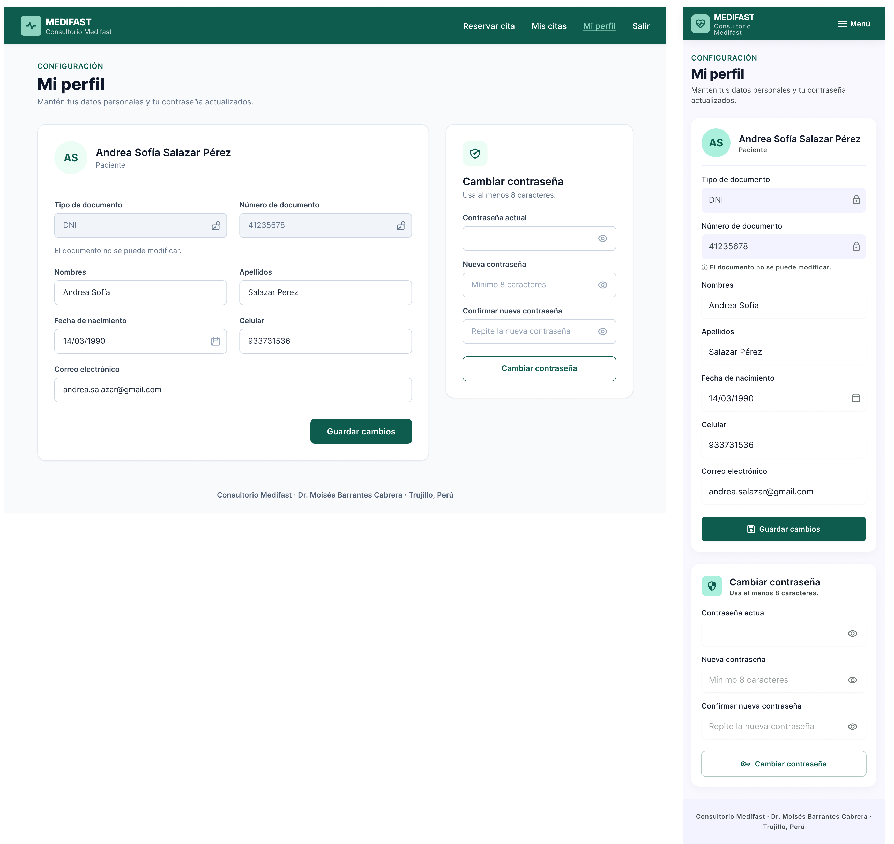
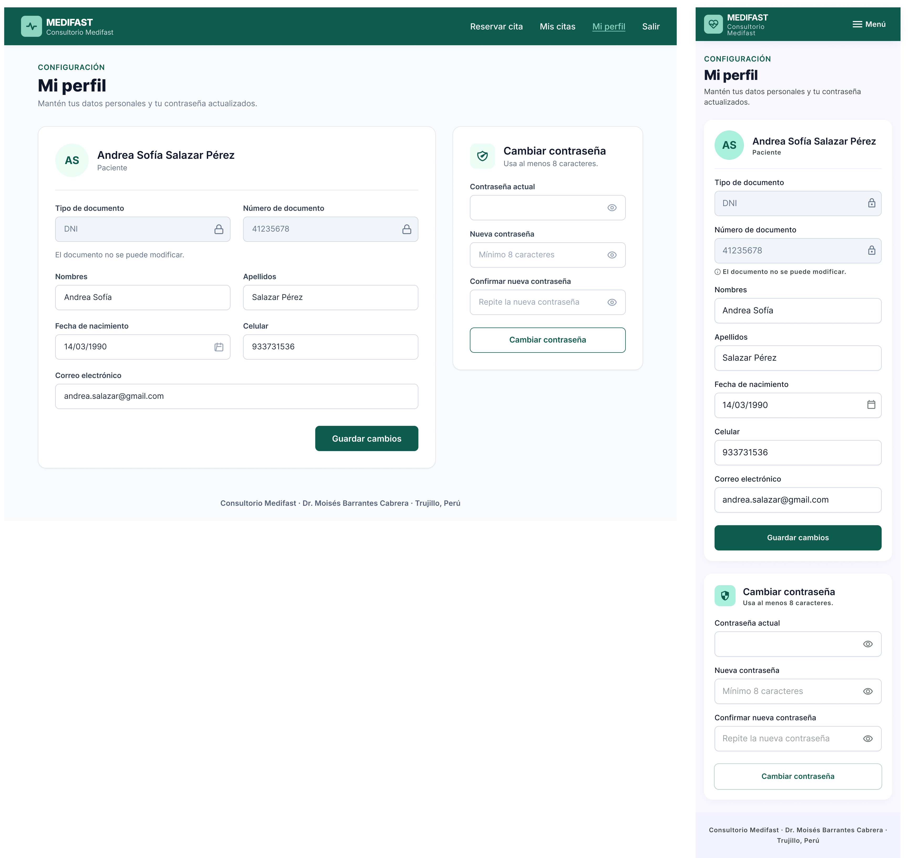
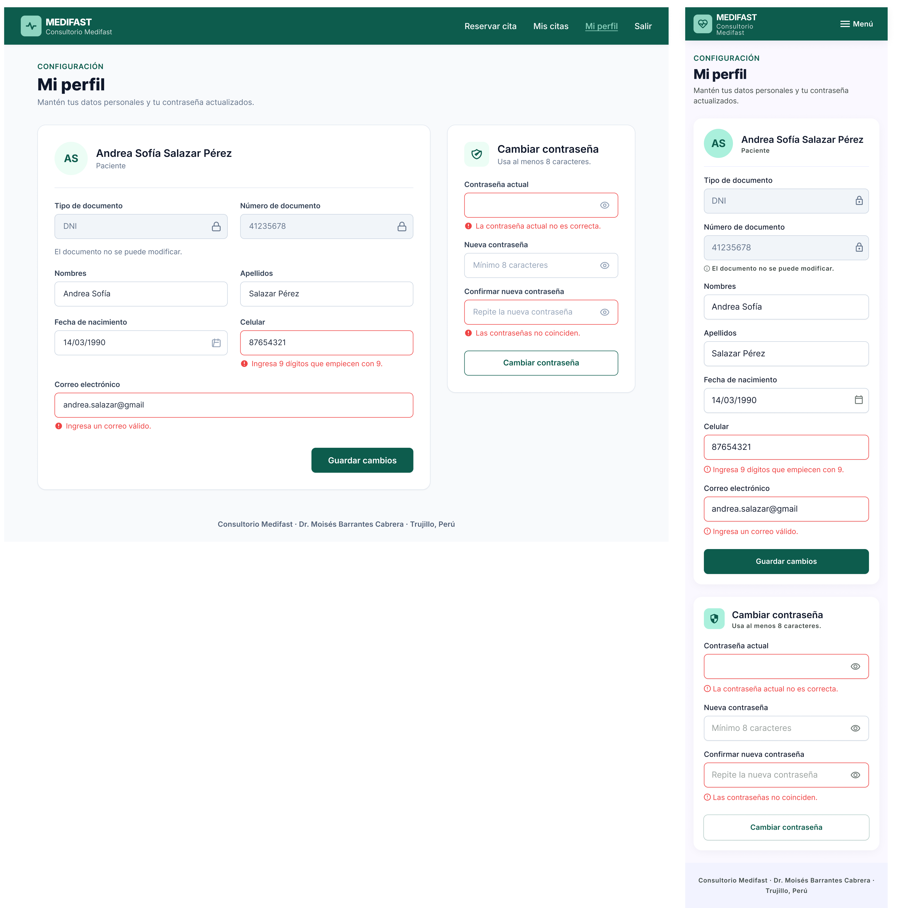

# P6 – Mi perfil: iteraciones

- **Requerimientos:** RF11 · RF02 · RN-12 · RNF03 · RNF07
- **Plantilla:** `templates/paciente/perfil.html`
- **Referencia visual:** [referencia-perfil.png](referencia-perfil.png). Se toman el encabezado "CONFIGURACIÓN / Mi perfil", las dos cards (datos personales a la izquierda, ~65%; seguridad a la derecha, ~35%), la cabecera de la card con las iniciales y el nombre, y el formulario en 2 columnas. Contiene elementos que no se siguen:
  - "Consultorio Barrantes" en el logo, el menú lateral oscuro, la card "¿Necesitas ayuda?" con un teléfono inventado y la cabecera "Hola, Andrea" con avatar: se usa la navbar superior de paciente de P5.
  - **"Documento" es un input editable**: RF11 y RN-12 dicen que el tipo y el n.º de documento se muestran pero no se editan. Va en solo lectura (fondo gris claro, sistema de diseño) y falta el **tipo de documento**.
  - Falta **Fecha de nacimiento**, editable según RF11.
  - El cambio de contraseña no pide **"Confirmar nueva contraseña"** (RF11).
  - "Paciente desde agosto 2026": dato que no está en ninguna pantalla ni requerimiento; se quita.
  - Los datos de ejemplo no coinciden con los de P4 (Andrea Sofía Salazar Pérez, DNI 41235678, 933731536, andrea.salazar@gmail.com).
  - Tipografía distinta de Inter.

| Versión | Fecha | Resultado | Estado |
| --- | --- | --- | --- |
| v1 | 2026-10-27 | [v1.png](v1.png) | Revisada, requiere 2 correcciones |
| v2 | 2026-10-27 | [v2.png](v2.png) | ✅ Estado principal aprobado |
| v3 | 2026-10-27 | [v3.1](v3.1.png) · [v3.2](v3.2.png) | ✅ Aprobada, con 3 ajustes a completar en Figma |

### Decisiones de flujo

Propuestas por Claude el 2026-10-27; el usuario no las objetó y quedan adoptadas:

- **Dos formularios independientes:** "Guardar cambios" envía solo los datos personales y "Cambiar contraseña" solo la contraseña. Cada uno muestra su propia alerta de éxito o sus errores dentro de su card.
- **Al cambiar la contraseña:** se mantiene la sesión y se muestra la alerta "**Contraseña actualizada.**"; los tres campos se vacían.
- **Al cambiar el correo:** solo se valida que sea único (RN-12); no hay verificación por correo (fuera de alcance).

### Mensajes de validación (para la implementación)

Se aplican las reglas de RF02. Los mensajes reutilizan los de [P1](../P1-registro/iteraciones.md#mensajes-de-validación-para-la-implementación), salvo los de contraseña:

| Campo | Regla | Mensaje |
| --- | --- | --- |
| Nombres / Apellidos | Obligatorios | "Ingresa tus nombres." / "Ingresa tus apellidos." |
| Fecha de nacimiento | Obligatoria y en el pasado | "Ingresa una fecha de nacimiento anterior a hoy." |
| Celular | 9 dígitos, empieza con 9 | "Ingresa 9 dígitos que empiecen con 9." |
| Correo electrónico | Formato válido | "Ingresa un correo válido." |
| Correo electrónico | Único (RN-12), sin contar el propio | "Este correo ya está registrado." |
| Contraseña actual | Obligatoria y correcta | "La contraseña actual no es correcta." |
| Nueva contraseña | Mínimo 8 caracteres | "La contraseña debe tener al menos 8 caracteres." |
| Confirmar nueva contraseña | Igual a la nueva | "Las contraseñas no coinciden." |

Alertas de éxito: "**Datos actualizados.**" (card de datos personales) y "**Contraseña actualizada.**" (card de seguridad). Al volver a mostrar el formulario con errores, los campos de contraseña se vacían.

---

## v1

**Prompt:** [prompt base](../00-prompt-base.md) + el prompt de abajo. Adjuntar [P5 v2](../P5-mis-citas/v2.png) como referencia de estilo (navbar ya corregida) y [la referencia](referencia-perfil.png) como referencia de layout. Primero solo el estado principal; los estados (éxito y errores) se piden después duplicando el frame aprobado.

```text
P6 – Mi perfil (paciente). Usa la imagen de "Mis citas" adjunta (P5) como referencia de estilo: misma navbar de paciente, logo, cards, inputs, botones y tipografía Inter. Usa la otra imagen solo como referencia de layout (dos cards: datos personales a la izquierda, seguridad a la derecha).

LAYOUT (escritorio)
1. Navbar de 72px, fondo #0d5c4d, contenido alineado a ~1200px. A la IZQUIERDA, el logo: cuadrado de 40px con radio 8px en verde menta #9fe0c4 con el ícono de pulso cardíaco en #0d5c4d, y a su derecha "MEDIFAST" (18px/800 blanco) y "Consultorio Medifast" (13px, blanco al 80%). A la DERECHA, en una sola línea: "Reservar cita", "Mis citas", "Mi perfil" (activo: texto #9fe0c4 con subrayado de 2px), "Salir". Sin avatar.
2. Fondo #f8fafc, contenido de ~1200px. Encabezado: rótulo "CONFIGURACIÓN" 14px/600 #0d5c4d, H1 "Mi perfil" 32px/800 y el texto "Mantén tus datos personales y tu contraseña actualizados."
3. Dos cards blancas (radio 16px, borde 1px #e2e8f0, sombra suave): izquierda ~65% "Datos personales" y derecha ~35% "Seguridad", alineadas arriba.

CARD "DATOS PERSONALES"
4. Cabecera: círculo de 64px fondo #ecfdf5 con las iniciales "AS" (20px/700 #0d5c4d); a su derecha "Andrea Sofía Salazar Pérez" (20px/600) y "Paciente" (14px gris). Debajo, una línea divisoria #e2e8f0.
5. Formulario en 2 columnas con 24px de separación. Inputs de 48px, borde 1px #cbd5e1, radio 8px, etiqueta 14px/600 arriba:
   - Fila 1 (solo lectura: fondo #f1f5f9, texto #64748b, ícono de candado a la derecha): "Tipo de documento" = "DNI" | "Número de documento" = "41235678". Debajo de la fila, ayuda 14px gris: "El documento no se puede modificar."
   - Fila 2: "Nombres" = "Andrea Sofía" | "Apellidos" = "Salazar Pérez".
   - Fila 3: "Fecha de nacimiento" = "14/03/1990" con ícono de calendario | "Celular" = "933731536".
   - Fila 4: "Correo electrónico" = "andrea.salazar@gmail.com", a ancho completo.
6. Al pie, alineado a la derecha, el botón primario "Guardar cambios" (relleno #0d5c4d, texto blanco, 48px, radio 8px).

CARD "SEGURIDAD"
7. Cabecera: ícono de escudo en un cuadrado #ecfdf5, título "Cambiar contraseña" (20px/600) y el texto "Usa al menos 8 caracteres." (14px gris).
8. Tres inputs en una columna, cada uno con el ícono de "ojo" a la derecha (contraseña oculta) y vacíos: "Contraseña actual", "Nueva contraseña" (placeholder "Mínimo 8 caracteres") y "Confirmar nueva contraseña" (placeholder "Repite la nueva contraseña").
9. Botón secundario a ancho completo "Cambiar contraseña" (fondo blanco, borde 1px #0d5c4d, texto #0d5c4d, 48px).
10. Pie de página: "Consultorio Medifast · Dr. Moisés Barrantes Cabrera · Trujillo, Perú".

MÓVIL (360px)
11. Navbar con el logo a la izquierda y solo el botón "Menú" (ícono + texto) a la derecha, sin avatar ni barra de pestañas inferior. Encabezado con los mismos textos. Las dos cards apiladas (primero "Datos personales", luego "Seguridad"); el formulario en una sola columna con los mismos campos y orden; "Guardar cambios" y "Cambiar contraseña" a ancho completo.

No incluir: menú lateral, avatar en la navbar, saludo "Hola", card de ayuda con teléfono, "Paciente desde…", foto de perfil o botón para subirla, documento editable, campos clínicos (alergias, antecedentes, seguro, grupo sanguíneo), dirección, verificación de correo o celular, autenticación en dos pasos, eliminar cuenta, preferencias de notificaciones, barra de pestañas inferior ni fondos lavanda.
```

**Resultado:** un frame de escritorio y uno móvil del estado principal.



### Feedback

**Lo que funciona (mantener):**

- Navbar de escritorio correcta a la primera: logo a la izquierda, enlaces en una línea, "Mi perfil" activo en menta, sin avatar. La lección de P5 (describir la distribución de la navbar) funcionó.
- Encabezado "CONFIGURACIÓN / Mi perfil" y las dos cards con el ancho pedido.
- Cabecera "AS" + "Andrea Sofía Salazar Pérez" + "Paciente", sin "Paciente desde…".
- Tipo y n.º de documento en solo lectura (fondo gris) con la ayuda "El documento no se puede modificar."; fecha de nacimiento con calendario; los datos de ejemplo de P4.
- Card "Cambiar contraseña" con los 3 inputs (incluida la confirmación), ícono de ojo y el botón secundario.
- Nada fuera de alcance: sin foto, campos clínicos, dirección, 2FA ni eliminar cuenta.

**Lo que hay que corregir:**

| # | Problema | Dónde | Severidad | Veces |
| --- | --- | --- | --- | --- |
| 1 | Los inputs editables no tienen borde: se ven como texto plano y no se distinguen de los de solo lectura | Móvil | Media | 1.ª |
| 2 | El ícono de los campos de documento es un candado **abierto** (sugiere que se puede editar); en móvil es cerrado | Escritorio | Media | 1.ª |
| 3 | "Guardar cambios" y "Cambiar contraseña" llevan íconos (disquete y llave) que no tiene el escritorio | Móvil | Baja | 1.ª |
| 4 | La cabecera de "Cambiar contraseña" pone el ícono encima del título; en móvil va a la izquierda | Escritorio | Baja | 1.ª |
| 5 | "Mi perfil" activo con subrayado de texto en lugar de la barra de 2px | Escritorio | Baja | 1.ª |
| 6 | Logo de corazón y "Consultorio Medifast" en dos líneas | Móvil | Baja (tolerado, ver P2) | — |

Los Media se corrigen en v2 antes de generar los estados: si no, los estados móviles heredarían los inputs sin borde.

---

## v2

Un prompt por dispositivo.

### Prompt 1 — Escritorio

Seleccionar solo **el frame de escritorio** y pegar:

```text
Edita solo este frame. No cambies nada más.
1. En "Tipo de documento" y "Número de documento", cambia el ícono de candado abierto por un candado CERRADO (gris #64748b).
2. Cabecera de la card "Cambiar contraseña": el ícono de escudo a la IZQUIERDA del título, en la misma fila (como en la card "Datos personales"), y el texto "Usa al menos 8 caracteres." debajo del título.
```

### Prompt 2 — Móvil

Después, seleccionar solo **el frame móvil** y pegar:

```text
Edita solo este frame. Copia exactamente los inputs del frame de escritorio. No cambies nada más.
1. Todos los inputs editables (Nombres, Apellidos, Fecha de nacimiento, Celular, Correo electrónico y los 3 de contraseña) con fondo blanco, borde 1px #cbd5e1, radio 8px y 48px de alto.
2. Los de solo lectura (Tipo y Número de documento) mantienen el fondo #f1f5f9 y el candado cerrado.
3. Quita los íconos de los botones: "Guardar cambios" y "Cambiar contraseña" solo con texto.
```

**Resultado:** un frame de escritorio y uno móvil.



### Feedback

**Corregido respecto a v1:** #1 inputs móviles con borde y fondo blanco, distintos de los de solo lectura; #2 candado cerrado en escritorio; #3 botones móviles sin íconos; #4 escudo a la izquierda del título en escritorio.

**Pendiente (pasa a Figma):** #5 "Mi perfil" activo con subrayado de texto (usar el componente de navbar de P4/P2) y #6 logo móvil (tolerado).

### Decisión

Se aprueba el **estado principal** con v2. Los estados se generan en v3 duplicando estos frames.

---

## v3

**Prompt:** el de "Estados" de la sección [Próximo prompt](#próximo-prompt-después-de-aprobar-el-principal), primero con el frame de escritorio de v2 seleccionado y luego con el móvil.

**Resultado:** [v3.1](v3.1.png) (guardado con éxito) y [v3.2](v3.2.png) (errores de validación). La primera subida de v3.2 era una copia de v3.1; el usuario la reemplazó.




### Feedback de v3.1 (guardado con éxito)

✅ Correcto en escritorio y móvil: alerta "Datos actualizados." bajo la línea divisoria, celular "987654321", alerta "Contraseña actualizada." en la card de seguridad y los tres inputs vacíos. Navbar, cards e inputs idénticos a v2.

| # | Problema | Dónde | Severidad | Veces |
| --- | --- | --- | --- | --- |
| 7 | El texto de las alertas no está en negrita | Móvil | Baja | 1.ª |

### Feedback de v3.2 (errores de validación)

✅ Correcto en escritorio y móvil: "Celular" = "87654321" con "Ingresa 9 dígitos que empiecen con 9.", "Correo electrónico" = "andrea.salazar@gmail" con "Ingresa un correo válido.", "Contraseña actual" con "La contraseña actual no es correcta." y "Confirmar nueva contraseña" con "Las contraseñas no coinciden."; bordes #ef4444, inputs de contraseña vacíos y el resto de los campos con su borde normal.

| # | Problema | Dónde | Severidad | Veces |
| --- | --- | --- | --- | --- |
| 8 | El ícono de error es de contorno; en escritorio es relleno | Móvil | Baja | 1.ª |

### Decisión

Se aprueba P6 con v3 (principal en [v2](v2.png), estados en [v3.1](v3.1.png) y [v3.2](v3.2.png)). Ajustes en Figma:

1. **Navbar:** componente de paciente de P4/P2 en los 6 frames (corrige #5 y #6).
2. **Componente "Input":** usar el de P0/P1 con las variantes Normal, Solo lectura (fondo #f1f5f9, candado cerrado) y Error (borde #ef4444, ícono de alerta relleno y mensaje 14px). Corrige #8.
3. **Alertas de éxito móviles:** texto en negrita, como en escritorio (corrige #7).

**Aprendizaje:** corregir los inputs del principal antes de pedir los estados evitó que los errores se heredaran: los 4 frames de estado salieron bien a la primera.

### Próximo prompt (después de aprobar el principal)

**Estados**, duplicando el frame aprobado; pegar una vez con el frame de escritorio y otra con el móvil:

```text
Duplica este frame 2 veces y en cada copia cambia solo lo que se indica. No toques navbar, cards, inputs, botones ni estilos.

A. "Guardado con éxito": dentro de la card "Datos personales", debajo de la línea divisoria y encima del formulario, una alerta de éxito (fondo #ecfdf5, borde 1px #10b981, radio 8px, ícono de check relleno #10b981): "Datos actualizados." en negrita. El celular con el valor "987654321". En la card "Seguridad", encima de los inputs, otra alerta igual: "Contraseña actualizada." en negrita; los tres inputs vacíos.

B. "Errores de validación": en "Datos personales", el input "Celular" con el valor "87654321" y el input "Correo electrónico" con "andrea.salazar@gmail", ambos con borde #ef4444 y debajo el mensaje rojo 14px con ícono de alerta: "Ingresa 9 dígitos que empiecen con 9." y "Ingresa un correo válido.". En "Seguridad", "Contraseña actual" con borde rojo y "La contraseña actual no es correcta.", y "Confirmar nueva contraseña" con borde rojo y "Las contraseñas no coinciden."; los inputs de contraseña vacíos.
```
