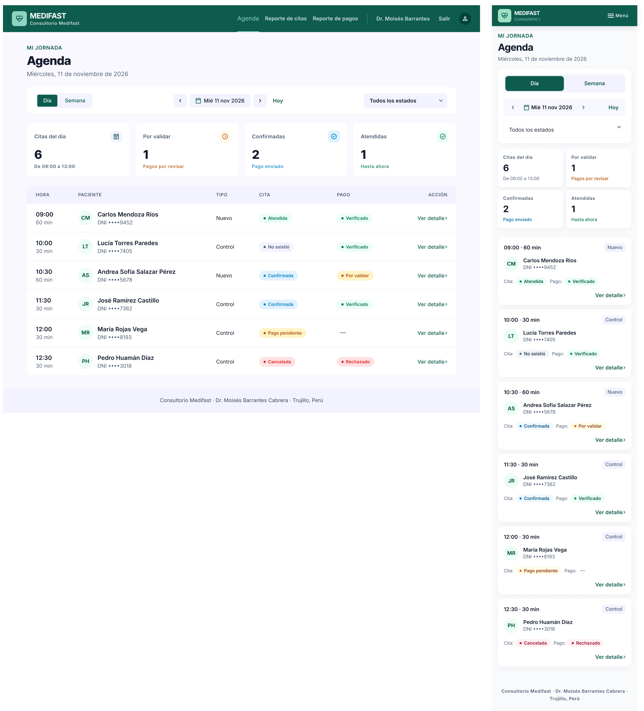
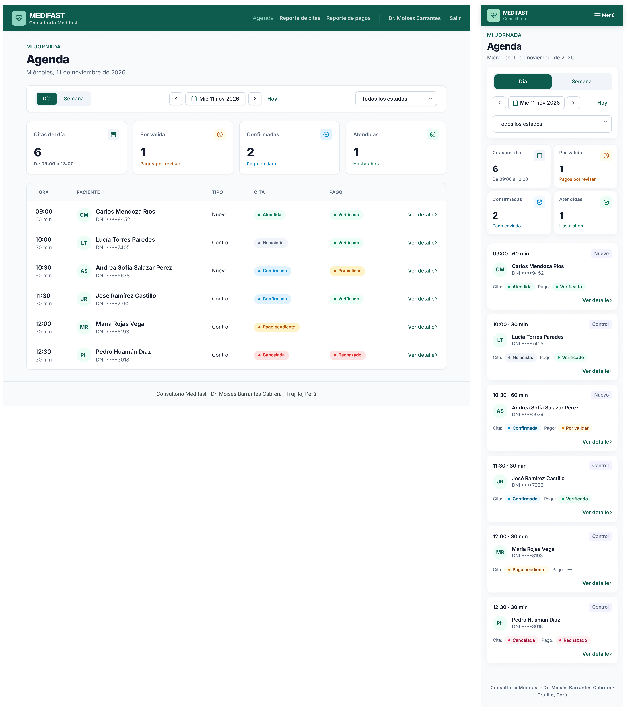
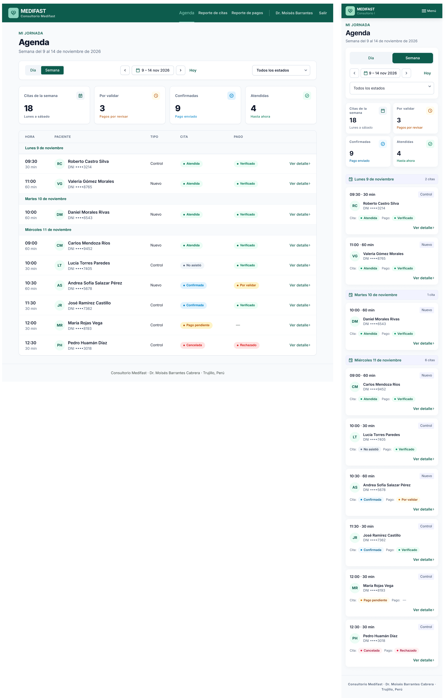
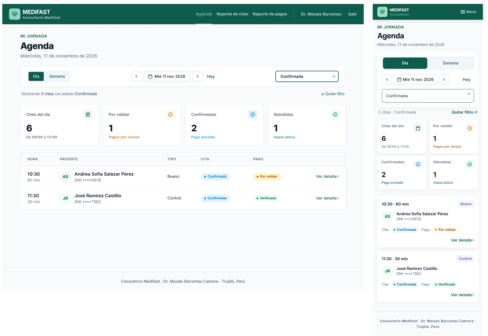
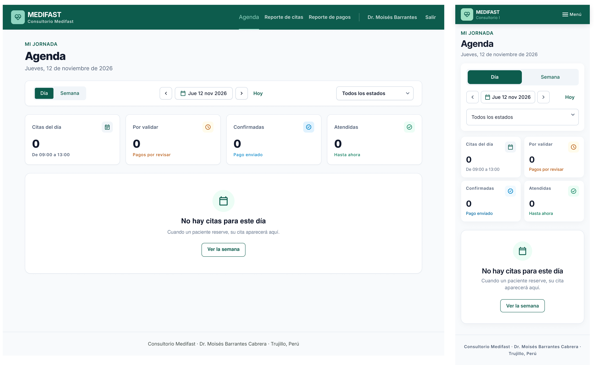

# P7 – Agenda: iteraciones

- **Requerimientos:** RF04 · RF07 (P7 es la pantalla principal del médico) · RN-03 · RN-05 · RN-08 · RNF07 · RNF08
- **Plantilla:** `templates/medico/agenda.html`
- **Referencia visual:** [referencia-agenda.png](referencia-agenda.png). Se toman el encabezado (rótulo "MI JORNADA", H1 "Agenda médica" y la fecha larga), la fila de 4 cards de indicadores, la card de la lista con los filtros de estado en píldoras arriba, y las filas con la hora y duración a la izquierda, las iniciales en un círculo, el nombre con el documento debajo, los badges a la derecha y el chevron. Contiene elementos que no se siguen:
  - "Consultorio Barrantes" en el logo: es **Consultorio Medifast** (README §7.2).
  - **Menú lateral oscuro**, la cabecera "PANEL MÉDICO / Dr. Moisés Barrantes" con avatar "MB" y la card "¿Necesitas ayuda?" con un teléfono: se usa la navbar superior del prompt base (rol médico: "Agenda", "Reporte de citas", "Reporte de pagos", el nombre del médico y "Salir"), igual que en las pantallas de paciente ya aprobadas. Sin avatar.
  - **Etiquetas fuera de §5.2:** "Pendiente" → "Pago pendiente"; "Pago verificado" → "Verificado"; "Sin verificar" → "Por validar". Además, colores cruzados: "Confirmada" va en azul info y "Atendida" en verde (prompt base).
  - **Filtros incompletos (RF04):** solo hay un botón "Hoy, 20 ago." y pestañas con 3 estados. Se agregan el selector Día / Semana, la navegación de fecha y los 5 estados de la cita.
  - **Buscador "Buscar paciente…":** no lo pide RF04; se quita para no sumar alcance.
  - **Horarios fuera del horario de la BD:** 08:00 y todas las citas de 60 min. El horario por defecto es 09:00–13:00 (RN-08) y la duración depende del tipo: Nuevo 60 min, Control 30 min (RN-03).
  - **"Consulta general" / "Control médico":** el tipo es **Nuevo** o **Control** (RN-02).
  - **DNI completo:** se muestra parcial ("DNI ••••5678"), solo los datos mínimos (RNF07 y prompt v1).
  - "Pendientes de pago — Requieren revisión": mezcla el estado de la cita con el del pago. El indicador que pide el prompt v1 es **pagos "Por validar"**.
  - Fecha de agosto: se usa noviembre de 2026, coherente con P2–P6.

| Versión | Fecha | Resultado | Estado |
| --- | --- | --- | --- |
| v1 | 2026-10-26 | [v1.png](v1.png) | Revisada: contenido correcto, requiere 2 correcciones de estilo |
| v2 | 2026-10-26 | [v2.png](v2.png) | ✅ Estado principal aprobado |
| v3 | 2026-10-26 | [v3.1](v3.1.png) · [v3.2](v3.2.png) · [v3.3](v3.3.png) | ✅ Aprobada, con 5 ajustes a completar en Figma |

### Decisiones de flujo

Propuestas por Claude el 2026-10-26; el usuario no las objetó y quedan adoptadas (revisión de v2):

- **Navegación superior, no menú lateral:** el médico usa la misma navbar que el paciente (prompt base), con sus enlaces y su nombre. Así P7–P10 comparten un solo fragmento `fragments/` con el paciente, cambiando solo los enlaces. La referencia y README §7 ("menú lateral según el rol") sugieren un lateral; si se prefiere, se cambia en P7 antes de seguir con P8–P10.
- **Vista por defecto:** al iniciar sesión (RF07), la agenda abre en **Día = hoy** y **Estado = Todas**.
- **Fila → P8:** toda la fila (y el enlace "Ver detalle") abre el detalle de la cita (P8). Al volver de P8, se mantienen los filtros elegidos.
- **Estado del pago "—":** una cita "Pago pendiente" todavía no tiene pago (se crea al adjuntar la constancia, §5.1); su columna de pago muestra "—".
- **Indicadores:** se calculan sobre el día o la semana elegidos, no solo sobre hoy. Sus rótulos cambian a "Citas del día" / "Citas de la semana".

### Datos de ejemplo

Coherentes con P2–P6: la cita de Andrea (#000124, Nuevo, miércoles 11 de noviembre, 10:30–11:30, Confirmada, pago Por validar). La agenda se ve ese miércoles a las ~11:45, con el horario 09:00–13:00 completo:

| Hora | Paciente | DNI | Tipo | Cita | Pago |
| --- | --- | --- | --- | --- | --- |
| 09:00–10:00 | Carlos Mendoza Ríos | ••••9452 | Nuevo | Atendida | Verificado |
| 10:00–10:30 | Lucía Torres Paredes | ••••7405 | Control | No asistió | Verificado |
| 10:30–11:30 | Andrea Sofía Salazar Pérez | ••••5678 | Nuevo | Confirmada | Por validar |
| 11:30–12:00 | José Ramírez Castillo | ••••7362 | Control | Confirmada | Verificado |
| 12:00–12:30 | María Rojas Vega | ••••8193 | Control | Pago pendiente | — |
| 12:30–13:00 | Pedro Huamán Díaz | ••••3018 | Control | Cancelada | Rechazado |

Indicadores: Citas del día **6** · Por validar **1** · Confirmadas **2** · Atendidas **1**.

---

## v1

**Prompt:** [prompt base](../00-prompt-base.md) + el prompt de abajo. Aún no hay una pantalla aprobada del médico: adjuntar [P6 v2](../P6-perfil/v2.png) como referencia de estilo (navbar, cards, badges y tipografía) y [la referencia](referencia-agenda.png) como referencia de layout. Solo el estado principal (vista Día).

```text
P7 – Agenda (médico). Usa la imagen de "Mi perfil" adjunta (P6) como referencia de estilo: mismo logo, navbar, cards, badges, botones y tipografía Inter. Usa la otra imagen solo como referencia de layout (encabezado, fila de 4 indicadores y la lista de citas en una card). NO copies su menú lateral, su avatar ni su card de ayuda.

LAYOUT (escritorio)
1. Navbar de 72px, fondo #0d5c4d, contenido alineado a ~1200px. A la IZQUIERDA, el logo: cuadrado de 40px con radio 8px en verde menta #9fe0c4 con el ícono de pulso cardíaco en #0d5c4d, y a su derecha "MEDIFAST" (18px/800 blanco) y "Consultorio Medifast" (13px, blanco al 80%). A la DERECHA, en una sola línea: "Agenda" (activo: texto #9fe0c4 con una barra de 2px debajo), "Reporte de citas", "Reporte de pagos", un separador vertical blanco al 30%, "Dr. Moisés Barrantes" (14px, blanco al 80%) y "Salir". Sin avatar ni menú lateral.
2. Fondo #f8fafc, contenido de ~1200px. Encabezado: rótulo "MI JORNADA" 14px/600 #0d5c4d, H1 "Agenda" 32px/800 y debajo "Miércoles, 11 de noviembre de 2026" (16px gris #64748b).

FILTROS (una card blanca, radio 16px, borde 1px #e2e8f0, en una fila)
3. Izquierda: control segmentado de 2 opciones "Día" (activo: relleno #0d5c4d, texto blanco) y "Semana" (texto #0d5c4d), radio 8px, 40px de alto.
4. Centro: navegación de fecha: botón cuadrado con "‹", el texto "Mié 11 nov 2026" con ícono de calendario (abre un selector de fecha) y botón con "›"; a su lado, el enlace "Hoy" en #0d5c4d.
5. Derecha: select "Estado" con el valor "Todos los estados" (input de 40px, borde 1px #cbd5e1, radio 8px).

INDICADORES
6. Cuatro cards blancas iguales en una fila (radio 16px, borde 1px #e2e8f0): rótulo 14px gris, número 32px/800 y una nota 14px:
   - "Citas del día" · "6" · "De 09:00 a 13:00" (gris)
   - "Por validar" · "1" · "Pagos por revisar" (ámbar #b45309), con un ícono de reloj ámbar en un cuadrado #fffbeb
   - "Confirmadas" · "2" · "Pago enviado" (azul #0284c7)
   - "Atendidas" · "1" · "Hasta ahora" (verde #047857)

LISTA DE CITAS (card blanca, radio 16px, borde 1px #e2e8f0)
7. Tabla con encabezados 14px/600 gris en mayúsculas: HORA, PACIENTE, TIPO, CITA, PAGO y una columna vacía para la acción. Filas de 72px separadas por líneas #e2e8f0, ordenadas por hora:
   - HORA: "09:00" (16px/600) y debajo "60 min" (14px gris).
   - PACIENTE: círculo de 40px fondo #ecfdf5 con las iniciales (14px/700 #0d5c4d), y a su derecha el nombre (16px/600) y "DNI ••••9452" (14px gris).
   - TIPO: "Nuevo" o "Control" (14px).
   - CITA y PAGO: badges tipo píldora con punto de color del sistema de diseño.
   - Acción: enlace "Ver detalle" en #0d5c4d con un chevron "›". Toda la fila tiene hover #f8fafc.
8. Las seis filas, en este orden:
   - 09:00 · 60 min · "CM" Carlos Mendoza Ríos · DNI ••••9452 · Nuevo · "Atendida" (verde) · "Verificado" (verde)
   - 10:00 · 30 min · "LT" Lucía Torres Paredes · DNI ••••7405 · Control · "No asistió" (gris) · "Verificado" (verde)
   - 10:30 · 60 min · "AS" Andrea Sofía Salazar Pérez · DNI ••••5678 · Nuevo · "Confirmada" (azul info #0284c7) · "Por validar" (ámbar)
   - 11:30 · 30 min · "JR" José Ramírez Castillo · DNI ••••7362 · Control · "Confirmada" (azul info) · "Verificado" (verde)
   - 12:00 · 30 min · "MR" María Rojas Vega · DNI ••••8193 · Control · "Pago pendiente" (ámbar) · "—" (gris)
   - 12:30 · 30 min · "PH" Pedro Huamán Díaz · DNI ••••3018 · Control · "Cancelada" (rojo) · "Rechazado" (rojo)
9. Pie de página: "Consultorio Medifast · Dr. Moisés Barrantes Cabrera · Trujillo, Perú".

MÓVIL (360px)
10. Navbar con el logo a la izquierda y solo el botón "Menú" (ícono + texto) a la derecha, sin avatar ni barra de pestañas inferior. Encabezado con los mismos textos.
11. Filtros apilados a ancho completo: el control "Día | Semana" (dos mitades iguales), la navegación "‹ Mié 11 nov 2026 ›" con "Hoy" y el select "Estado".
12. Indicadores en una cuadrícula de 2×2 con los mismos textos.
13. En lugar de la tabla, una tarjeta por cita (mismo orden y datos): arriba la hora "09:00 · 60 min" a la izquierda y el tipo "Nuevo" a la derecha; luego las iniciales, el nombre y "DNI ••••9452"; luego los dos badges en una fila con las etiquetas "Cita:" y "Pago:"; al pie, "Ver detalle ›" alineado a la derecha.

No incluir: menú lateral, avatar o iniciales del médico en la navbar, card de ayuda con teléfono, buscador de pacientes, botón "Nueva cita" o registro de citas a nombre de terceros, reprogramar, editar horarios, citas virtuales, información clínica (diagnóstico, motivo de consulta, notas), DNI completo, correo o celular del paciente, horarios fuera de 09:00–13:00, barra de pestañas inferior ni fondos lavanda. Etiquetas de estado exactamente: "Pago pendiente", "Confirmada", "Atendida", "No asistió", "Cancelada" / "Por validar", "Verificado", "Rechazado".
```

**Resultado:** un frame de escritorio y uno móvil del estado principal.



### Próximos prompts (después de aprobar el principal)

**Estados**, duplicando el frame aprobado; pegar una vez con el frame de escritorio y otra con el móvil:

```text
Duplica este frame 3 veces y en cada copia cambia solo lo que se indica. No toques navbar, encabezado, cards, badges, colores ni estilos.

A. "Semana": en el control segmentado, "Semana" pasa a activo y "Día" a inactivo. La navegación de fecha muestra "9 – 14 nov 2026". El subtítulo del encabezado dice "Semana del 9 al 14 de noviembre de 2026". Indicadores: "Citas de la semana" · "18" · "Lunes a sábado"; "Por validar" · "3"; "Confirmadas" · "9"; "Atendidas" · "4". En la tabla, las filas se agrupan por día con una fila de cabecera gris #f8fafc (14px/600 #0d5c4d): "Lunes 9 de noviembre" con 2 citas, "Martes 10 de noviembre" con 1 cita y "Miércoles 11 de noviembre" con las 6 citas actuales. Usa nombres y datos inventados coherentes para lunes y martes (solo Nuevo/Control, horas entre 09:00 y 13:00).

B. "Filtro por estado": el select "Estado" muestra "Confirmada" con borde #0d5c4d. La tabla muestra solo las 2 citas "Confirmada" (10:30 Andrea Sofía Salazar Pérez y 11:30 José Ramírez Castillo). Debajo de los filtros, el texto 14px gris "2 citas · Confirmada" y el enlace "Quitar filtro" en #0d5c4d. Los indicadores no cambian.

C. "Sin citas": la navegación de fecha muestra "Jue 12 nov 2026" y el subtítulo "Jueves, 12 de noviembre de 2026". Indicadores en "0". En lugar de la tabla, un estado vacío centrado dentro de la card: ícono de calendario en un círculo #ecfdf5, título "No hay citas para este día" (20px/600), texto "Cuando un paciente reserve, su cita aparecerá aquí." (14px gris) y el botón secundario "Ver la semana".
```

### Feedback

**Lo que funciona (mantener):**

- Navbar superior de médico: logo a la izquierda, "Agenda" activo en menta con barra, "Reporte de citas", "Reporte de pagos", separador, "Dr. Moisés Barrantes" y "Salir" en una línea. Sin menú lateral ni card de ayuda.
- Encabezado "MI JORNADA / Agenda / Miércoles, 11 de noviembre de 2026".
- Filtros completos (RF04): "Día | Semana", "‹ Mié 11 nov 2026 ›", "Hoy" y "Todos los estados". Sin buscador.
- 4 indicadores con los textos y colores pedidos.
- Las 6 filas con los datos exactos: horas de 09:00 a 12:30, duración según el tipo (60/30 min), DNI parcial y las etiquetas de §5.2 con sus colores ("Confirmada" en azul, "Atendida" en verde, "—" sin pago).
- Móvil: tarjetas apiladas con hora, tipo, iniciales, "Cita:" / "Pago:" y "Ver detalle ›"; los mismos textos y el mismo orden que el escritorio.
- Nada fuera de alcance: sin "Nueva cita", reprogramar ni datos clínicos.

**Lo que hay que corregir:**

| # | Problema | Dónde | Severidad | Veces |
| --- | --- | --- | --- | --- |
| 1 | **Fondos lavanda** (excluidos en el prompt base): fondo de página #faf8ff y rellenos #f2f3ff en el control "Día / Semana", el select de estado, la cabecera de la tabla y la franja del pie; en móvil, el control segmentado y la navegación de fecha | Ambas | Media | 1.ª |
| 2 | Ícono de **avatar** (círculo oscuro con silueta) a la derecha de "Salir" | Escritorio | Media | 1.ª |
| 3 | El select "Estado" no tiene el borde 1px #cbd5e1 de los inputs (relleno lavanda en escritorio, sombra sin borde en móvil) | Ambas | Baja | 1.ª |
| 4 | Las cards de indicadores llevan un ícono en las 4 en escritorio y ninguno en móvil | Móvil | Baja | 1.ª |
| 5 | Encabezado "ACCIÓN" en la última columna (se pidió vacía) | Escritorio | Baja | 1.ª |
| 6 | Logo de corazón con pulso y "Consultorio I" cortado | Móvil | Baja (tolerado, ver P2/P6) | — |

Los Media se corrigen en v2 antes de pedir los estados, porque los duplicados heredarían el lavanda y el avatar. #3–#5 entran en el mismo prompt; si no se corrigen, pasan a Figma.

**Aprendizaje:** aunque el prompt base excluye los fondos lavanda, Stitch volvió a usarlos para los rellenos neutros (control segmentado, select, cabecera de tabla). Hay que dar el hex del relleno de cada elemento (#f1f5f9 o #ecfdf5), no solo excluir el lavanda.

---

## v2

Un prompt por dispositivo.

### Prompt 1 — Escritorio

Seleccionar solo **el frame de escritorio** y pegar:

```text
Edita solo este frame. No cambies textos, datos, layout ni badges.
1. Fondo de la página #f8fafc (gris neutro, sin tono lavanda ni morado). La franja del pie de página también #f8fafc, con una línea superior de 1px #e2e8f0.
2. Control segmentado "Día | Semana": contenedor con fondo #f1f5f9 (gris neutro); "Día" activo con relleno #0d5c4d y texto blanco; "Semana" con texto #0d5c4d.
3. Botones "‹" y "›" y el botón de fecha "Mié 11 nov 2026": fondo blanco con borde 1px #cbd5e1 y radio 8px.
4. Select "Todos los estados": fondo blanco, borde 1px #cbd5e1, radio 8px, 40px de alto, como los inputs de "Mi perfil".
5. Cabecera de la tabla (HORA, PACIENTE…): fondo #f8fafc con una línea inferior de 1px #e2e8f0. Borra el texto "ACCIÓN": esa columna va sin encabezado.
6. En la navbar, elimina el ícono de avatar (círculo con silueta) que está a la derecha de "Salir". "Salir" queda como último elemento.
Ningún fondo, relleno ni borde de la pantalla puede tener tono lavanda, azulado o morado: usa solo blanco, #f8fafc, #f1f5f9 o #ecfdf5.
```

### Prompt 2 — Móvil

Seleccionar solo **el frame móvil** y pegar:

```text
Edita solo este frame. Copia los colores y estilos del frame de escritorio ya corregido. No cambies textos, datos, tarjetas ni badges.
1. Fondo de la página #f8fafc (gris neutro, sin tono lavanda).
2. Control segmentado "Día | Semana": contenedor con fondo #f1f5f9; "Día" activo con relleno #0d5c4d y texto blanco.
3. Navegación "‹ Mié 11 nov 2026 › Hoy": sin fondo de color; los botones "‹" y "›" y la fecha con fondo blanco, borde 1px #cbd5e1 y radio 8px.
4. Select "Todos los estados": fondo blanco, borde 1px #cbd5e1, radio 8px, 48px de alto, sin sombra.
5. En las 4 cards de indicadores, agrega el mismo ícono que en escritorio, arriba a la derecha (calendario, reloj ámbar, insignia azul y check verde), en un cuadrado de 32px.
Ningún fondo, relleno ni borde puede tener tono lavanda, azulado o morado: usa solo blanco, #f8fafc, #f1f5f9 o #ecfdf5.
```

**Resultado:** los dos frames corregidos.



**Corregido respecto a v1:** #1 sin lavanda (fondo #f8fafc; control segmentado #f1f5f9; cabecera de tabla y pie #f8fafc, medidos en la captura); #2 sin avatar en la navbar; #3 select con borde 1px en ambos frames; #4 íconos en los indicadores móviles; #5 columna de acción sin encabezado.

**Pendiente:**

| # | Problema | Dónde | Severidad | Veces |
| --- | --- | --- | --- | --- |
| 6 | Logo de corazón con pulso y "Consultorio I" cortado | Móvil | Baja (tolerado) | — |

Se aprueba el **estado principal** (vista Día, todos los estados) con v2. Los estados se generan en v3 duplicando estos frames.

---

## v3

Pegar el prompt **dos veces**: primero con el frame de escritorio de v2 seleccionado y luego con el móvil. Guardar cada estado como `v3.1.png` (A, Semana), `v3.2.png` (B, filtro) y `v3.3.png` (C, sin citas), cada uno con su escritorio y su móvil.

```text
Duplica este frame 3 veces y en cada copia cambia solo lo que se indica. No toques navbar, encabezado, cards, badges, colores ni estilos.

A. "Semana": en el control segmentado, "Semana" pasa a activo y "Día" a inactivo. La navegación de fecha muestra "9 – 14 nov 2026". El subtítulo del encabezado dice "Semana del 9 al 14 de noviembre de 2026". Indicadores: "Citas de la semana" · "18" · "Lunes a sábado"; "Por validar" · "3"; "Confirmadas" · "9"; "Atendidas" · "4". En la tabla, las filas se agrupan por día con una fila de cabecera gris #f8fafc (14px/600 #0d5c4d): "Lunes 9 de noviembre" con 2 citas, "Martes 10 de noviembre" con 1 cita y "Miércoles 11 de noviembre" con las 6 citas actuales. Usa nombres y datos inventados coherentes para lunes y martes (solo Nuevo/Control, horas entre 09:00 y 13:00).

B. "Filtro por estado": el select "Estado" muestra "Confirmada" con borde #0d5c4d. La tabla muestra solo las 2 citas "Confirmada" (10:30 Andrea Sofía Salazar Pérez y 11:30 José Ramírez Castillo). Debajo de los filtros, el texto 14px gris "2 citas · Confirmada" y el enlace "Quitar filtro" en #0d5c4d. Los indicadores no cambian.

C. "Sin citas": la navegación de fecha muestra "Jue 12 nov 2026" y el subtítulo "Jueves, 12 de noviembre de 2026". Indicadores en "0". En lugar de la tabla, un estado vacío centrado dentro de la card: ícono de calendario en un círculo #ecfdf5, título "No hay citas para este día" (20px/600), texto "Cuando un paciente reserve, su cita aparecerá aquí." (14px gris) y el botón secundario "Ver la semana".
```

**Resultado:** los 3 estados, cada uno con su escritorio y su móvil.

| Captura | Estado | Escritorio | Móvil |
| --- | --- | --- | --- |
| [v3.1](v3.1.png) | A. Semana | ✅ | ⚠️ cabecera de día lavanda |
| [v3.2](v3.2.png) | B. Filtro "Confirmada" | ✅ | ⚠️ texto del resumen distinto |
| [v3.3](v3.3.png) | C. Sin citas | ✅ | ✅ |







**Lo que funciona (mantener):**

- Navbar, encabezado, filtros e indicadores idénticos a v2 en los 6 frames, sin lavanda en las páginas (#f8fafc medido) ni avatar: duplicar el frame aprobado volvió a funcionar.
- **Semana:** "Semana" activo, "9 – 14 nov 2026", subtítulo "Semana del 9 al 14 de noviembre de 2026", filas agrupadas por día con cabecera; lunes y martes con datos coherentes (Nuevo 60 min / Control 30 min, entre 09:00 y 13:00). En móvil, la cabecera de cada día suma el contador ("2 citas").
- **Filtro:** select "Confirmada" con borde primario, solo las 2 citas, "Quitar filtro" e indicadores sin cambios.
- **Sin citas:** "Jue 12 nov 2026", indicadores en 0 y el estado vacío con ícono, título, texto y "Ver la semana" (secundario).

**Pendiente (pasa a Figma):**

| # | Problema | Dónde | Severidad | Veces |
| --- | --- | --- | --- | --- |
| 7 | Indicadores de la semana (18 / 3 / 9 / 4) que no coinciden con las 9 filas listadas. El error vino del prompt, que inventó los totales | Ambas, v3.1 | Media (mecánico) | 1.ª |
| 8 | Cabecera de día con fondo lavanda #f2f3ff | Móvil, v3.1 | Baja | 1.ª |
| 9 | La cabecera de día de escritorio no muestra el contador "N citas" del móvil | Escritorio, v3.1 | Baja | 1.ª |
| 10 | El resumen del filtro dice "Mostrando 2 citas con estado Confirmada" en escritorio y "2 citas · Confirmada" en móvil | v3.2 | Baja | 1.ª |
| 6 | Logo de corazón con pulso y "Consultorio I" cortado | Móvil | Baja (tolerado) | — |

**Aprendizaje:** los totales de un indicador tienen que salir de las filas que se piden. Si el prompt inventa los números (18 citas cuando la lista muestra 9), Stitch los copia tal cual.

### Decisión

Se aprueba v3. Frames base para Figma: [v2](v2.png) (Día, todos los estados), [v3.1](v3.1.png) (Semana), [v3.2](v3.2.png) (filtro por estado) y [v3.3](v3.3.png) (sin citas), cada uno en escritorio y móvil. Ajustes a completar en Figma:

1. **Navbar de médico:** crear el componente a partir de v2 (escritorio: enlaces, separador, nombre y "Salir"; móvil: logo y "Menú"), con el logo de pulso de la navbar de paciente (P2/P4) y "Consultorio Medifast" completo en móvil. Corrige #6. Lo reutilizan P8–P10.
2. **Indicadores de la semana (v3.1):** "Citas de la semana" **9**, "Por validar" **1**, "Confirmadas" **2**, "Atendidas" **4**, para que coincidan con las filas. Corrige #7.
3. **Cabecera de día (v3.1):** fondo #f8fafc en móvil (corrige #8) y el contador "2 citas" / "1 cita" / "6 citas" alineado a la derecha también en escritorio (corrige #9).
4. **Resumen del filtro (v3.2):** usar "2 citas · Confirmada" y "Quitar filtro ×" en ambos dispositivos. Corrige #10.
5. **Componentes nuevos:** fila de cita (escritorio) y tarjeta de cita (móvil), con variantes para los 5 estados de la cita y los 3 del pago más "—"; tarjeta de indicador; control segmentado Día / Semana; navegación de fecha.

**Aprendizaje para las siguientes pantallas:** en P9 y P10, calcular los indicadores a partir de las filas de ejemplo antes de escribir el prompt.
