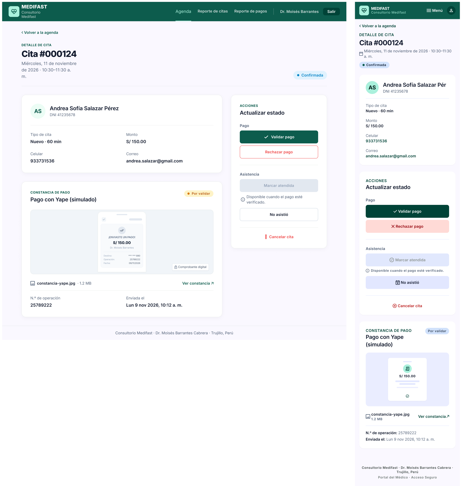
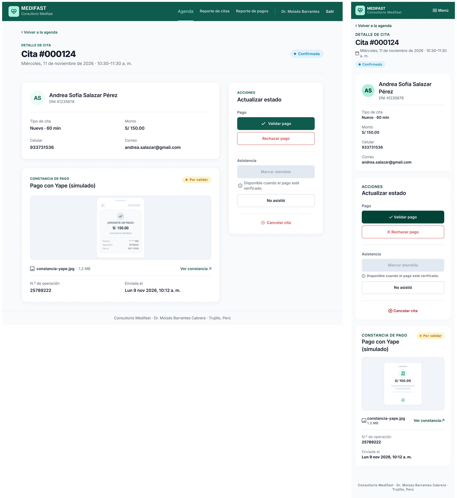
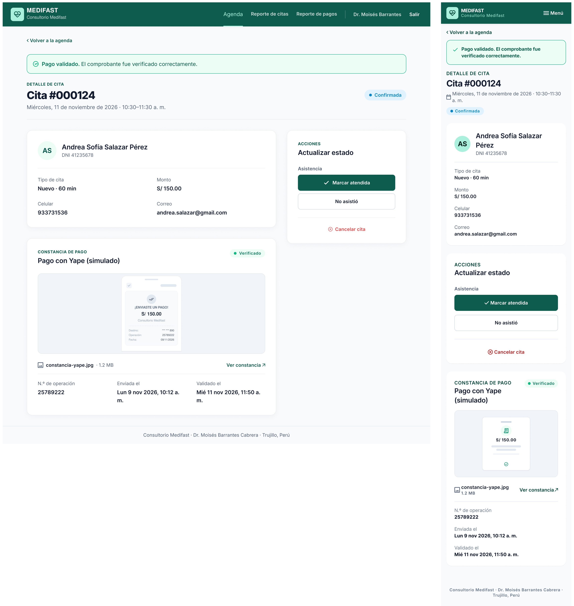
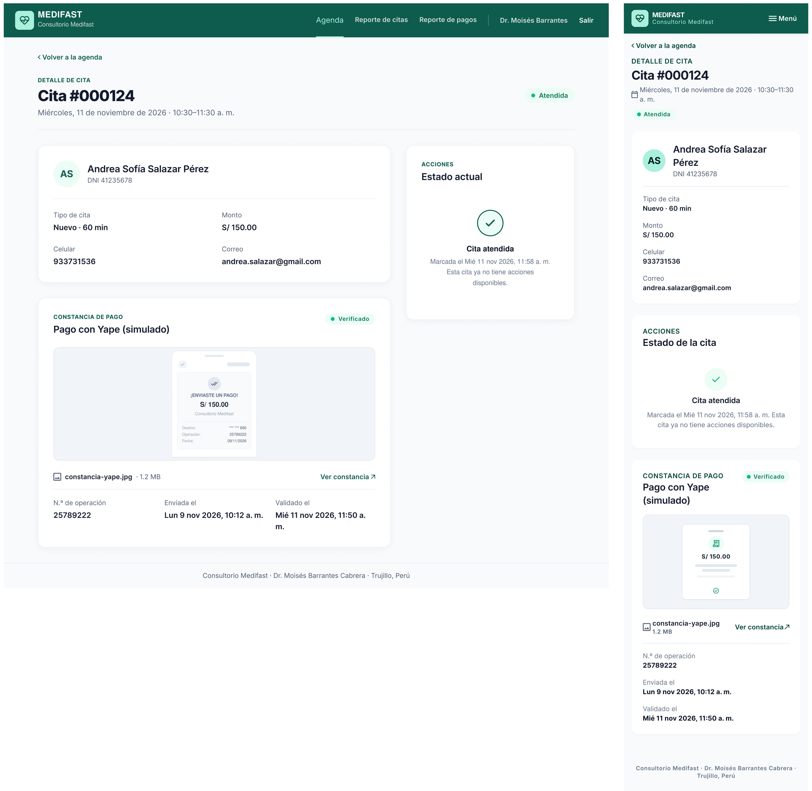
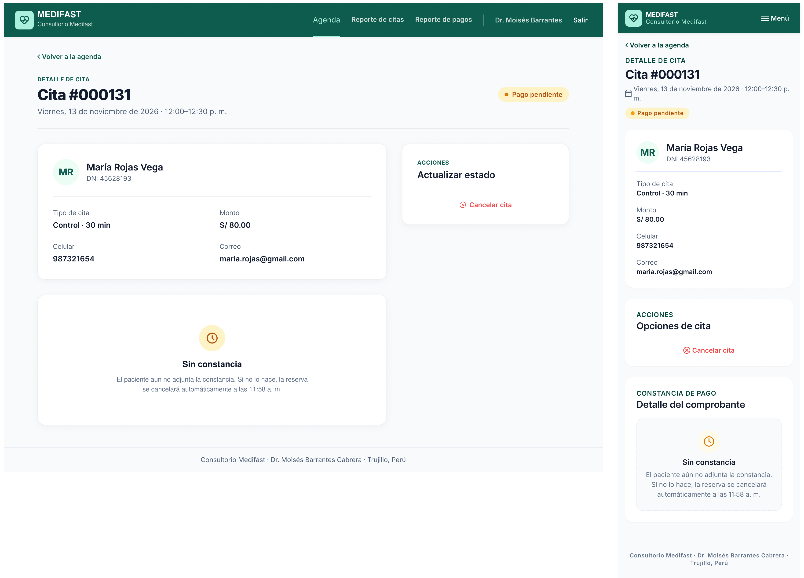
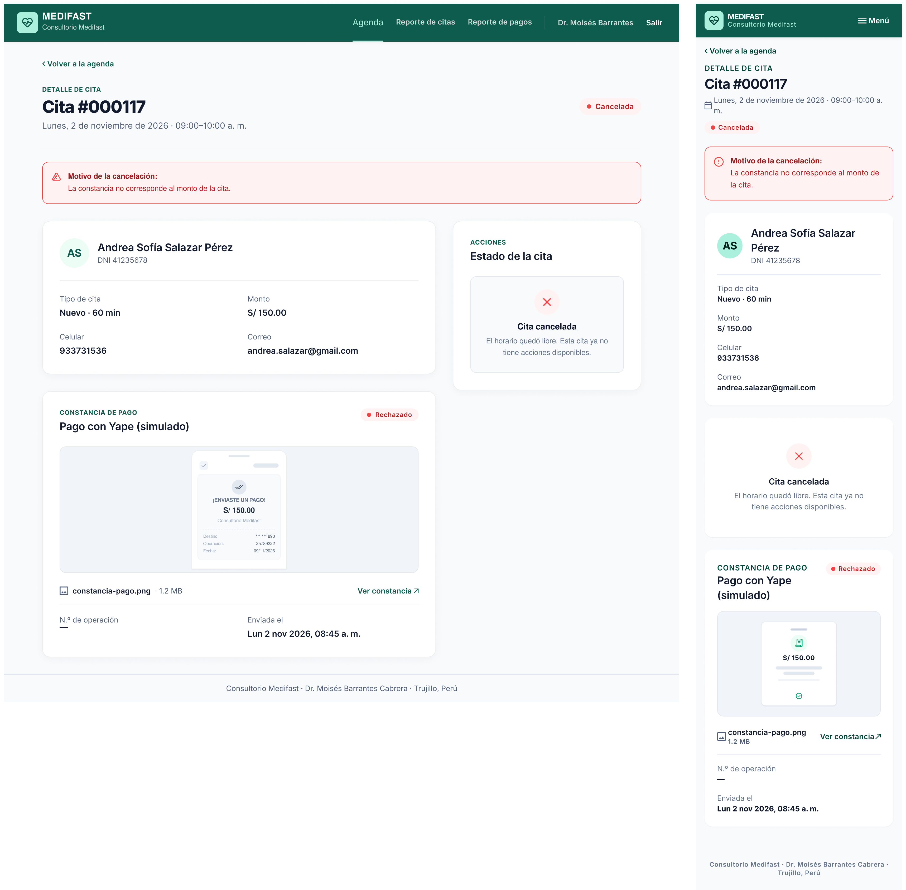
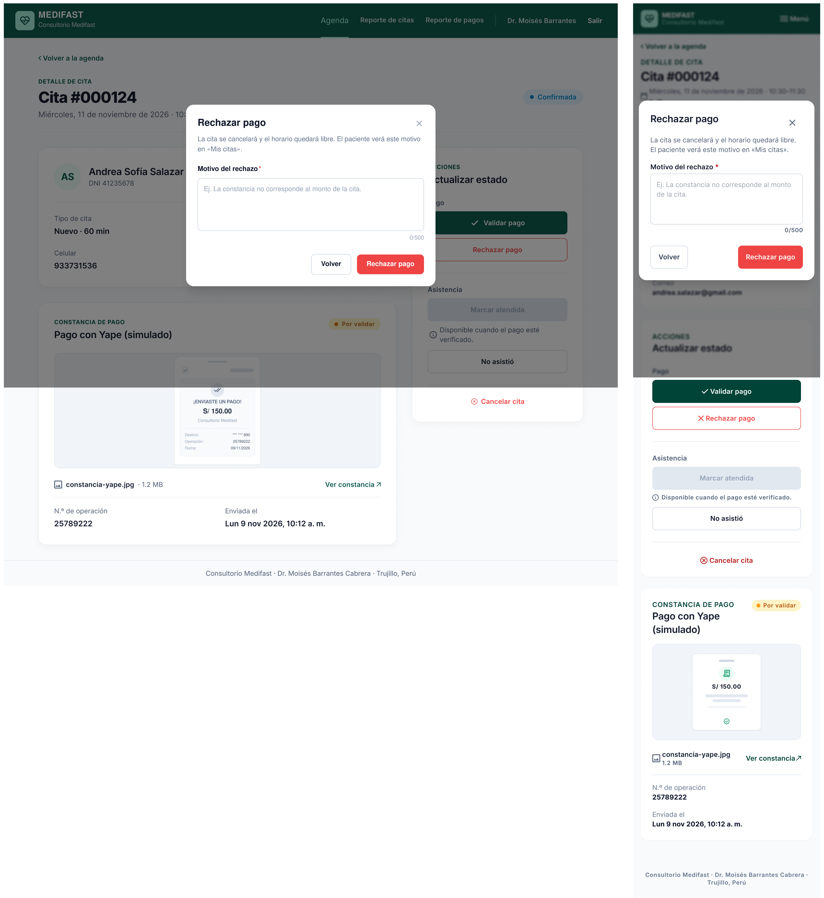
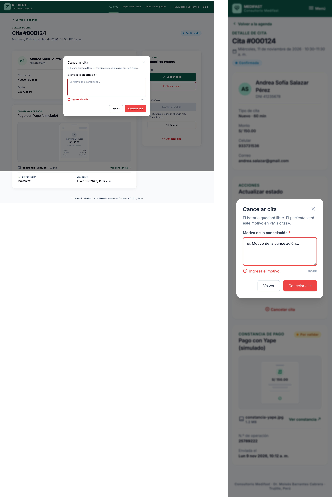

# P8 – Detalle de cita: iteraciones

- **Requerimientos:** RF08 · RF12 · RF13 · RF14 · RN-05 · RN-07 · RN-13 · RN-14 · RNF06
- **Plantilla:** `templates/medico/cita.html`
- **Referencia visual:** [referencia-detalle-cita.png](referencia-detalle-cita.png). Se toman el enlace "‹ Volver a la agenda", el encabezado (rótulo, H1 con el n.º de cita, fecha y hora, badge de estado a la derecha), las dos columnas (izquierda ~65%: card del paciente y card de la constancia; derecha ~35%: card de acciones) y la cabecera del paciente con iniciales. Contiene elementos que no se siguen:
  - "Consultorio Barrantes", el **menú lateral oscuro** y la card "¿Necesitas ayuda?": se usa la navbar superior de médico aprobada en [P7](../P7-agenda/iteraciones.md).
  - **Falta "Rechazar pago"** y el campo "Observación" es una nota de la atención (README §7.2): la observación solo es el **motivo obligatorio** al rechazar o cancelar (RN-13) y va en un modal. Las notas de atención están fuera de alcance (§3.2, RN-10).
  - **Todas las acciones activas a la vez:** "Marcar como atendida" está habilitado como acción principal aunque el pago no esté validado. Según RN-07 y RN-14, cada botón depende del estado (ver la tabla de abajo).
  - **Visor de la constancia morado** con "Constancia adjunta": morado excluido en el prompt base; se reemplaza por una vista previa de la imagen con el nombre del archivo y "Ver constancia ↗".
  - "Cita #MF-2084" → formato "#000124" (P4). "Consulta médica" → tipo **Nuevo** / **Control**. "Verificada" → etiqueta de pago de §5.2 ("Por validar" / "Verificado" / "Rechazado").
  - Fecha de agosto y "08:00 a. m.": se usa la cita de Andrea (miércoles 11 de noviembre, 10:30–11:30), coherente con P2–P7.

| Versión | Fecha | Resultado | Estado |
| --- | --- | --- | --- |
| v1 | 2026-10-26 | [v1.png](v1.png) | Revisada: escritorio casi listo, móvil con muchas desviaciones |
| v2 | 2026-10-26 | [v2.png](v2.png) | ✅ Estado principal aprobado |
| v3 | 2026-10-26 | [v3.1](v3.1.png) · [v3.2](v3.2.png) · [v3.3](v3.3.png) · [v3.4](v3.4.png) · [v3.5](v3.5.png) · [v3.6](v3.6.png) | ✅ Aprobada, con 7 ajustes a completar en Figma |

### Acciones según el estado (para la implementación)

| Acción | Habilitada si… | Regla | Si no aplica |
| --- | --- | --- | --- |
| Validar pago | Pago `POR_VALIDAR` | RF13 | Se oculta |
| Rechazar pago | Pago `POR_VALIDAR` (abre el modal del motivo) | RF13, RN-07 | Se oculta |
| Marcar atendida | Cita `PROGRAMADA`, pago `VALIDADO` y la hora de inicio ya llegó | RF08, RN-07, RN-14 | Deshabilitado con la ayuda "Disponible cuando el pago esté verificado." o "Disponible desde las 10:30 a. m." |
| No asistió | Cita `PROGRAMADA` y la hora de inicio ya llegó | RF08, RN-14 | Deshabilitado con la ayuda "Disponible desde las 10:30 a. m." |
| Cancelar cita | Cita `PENDIENTE_PAGO` o `PROGRAMADA` (abre el modal del motivo) | RF14, RN-13 | Se oculta |

En una cita `ATENDIDA`, `NO_ASISTIO` o `CANCELADA` no hay acciones: la card muestra un texto informativo.

### Decisiones de flujo

Propuestas por Claude el 2026-10-26; el usuario no las objetó y quedan adoptadas (revisión de v2):

- **Botones que no aplican:** los de pago se ocultan cuando no hay pago por validar; "Marcar atendida" y "No asistió" se muestran deshabilitados con una ayuda visible debajo (no solo tooltip, que no se ve en móvil), porque el médico necesita saber qué falta.
- **Después de cada acción:** se vuelve a mostrar P8 con la alerta de éxito arriba ("Pago validado.", "Pago rechazado. La cita se canceló y el horario quedó libre.", "Cita marcada como atendida.", "Cita marcada como no asistió.", "Cita cancelada. El horario quedó libre."). "‹ Volver a la agenda" regresa a P7 con los filtros que tenía.
- **Validar pago y marcar asistencia sin modal:** son reversibles solo por BD, pero no piden datos; se confirman con un clic. Rechazar y cancelar sí abren el modal porque piden el motivo.
- **Motivo:** obligatorio, hasta 500 caracteres (`cita.observacion` es `VARCHAR(500)`). El prompt v1 original pedía un mínimo de 20 caracteres, que el README no define; se quita.
- **Constancia:** "Ver constancia ↗" abre el archivo en una pestaña nueva, igual que en P5 (RF12, RNF06).

### Mensajes (para la implementación)

| Campo | Regla | Mensaje |
| --- | --- | --- |
| Motivo del rechazo / de la cancelación | Obligatorio | "Ingresa el motivo." |
| Motivo del rechazo / de la cancelación | Máximo 500 caracteres | "El motivo no puede superar los 500 caracteres." |
| Marcar atendida | Pago no validado (si llega por URL) | "Primero valida el pago." |
| Marcar atendida / No asistió | Hora de inicio no alcanzada | "La cita aún no empieza." |

### Datos de ejemplo

La cita #000124 de Andrea en la agenda de P7: Andrea Sofía Salazar Pérez, DNI 41235678, celular 933731536, andrea.salazar@gmail.com; Nuevo · 60 min · S/ 150.00; miércoles 11 de noviembre de 2026, 10:30–11:30 a. m.; Confirmada; constancia "constancia-yape.jpg" (1.2 MB), n.º de operación 25789222, enviada el lunes 9 de noviembre a las 10:12 a. m.; pago Por validar. Se ve a las ~11:45, así que la hora de inicio ya llegó.

---

## v1

**Prompt:** [prompt base](../00-prompt-base.md) + el prompt de abajo. Adjuntar [P7 v2](../P7-agenda/v2.png) como referencia de estilo (navbar de médico, cards y badges) y [la referencia](referencia-detalle-cita.png) como referencia de layout. Solo el estado principal (pago por validar).

```text
P8 – Detalle de cita (médico). Usa la imagen de "Agenda" adjunta (P7) como referencia de estilo: misma navbar de médico, logo, cards, badges, botones y tipografía Inter. Usa la otra imagen solo como referencia de layout (dos columnas: datos y constancia a la izquierda, acciones a la derecha). NO copies su menú lateral, su card de ayuda, su recuadro morado ni su campo "Observación".

LAYOUT (escritorio)
1. Navbar de 72px, fondo #0d5c4d, contenido alineado a ~1200px. A la IZQUIERDA, el logo: cuadrado de 40px con radio 8px en verde menta #9fe0c4 con el ícono de pulso cardíaco en #0d5c4d, y a su derecha "MEDIFAST" (18px/800 blanco) y "Consultorio Medifast" (13px, blanco al 80%). A la DERECHA, en una sola línea: "Agenda" (activo: texto #9fe0c4 con una barra de 2px debajo), "Reporte de citas", "Reporte de pagos", un separador vertical blanco al 30%, "Dr. Moisés Barrantes" (14px, blanco al 80%) y "Salir". Sin avatar ni menú lateral.
2. Fondo #f8fafc, contenido de ~1200px. Enlace "‹ Volver a la agenda" (14px/600 #0d5c4d). Encabezado: rótulo "DETALLE DE CITA" 14px/600 #0d5c4d, H1 "Cita #000124" 32px/800 (Inter, no monoespaciada) y debajo "Miércoles, 11 de noviembre de 2026 · 10:30–11:30 a. m." (16px gris #64748b). A la derecha del encabezado, el badge "Confirmada" (azul info #0284c7, píldora con punto).
3. Dos columnas alineadas arriba: izquierda ~65% con dos cards apiladas; derecha ~35% con la card de acciones. Cards blancas, radio 16px, borde 1px #e2e8f0, sombra suave.

CARD "PACIENTE Y CITA" (izquierda, arriba)
4. Cabecera: círculo de 56px fondo #ecfdf5 con "AS" (20px/700 #0d5c4d); a su derecha "Andrea Sofía Salazar Pérez" (20px/600) y "DNI 41235678" (14px gris). Línea divisoria #e2e8f0.
5. Datos en 2 columnas, etiqueta 14px gris arriba y valor 16px/600 abajo: "Tipo de cita" = "Nuevo · 60 min" | "Monto" = "S/ 150.00"; "Celular" = "933731536" | "Correo" = "andrea.salazar@gmail.com".

CARD "CONSTANCIA DE PAGO" (izquierda, abajo)
6. Cabecera: rótulo "CONSTANCIA DE PAGO" 14px/600 #0d5c4d y título "Pago con Yape (simulado)" 20px/600; a la derecha el badge "Por validar" (ámbar).
7. Vista previa de la constancia: recuadro de 240px de alto, fondo #f1f5f9, borde 1px #e2e8f0, radio 12px, con una miniatura de una captura de pantalla de celular centrada (gris claro, sin colores morados). Debajo, una fila con ícono de imagen, "constancia-yape.jpg" (14px/600), "1.2 MB" (14px gris) y a la derecha el enlace "Ver constancia ↗" en #0d5c4d (abre en una pestaña nueva).
8. Datos en 2 columnas: "N.º de operación" = "25789222" | "Enviada el" = "Lun 9 nov 2026, 10:12 a. m.".

CARD "ACCIONES" (derecha)
9. Rótulo "ACCIONES" 14px/600 #0d5c4d, título "Actualizar estado" 20px/600.
10. Sección "Pago" (14px/600 gris): botón primario a ancho completo "Validar pago" con ícono de check (relleno #0d5c4d, texto blanco, 48px, radio 8px) y debajo el botón de peligro con borde "Rechazar pago" (fondo blanco, borde 1px #ef4444, texto #ef4444, 48px).
11. Línea divisoria #e2e8f0. Sección "Asistencia" (14px/600 gris): botón "Marcar atendida" DESHABILITADO (fondo #e2e8f0, texto #94a3b8, 48px) con la ayuda debajo, 14px gris con ícono de información: "Disponible cuando el pago esté verificado."; y debajo el botón secundario habilitado "No asistió" (fondo blanco, borde 1px #cbd5e1, texto #0f172a, 48px).
12. Línea divisoria #e2e8f0. Enlace de peligro centrado "Cancelar cita" (texto #ef4444, 14px/600, con ícono de x).
13. Pie de página: "Consultorio Medifast · Dr. Moisés Barrantes Cabrera · Trujillo, Perú".

MÓVIL (360px)
14. Navbar con el logo a la izquierda y solo el botón "Menú" (ícono + texto) a la derecha, sin avatar ni barra de pestañas inferior. "‹ Volver a la agenda", encabezado con los mismos textos y el badge "Confirmada" debajo de la fecha.
15. Una sola columna en este orden: card "Paciente y cita" (datos en una columna), card "Acciones" (botones a ancho completo, mismos textos, estados y ayuda) y card "Constancia de pago".

No incluir: menú lateral, avatar, card de ayuda con teléfono, campo de observación o notas de la atención, diagnóstico, receta, historia clínica o cualquier dato clínico, reprogramar, editar la cita, enviar mensajes o correos al paciente, recuadros o fondos morados o lavanda, barra de pestañas inferior. Etiquetas de estado exactamente: "Pago pendiente", "Confirmada", "Atendida", "No asistió", "Cancelada" / "Por validar", "Verificado", "Rechazado".
```

**Resultado:** un frame de escritorio y uno móvil del estado principal.



### Próximos prompts (después de aprobar el principal)

**Estados**, duplicando el frame aprobado; pegar una vez con el frame de escritorio y otra con el móvil:

```text
Duplica este frame 4 veces y en cada copia cambia solo lo que se indica. No toques navbar, encabezado, cards, colores ni estilos.

A. "Pago validado": arriba del encabezado, alerta de éxito (fondo #ecfdf5, borde 1px #10b981, ícono de check) con "Pago validado." en negrita. En la card de la constancia, el badge pasa a "Verificado" (verde) y se agrega el dato "Validado el" = "Mié 11 nov 2026, 11:50 a. m.". En la card de acciones desaparece la sección "Pago"; "Marcar atendida" pasa a botón primario habilitado (relleno #0d5c4d, texto blanco, ícono de check) y desaparece su ayuda. "No asistió" y "Cancelar cita" se mantienen.

B. "Atendida": partiendo de A, sin la alerta. El badge del encabezado pasa a "Atendida" (verde). La card de acciones no tiene botones: muestra un ícono de check en un círculo #ecfdf5, el título "Cita atendida" (16px/600) y el texto "Marcada el Mié 11 nov 2026, 11:58 a. m. Esta cita ya no tiene acciones disponibles." (14px gris).

C. "Cancelada por rechazo": cambia la cita a "Cita #000117", "Lunes, 2 de noviembre de 2026 · 09:00–10:00 a. m." y badge "Cancelada" (rojo). El badge de la constancia pasa a "Rechazado" (rojo), con "constancia-pago.png" y el n.º de operación "—". Debajo del encabezado, un aviso rojo tenue (fondo #fef2f2, borde 1px #ef4444, ícono de alerta): "Motivo de la cancelación:" en negrita y "La constancia no corresponde al monto de la cita.". La card de acciones no tiene botones: ícono de x en un círculo #fef2f2, título "Cita cancelada" y texto "El horario quedó libre. Esta cita ya no tiene acciones disponibles."

D. "Pago pendiente": cambia la cita a "Cita #000131", "Viernes, 13 de noviembre de 2026 · 12:00–12:30 p. m.", paciente "MR" "María Rojas Vega" "DNI 45628193", "Control · 30 min", "S/ 80.00", celular "987321654" y correo "maria.rojas@gmail.com". Badge del encabezado "Pago pendiente" (ámbar). La card de la constancia no tiene vista previa ni datos: muestra un ícono de reloj en un círculo #fffbeb, el título "Sin constancia" y el texto "El paciente aún no adjunta la constancia. Si no lo hace, la reserva se cancelará automáticamente a las 11:58 a. m." (14px gris), sin badge de pago. En la card de acciones solo queda el enlace "Cancelar cita"; las secciones "Pago" y "Asistencia" desaparecen.
```

**Modal del motivo**, en un prompt aparte con el frame principal seleccionado (pegar con el de escritorio y con el móvil):

```text
Duplica este frame 2 veces y en cada copia agrega un modal centrado sobre un fondo oscuro al 50%. No toques el resto de la pantalla.

A. "Modal rechazar pago": modal blanco de 520px (en móvil, ancho completo con 16px de margen), radio 16px. Título "Rechazar pago" (20px/600) y botón de cerrar (x). Texto: "La cita se cancelará y el horario quedará libre. El paciente verá este motivo en «Mis citas»." (14px gris). Textarea "Motivo del rechazo" (etiqueta en negrita, obligatorio con asterisco rojo), 4 líneas, placeholder "Ej. La constancia no corresponde al monto de la cita.", contador "0/500" abajo a la derecha. Pie con dos botones alineados a la derecha: secundario "Volver" y de peligro relleno "Rechazar pago" (fondo #ef4444, texto blanco).

B. "Modal cancelar cita, con error": igual que A, con el título "Cancelar cita", el texto "El horario quedará libre. El paciente verá este motivo en «Mis citas».", la etiqueta "Motivo de la cancelación", el textarea vacío con borde rojo #ef4444 y debajo el mensaje rojo 14px con ícono de alerta "Ingresa el motivo.". Botones "Volver" y "Cancelar cita" (peligro relleno).
```

### Feedback

**Lo que funciona (mantener):**

- Escritorio: dos columnas con las tres cards en su lugar, sin menú lateral, card de ayuda, campo de observación ni recuadro morado.
- La lógica de acciones de RN-07/RN-14 se entendió: "Validar pago" primario, "Rechazar pago" con borde rojo, "Marcar atendida" deshabilitado con la ayuda "Disponible cuando el pago esté verificado.", "No asistió" secundario y "Cancelar cita" como enlace rojo.
- Datos de ejemplo exactos: #000124, Andrea, DNI, Nuevo · 60 min, S/ 150.00, constancia-yape.jpg, 25789222, "Lun 9 nov 2026, 10:12 a. m.".
- Badges "Confirmada" (azul) y "Por validar" (ámbar) correctos en escritorio.

**Lo que hay que corregir:**

| # | Problema | Dónde | Severidad | Veces |
| --- | --- | --- | --- | --- |
| 1 | **Fondo de página lavanda** #faf8ff (se repite el problema de P7 v1) | Ambas | Media | 1.ª |
| 2 | La fecha del encabezado se parte en 3 líneas en una columna angosta, con el badge muy abajo | Escritorio | Media | 1.ª |
| 3 | La vista previa de la constancia tiene un chip con candado "Comprobante digital" (sello de confianza excluido) | Escritorio | Media | 1.ª |
| 4 | "Salir" como botón oscuro relleno; en P7 es un enlace de texto | Escritorio | Baja | 1.ª |
| 5 | "Consultorio Medifast" en dos líneas en el logo | Escritorio | Baja | 1.ª |
| 6 | El ícono de "Cancelar cita" es una barra roja en lugar de una x | Escritorio | Baja | 1.ª |
| 7 | **Badge "Por validar" gris-azulado** en lugar de ámbar | Móvil | Alta | 1.ª |
| 8 | Rellenos lavanda: "Marcar atendida" deshabilitado (#e1e8fd), "No asistió" relleno lavanda (debe ser blanco con borde) y vista previa de la constancia (#eaedff) | Móvil | Media | 1.ª |
| 9 | "Rechazar pago" relleno rosa; en escritorio es blanco con borde rojo | Móvil | Media | 1.ª |
| 10 | Ícono de **avatar** en la navbar | Móvil | Media | 1.ª |
| 11 | Pie con el texto inventado "Portal del Médico · Acceso Seguro" | Móvil | Media | 1.ª |
| 12 | Nombre cortado "Andrea Sofía Salazar Pér" | Móvil | Media | 1.ª |
| 13 | Badge "Confirmada" con punto verde (debe ser azul #0284c7); celular y correo en verde como enlaces | Móvil | Baja | 1.ª |

El móvil se aleja del escritorio en casi todos los componentes. Siguiendo la lección de P2, en vez de describir cada corrección se le pide que **copie** los componentes del escritorio ya corregido.

---

## v2

Un prompt por dispositivo: primero escritorio y luego móvil.

### Prompt 1 — Escritorio

Seleccionar solo **el frame de escritorio** y pegar:

```text
Edita solo este frame. No cambies las cards, los datos, los botones de acciones ni los badges.
1. Fondo de la página #f8fafc (gris neutro, sin tono lavanda ni morado).
2. Encabezado: la fecha "Miércoles, 11 de noviembre de 2026 · 10:30–11:30 a. m." en UNA sola línea, a todo el ancho. El badge "Confirmada" a la derecha, alineado verticalmente con el título "Cita #000124".
3. En la vista previa de la constancia, quita el chip con candado "Comprobante digital". En la miniatura, cambia "Dr. Moisés Barrantes" por "Consultorio Medifast".
4. En la navbar, "Salir" como enlace de texto blanco, sin fondo ni borde, igual que los demás enlaces.
5. En el logo, "Consultorio Medifast" en una sola línea (13px, blanco al 80%).
6. "Cancelar cita": el ícono a la izquierda es una x dentro de un círculo (línea fina, #ef4444), no una barra.
Ningún fondo ni relleno puede tener tono lavanda, azulado o morado: usa solo blanco, #f8fafc, #f1f5f9 o #ecfdf5.
```

### Prompt 2 — Móvil

Seleccionar solo **el frame móvil** y pegar:

```text
Edita solo este frame. Copia exactamente los componentes del frame de escritorio (botones, badges, vista previa de la constancia y colores); solo cambia la disposición a una columna. No cambies los textos ni el orden de las cards.
1. Fondo de la página #f8fafc (sin tono lavanda).
2. Navbar: quita el ícono de avatar; a la derecha solo queda el botón "Menú".
3. Badge "Confirmada" con fondo #e0f2fe, punto y texto azul #0284c7. Badge "Por validar" ámbar: fondo #fef3c7, punto #f59e0b y texto #b45309.
4. Nombre "Andrea Sofía Salazar Pérez" completo, en dos líneas si no cabe (sin cortar).
5. "Celular" y "Correo" con el valor en texto oscuro #0f172a, no verde.
6. "Rechazar pago": fondo blanco, borde 1px #ef4444 y texto #ef4444 (igual que en escritorio), sin relleno rosa.
7. "Marcar atendida" deshabilitado: fondo #e2e8f0, texto #94a3b8, sin ícono. "No asistió": fondo blanco, borde 1px #cbd5e1, texto #0f172a, sin ícono.
8. Vista previa de la constancia: fondo #f1f5f9, borde 1px #e2e8f0, la misma miniatura del escritorio. "N.º de operación" y "Enviada el" como etiqueta gris arriba y valor en negrita abajo, igual que en escritorio.
9. Pie de página: solo "Consultorio Medifast · Dr. Moisés Barrantes Cabrera · Trujillo, Perú". Borra "Portal del Médico · Acceso Seguro".
Ningún fondo ni relleno puede tener tono lavanda, azulado o morado: usa solo blanco, #f8fafc, #f1f5f9, #ecfdf5, #fef3c7 o #e0f2fe.
```

**Resultado:** los dos frames corregidos.



**Corregido respecto a v1:** #1 fondo #f8fafc en ambos (medido); #2 fecha en una línea y badge alineado con el título; #3 sin el chip "Comprobante digital"; #4 "Salir" como enlace; #5 logo en una línea; #6 ícono x en círculo; #7 "Por validar" ámbar en móvil; #8 "Marcar atendida" #e2e8f0, "No asistió" blanco con borde y vista previa #f1f5f9; #9 "Rechazar pago" con borde rojo; #10 sin avatar; #11 pie sin texto inventado; #12 nombre completo en dos líneas; #13 "Confirmada" azul y datos en texto oscuro.

**Pendiente (pasa a Figma):**

| # | Problema | Dónde | Severidad | Veces |
| --- | --- | --- | --- | --- |
| 14 | La miniatura de la constancia es distinta de la de escritorio (más simple) | Móvil | Baja | 1.ª |
| 15 | La fecha del encabezado lleva un ícono de calendario que no tiene el escritorio | Móvil | Baja | 1.ª |
| 16 | "Rechazar pago" con ícono x; en escritorio no lo tiene | Móvil | Baja | 1.ª |

Se aprueba el **estado principal** (pago por validar) con v2. Los estados y los modales se generan en v3 duplicando estos frames.

---

## v3

Dos prompts, cada uno pegado **dos veces** (con el frame de escritorio de v2 seleccionado y luego con el móvil). Guardar las capturas como:

- `v3.1.png` A. Pago validado · `v3.2.png` B. Atendida · `v3.3.png` C. Cancelada por rechazo · `v3.4.png` D. Pago pendiente
- `v3.5.png` modal "Rechazar pago" · `v3.6.png` modal "Cancelar cita" con error

### Prompt 1 — Estados

```text
Duplica este frame 4 veces y en cada copia cambia solo lo que se indica. No toques navbar, encabezado, cards, colores ni estilos.

A. "Pago validado": arriba del encabezado, alerta de éxito (fondo #ecfdf5, borde 1px #10b981, ícono de check) con "Pago validado." en negrita. En la card de la constancia, el badge pasa a "Verificado" (verde) y se agrega el dato "Validado el" = "Mié 11 nov 2026, 11:50 a. m.". En la card de acciones desaparece la sección "Pago"; "Marcar atendida" pasa a botón primario habilitado (relleno #0d5c4d, texto blanco, ícono de check) y desaparece su ayuda. "No asistió" y "Cancelar cita" se mantienen.

B. "Atendida": partiendo de A, sin la alerta. El badge del encabezado pasa a "Atendida" (verde). La card de acciones no tiene botones: muestra un ícono de check en un círculo #ecfdf5, el título "Cita atendida" (16px/600) y el texto "Marcada el Mié 11 nov 2026, 11:58 a. m. Esta cita ya no tiene acciones disponibles." (14px gris).

C. "Cancelada por rechazo": cambia la cita a "Cita #000117", "Lunes, 2 de noviembre de 2026 · 09:00–10:00 a. m." y badge "Cancelada" (rojo). El badge de la constancia pasa a "Rechazado" (rojo), con "constancia-pago.png" y el n.º de operación "—". Debajo del encabezado, un aviso rojo tenue (fondo #fef2f2, borde 1px #ef4444, ícono de alerta): "Motivo de la cancelación:" en negrita y "La constancia no corresponde al monto de la cita.". La card de acciones no tiene botones: ícono de x en un círculo #fef2f2, título "Cita cancelada" y texto "El horario quedó libre. Esta cita ya no tiene acciones disponibles."

D. "Pago pendiente": cambia la cita a "Cita #000131", "Viernes, 13 de noviembre de 2026 · 12:00–12:30 p. m.", paciente "MR" "María Rojas Vega" "DNI 45628193", "Control · 30 min", "S/ 80.00", celular "987321654" y correo "maria.rojas@gmail.com". Badge del encabezado "Pago pendiente" (ámbar). La card de la constancia no tiene vista previa ni datos: muestra un ícono de reloj en un círculo #fffbeb, el título "Sin constancia" y el texto "El paciente aún no adjunta la constancia. Si no lo hace, la reserva se cancelará automáticamente a las 11:58 a. m." (14px gris), sin badge de pago. En la card de acciones solo queda el enlace "Cancelar cita"; las secciones "Pago" y "Asistencia" desaparecen.
```

### Prompt 2 — Modales

```text
Duplica este frame 2 veces y en cada copia agrega un modal centrado sobre un fondo oscuro al 50%. No toques el resto de la pantalla.

A. "Modal rechazar pago": modal blanco de 520px (en móvil, ancho completo con 16px de margen), radio 16px. Título "Rechazar pago" (20px/600) y botón de cerrar (x). Texto: "La cita se cancelará y el horario quedará libre. El paciente verá este motivo en «Mis citas»." (14px gris). Textarea "Motivo del rechazo" (etiqueta en negrita, obligatorio con asterisco rojo), 4 líneas, placeholder "Ej. La constancia no corresponde al monto de la cita.", contador "0/500" abajo a la derecha. Pie con dos botones alineados a la derecha: secundario "Volver" y de peligro relleno "Rechazar pago" (fondo #ef4444, texto blanco).

B. "Modal cancelar cita, con error": igual que A, con el título "Cancelar cita", el texto "El horario quedará libre. El paciente verá este motivo en «Mis citas».", la etiqueta "Motivo de la cancelación", el textarea vacío con borde rojo #ef4444 y debajo el mensaje rojo 14px con ícono de alerta "Ingresa el motivo.". Botones "Volver" y "Cancelar cita" (peligro relleno).
```

**Resultado:** los 4 estados y los 2 modales, cada uno con su escritorio y su móvil. El usuario guardó D como `v3.3` y C como `v3.4` (al revés de lo planeado); se respeta su numeración:

| Captura | Estado | Escritorio | Móvil |
| --- | --- | --- | --- |
| [v3.1](v3.1.png) | A. Pago validado | ✅ | ✅ |
| [v3.2](v3.2.png) | B. Atendida | ⚠️ título de card distinto | ⚠️ |
| [v3.3](v3.3.png) | D. Pago pendiente | ⚠️ constancia sin cabecera | ⚠️ título "Opciones de cita" |
| [v3.4](v3.4.png) | C. Cancelada por rechazo | ⚠️ miniatura con datos de otra cita | ⚠️ card de acciones sin cabecera |
| [v3.5](v3.5.png) | Modal "Rechazar pago" | ⚠️ overlay cortado | ⚠️ overlay cortado |
| [v3.6](v3.6.png) | Modal "Cancelar cita" con error | ⚠️ overlay cortado | ⚠️ placeholder oscuro |













**Lo que funciona (mantener):**

- La lógica de acciones de la tabla se respeta en los 4 estados: con el pago validado desaparece "Pago" y "Marcar atendida" se habilita; en Atendida y Cancelada no hay botones; en Pago pendiente solo queda "Cancelar cita".
- Badges correctos en todos los frames: "Confirmada", "Atendida", "Cancelada", "Pago pendiente" / "Verificado", "Rechazado".
- Cancelada: aviso rojo con el motivo de P5 ("La constancia no corresponde al monto de la cita."), n.º de operación "—".
- Pago pendiente: cita #000131 de María (Control · 30 min · S/ 80.00) con "Sin constancia" y la hora de vencimiento.
- Modales con el título, el texto sobre «Mis citas», el motivo obligatorio con asterisco, el contador "0/500", "Volver" y la acción en rojo; el error "Ingresa el motivo." con borde rojo.
- Navbar, fondo #f8fafc y estilos idénticos a v2 en todos los frames, sin avatar ni lavanda.

**Pendiente (pasa a Figma):**

| # | Problema | Dónde | Severidad | Veces |
| --- | --- | --- | --- | --- |
| 17 | El overlay oscuro de los modales cubre solo la parte de arriba de la pantalla | v3.5 ambas, v3.6 escritorio | Media (mecánico) | 1.ª |
| 18 | Título de la card de acciones distinto en cada estado: "Actualizar estado", "Estado actual", "Estado de la cita", "Opciones de cita" o sin cabecera | v3.2, v3.3, v3.4 | Baja | 1.ª |
| 19 | La miniatura de la constancia rechazada muestra los datos de la cita #000124 (25789222, 09/11/2026) | v3.4 | Baja | 1.ª |
| 20 | La card de la constancia en Pago pendiente no tiene cabecera en escritorio; en móvil dice "Detalle del comprobante" | v3.3 | Baja | 1.ª |
| 21 | La alerta dice "Pago validado. El comprobante fue verificado correctamente." (texto agregado, y "comprobante" en vez de "constancia") | v3.1 | Baja | 1.ª |
| 22 | Placeholder del textarea en texto oscuro, parece un valor | Móvil, v3.6 | Baja | 1.ª |
| 14–16 | Miniatura móvil distinta, ícono de calendario en la fecha y "x" en "Rechazar pago" (de v2) | Móvil | Baja | — |

### Decisión

Se aprueba v3. Frames base para Figma: [v2](v2.png) (pago por validar), [v3.1](v3.1.png) (pago validado), [v3.2](v3.2.png) (atendida), [v3.4](v3.4.png) (cancelada), [v3.3](v3.3.png) (pago pendiente), [v3.5](v3.5.png) y [v3.6](v3.6.png) (modales), cada uno en escritorio y móvil. Ajustes a completar en Figma:

1. **Modales:** overlay #0f172a al 50% a pantalla completa (corrige #17); placeholder del textarea en #94a3b8 (corrige #22). Crear un solo componente de modal de motivo con dos variantes (rechazar / cancelar) y el estado de error.
2. **Card de acciones:** cabecera fija "ACCIONES" + "Actualizar estado" cuando hay acciones, y "ACCIONES" + "Estado de la cita" en los estados finales (Atendida, Cancelada). Mismo ícono en círculo relleno para el estado final en escritorio y móvil. Corrige #18.
3. **Constancia rechazada (v3.4):** en la miniatura, el n.º de operación "—" y la fecha "02/11/2026". Corrige #19.
4. **Constancia en Pago pendiente (v3.3):** la misma cabecera que los demás estados ("CONSTANCIA DE PAGO" + "Pago con Yape (simulado)"), sin badge. Corrige #20.
5. **Alerta de éxito (v3.1):** solo "Pago validado." (el resto de las alertas de éxito según la tabla de decisiones de flujo). Corrige #21.
6. **Móvil:** la miniatura de la constancia igual a la de escritorio; quitar el ícono de calendario de la fecha y la "x" de "Rechazar pago". Corrige #14–#16.
7. **Componentes nuevos:** card de acciones con sus variantes por estado, card de constancia (con vista previa, sin constancia, rechazada), aviso de motivo de cancelación, estado final con ícono.

**Aprendizaje para las siguientes pantallas:** al duplicar estados que cambian el texto de una cabecera, Stitch inventa un título distinto en cada copia. Conviene escribir en el prompt el título literal de cada card en cada estado, aunque no cambie.
