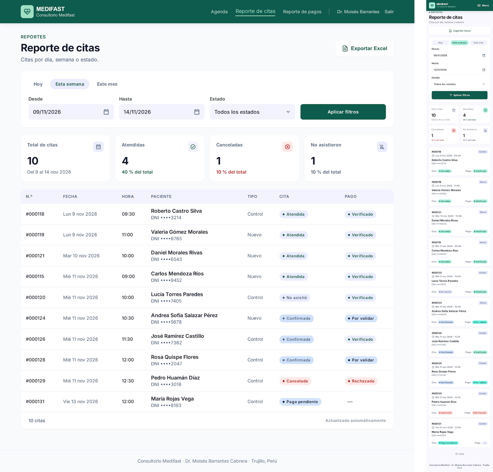
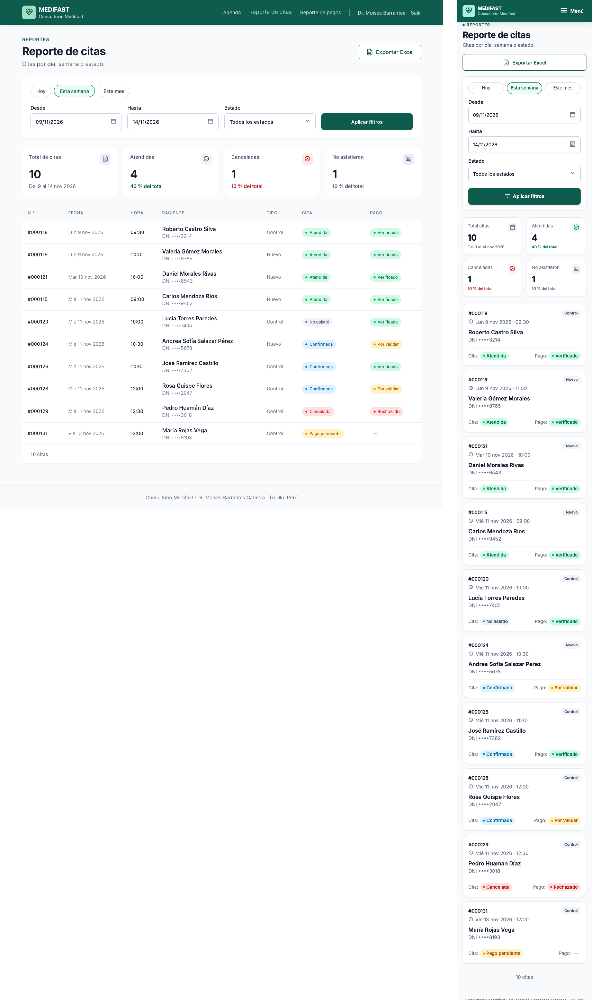
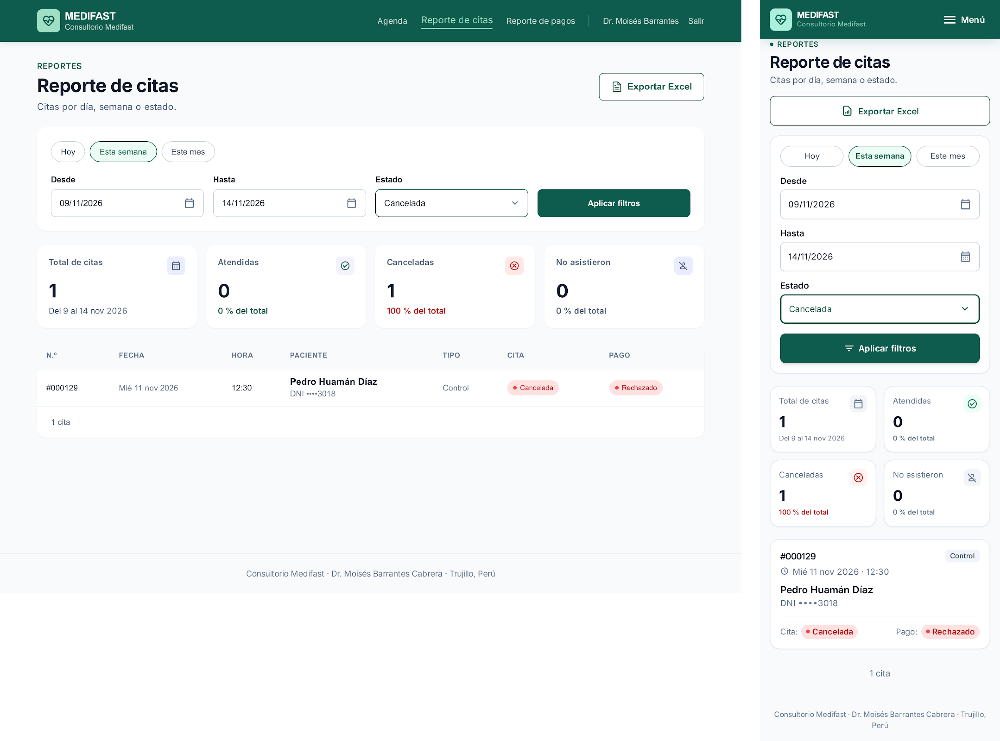
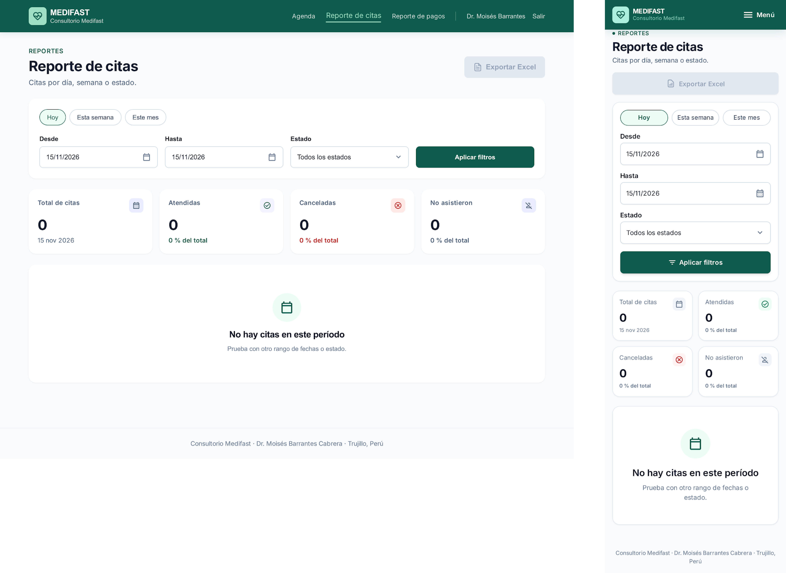
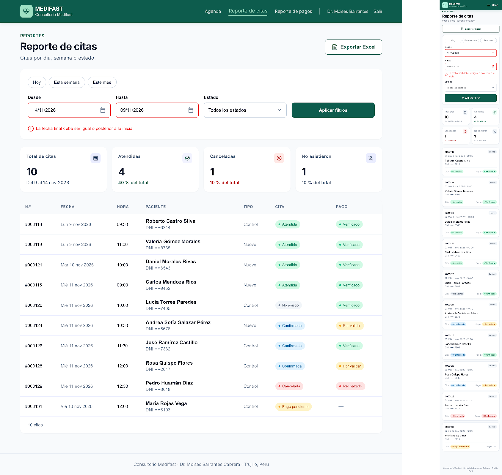

# P9 – Reporte de citas: iteraciones

- **Requerimientos:** RF09 · RN-05 · RNF07 · RNF14 (Apache POI para el .xlsx)
- **Plantilla:** `templates/medico/reporte-citas.html`
- **Referencia visual:** [referencia-reporte-citas.png](referencia-reporte-citas.png). Se toman el encabezado (rótulo, H1, texto y "Exportar Excel" a la derecha), la card de filtros en una fila con el botón "Aplicar filtros", los 4 indicadores (total, atendidas, canceladas y no asistieron, como pide RF09) y la tabla con n.º de cita, paciente con documento, fecha y hora, tipo, estado y pago. Contiene elementos que no se siguen:
  - "Consultorio Barrantes", el **menú lateral oscuro**, la cabecera "PANEL MÉDICO" con avatar "MB" y la card de ayuda: se usa la navbar superior de médico de [P7](../P7-agenda/iteraciones.md).
  - **Filtro "Período: Agosto 2026"** (por mes): README §7.2 y RF09 piden **rango de fechas** (Desde / Hasta), con día, semana y mes como atajos.
  - **Buscador "Paciente o documento":** RF09 no lo pide; se quita.
  - **Etiquetas fuera de §5.2:** "Pendiente" → "Pago pendiente"; pago "Pagado" / "Pendiente" → "Verificado" / "Por validar" / "Rechazado" / "—". "Confirmada" va en azul y "Atendida" en verde.
  - "+6 vs. julio" y "Requiere revisión": comparación con otro período y textos que RF09 no define. Se usan porcentajes sobre el total.
  - "#MF-2084" → "#000124". "Consulta general" / "Control médico" → **Nuevo** / **Control**. Horas de las 08:00 → horario de 09:00 a 13:00.
  - DNI completo → DNI parcial, como en P7 (RNF07).

| Versión | Fecha | Resultado | Estado |
| --- | --- | --- | --- |
| v1 | 2026-10-26 | [v1.png](v1.png) | Revisada: contenido correcto, colores de badges e inputs incorrectos |
| v2 | 2026-10-26 | [v2.png](v2.png) | ✅ Estado principal aprobado |
| v3 | 2026-10-26 | [v3.1](v3.1.png) · [v3.2](v3.2.png) · [v3.3](v3.3.png) | ✅ Aprobada, con 5 ajustes a completar en Figma |

### Decisiones de flujo

Propuestas por Claude el 2026-10-26; el usuario no las objetó y quedan adoptadas (revisión de v2):

- **Filtro por defecto:** al entrar, "Esta semana" (lunes a sábado de la semana actual) y "Todos los estados".
- **Atajos:** "Hoy", "Esta semana" y "Este mes" solo rellenan Desde / Hasta; la consulta se ejecuta con "Aplicar filtros". El rango máximo no se limita en la interfaz (el README no lo define).
- **Indicadores sobre el resultado filtrado:** los 4 indicadores cuentan las filas del rango y del estado elegidos. Con el estado "Cancelada", el total y "Canceladas" coinciden y los demás quedan en 0.
- **"Exportar Excel"** descarga un .xlsx con los mismos filtros y columnas de la tabla, más una hoja o fila de resumen con los 4 indicadores (RF09). Se deshabilita cuando no hay resultados.
- **Fila → P8:** cada fila abre el detalle de la cita, como en la agenda.
- **Validación de fechas:** si "Hasta" es anterior a "Desde", no se consulta y se muestra el error bajo "Hasta".

### Mensajes (para la implementación)

| Campo | Regla | Mensaje |
| --- | --- | --- |
| Desde / Hasta | Obligatorias | "Ingresa la fecha." |
| Hasta | Igual o posterior a Desde | "La fecha final debe ser igual o posterior a la inicial." |
| Resultado vacío | Sin citas en el rango y estado | Título "No hay citas en este período", texto "Prueba con otro rango de fechas o estado." |

### Datos de ejemplo

Semana del 9 al 14 de noviembre de 2026, vista el miércoles 11 a las ~11:45 (el mismo momento que P7). Son las 9 citas de la semana de [P7 v3.1](../P7-agenda/v3.1.png) más la cita #000131 de María del viernes 13 ([P8 v3.3](../P8-detalle-cita/v3.3.png)). La fila de las 12:00 del miércoles pasa a **Rosa Quispe Flores** (Confirmada · Por validar): María no puede tener dos citas activas (RN-09); el ajuste se agregó también en P7.

| N.º | Fecha | Hora | Paciente | DNI | Tipo | Cita | Pago |
| --- | --- | --- | --- | --- | --- | --- | --- |
| #000118 | Lun 9 nov | 09:30 | Roberto Castro Silva | ••••3214 | Control | Atendida | Verificado |
| #000119 | Lun 9 nov | 11:00 | Valeria Gómez Morales | ••••8765 | Nuevo | Atendida | Verificado |
| #000121 | Mar 10 nov | 10:00 | Daniel Morales Rivas | ••••6543 | Nuevo | Atendida | Verificado |
| #000115 | Mié 11 nov | 09:00 | Carlos Mendoza Ríos | ••••9452 | Nuevo | Atendida | Verificado |
| #000120 | Mié 11 nov | 10:00 | Lucía Torres Paredes | ••••7405 | Control | No asistió | Verificado |
| #000124 | Mié 11 nov | 10:30 | Andrea Sofía Salazar Pérez | ••••5678 | Nuevo | Confirmada | Por validar |
| #000126 | Mié 11 nov | 11:30 | José Ramírez Castillo | ••••7362 | Control | Confirmada | Verificado |
| #000128 | Mié 11 nov | 12:00 | Rosa Quispe Flores | ••••2047 | Control | Confirmada | Por validar |
| #000129 | Mié 11 nov | 12:30 | Pedro Huamán Díaz | ••••3018 | Control | Cancelada | Rechazado |
| #000131 | Vie 13 nov | 12:00 | María Rojas Vega | ••••8193 | Control | Pago pendiente | — |

Indicadores (calculados de las filas): Total **10** · Atendidas **4** (40 %) · Canceladas **1** (10 %) · No asistieron **1** (10 %).

---

## v1

**Prompt:** [prompt base](../00-prompt-base.md) + el prompt de abajo. Adjuntar [P7 v2](../P7-agenda/v2.png) como referencia de estilo (navbar de médico, indicadores, tabla y badges) y [la referencia](referencia-reporte-citas.png) como referencia de layout. Solo el estado principal.

```text
P9 – Reporte de citas (médico). Usa la imagen de "Agenda" adjunta (P7) como referencia de estilo: misma navbar de médico, logo, cards de indicadores, tabla, badges, inputs y tipografía Inter. Usa la otra imagen solo como referencia de layout (encabezado con "Exportar Excel", filtros en una card, 4 indicadores y tabla). NO copies su menú lateral, su avatar, su card de ayuda ni su buscador.

LAYOUT (escritorio)
1. Navbar de 72px, fondo #0d5c4d, contenido alineado a ~1200px. A la IZQUIERDA, el logo: cuadrado de 40px con radio 8px en verde menta #9fe0c4 con el ícono de pulso cardíaco en #0d5c4d, y a su derecha "MEDIFAST" (18px/800 blanco) y "Consultorio Medifast" (13px, blanco al 80%, en una línea). A la DERECHA, en una sola línea: "Agenda", "Reporte de citas" (activo: texto #9fe0c4 con una barra de 2px debajo), "Reporte de pagos", un separador vertical blanco al 30%, "Dr. Moisés Barrantes" (14px, blanco al 80%) y "Salir" (enlace de texto). Sin avatar ni menú lateral.
2. Fondo #f8fafc, contenido de ~1200px. Encabezado: rótulo "REPORTES" 14px/600 #0d5c4d, H1 "Reporte de citas" 32px/800 y el texto "Citas por día, semana o estado." (16px gris #64748b). A la derecha del encabezado, el botón secundario "Exportar Excel" con un ícono de hoja de cálculo (fondo blanco, borde 1px #0d5c4d, texto #0d5c4d, 48px, radio 8px).

FILTROS (card blanca, radio 16px, borde 1px #e2e8f0)
3. Fila de atajos arriba: tres píldoras "Hoy", "Esta semana" (activa: fondo #ecfdf5, borde 1px #0d5c4d, texto #0d5c4d) y "Este mes" (fondo blanco, borde 1px #cbd5e1, texto #334155).
4. Debajo, en una fila: input de fecha "Desde" = "09/11/2026" y "Hasta" = "14/11/2026" (con ícono de calendario), select "Estado" = "Todos los estados", y el botón primario "Aplicar filtros" (relleno #0d5c4d, texto blanco, 48px). Inputs de 48px, fondo blanco, borde 1px #cbd5e1, radio 8px, etiqueta 14px/600 arriba.

INDICADORES
5. Cuatro cards blancas iguales (radio 16px, borde 1px #e2e8f0), con rótulo 14px gris, número 32px/800, nota 14px e ícono arriba a la derecha en un cuadrado de 32px:
   - "Total de citas" · "10" · "Del 9 al 14 nov 2026" (gris), ícono de calendario sobre #f1f5f9
   - "Atendidas" · "4" · "40 % del total" (verde #047857), ícono de check sobre #ecfdf5
   - "Canceladas" · "1" · "10 % del total" (rojo #b91c1c), ícono de x sobre #fef2f2
   - "No asistieron" · "1" · "10 % del total" (gris #64748b), ícono de usuario tachado sobre #f1f5f9

TABLA (card blanca, radio 16px, borde 1px #e2e8f0)
6. Cabecera de la tabla con fondo #f8fafc y encabezados 14px/600 gris en mayúsculas: N.º, FECHA, HORA, PACIENTE, TIPO, CITA, PAGO. Filas de 64px separadas por líneas #e2e8f0, con hover #f8fafc; el n.º en Inter (no monoespaciada); el paciente con el nombre (16px/600) y "DNI ••••3214" (14px gris) debajo; CITA y PAGO como badges tipo píldora con punto.
7. Las 10 filas, en este orden:
   - #000118 · Lun 9 nov 2026 · 09:30 · Roberto Castro Silva · DNI ••••3214 · Control · "Atendida" (verde) · "Verificado" (verde)
   - #000119 · Lun 9 nov 2026 · 11:00 · Valeria Gómez Morales · DNI ••••8765 · Nuevo · "Atendida" · "Verificado"
   - #000121 · Mar 10 nov 2026 · 10:00 · Daniel Morales Rivas · DNI ••••6543 · Nuevo · "Atendida" · "Verificado"
   - #000115 · Mié 11 nov 2026 · 09:00 · Carlos Mendoza Ríos · DNI ••••9452 · Nuevo · "Atendida" · "Verificado"
   - #000120 · Mié 11 nov 2026 · 10:00 · Lucía Torres Paredes · DNI ••••7405 · Control · "No asistió" (gris) · "Verificado"
   - #000124 · Mié 11 nov 2026 · 10:30 · Andrea Sofía Salazar Pérez · DNI ••••5678 · Nuevo · "Confirmada" (azul info #0284c7) · "Por validar" (ámbar)
   - #000126 · Mié 11 nov 2026 · 11:30 · José Ramírez Castillo · DNI ••••7362 · Control · "Confirmada" (azul) · "Verificado"
   - #000128 · Mié 11 nov 2026 · 12:00 · Rosa Quispe Flores · DNI ••••2047 · Control · "Confirmada" (azul) · "Por validar" (ámbar)
   - #000129 · Mié 11 nov 2026 · 12:30 · Pedro Huamán Díaz · DNI ••••3018 · Control · "Cancelada" (rojo) · "Rechazado" (rojo)
   - #000131 · Vie 13 nov 2026 · 12:00 · María Rojas Vega · DNI ••••8193 · Control · "Pago pendiente" (ámbar) · "—" (gris)
8. Pie de la tabla: "10 citas" a la izquierda (14px gris). Sin paginación.
9. Pie de página: "Consultorio Medifast · Dr. Moisés Barrantes Cabrera · Trujillo, Perú".

MÓVIL (360px)
10. Navbar con el logo a la izquierda y solo el botón "Menú" (ícono + texto) a la derecha, sin avatar ni barra de pestañas inferior. Encabezado con los mismos textos y "Exportar Excel" a ancho completo debajo del texto.
11. Filtros apilados: los tres atajos en una fila, "Desde" y "Hasta" uno debajo del otro, "Estado" y "Aplicar filtros" a ancho completo.
12. Indicadores en una cuadrícula de 2×2 con los mismos textos e íconos.
13. En lugar de la tabla, una tarjeta por cita (mismo orden y datos): arriba el n.º "#000118" a la izquierda y el tipo "Control" a la derecha; "Lun 9 nov 2026 · 09:30" (14px gris); el nombre y "DNI ••••3214"; los dos badges en una fila con las etiquetas "Cita:" y "Pago:". Al final, "10 citas".

No incluir: menú lateral, avatar, card de ayuda con teléfono, buscador de pacientes, filtro "Período" por mes como único filtro, comparaciones con otros períodos ("vs. julio"), gráficos, montos o totales en S/ (eso es el reporte de pagos), datos clínicos, DNI completo, horarios fuera de 09:00–13:00, paginación, barra de pestañas inferior ni fondos lavanda, azulados o morados (los rellenos neutros son solo #f8fafc o #f1f5f9). Etiquetas de estado exactamente: "Pago pendiente", "Confirmada", "Atendida", "No asistió", "Cancelada" / "Por validar", "Verificado", "Rechazado".
```

**Resultado:** un frame de escritorio y uno móvil del estado principal.



### Próximos prompts (después de aprobar el principal)

**Estados**, duplicando el frame aprobado; pegar una vez con el frame de escritorio y otra con el móvil:

```text
Duplica este frame 3 veces y en cada copia cambia solo lo que se indica. No toques navbar, encabezado, cards, tabla, colores ni estilos. Mantén los títulos de las cards igual: "Total de citas", "Atendidas", "Canceladas", "No asistieron".

A. "Filtro por estado": el select "Estado" muestra "Cancelada" con borde #0d5c4d. La tabla muestra solo la fila #000129 (Pedro Huamán Díaz, "Cancelada", "Rechazado") y el pie "1 cita". Indicadores: "Total de citas" · "1" · "Del 9 al 14 nov 2026"; "Atendidas" · "0" · "0 % del total"; "Canceladas" · "1" · "100 % del total"; "No asistieron" · "0" · "0 % del total".

B. "Sin resultados": atajo "Hoy" activo y las fechas "Desde" = "15/11/2026" y "Hasta" = "15/11/2026". Indicadores en "0" con la nota "15 nov 2026" en "Total de citas" y "0 % del total" en los demás. En lugar de la tabla, un estado vacío centrado en la card: ícono de calendario en un círculo #ecfdf5, título "No hay citas en este período" (20px/600) y texto "Prueba con otro rango de fechas o estado." (14px gris). El botón "Exportar Excel" deshabilitado (fondo #e2e8f0, texto #94a3b8, sin borde).

C. "Error de fechas": ningún atajo activo. "Desde" = "14/11/2026" y "Hasta" = "09/11/2026" con borde rojo #ef4444 y debajo el mensaje rojo 14px con ícono de alerta "La fecha final debe ser igual o posterior a la inicial.". Indicadores y tabla iguales al frame original.
```

### Feedback

**Lo que funciona (mantener):**

- Navbar de médico con "Reporte de citas" activo, sin avatar ni menú lateral; fondo de página #f8fafc en escritorio.
- Encabezado "REPORTES / Reporte de citas" con "Exportar Excel" a la derecha.
- Filtros de RF09: atajos "Hoy / Esta semana / Este mes", "Desde" y "Hasta", "Estado" y "Aplicar filtros". Sin buscador ni filtro por mes.
- Los 4 indicadores con los números calculados (10 / 4 / 1 / 1) y sus porcentajes; sin comparaciones con otros períodos.
- Las 10 filas con los datos exactos, ordenadas por fecha y hora, y el pie "10 citas". Móvil con tarjetas apiladas y los mismos datos.

**Lo que hay que corregir:**

| # | Problema | Dónde | Severidad | Veces |
| --- | --- | --- | --- | --- |
| 1 | **Colores de los badges incorrectos:** "Por validar" y "Pago pendiente" en azul (deben ser ámbar), "Confirmada" en gris azulado y todos los badges verdes o grises con fondo lavanda | Ambas (en móvil, "Por validar" y "Pago pendiente" en cian) | Alta | 1.ª |
| 2 | Inputs "Desde", "Hasta" y "Estado" sin borde y con relleno lavanda #f3f4ff; cabecera de la tabla lavanda #f2f3ff | Escritorio | Media | 1.ª |
| 3 | Fondo de la página lavanda #faf8ff | Móvil | Media | 1.ª |
| 4 | Texto inventado "Actualizado automáticamente" en el pie de la tabla | Escritorio | Media | 1.ª |
| 5 | "Exportar Excel" sin borde (botón secundario: borde 1px #0d5c4d) | Escritorio | Baja | 1.ª |
| 6 | El atajo activo "Esta semana" va relleno lavanda; los inactivos sin borde | Escritorio | Baja | 1.ª |
| 7 | Logo de corazón con pulso | Ambas | Baja (tolerado) | — |

**Aprendizaje:** el prompt base nombra los colores de los badges ("ámbar", "azul info") pero no da sus hex, y en una pantalla con muchos badges Stitch los inventó. Se agregan los hex de fondo, punto y texto de cada badge al prompt base.

---

## v2

Un prompt por dispositivo.

### Prompt 1 — Escritorio

Seleccionar solo **el frame de escritorio** y pegar:

```text
Edita solo este frame. No cambies textos, datos, filas, indicadores ni layout.
1. Badges de las columnas CITA y PAGO, píldora con punto, exactamente con estos colores:
   - "Pago pendiente" y "Por validar": fondo #fef3c7, punto #f59e0b, texto #b45309
   - "Confirmada": fondo #e0f2fe, punto #0284c7, texto #0369a1
   - "Atendida" y "Verificado": fondo #d1fae5, punto #10b981, texto #047857
   - "No asistió": fondo #f1f5f9, punto #64748b, texto #475569
   - "Cancelada" y "Rechazado": fondo #fee2e2, punto #ef4444, texto #b91c1c
   El guion "—" de la fila #000131 en gris #94a3b8, sin badge.
2. Inputs "Desde", "Hasta" y el select "Estado": fondo blanco, borde 1px #cbd5e1, radio 8px, 48px de alto, como el select de la Agenda.
3. Cabecera de la tabla (N.º, FECHA…): fondo #f8fafc con una línea inferior de 1px #e2e8f0.
4. Atajos: "Esta semana" activo con fondo #ecfdf5, borde 1px #0d5c4d y texto #0d5c4d; "Hoy" y "Este mes" con fondo blanco, borde 1px #cbd5e1 y texto #334155.
5. "Exportar Excel": fondo blanco, borde 1px #0d5c4d, texto e ícono #0d5c4d.
6. En el pie de la tabla, borra "Actualizado automáticamente"; solo queda "10 citas".
Ningún fondo ni relleno puede tener tono lavanda, azulado o morado: usa solo blanco, #f8fafc, #f1f5f9, #ecfdf5 o los fondos de los badges indicados.
```

### Prompt 2 — Móvil

Seleccionar solo **el frame móvil** y pegar:

```text
Edita solo este frame. Copia los colores y estilos del frame de escritorio ya corregido. No cambies textos, datos ni el orden de las tarjetas.
1. Fondo de la página #f8fafc (sin tono lavanda).
2. Badges "Cita:" y "Pago:" exactamente con estos colores (píldora con punto):
   - "Pago pendiente" y "Por validar": fondo #fef3c7, punto #f59e0b, texto #b45309
   - "Confirmada": fondo #e0f2fe, punto #0284c7, texto #0369a1
   - "Atendida" y "Verificado": fondo #d1fae5, punto #10b981, texto #047857
   - "No asistió": fondo #f1f5f9, punto #64748b, texto #475569
   - "Cancelada" y "Rechazado": fondo #fee2e2, punto #ef4444, texto #b91c1c
3. Inputs "Desde", "Hasta" y "Estado" con fondo blanco y borde 1px #cbd5e1; atajos con los mismos estilos que en escritorio ("Esta semana" activo en #ecfdf5 con borde #0d5c4d).
4. "Exportar Excel" a ancho completo con fondo blanco, borde 1px #0d5c4d, texto e ícono #0d5c4d.
5. Tamaños de texto legibles a 360px: nombre del paciente 16px/600, n.º y fecha 14px, badges 13px.
Ningún fondo ni relleno puede tener tono lavanda, azulado, morado o cian.
```

**Resultado:** los dos frames corregidos.



**Corregido respecto a v1:** #1 badges con los hex del prompt en ambos frames ("Por validar" y "Pago pendiente" ámbar #fef3c7, "Confirmada" #e0f2fe, medidos); #2 inputs con borde y sin lavanda, cabecera de tabla neutra; #3 fondo móvil #f8fafc; #4 sin "Actualizado automáticamente"; #5 "Exportar Excel" con borde; #6 atajos con los estilos pedidos.

**Pendiente (pasa a Figma):**

| # | Problema | Dónde | Severidad | Veces |
| --- | --- | --- | --- | --- |
| 8 | El indicador dice "Total citas" en lugar de "Total de citas" | Móvil | Baja | 1.ª |
| 9 | El pie de página queda cortado al final del frame | Móvil | Baja | 1.ª |
| 7 | Logo de corazón con pulso | Ambas | Baja (tolerado) | — |

Se aprueba el **estado principal** con v2. Los estados se generan en v3 duplicando estos frames.

---

## v3

Pegar el prompt **dos veces**: con el frame de escritorio de v2 seleccionado y luego con el móvil. Guardar como `v3.1.png` (A, filtro), `v3.2.png` (B, sin resultados) y `v3.3.png` (C, error de fechas).

```text
Duplica este frame 3 veces y en cada copia cambia solo lo que se indica. No toques navbar, encabezado, cards, tabla, colores ni estilos. Mantén los títulos de las cards igual: "Total de citas", "Atendidas", "Canceladas", "No asistieron".

A. "Filtro por estado": el select "Estado" muestra "Cancelada" con borde #0d5c4d. La tabla muestra solo la fila #000129 (Pedro Huamán Díaz, "Cancelada", "Rechazado") y el pie "1 cita". Indicadores: "Total de citas" · "1" · "Del 9 al 14 nov 2026"; "Atendidas" · "0" · "0 % del total"; "Canceladas" · "1" · "100 % del total"; "No asistieron" · "0" · "0 % del total".

B. "Sin resultados": atajo "Hoy" activo y las fechas "Desde" = "15/11/2026" y "Hasta" = "15/11/2026". Indicadores en "0" con la nota "15 nov 2026" en "Total de citas" y "0 % del total" en los demás. En lugar de la tabla, un estado vacío centrado en la card: ícono de calendario en un círculo #ecfdf5, título "No hay citas en este período" (20px/600) y texto "Prueba con otro rango de fechas o estado." (14px gris). El botón "Exportar Excel" deshabilitado (fondo #e2e8f0, texto #94a3b8, sin borde).

C. "Error de fechas": ningún atajo activo. "Desde" = "14/11/2026" y "Hasta" = "09/11/2026" con borde rojo #ef4444 y debajo el mensaje rojo 14px con ícono de alerta "La fecha final debe ser igual o posterior a la inicial.". Indicadores y tabla iguales al frame original.
```

**Resultado:** los 3 estados, cada uno con su escritorio y su móvil.

| Captura | Estado | Escritorio | Móvil |
| --- | --- | --- | --- |
| [v3.1](v3.1.png) | A. Filtro "Cancelada" | ⚠️ borde del select gris | ✅ |
| [v3.2](v3.2.png) | B. Sin resultados | ✅ | ✅ |
| [v3.3](v3.3.png) | C. Error de fechas | ⚠️ "Desde" también en rojo | ⚠️ ídem; frame en baja resolución |







**Lo que funciona (mantener):**

- Navbar, encabezado, filtros y estilos iguales a v2 en los 6 frames; badges con los colores correctos.
- **Filtro:** "Cancelada" en el select, solo la fila #000129, "1 cita" e indicadores recalculados (1 / 0 / 1 / 0 con 100 % y 0 %). Los títulos de los indicadores se mantuvieron: pedirlos literalmente funcionó (lección de P8).
- **Sin resultados:** "Hoy" activo, 15/11/2026, indicadores en 0, estado vacío y "Exportar Excel" deshabilitado.
- **Error:** el mensaje "La fecha final debe ser igual o posterior a la inicial." y la tabla del frame original.

**Pendiente (pasa a Figma):**

| # | Problema | Dónde | Severidad | Veces |
| --- | --- | --- | --- | --- |
| 10 | "Desde" también con borde rojo; el error es solo de "Hasta" y el mensaje va debajo de ese campo | v3.3 ambas | Baja | 1.ª |
| 11 | El select "Cancelada" con borde gris oscuro en lugar de #0d5c4d | Escritorio, v3.1 | Baja | 1.ª |
| 12 | El frame móvil de v3.3 se exportó a baja resolución | Móvil, v3.3 | Baja | 1.ª |
| 8 | "Total citas" en lugar de "Total de citas" (v2, v3.3) | Móvil | Baja | 2.ª |
| 9 | Pie de página cortado | Móvil, v2 | Baja | — |

### Decisión

Se aprueba v3. Frames base para Figma: [v2](v2.png) (estado principal), [v3.1](v3.1.png) (filtro por estado), [v3.2](v3.2.png) (sin resultados) y [v3.3](v3.3.png) (error de fechas), cada uno en escritorio y móvil. Ajustes a completar en Figma:

1. **Error de fechas (v3.3):** borde rojo solo en "Hasta" y el mensaje justo debajo de ese campo, en escritorio y móvil; armar el móvil a partir del de v3.1 (resolución). Corrige #10 y #12.
2. **Select con filtro activo (v3.1):** borde 1px #0d5c4d en escritorio, como en móvil. Corrige #11.
3. **Indicador móvil:** "Total de citas" y el pie de página completo. Corrige #8 y #9.
4. **Navbar:** usar el componente de médico de P7 (logo de pulso).
5. **Componentes nuevos:** filtros de reporte (atajos + Desde/Hasta + Estado + Aplicar), tarjeta de indicador con ícono y porcentaje, tabla de reporte y su tarjeta móvil, botón "Exportar Excel" (normal y deshabilitado). Se reutilizan en P10.

**Aprendizaje para las siguientes pantallas:** con los hex de cada badge en el prompt base y los títulos de las cards escritos en cada estado, los duplicados salieron consistentes a la primera.

---

## Implementación (2026-10-27)

Implementada en `templates/medico/reporte-citas.html` (`ReporteController`, SD-07 del README) a partir de [v2](v2.png) y [v3.1–v3.3](v3.1.png), con los ajustes de Figma 1–4 aplicados: el error de fechas marca solo "Hasta" con el mensaje debajo, el select con filtro activo lleva borde #0d5c4d, el indicador se titula "Total de citas" y la navbar es el fragmento `navbarMedico` de P7. Las piezas comunes con P10 están en `fragments/reportes.html` y `static/js/reportes.js`.

Decisiones tomadas al implementar:

- **Total por estado (RF09):** el README pide el total de los 5 estados y el diseño aprobado muestra 4 cards. Se mantienen las 4 cards y debajo se agrega la franja "Por estado:" con un badge por estado ("Pago pendiente · 1", "Confirmada · 6"…). El Excel trae el total y los 5 estados con su porcentaje.
- **Validación en cliente y servidor:** el script evita la recarga y muestra el error bajo el campo; si la petición llega igual (sin JS o por URL), el servidor no consulta, muestra el mismo mensaje y oculta indicadores y tabla. El .xlsx con fechas inválidas redirige a la pantalla con el error.
- **Atajo activo:** se marca el atajo cuyo rango coincide con Desde / Hasta, también al editar las fechas a mano.
- **Fila → P8:** la fila y el n.º de cita abren `/medico/citas/{id}` (P8, pendiente).
