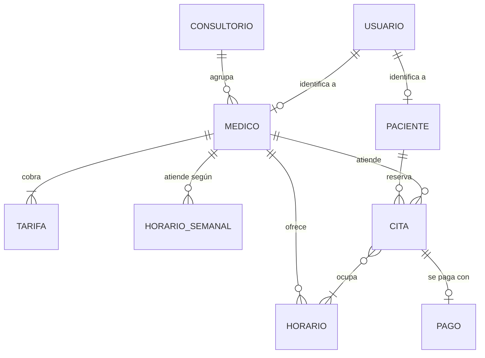
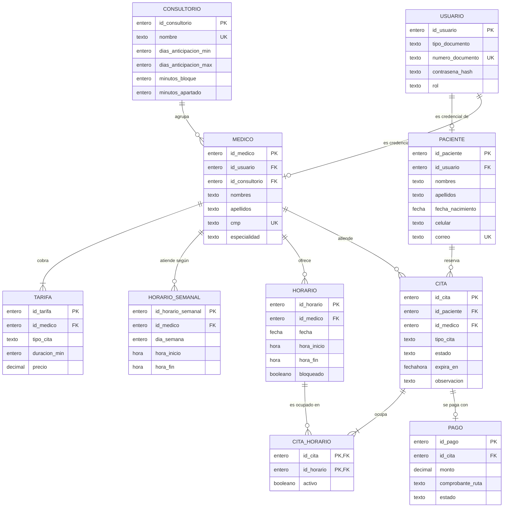
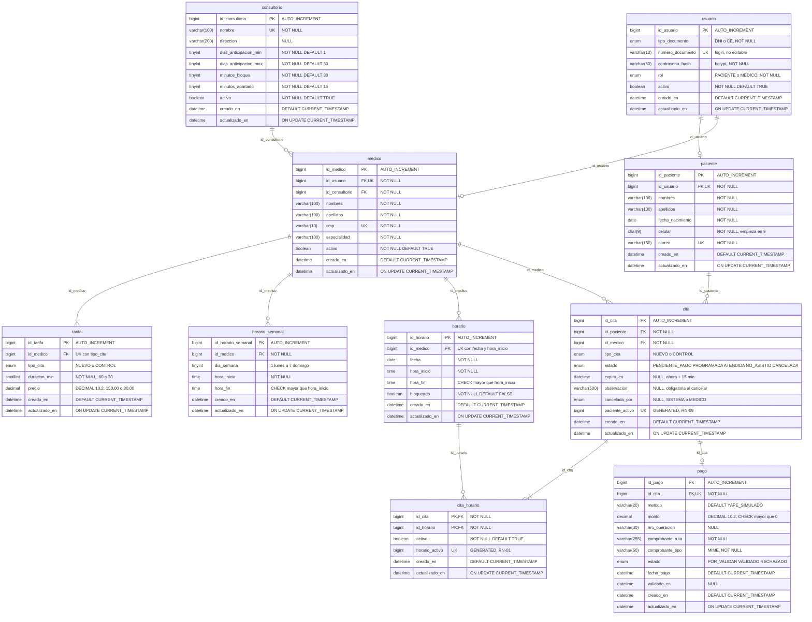

# Diagramas de base de datos

> Diagramas en [Mermaid](https://mermaid.js.org/): GitHub y VS Code (extensión *Markdown Preview Mermaid Support*) los renderizan directamente. Para el informe, exportarlos a PNG/SVG con [mermaid.live](https://mermaid.live) o con mermaid-cli (ver [índice](README.md)).
>
> La fuente de verdad de requerimientos y reglas es el [README del proyecto](../../README.md). Si un diagrama lo contradice, se corrige el diagrama.

Modelo de datos de MEDIFAST para **MySQL 8.4** (InnoDB, utf8mb4), normalizado hasta 3FN. Admite varios consultorios y médicos; esta versión opera con uno. Reemplaza `script.sql` y los diagramas `modelado.drawio` / `modelado_*.png`. Las decisiones de diseño están en el README, §10, y los scripts en §13.1.

| # | Diagrama | Nivel de detalle |
| --- | --- | --- |
| BD-01 | Modelo conceptual | Entidades y relaciones, sin atributos |
| BD-02 | Modelo lógico | + atributos principales, claves y cardinalidades |
| BD-03 | Modelo físico (MySQL 8.4) | + tipos de datos, nulos, valores por defecto, columnas generadas |
| — | Restricciones e índices | UNIQUE, CHECK, índices y FK |
| — | Diccionario de datos | Cada campo de cada tabla |

---

## BD-01 — Modelo conceptual

Las entidades del negocio y cómo se relacionan. La relación muchos a muchos entre **CITA** y **HORARIO** (una cita de paciente nuevo ocupa 2 bloques de 30 min; un bloque puede tener varias citas canceladas en su historial) se resuelve en el modelo lógico con la entidad asociativa `CITA_HORARIO`.

| Relación | Cardinalidad | Regla |
| --- | --- | --- |
| Consultorio – Médico | 1 : N | Un consultorio agrupa médicos |
| Usuario – Paciente / Médico | 1 : 0..1 | Cada persona inicia sesión con un usuario |
| Médico – Tarifa | 1 : N (2) | Una tarifa por tipo de cita (RN-03) |
| Médico – Horario semanal / Horario | 1 : N | Plantilla y bloques generados (RN-08) |
| Paciente – Cita | 1 : N | Máximo **una cita activa** a la vez (RN-09) |
| Cita – Horario | N : M | Una cita ocupa 1 o 2 bloques; un bloque, máximo **una cita activa** (RN-01) |
| Cita – Pago | 1 : 0..1 | El pago existe desde que se adjunta la constancia |

---

## BD-02 — Modelo lógico

Entidades, atributos principales, claves y cardinalidades, sin detalles del motor.

---

## BD-03 — Modelo físico (MySQL 8.4)

Tablas, tipos de datos MySQL, claves y restricciones. `UK` = `UNIQUE`. Las columnas `GENERATED` son `STORED`.

---

## Restricciones e índices

| Tabla | Nombre | Definición | Propósito |
| --- | --- | --- | --- |
| usuario | `uq_usuario_documento` | `UNIQUE (numero_documento)` | Login único (RN-12) |
| paciente | `uq_paciente_usuario`, `uq_paciente_correo` | `UNIQUE (id_usuario)`, `UNIQUE (correo)` | 1 paciente por usuario; correo único |
| medico | `uq_medico_usuario`, `uq_medico_cmp` | `UNIQUE (id_usuario)`, `UNIQUE (cmp)` | 1 médico por usuario; colegiatura única |
| tarifa | `uq_tarifa_medico_tipo` | `UNIQUE (id_medico, tipo_cita)` | Una tarifa por tipo y médico (RN-03) |
| horario_semanal | `ck_hs_rango`, `ck_hs_dia` | `hora_fin > hora_inicio`, `dia_semana BETWEEN 1 AND 7` | Plantilla válida (RN-08) |
| horario | `uq_horario_medico_inicio`, `ck_horario_rango` | `UNIQUE (id_medico, fecha, hora_inicio)`, `hora_fin > hora_inicio` | Sin bloques duplicados |
| cita | `uq_cita_paciente_activo` | `paciente_activo AS (IF(estado IN ('PENDIENTE_PAGO','PROGRAMADA'), id_paciente, NULL)) STORED UNIQUE` | **Una cita activa por paciente (RN-09)** |
| cita_horario | `uq_cita_horario_activo` | `horario_activo AS (IF(activo, id_horario, NULL)) STORED UNIQUE` | **Un bloque, una cita activa (RN-01)** |
| pago | `uq_pago_cita`, `ck_pago_monto` | `UNIQUE (id_cita)`, `monto > 0` | Un pago por cita |
| usuario | `ck_usuario_documento` | DNI `^[0-9]{8}$`; CE `^[0-9A-Z]{9,12}$` | Formato del documento (RF02) |
| paciente | `ck_paciente_celular` | `celular` `^9[0-9]{8}$` | Celular de 9 dígitos que empieza en 9 (RF02) |
| cita | `ck_cita_cancelacion` | `estado <> 'CANCELADA' OR (observacion IS NOT NULL AND cancelada_por IS NOT NULL)` | Toda cancelación lleva observación (RN-13) |
| pago | `ck_pago_tipo` | `comprobante_tipo IN ('image/jpeg','image/png','application/pdf')` | Tipos de constancia (RN-11) |
| cita | `idx_cita_medico_estado` | `INDEX (id_medico, estado)` | Agenda y reporte 1 |
| cita | `idx_cita_paciente_creado` | `INDEX (id_paciente, creado_en)` | Historial del paciente |
| cita | `idx_cita_estado_expira` | `INDEX (estado, expira_en)` | Tarea de vencimiento (RN-04) |
| pago | `idx_pago_estado_fecha` | `INDEX (estado, fecha_pago)` | Reporte 2 |

Todas las FK usan `ON DELETE RESTRICT` (no se borran datos con historial; se desactivan con `activo = FALSE`).

---

## Diccionario de datos

### consultorio

Parámetros del consultorio; permite que el sistema sea reutilizable (multi-consultorio).

| Campo | Tipo | Nulo | Clave | Por defecto | Descripción |
| --- | --- | --- | --- | --- | --- |
| id_consultorio | BIGINT | No | PK | AUTO_INCREMENT | Identificador |
| nombre | VARCHAR(100) | No | UK | — | Nombre comercial (Medifast) |
| direccion | VARCHAR(200) | Sí | — | NULL | Dirección del consultorio |
| dias_anticipacion_min | TINYINT | No | — | 1 | Días mínimos de anticipación para reservar (RN-06) |
| dias_anticipacion_max | TINYINT | No | — | 30 | Días máximos de anticipación para reservar (RN-06) |
| minutos_bloque | TINYINT | No | — | 30 | Duración de cada bloque de horario |
| minutos_apartado | TINYINT | No | — | 15 | Minutos que se aparta un horario sin constancia (RN-04) |
| activo | BOOLEAN | No | — | TRUE | Baja lógica |
| creado_en | DATETIME | No | — | CURRENT_TIMESTAMP | Auditoría |
| actualizado_en | DATETIME | No | — | CURRENT_TIMESTAMP ON UPDATE | Auditoría |

### usuario

Credenciales de acceso de pacientes y médicos.

| Campo | Tipo | Nulo | Clave | Por defecto | Descripción |
| --- | --- | --- | --- | --- | --- |
| id_usuario | BIGINT | No | PK | AUTO_INCREMENT | Identificador |
| tipo_documento | ENUM('DNI','CE') | No | — | — | Tipo de documento (RN-12) |
| numero_documento | VARCHAR(12) | No | UK | — | Usuario de login; no editable |
| contrasena_hash | VARCHAR(60) | No | — | — | Hash bcrypt de la contraseña |
| rol | ENUM('PACIENTE','MEDICO') | No | — | — | Rol de acceso |
| activo | BOOLEAN | No | — | TRUE | Baja lógica |
| creado_en | DATETIME | No | — | CURRENT_TIMESTAMP | Auditoría |
| actualizado_en | DATETIME | No | — | CURRENT_TIMESTAMP ON UPDATE | Auditoría |

### paciente

Datos personales del paciente (solo administrativos, RN-10).

| Campo | Tipo | Nulo | Clave | Por defecto | Descripción |
| --- | --- | --- | --- | --- | --- |
| id_paciente | BIGINT | No | PK | AUTO_INCREMENT | Identificador |
| id_usuario | BIGINT | No | FK, UK | — | Credencial del paciente → `usuario` |
| nombres | VARCHAR(100) | No | — | — | Nombres |
| apellidos | VARCHAR(100) | No | — | — | Apellidos |
| fecha_nacimiento | DATE | No | — | — | Fecha de nacimiento (en el pasado) |
| celular | CHAR(9) | No | — | — | Celular de 9 dígitos que empieza en 9 |
| correo | VARCHAR(150) | No | UK | — | Correo electrónico |
| creado_en | DATETIME | No | — | CURRENT_TIMESTAMP | Auditoría |
| actualizado_en | DATETIME | No | — | CURRENT_TIMESTAMP ON UPDATE | Auditoría |

### medico

Datos del médico. Se cargan por script (no hay módulo de administración).

| Campo | Tipo | Nulo | Clave | Por defecto | Descripción |
| --- | --- | --- | --- | --- | --- |
| id_medico | BIGINT | No | PK | AUTO_INCREMENT | Identificador |
| id_usuario | BIGINT | No | FK, UK | — | Credencial del médico → `usuario` |
| id_consultorio | BIGINT | No | FK | — | Consultorio → `consultorio` |
| nombres | VARCHAR(100) | No | — | — | Nombres |
| apellidos | VARCHAR(100) | No | — | — | Apellidos |
| cmp | VARCHAR(10) | No | UK | — | N.º de colegiatura (CMP) |
| especialidad | VARCHAR(100) | No | — | — | Especialidad |
| activo | BOOLEAN | No | — | TRUE | Baja lógica |
| creado_en | DATETIME | No | — | CURRENT_TIMESTAMP | Auditoría |
| actualizado_en | DATETIME | No | — | CURRENT_TIMESTAMP ON UPDATE | Auditoría |

### tarifa

Precio y duración por tipo de cita y médico (RN-03).

| Campo | Tipo | Nulo | Clave | Por defecto | Descripción |
| --- | --- | --- | --- | --- | --- |
| id_tarifa | BIGINT | No | PK | AUTO_INCREMENT | Identificador |
| id_medico | BIGINT | No | FK, UK* | — | Médico → `medico` (*UK compuesta con `tipo_cita`) |
| tipo_cita | ENUM('NUEVO','CONTROL') | No | UK* | — | Tipo de cita |
| duracion_min | SMALLINT | No | — | — | Duración en minutos (60 / 30) |
| precio | DECIMAL(10,2) | No | — | — | Precio en soles (150.00 / 80.00) |
| creado_en | DATETIME | No | — | CURRENT_TIMESTAMP | Auditoría |
| actualizado_en | DATETIME | No | — | CURRENT_TIMESTAMP ON UPDATE | Auditoría |

### horario_semanal

Plantilla semanal de atención por médico; se configura en la BD (RN-08).

| Campo | Tipo | Nulo | Clave | Por defecto | Descripción |
| --- | --- | --- | --- | --- | --- |
| id_horario_semanal | BIGINT | No | PK | AUTO_INCREMENT | Identificador |
| id_medico | BIGINT | No | FK | — | Médico → `medico` |
| dia_semana | TINYINT | No | — | — | 1 = lunes … 7 = domingo (CHECK 1–7) |
| hora_inicio | TIME | No | — | — | Inicio de la atención |
| hora_fin | TIME | No | — | — | Fin de la atención (CHECK > hora_inicio) |
| creado_en | DATETIME | No | — | CURRENT_TIMESTAMP | Auditoría |
| actualizado_en | DATETIME | No | — | CURRENT_TIMESTAMP ON UPDATE | Auditoría |

### horario

Bloques de 30 min generados a partir de la plantilla semanal.

| Campo | Tipo | Nulo | Clave | Por defecto | Descripción |
| --- | --- | --- | --- | --- | --- |
| id_horario | BIGINT | No | PK | AUTO_INCREMENT | Identificador |
| id_medico | BIGINT | No | FK, UK* | — | Médico → `medico` (*UK con `fecha` y `hora_inicio`) |
| fecha | DATE | No | UK* | — | Fecha del bloque |
| hora_inicio | TIME | No | UK* | — | Inicio del bloque |
| hora_fin | TIME | No | — | — | Fin del bloque (CHECK > hora_inicio) |
| bloqueado | BOOLEAN | No | — | FALSE | Bloque no disponible (configurado en BD) |
| creado_en | DATETIME | No | — | CURRENT_TIMESTAMP | Auditoría |
| actualizado_en | DATETIME | No | — | CURRENT_TIMESTAMP ON UPDATE | Auditoría |

### cita

Reserva de un paciente con un médico.

| Campo | Tipo | Nulo | Clave | Por defecto | Descripción |
| --- | --- | --- | --- | --- | --- |
| id_cita | BIGINT | No | PK | AUTO_INCREMENT | Identificador (n.º de cita) |
| id_paciente | BIGINT | No | FK | — | Paciente → `paciente` |
| id_medico | BIGINT | No | FK | — | Médico → `medico` |
| tipo_cita | ENUM('NUEVO','CONTROL') | No | — | — | Tipo detectado al reservar (RN-02) |
| estado | ENUM('PENDIENTE_PAGO','PROGRAMADA','ATENDIDA','NO_ASISTIO','CANCELADA') | No | — | 'PENDIENTE_PAGO' | Estado (RN-05) |
| expira_en | DATETIME | Sí | — | NULL | Vencimiento del apartado (creación + 15 min) |
| observacion | VARCHAR(500) | Sí | — | NULL | Motivo de cancelación o rechazo (obligatorio al cancelar) |
| cancelada_por | ENUM('SISTEMA','MEDICO') | Sí | — | NULL | Quién canceló |
| paciente_activo | BIGINT | Sí | UK | GENERATED STORED | `id_paciente` si la cita está activa, si no `NULL` (RN-09) |
| creado_en | DATETIME | No | — | CURRENT_TIMESTAMP | Fecha de la reserva |
| actualizado_en | DATETIME | No | — | CURRENT_TIMESTAMP ON UPDATE | Auditoría |

### cita_horario

Bloques que ocupa cada cita (1 para control, 2 para nuevo).

| Campo | Tipo | Nulo | Clave | Por defecto | Descripción |
| --- | --- | --- | --- | --- | --- |
| id_cita | BIGINT | No | PK, FK | — | Cita → `cita` |
| id_horario | BIGINT | No | PK, FK | — | Bloque → `horario` |
| activo | BOOLEAN | No | — | TRUE | `FALSE` al cancelar (libera el bloque) |
| horario_activo | BIGINT | Sí | UK | GENERATED STORED | `id_horario` si está activo, si no `NULL` (RN-01) |
| creado_en | DATETIME | No | — | CURRENT_TIMESTAMP | Auditoría |
| actualizado_en | DATETIME | No | — | CURRENT_TIMESTAMP ON UPDATE | Auditoría |

### pago

Pago simulado con Yape; se crea al adjuntar la constancia.

| Campo | Tipo | Nulo | Clave | Por defecto | Descripción |
| --- | --- | --- | --- | --- | --- |
| id_pago | BIGINT | No | PK | AUTO_INCREMENT | Identificador |
| id_cita | BIGINT | No | FK, UK | — | Cita → `cita` (un pago por cita) |
| metodo | VARCHAR(20) | No | — | 'YAPE_SIMULADO' | Método de pago |
| monto | DECIMAL(10,2) | No | — | — | Monto según la tarifa al reservar (CHECK > 0) |
| nro_operacion | VARCHAR(30) | Sí | — | NULL | N.º de operación Yape (opcional, RN-11) |
| comprobante_ruta | VARCHAR(255) | No | — | — | Ruta del archivo en `uploads/comprobantes/` (nombre UUID) |
| comprobante_tipo | VARCHAR(50) | No | — | — | Tipo MIME (image/jpeg, image/png, application/pdf) |
| estado | ENUM('POR_VALIDAR','VALIDADO','RECHAZADO') | No | — | 'POR_VALIDAR' | Estado del pago (RN-07) |
| fecha_pago | DATETIME | No | — | CURRENT_TIMESTAMP | Momento en que se adjuntó la constancia |
| validado_en | DATETIME | Sí | — | NULL | Momento de la validación o el rechazo |
| creado_en | DATETIME | No | — | CURRENT_TIMESTAMP | Auditoría |
| actualizado_en | DATETIME | No | — | CURRENT_TIMESTAMP ON UPDATE | Auditoría |
