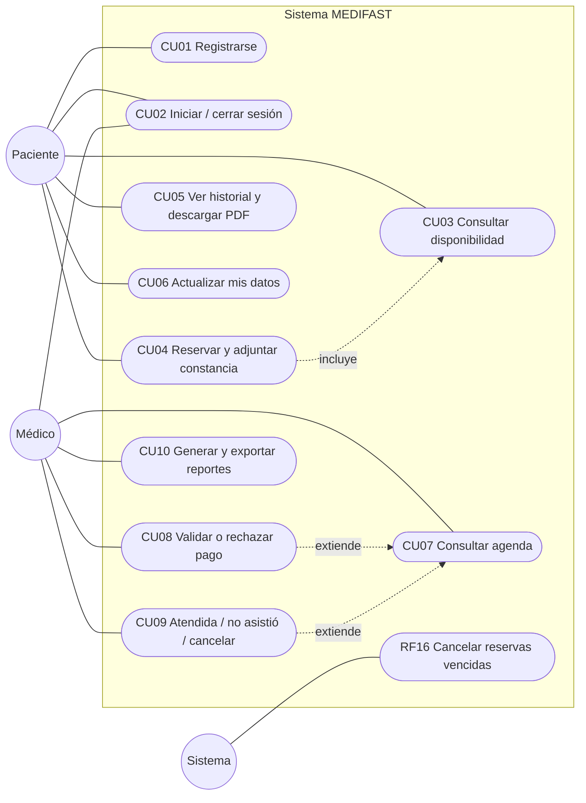
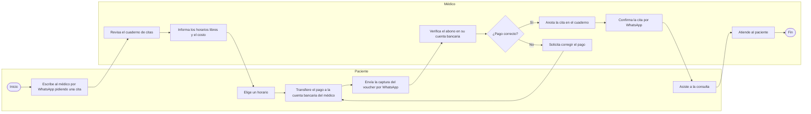
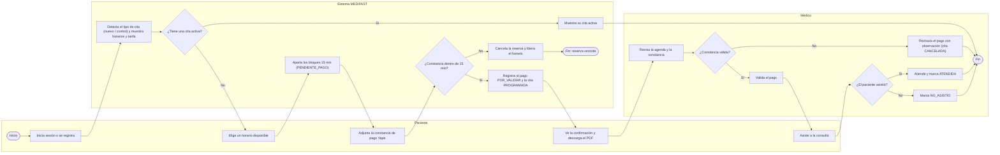
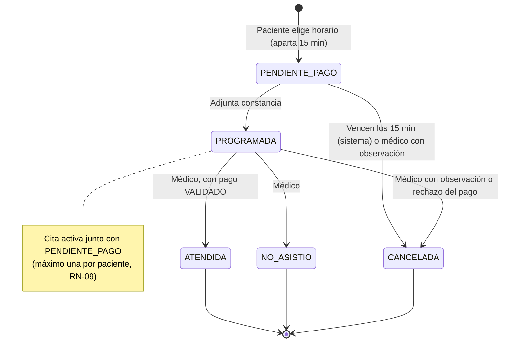
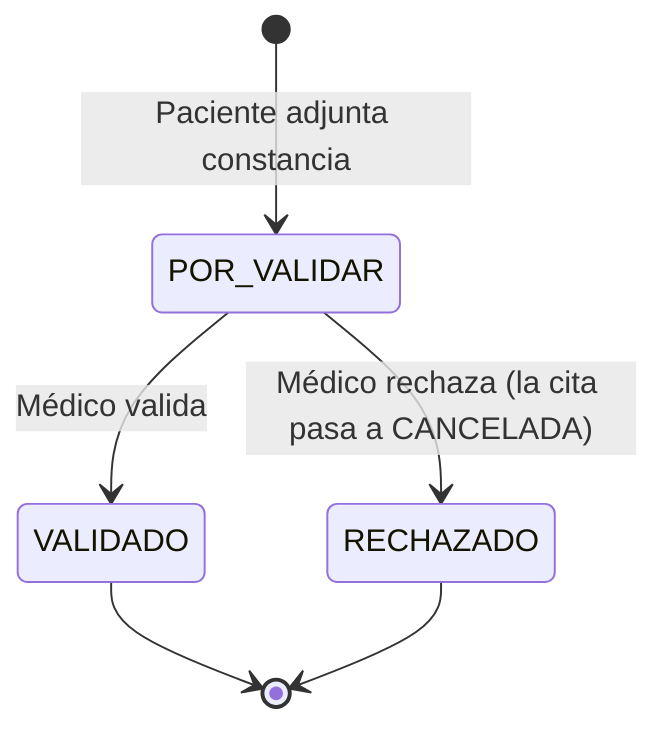
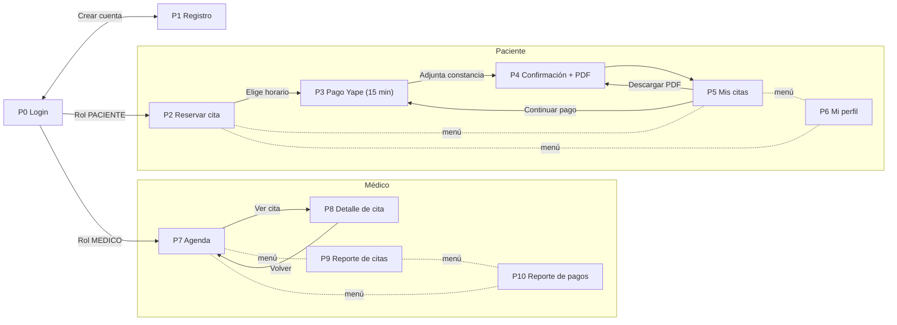
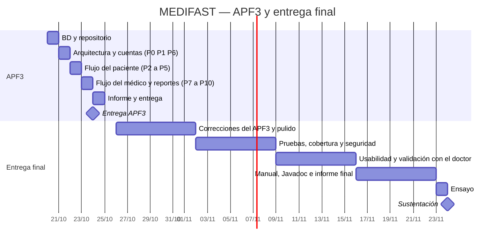

# Diagramas funcionales

> Diagramas en [Mermaid](https://mermaid.js.org/): GitHub y VS Code (extensión *Markdown Preview Mermaid Support*) los renderizan directamente. Para el informe, exportarlos a PNG/SVG con [mermaid.live](https://mermaid.live) o con mermaid-cli (ver [índice](README.md)).
>
> La fuente de verdad de requerimientos y reglas es el [README del proyecto](../../README.md). Si un diagrama lo contradice, se corrige el diagrama.

Describen **qué hace el sistema y para quién**, sin entrar en cómo está construido.

| # | Diagrama |
| --- | --- |
| F-01 | Casos de uso |
| F-02 | Proceso AS-IS (gestión manual actual) |
| F-03 | Proceso TO-BE (con MEDIFAST) |
| F-04 | Estados de la cita |
| F-05 | Estados del pago |
| F-06 | Mapa de navegación |
| F-07 | Cronograma |

> **Nota sobre BPMN:** Mermaid no tiene notación BPMN. F-02 y F-03 usan diagramas de flujo con carriles (`subgraph`) que siguen la lógica BPMN: inicio y fin redondeados, tareas rectangulares, compuertas en rombo. Si la rúbrica exige la notación BPMN formal, se redibujan en Bizagi a partir de estos.

---

## F-01 — Casos de uso

Actores, casos de uso (CU01–CU10) y la tarea automática del sistema (RF16). Detalle y trazabilidad en el README, §8.

---

## F-02 — Proceso AS-IS (gestión manual actual)

Según la entrevista con el Dr. Barrantes: la cita se coordina por WhatsApp, el pago se hace por transferencia y la agenda se lleva en un cuaderno.

**Problemas que muestra:** el médico interviene en cada paso administrativo, la disponibilidad depende de su respuesta, el cuaderno no impide cruces de horario y la verificación del voucher es manual y sin registro.

---

## F-03 — Proceso TO-BE (con MEDIFAST)

**Mejoras:** el paciente se autogestiona, la BD impide cruces de horario (RN-01) y citas duplicadas (RN-09), el apartado de 15 min evita bloqueos indefinidos (RN-04) y cada validación del médico queda registrada.

---

## F-04 — Estados de la cita

Ciclo de vida de una cita (RN-05). Cita **activa** = `PENDIENTE_PAGO` o `PROGRAMADA`.

---

## F-05 — Estados del pago

El pago se crea al adjuntar la constancia y lo resuelve el médico (RN-07).

---

## F-06 — Mapa de navegación

Las 11 pantallas comprometidas para el APF3 (README, §7) y cómo se llega a cada una según el rol.

---

## F-07 — Cronograma

Plan hasta el APF3 (24-oct) y la sustentación final (24-nov).

