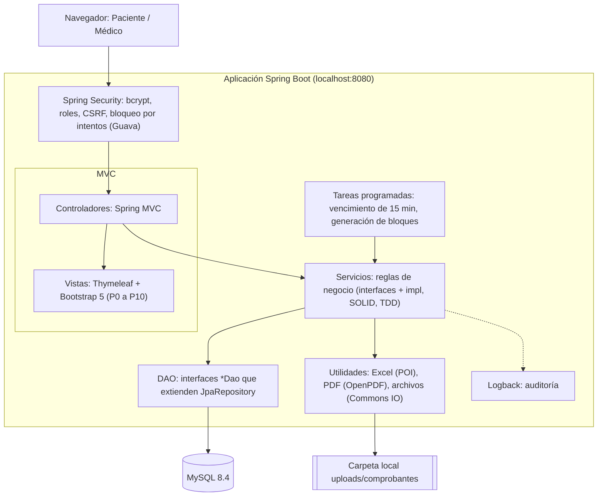
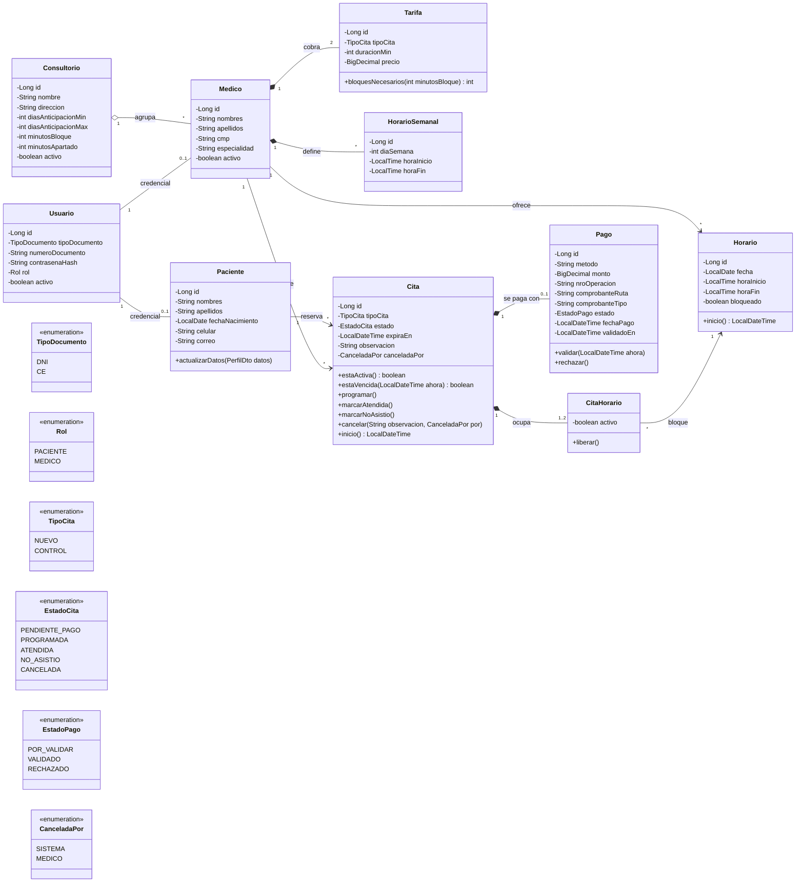
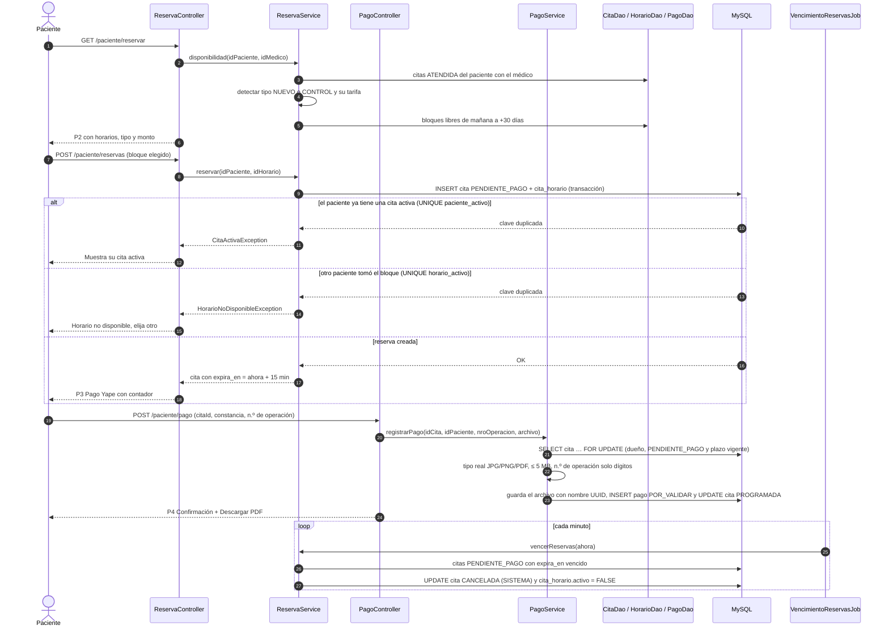
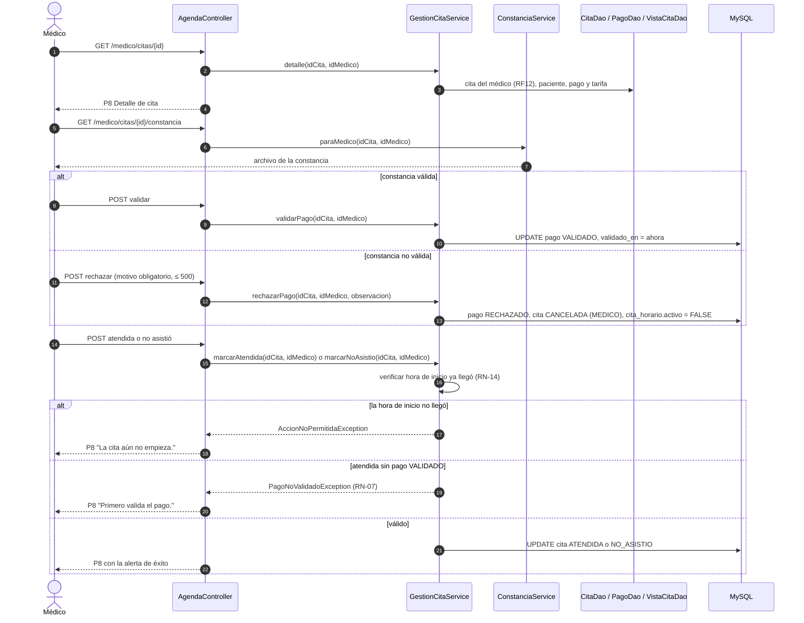

# Diagramas técnicos

> Diagramas en [Mermaid](https://mermaid.js.org/): GitHub y VS Code (extensión *Markdown Preview Mermaid Support*) los renderizan directamente. Para el informe, exportarlos a PNG/SVG con [mermaid.live](https://mermaid.live) o con mermaid-cli (ver [índice](README.md)).
>
> La fuente de verdad de requerimientos y reglas es el [README del proyecto](../../README.md). Si un diagrama lo contradice, se corrige el diagrama.

Describen **cómo está construido el sistema**: arquitectura, clases y la interacción entre componentes. Evidencian los principios que exige la rúbrica del APF3: **MVC, DAO, SOLID** (y **TDD** en las pruebas de los servicios).

| # | Diagrama |
| --- | --- |
| T-01 | Arquitectura MVC por capas |
| T-02 | Clases por capas (MVC, servicios y DAO) |
| T-03 | Clases del dominio |
| T-04 | Secuencia: reservar y adjuntar la constancia |
| T-05 | Secuencia: validar pago y registrar la atención |

---

## T-01 — Arquitectura MVC por capas

Monolito Spring Boot en localhost. La petición pasa por Spring Security, el controlador delega en los servicios (reglas de negocio) y estos acceden a MySQL solo a través de los DAO.

---

## T-02 — Clases por capas (MVC, servicios y DAO)

Muestra los principios de la rúbrica: **MVC** (controladores + vistas), **SOLID** (interfaces pequeñas, una responsabilidad, inyección de dependencias) y **DAO** (interfaces que extienden `JpaRepository`). Cada interfaz de servicio tiene su implementación en `service/impl/` (`ReservaServiceImpl`, etc.).

```mermaid
classDiagram
    direction TB

    class AuthController
    class SecurityConfig
    class UsuarioDetailsService
    class EventosAutenticacion
    class RedireccionPorRol
    class UsuarioActual {
        +idPaciente(Authentication) Long
        +idMedico(Authentication) Long
        +medico(Authentication) Medico
    }
    class PerfilController
    class ReservaController
    class MisCitasController
    class AgendaController
    class ReporteController

    class PacienteService {
        <<interface>>
        +registrar(RegistroDto dto) Paciente
        +actualizar(Long idPaciente, PerfilDto dto) Paciente
        +cambiarContrasena(Long idUsuario, String actual, String nueva)
    }
    class ReservaService {
        <<interface>>
        +disponibilidad(Long idPaciente, Long idMedico) DisponibilidadDto
        +detectarTipo(Long idPaciente, Long idMedico) TipoCita
        +reservar(Long idPaciente, Long idHorario) Cita
        +historial(Long idPaciente) MisCitasDto
        +vencerReservas(LocalDateTime ahora) int
    }
    class PagoController
    class PagoService {
        <<interface>>
        +paraPagar(Long idCita, Long idPaciente) PagoPendienteDto
        +registrarPago(Long idCita, Long idPaciente, String nroOperacion, MultipartFile comprobante) Pago
    }
    class GestionCitaService {
        <<interface>>
        +agenda(Long idMedico, FiltroAgendaDto filtro) AgendaDto
        +detalle(Long idCita, Long idMedico) DetalleCitaDto
        +validarPago(Long idCita, Long idMedico)
        +rechazarPago(Long idCita, Long idMedico, String observacion)
        +marcarAtendida(Long idCita, Long idMedico)
        +marcarNoAsistio(Long idCita, Long idMedico)
        +cancelar(Long idCita, Long idMedico, String observacion)
    }
    class ReporteService {
        <<interface>>
        +citas(Long idMedico, FiltroReporteDto filtro) ReporteCitasDto
	+pagos(Long idMedico, FiltroReporteDto filtro) ResumenPagosDto
    }
    class GeneracionHorarioService {
        <<interface>>
        +generar(LocalDate desde, LocalDate hasta) int
    }
    class GeneracionHorarioServiceImpl
    class GeneracionHorarioJob {
        +ejecutar()
        ApplicationReadyEvent y 02:00 America/Lima
    }
    class ProgramacionConfig {
        @EnableScheduling
    }
    class ExportadorReporte {
        <<interface>>
        +exportar(Reporte reporte) byte[]
    }
    class ExcelExportador {
        Apache POI
    }
    class ConfirmacionPdfService {
        <<interface>>
        +generar(Long idCita, Long idPaciente) byte[]
    }
    class ConstanciaService {
        <<interface>>
        +paraPaciente(Long idCita, Long idPaciente) ConstanciaDto
        +paraMedico(Long idCita, Long idMedico) ConstanciaDto
    }
    class AlmacenamientoService {
        <<interface>>
        +guardar(MultipartFile archivo) String
        +cargar(String ruta) Resource
    }
    class AlmacenamientoLocal {
        Apache Commons IO
    }
    class IntentosLoginService {
        Guava Cache
        +registrarFallo(String documento)
        +estaBloqueado(String documento) boolean
        +reiniciar(String documento)
    }
    class Auditoria {
        <<util>>
        +registrar(Evento evento, String documento, String detalle)
    }
    class VencimientoReservasJob {
        Scheduled cada minuto
        +ejecutar()
    }

    class JpaRepository {
        <<Spring Data>>
    }
    class UsuarioDao {
        <<interface>>
    }
    class PacienteDao {
        <<interface>>
    }
    class MedicoDao {
        <<interface>>
    }
    class TarifaDao {
        <<interface>>
    }
    class HorarioDao {
        <<interface>>
        +bloquesLibres(Long idMedico, LocalDate desde, LocalDate hasta) List~Horario~
        +findAllByMedicoIdAndFechaBetween(Long idMedico, LocalDate desde, LocalDate hasta) List~Horario~
    }
    class HorarioSemanalDao {
        <<interface>>
        +findAllByMedicoId(Long idMedico) List~HorarioSemanal~
    }
    class ConsultorioDao {
        <<interface>>
        +findAllByActivoTrue() List~Consultorio~
    }
    class CitaDao {
        <<interface>>
        +existeAtendida(Long idPaciente, Long idMedico) boolean
        +pendientesVencidas(LocalDateTime ahora) List~Cita~
    }
    class VistaCitaDao {
        <<interface>>
        +findAllByIdMedicoAndFechaBetweenOrderByFechaAscHoraInicioAsc(Long idMedico, LocalDate desde, LocalDate hasta) List~VistaCita~
    }
    class FiltroAgendaDto {
        <<record>>
        +Vista vista
        +LocalDate fecha
        +EstadoCitaEnum estado
        +desde() LocalDate
        +hasta() LocalDate
    }
    class AgendaDto {
        <<record>>
        +List~VistaCita~ citas
        +long total
        +long porValidar
        +long confirmadas
        +long atendidas
        +List~HorarioSemanal~ horario
    }
    class PagoDao {
        <<interface>>
        +pagosValidados(Long idMedico, LocalDateTime desde, LocalDateTime hastaExclusivo) List~PagoValidadoDto~
    }

    SecurityConfig ..> UsuarioDetailsService
    SecurityConfig --> RedireccionPorRol
    SecurityConfig ..> AuthController : rutas /login y /
    UsuarioDetailsService ..> UsuarioDao
    UsuarioDetailsService --> IntentosLoginService
    EventosAutenticacion --> IntentosLoginService
    EventosAutenticacion --> Auditoria
    UsuarioActual ..> PacienteDao
    UsuarioActual ..> MedicoDao
    PerfilController --> PacienteService
    ReservaController --> ReservaService
    MisCitasController --> ReservaService
    MisCitasController --> ConfirmacionPdfService
    MisCitasController --> ConstanciaService
    ConfirmacionPdfService ..> VistaCitaDao
    ConstanciaService ..> CitaDao
    ConstanciaService ..> PagoDao
    AgendaController --> GestionCitaService
    AgendaController --> UsuarioActual
    AgendaController ..> FiltroAgendaDto
    GestionCitaService ..> AgendaDto
    GestionCitaService ..> DetalleCitaDto
    AgendaController ..> MotivoDto
    AgendaController --> ConstanciaService
    ReporteController --> ReporteService
    ReporteController --> UsuarioActual
    ReporteController --> ExportadorReporte
    VencimientoReservasJob --> ReservaService
    GeneracionHorarioJob --> GeneracionHorarioService
    GeneracionHorarioJob ..> ConsultorioDao
    GeneracionHorarioServiceImpl ..|> GeneracionHorarioService
    GeneracionHorarioServiceImpl ..> MedicoDao
    GeneracionHorarioServiceImpl ..> HorarioSemanalDao
    GeneracionHorarioServiceImpl ..> HorarioDao

    ExcelExportador ..|> ExportadorReporte
    AlmacenamientoLocal ..|> AlmacenamientoService

    PacienteService ..> UsuarioDao
    PacienteService ..> PacienteDao
    ReservaService ..> HorarioDao
    ReservaService ..> CitaDao
    ReservaService ..> TarifaDao
    ReservaService ..> PagoDao
    PagoController --> PagoService
    PagoController --> UsuarioActual
    PagoService ..> CitaDao
    PagoService ..> PagoDao
    PagoService ..> TarifaDao
    PagoService ..> VistaCitaDao
    GestionCitaService ..> CitaDao
    GestionCitaService ..> PagoDao
    GestionCitaService ..> VistaCitaDao
    GestionCitaService ..> HorarioSemanalDao
    ReporteService ..> VistaCitaDao
    ReporteService ..> PagoDao

    UsuarioDao --|> JpaRepository
    PacienteDao --|> JpaRepository
    MedicoDao --|> JpaRepository
    TarifaDao --|> JpaRepository
    HorarioDao --|> JpaRepository
    HorarioSemanalDao --|> JpaRepository
    ConsultorioDao --|> JpaRepository
    CitaDao --|> JpaRepository
    PagoDao --|> JpaRepository
    VistaCitaDao --|> JpaRepository
```

---

## T-03 — Clases del dominio

Entidades JPA del paquete `model/`. Las fechas y horas de la cita se obtienen de sus bloques (`CitaHorario` → `Horario`). Corresponden 1 a 1 con las tablas del [modelo físico](base-de-datos.md#bd-03--modelo-físico-mysql-84).

---

## T-04 — Secuencia: reservar y adjuntar la constancia

Cubre RF01, RF03, RF16 y las reglas RN-01, RN-02, RN-04 y RN-09.

---

## T-05 — Secuencia: validar pago y registrar la atención

Cubre RF08, RF12, RF13 y RF14, y las reglas RN-07, RN-13 y RN-14.

